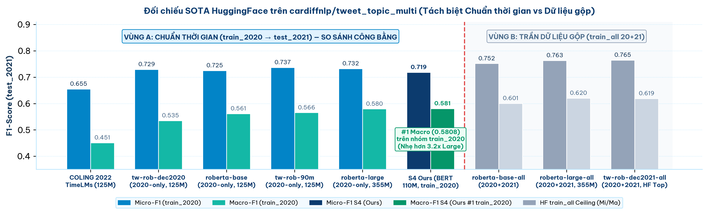
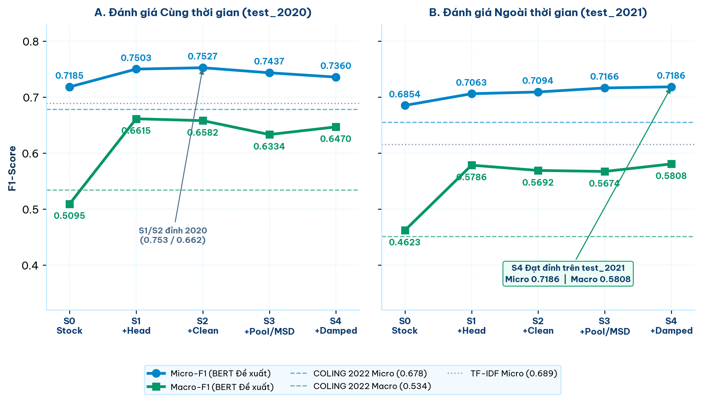

# Tweet Topic Multi-Label Classification (`cardiffnlp/tweet_topic_multi`)

Nghiên cứu xây dựng, kiểm chứng ablation và phân tích lỗi chuyên sâu cho bài toán **Multi-Label Topic Classification** trên tập dữ liệu [`cardiffnlp/tweet_topic_multi`](https://huggingface.co/datasets/cardiffnlp/tweet_topic_multi) (**19 topics**, đánh giá Out-of-Time từ `2020 -> 2021`), sử dụng một backbone gọn nhẹ duy nhất: **`bert-base-uncased` (110M parameters)**.

Toàn bộ quá trình huấn luyện được thực thi 100% trên **Kaggle GPU (T4/P100)** theo cấu hình thống nhất: `10 Epochs + Cosine Annealing + Early Stopping (patience = 3)` và `Global Threshold τ = 0.60`.

---

## 1. Kết Quả Chính (Official Benchmark)

So sánh hiệu năng trên tập In-Time (`test_2020`, $N = 573$) và Out-of-Time (`test_2021`, $N = 1{,}679$) dọc theo chuỗi Controlled Ablation Ladder (`S0 -> S4`):

| Stage / Model | Key Component Added | `test_2020` Micro / Macro | `test_2021` Micro-F1 | `test_2021` Macro-F1 | `test_2021` Exact Match | Zero-F1 Classes | OOT Drift ($\Delta$ Micro) |
| :--- | :--- | :---: | :---: | :---: | :---: | :---: | :---: |
| **ML Baseline** | Dual TF-IDF (Word + Char) + OvR LR | `0.6258 / 0.5171` | `0.5944` | `0.4832` | `34.07%` | `0 / 19` | `-3.14 pts` |
| **`S0 @ 0.50`** | Stock `bert-base-uncased` + BCE (default $\tau=0.50$) | `0.6808 / 0.4535` | `0.6775` | `0.4408` | `43.95%` | `5 / 19` | `-0.33 pts` |
| **`S0 @ 0.30`** | Stock `bert-base-uncased` + Global Threshold Tuning | `0.6860 / 0.5425` | `0.6852` | `0.5204` | `40.56%` | `1 / 19` | `-0.08 pts` |
| **`S1`** | Custom Head (`LN -> Dropout -> Linear`) + Differential LR | `0.7131 / 0.5762` | `0.7069` | `0.5313` | `43.78%` | `0 / 19` | `-0.62 pts` |
| **`S2`** | `+ TweetTextCleaner` (WordPiece-Aware Preprocessing) | `0.7138 / 0.5964` | `0.7097` | `0.5469` | `44.73%` | `0 / 19` | `-0.41 pts` |
| **`S3`** | `+ ResidualHybridPooling` (`[CLS]` + Attention) + MSD ($K=5$) | `0.7204 / 0.6041` | `0.7124` | `0.5567` | `44.79%` | `0 / 19` | `-0.80 pts` |
| **`S4` (Proposed)** | **`+ Damped W-BCE` ($p=0.5, w_{\max}=6.0$) + $\tau = 0.60$** | **`0.7360 / 0.6470`** | **`0.7186`** | **`0.5808`** | **`45.32%`** | **`0 / 19`** | **`-1.74 pts`** |
| **`S4` (3-Seed Avg)** | Probability Averaging across seeds `{42, 1337, 2024}` | `0.7434 / 0.6611` *(val)* | **`0.7220`** | **`0.5896`** | **`46.22%`** | **`0 / 19`** | — |

* **Multi-Seed Stability (`S4`, seeds `42, 1337, 2024` trên `test_2021`):** Micro-F1 = **`0.7117 ± 0.0057`**, Macro-F1 = **`0.5770 ± 0.0066`**.
* **So sánh với HuggingFace Hub (`train_2020` split):** `S4` (`bert-base-uncased`, 110M) đạt **#1 Macro-F1 (`0.5808`)** trong nhóm mô hình chỉ huấn luyện trên `train_2020`, vượt trội `cardiffnlp/roberta-base-tweet-topic-multi-2020` (`0.541`) và `bert-base-uncased` gốc của Antypas et al. (`0.491`).
* **Selective Prediction (Zero-Retrain, `test_2021`):** Tự động hóa **80%** luồng tin cậy cao (chuyển 20% mẫu sát ngưỡng cho human review) nâng luồng tự động lên **`0.7530` Micro-F1 / `0.6018` Macro-F1 / `50.56%` Exact Match**.

<p align="center">
  
  
</p>

---

## 2. Tài Liệu & Báo Cáo Chính Thức

| Tài liệu | Nội dung |
| :--- | :--- |
| **[`docs/technical_report.md`](docs/technical_report.md)** | Báo cáo kỹ thuật đầy đủ: Đặc tả toán học, SOTA HuggingFace, EDA, Controlled Ablation `S0 -> S4`, đối chiếu `15ep ReduceLROnPlateau + LLRD`, và Deep Error Analysis (`test_2021`). |
| **[`docs/validation_error_analysis.md`](docs/validation_error_analysis.md)** | Chẩn đoán gốc rễ lỗi theo giao thức **Zero Test Leakage** (`test_splits_accessed = []`) trên `validation_2020` (`532` binary errors, 5-Model Consensus Audit). |
| **[`eda/eda_report.md`](eda/eda_report.md)** | Báo cáo Exploratory Data Analysis chi tiết trên `train_2020`, `validation_2020`, `test_2020`, `test_2021` (Long-Tail `20.18:1`, Multi-Label Co-occurrence, Temporal Drift $JS = 0.1377$). |
| **[`presentation/tweet_topic_bert_evaluation.pptx`](presentation/tweet_topic_bert_evaluation.pptx)** | Bộ slide thuyết trình hoàn chỉnh (**28 slides**), đồng bộ toàn bộ số liệu, phương trình toán học và các phát hiện cốt lõi từ Error Analysis. |

---

## 3. Điểm Nhấn Từ Error Analysis (`S4`, `test_2021`)

Phân tích sâu trên toàn bộ **`918 / 1,679`** failed samples (**`1,474`** binary errors = `752 FP + 722 FN`) bằng **3-Seed `S4` Consensus** (`42, 1337, 2024`):

1. **4-Stratum Error Budget:** `35.9%` (`529`) Unanimous `3/3` Extreme Ceiling + `32.8%` (`484`) Structural Bias + `17.5%` (`257`) `2/3` Boundary + `13.8%` (`204`, `75%` FP) Random-Seed Variance.
2. **Bất đối xứng FP vs FN:** `81.4%` FN mang tính cấu trúc cứng (`3/3` seeds cùng bỏ sót), trong khi `43.5%` FP đến từ variance quanh ngưỡng — vì vậy **3-Seed Probability Averaging** triệt tiêu trực tiếp **`-87 FP`** mà không cần huấn luyện lại.
3. **3 Cơ chế lỗi cốt lõi:**
   * **Co-occurrence Halo & `{@Entity@}` Shortcut:** `celebrity_&_pop_culture` chiếm `37.2%` tổng FP; tweet chứa `{@Entity@}` có FPR cho `celebrity` cao gấp **`2.31×`** (`16.3%` vs `7.0%`).
   * **Secondary-Label Suppression & Cardinality Compression:** Khi đi kèm chủ đề nổi trội (`sports+news`, `music+news`), mô hình bỏ sót nhãn phụ `news` tới `78.6%–80.7%`; dự đoán thừa ở `k = 1` (`1.37`) và nén mạnh ở `k ≥ 3` (`2.17–2.31`).
   * **Calibration Trade-off của Damped W-BCE:** `ECE` tăng `3.1×` (`S3: 0.0115 -> S4: 0.0352`) với overconfidence gap `+37%` đến `+56%` trên các tail/broad classes.
4. **Tính nhất quán lỗi xuyên thời gian (`validation_2020 <-> test_2021`):** Tương quan cấu trúc lỗi theo từng chủ đề đạt **$r = 0.9085$ (FP)** và **$r = 0.8036$ (FN)**, chứng minh lỗi được chẩn đoán trên validation có tính khái quát cao sang tương lai.

---

## 4. Cấu Trúc Repository

```text
tweet_topic_benchmark/
├── README.md                                  # Tổng quan dự án, kết quả benchmark & hướng dẫn
├── setup.py                                   # Cài đặt package tweet_topic
├── configs/
│   ├── ml/linear_ovr.yaml                     # Dual TF-IDF + One-vs-Rest Logistic Regression
│   ├── v4/                                    # Controlled Ablation S0->S4, Loss Controls, 3 Seeds, ValFix
│   └── v5_15ep/                               # Đối chiếu 15 Epochs + ReduceLROnPlateau + LLRD
├── docs/
│   ├── technical_report.md                    # Báo cáo kỹ thuật tổng hợp (S0->S4 + Error Analysis)
│   ├── validation_error_analysis.md           # Chẩn đoán gốc rễ lỗi Zero-Leakage trên validation_2020
│   └── figures/                               # 15 biểu đồ chuẩn hóa (fig01..fig15) dùng trong báo cáo
├── presentation/
│   └── tweet_topic_bert_evaluation.pptx       # Bộ slide thuyết trình chính thức (28 slides)
├── eda/
│   ├── run_eda.py                             # Script EDA thuần CPU
│   ├── eda_report.md                          # Báo cáo EDA
│   ├── eda_summary.json                       # Thống kê phân bố 19 chủ đề
│   └── figures/                               # 5 biểu đồ EDA gốc
├── scripts/
│   ├── run.py                                 # Runner chính (có Kaggle-only guard cho training)
│   ├── build_package_notebooks.py             # Đóng gói notebook tự chứa để đẩy lên Kaggle GPU
│   ├── kaggle_dispatcher.py                   # Điều phối chạy kernel trên Kaggle
│   ├── make_v4_configs.py                     # Sinh bộ YAML cấu hình v4
│   ├── collect_results.py                     # Gom artifacts tải về từ Kaggle vào outputs/
│   ├── postprocess_analysis.py                # Calibration & Selective Prediction risk-coverage
│   ├── extract_v4_error_cases.py              # Trích xuất ca lỗi định tính từ predictions
│   └── generate_v4_report_figures.py          # Vẽ biểu đồ phân tích từ outputs/
└── tweet_topic/                               # Core Python package
    ├── core/                                  # BaseTopicClassifier, ModelFactory, Registry
    ├── data/                                  # Dataset loader & 19-class taxonomy
    ├── models/                                # bert/ (pooling, losses, encoder), ml/, decision/, llm/
    ├── evaluation/                            # Metrics, global/per-class thresholding, ECE, selective
    └── addons/                                # TweetTextCleaner (WordPiece-aware preprocessing)
```

---

## 5. Hướng Dẫn Tái Lập Thực Nghiệm (Kaggle-Only Training)

> **Lưu ý thực thi:** Toàn bộ quá trình huấn luyện mô hình được thiết kế chạy trên **Kaggle GPU** (`T4` / `P100`). Script `scripts/run.py` tự động chặn việc huấn luyện cục bộ nếu không nằm trong môi trường Kaggle.

### Bước 1: Cài đặt package cục bộ (cho tiền xử lý, đóng gói & phân tích kết quả)
```bash
pip install -e .
```

### Bước 2: Đóng gói Notebook & đẩy lên Kaggle GPU
```bash
# Đóng gói source package + YAML configs thành Kaggle notebooks
python scripts/build_package_notebooks.py

# Chuẩn bị và đẩy các suite S0->S4 lên Kaggle GPU
python scripts/kaggle_dispatcher.py --action prepare --kernels v4_ladder_a,v4_ladder_b,v4_seeds
```

### Bước 3: Chạy trực tiếp trong Kaggle Notebook / Terminal
```bash
python scripts/run.py --config configs/v4/v4_s0_stock_bce.yaml
python scripts/run.py --config configs/v4/v4_s1_custom_head_bce.yaml
python scripts/run.py --config configs/v4/v4_s2_cleaner_bce.yaml
python scripts/run.py --config configs/v4/v4_s3_hybrid_pool_msd_bce.yaml
python scripts/run.py --config configs/v4/v4_s4_damped_wbce.yaml
```

### Bước 4: Gom kết quả & chạy hậu kiểm (Pure CPU)
```bash
python scripts/collect_results.py --source kaggle/outputs --overwrite
python scripts/postprocess_analysis.py --all
python scripts/extract_v4_error_cases.py
```

---

## Tài Liệu Tham Khảo Gốc

* Antypas, D., Ushio, A., Camacho-Collados, J., Neves, L., Silva, V., & Barbieri, F. (2022). *Twitter Topic Classification*. Proceedings of COLING 2022.
* Camacho-Collados, J., et al. (2022). *TweetNLP: Cutting-Edge Natural Language Processing for Social Media*. Proceedings of EMNLP 2022 (System Demonstrations).
