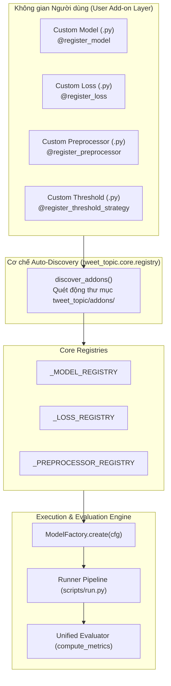

# Add-on Methodology & Plugin Architecture Guide

Tài liệu này đặc tả toàn bộ **phương pháp luận thiết kế Add-on (Add-on Methodology)** cho hệ thống phân loại chủ đề đa nhãn Twitter (`tweet_topic`).

Hệ thống được thiết kế theo nguyên lý **Open-Closed Principle (SOLID)**: *Mở cho việc mở rộng (Open for extension), Đóng đối với việc sửa đổi (Closed for modification)*. Bất kỳ nhà nghiên cứu hoặc kỹ sư nào cũng có thể bổ sung các thuật toán, bộ tiền xử lý, hàm mất mát hoặc cơ chế hiệu chuẩn ngưỡng mới mà không cần chỉnh sửa một dòng mã nguồn lõi nào.

---

## 1. Bản Vẽ Kiến Trúc (Architecture Blueprint)



---

## 2. Vòng Đời Của Một Add-on (Add-on Lifecycle)

Mỗi Add-on khi tích hợp vào hệ thống đều trải qua 5 giai đoạn được kiểm soát nghiêm ngặt:

1. **Discovery Stage (Quét & Tự Động Nhận Diện):**
   Khi `import tweet_topic` hoặc khi khởi chạy runner, hàm `discover_addons()` tự động duyệt qua tất cả các file `.py` trong thư mục `tweet_topic/addons/` và nạp vào không gian nhớ Python.
2. **Registration Stage (Đăng Ký Vào Bảng Danh Mục):**
   Thông qua các Python decorator (`@register_model`, `@register_loss`, `@register_preprocessor`), lớp mới được ghi nhận vào `_MODEL_REGISTRY` kèm định danh duy nhất (unique slug).
3. **Instantiation Stage (Khởi Tạo Dựa Trên Cấu Hình):**
   `ModelFactory.create(config)` đọc trường `model_type` từ file YAML/JSON, tra cứu registry và khởi tạo đối tượng với tham số tương ứng.
4. **Execution Stage (Huấn Luyện & Suy Luận Thống Nhất):**
   Mọi mô hình add-on bắt buộc phải tuân thủ giao thức hợp đồng:
   - `fit(train_texts, train_labels, val_texts, val_labels)`
   - `predict_proba(texts) -> np.ndarray` (shape: `[N, 19]`, giá trị $\in [0, 1]$)
   - `predict(texts, threshold) -> np.ndarray` (shape: `[N, 19]`, giá trị $\in \{0, 1\}$)
5. **Evaluation Hook (Đánh Giá Chuẩn Hóa):**
   Kết quả đầu ra được tự động chuyển qua `compute_metrics()`, xuất ra Micro-F1, Macro-F1, Exact Match Ratio, Hamming Loss và Per-Class F1.

---

## 3. Bản Mẫu Thực Thi 4 Loại Add-on (Implementation Templates)

### 3.1. Loại 1: Model Add-on (Bổ sung mô hình phân loại mới)
Thích hợp khi bạn muốn thử nghiệm CatBoost, XGBoost, TabNet, hoặc gọi API LLM ngoài (Gemini, Claude, GPT-4o).

```python
# tweet_topic/addons/my_xgboost_addon.py
from __future__ import annotations
import numpy as np
from tweet_topic.core.base import BaseTopicClassifier
from tweet_topic.core.registry import register_model

@register_model("my_custom_xgboost")
class CustomXGBoostClassifier(BaseTopicClassifier):
    """Mô hình XGBoost Multi-Output Add-on."""

    def __init__(self, config: dict):
        super().__init__(config)
        self.n_estimators = config.get("n_estimators", 100)
        self.learning_rate = config.get("learning_rate", 0.1)
        # Khởi tạo pipeline / mô hình

    def fit(self, train_texts, train_labels, val_texts=None, val_labels=None):
        # Huấn luyện mô hình
        return self

    def predict_proba(self, texts: list[str]) -> np.ndarray:
        # Bắt buộc trả về ma trận xác suất (n_samples, 19)
        return np.full((len(texts), 19), 0.1, dtype=np.float32)
```

**Cách sử dụng trong file Config YAML:**
```yaml
experiment_name: "test_custom_xgboost"
model:
  model_type: "my_custom_xgboost"
  n_estimators: 200
  learning_rate: 0.05
```

---

### 3.2. Loại 2: Preprocessor Add-on (Bộ tiền xử lý đặc trưng mạng xã hội)
Xử lý các đặc thù của tweet như slang, hashtag camelCase, emoji hoặc chuẩn hóa mention/URL.

```python
# tweet_topic/addons/my_normalizer_addon.py
import re
from tweet_topic.core.registry import register_preprocessor

@register_preprocessor("social_slang_cleaner")
class SocialSlangCleaner:
    def __init__(self, config=None):
        self.config = config or {}

    def transform(self, texts: list[str]) -> list[str]:
        cleaned = []
        for t in texts:
            # Thay thế URL
            t = t.replace("{{URL}}", "http_link")
            # Tách hashtag: #ArtificialIntelligence -> #Artificial Intelligence
            t = re.sub(r"#([a-z]+)([A-Z])", r"#\1 \2", t)
            cleaned.append(t)
        return cleaned
```

---

### 3.3. Loại 3: Loss Function Add-on (Hàm mất mát chuyên biệt cho đa nhãn)
Giải quyết bài toán mất cân bằng nhãn cực đoan (imbalance ratio 20:1) và triệt tiêu gradient của 95% mẫu âm tính.

```python
# tweet_topic/addons/my_custom_loss.py
import torch
import torch.nn as nn
from tweet_topic.core.registry import register_loss

@register_loss("custom_focal_loss")
class CustomFocalLoss(nn.Module):
    def __init__(self, gamma: float = 2.0, alpha: float = 0.25):
        super().__init__()
        self.gamma = gamma
        self.alpha = alpha

    def forward(self, logits: torch.Tensor, targets: torch.Tensor) -> torch.Tensor:
        probs = torch.sigmoid(logits)
        bce = nn.functional.binary_cross_entropy_with_logits(logits, targets, reduction="none")
        p_t = probs * targets + (1 - probs) * (1 - targets)
        loss = (1.0 - p_t) ** self.gamma * bce
        return loss.mean()
```

---

### 3.4. Loại 4: Ensemble / Post-Processing Add-on
Kết hợp (blend) dự đoán từ nhiều mô hình thành phần hoặc áp dụng tối ưu hóa ngưỡng đa mục tiêu.

Xem triển khai hoàn chỉnh tại: [`tweet_topic/addons/custom_ensemble_addon.py`](file:///D:/VSF/tweet_topic_benchmark/tweet_topic/addons/custom_ensemble_addon.py).

---

## 4. Giao Thức Kiểm Thử & Xác Thực Add-on (Verification Protocol)

Mỗi khi tạo một Add-on mới, bạn có thể kiểm tra tính tương thích bằng đoạn mã test nhanh sau:

```python
# tests/test_addon.py
import numpy as np
from tweet_topic.core.factory import ModelFactory
from tweet_topic.data.taxonomy import NUM_CLASSES

def test_custom_addon_contract():
    config = {"model_type": "my_custom_xgboost"}
    model = ModelFactory.create(config)
    
    dummy_texts = ["Loving the new football match today!", "Great music concert."]
    dummy_labels = np.zeros((2, NUM_CLASSES))
    dummy_labels[0, 16] = 1  # sports
    dummy_labels[1, 11] = 1  # music

    # 1. Kiểm tra fit không báo lỗi
    model.fit(dummy_texts, dummy_labels)

    # 2. Kiểm tra shape và giá trị ma trận xác suất
    probs = model.predict_proba(dummy_texts)
    assert probs.shape == (2, NUM_CLASSES), f"Sai shape: {probs.shape}"
    assert np.all((probs >= 0.0) & (probs <= 1.0)), "Xác suất phải nằm trong đoạn [0, 1]"

    # 3. Kiểm tra nhị phân hóa dự đoán
    preds = model.predict(dummy_texts, threshold=0.5)
    assert preds.shape == (2, NUM_CLASSES)
    assert set(np.unique(preds)).issubset({0, 1})
    print("Add-on tương thích 100% với hệ thống!")

if __name__ == "__main__":
    test_custom_addon_contract()
```

---

## 5. Triển Khai Add-on Lên Kaggle

Khi đưa Add-on lên Kaggle:
- **Cách 1 (Kaggle Dataset / Utility Script):** Đóng gói thư mục `tweet_topic` thành 1 file zip hoặc Kaggle Dataset, sau đó gọi `!pip install /kaggle/input/tweet-topic-package`.
- **Cách 2 (Notebook In-line Add-on):** Bạn có thể copy trực tiếp định nghĩa lớp Add-on kèm `@register_model` vào cell đầu của Kaggle Notebook, hệ thống sẽ tự động đăng ký và sử dụng ngay lập tức trong phiên chạy đó.
