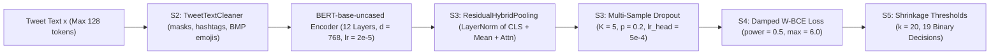
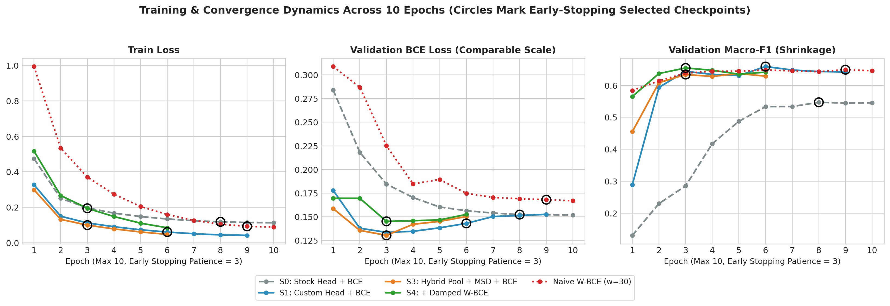
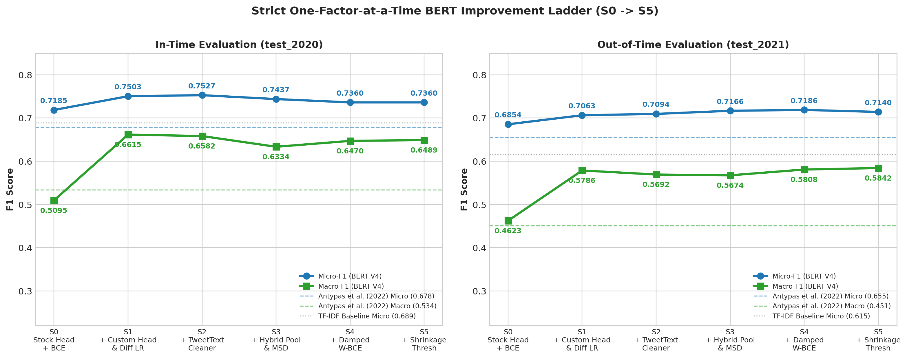
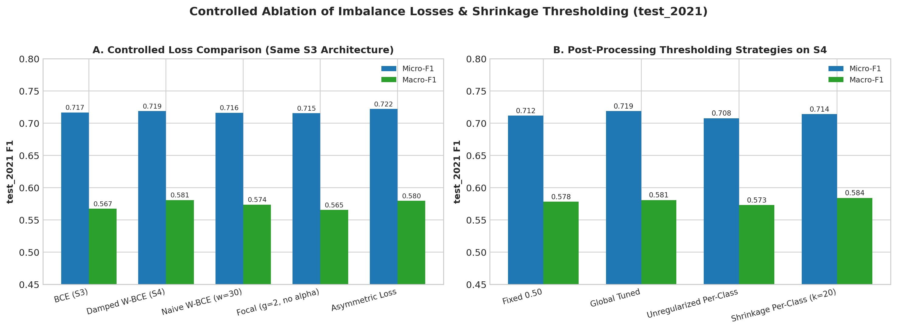
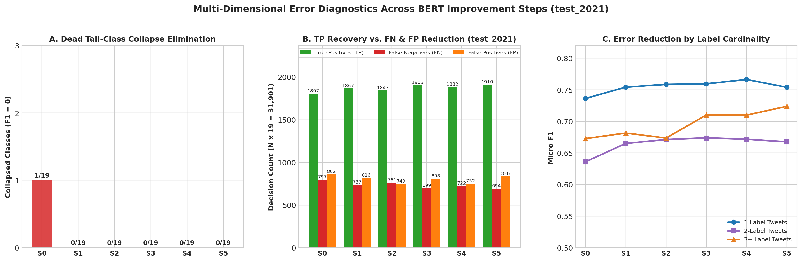

# BÁO CÁO ĐỒ ÁN MÔN HỌC DEEP LEARNING
## Phân loại Chủ đề Đa nhãn cho Dữ liệu Twitter (X) bằng Mô hình BERT Cải tiến Lũy tiến Dựa trên Phân tích Lỗi

**Phương pháp Deep Learning trọng tâm:** Pre-trained Transformer Encoder (`bert-base-uncased`, 110M tham số)  
**Bộ dữ liệu chuẩn hóa:** [`cardiffnlp/tweet_topic_multi`](https://huggingface.co/datasets/cardiffnlp/tweet_topic_multi) (19 chủ đề, phân chia theo thời gian `2020 -> 2021`)  
**Cơ sở đối chiếu:** Tài liệu gốc Antypas et al. (COLING 2022) & Baseline từ vựng TF-IDF + Logistic Regression  
**Lưu ý phạm vi:** Bước *Thu thập dữ liệu (Data Collection)* được bỏ qua theo yêu cầu đề bài do sử dụng bộ benchmark chuẩn công khai `cardiffnlp/tweet_topic_multi`. Báo cáo tập trung xuyên suốt quy trình 5 phần: **Xác định vấn đề $\rightarrow$ Tiền xử lý & Làm sạch $\rightarrow$ Khám phá dữ liệu (EDA) $\rightarrow$ Mô hình hóa với BERT (10 epochs + Early Stopping) $\rightarrow$ Đánh giá & Phân tích lỗi dẫn dắt cải tiến**.

---

## MỤC LỤC

* [PHẦN 1. XÁC ĐỊNH VẤN ĐỀ (PROBLEM DEFINITION)](#phần-1-xác-định-vấn-đề-problem-definition)
  * [1.1. Bối cảnh Ứng dụng và Bài toán Cần Giải quyết](#11-bối-cảnh-ứng-dụng-và-bài-toán-cần-giải-quyết)
  * [1.2. Tổng quan Nghiên cứu Liên quan (2022–2026)](#12-tổng-quan-nghiên-cứu-liên-quan-20222026)
  * [1.3. Đặc tả Toán học và Tiêu chí Đánh giá Thành công](#13-đặc-tả-toán-học-và-tiêu-chí-đánh-giá-thành-công)
* [PHẦN 2. TIỀN XỬ LÝ VÀ LÀM SẠCH DỮ LIỆU (DATA CLEANING & PREPROCESSING)](#phần-2-tiền-xử-lý-và-làm-sạch-dữ-liệu-data-cleaning--preprocessing)
  * [2.1. Kiểm toán Chất lượng Dữ liệu & Hiện tượng Ẩn danh hóa](#21-kiểm-toán-chất-lượng-dữ-liệu--hiện-tượng-ẩn-danh-hóa)
  * [2.2. Quy trình Làm sạch Hướng WordPiece (`TweetTextCleaner`)](#22-quy-trình-làm-sạch-hướng-wordpiece-tweettextcleaner)
  * [2.3. Phân chia Thời gian (Temporal Split), Token hóa và Chống Rò rỉ Dữ liệu](#23-phân-chia-thời-gian-temporal-split-token-hóa-và-chống-rò-rỉ-dữ-liệu)
* [PHẦN 3. KHÁM PHÁ DỮ LIỆU (EXPLORATORY DATA ANALYSIS - EDA)](#phần-3-khám-phá-dữ-liệu-exploratory-data-analysis---eda)
  * [3.1. Phân bố 19 Chủ đề và Mức độ Mất cân bằng Cực đoan](#31-phân-bố-19-chủ-đề-và-mức-độ-mất-cân-bằng-cực-đoan)
  * [3.2. Tính Đa nhãn, Tương quan Đồng xuất hiện, Trôi dạt Thời gian và Độ dài](#32-tính-đa-nhãn-tương-quan-đồng-xuất-hiện-trôi-dạt-thời-gian-và-độ-dài)
  * [3.3. Tổng hợp Hệ quả EDA $\rightarrow$ Quyết định Thiết kế Mô hình BERT](#33-tổng-hợp-hệ-quả-eda--quyết-định-thiết-kế-mô-hình-bert)
* [PHẦN 4. MÔ HÌNH HÓA (MODELING – BERT MULTI-LABEL ENCODER)](#phần-4-mô-hình-hóa-modeling--bert-multi-label-encoder)
  * [4.1. Lý do Lựa chọn Phương pháp Deep Learning Duy nhất: BERT](#41-lý-do-lựa-chọn-phương-pháp-deep-learning-duy-nhất-bert)
  * [4.2. Thiết kế Thang Cải tiến Lũy tiến Đơn biến (`S0 -> S5`)](#42-thiết-kế-thang-cải-tiến-lũy-tiến-đơn-biến-s0---s5)
  * [4.3. Chi tiết Kiến trúc, Hàm Mất mát và Ngưỡng Co cụm Hỗ trợ](#43-chi-tiết-kiến-trúc-hàm-mất-mát-và-ngưỡng-co-cụm-hỗ-trợ)
  * [4.4. Chiến lược Huấn luyện 10 Epochs + Early Stopping & Cosine Warmup](#44-chiến-lược-huấn-luyện-10-epochs--early-stopping--cosine-warmup)
* [PHẦN 5. ĐÁNH GIÁ MÔ HÌNH & PHÂN TÍCH LỖI DẪN DẮT CẢI TIẾN](#phần-5-đánh-giá-mô-hình--phân-tích-lỗi-dẫn-dắt-cải-tiến)
  * [5.1. Kết quả Thang Cải tiến Lũy tiến (`S0 -> S5`) & Đối chiếu SOTA](#51-kết-quả-thang-cải-tiến-lũy-tiến-s0---s5--đối-chiếu-sota)
  * [5.2. Thực nghiệm Đối chứng Có kiểm soát: Hàm Loss & Chiến lược Ngưỡng](#52-thực-nghiệm-đối-chứng-có-kiểm-soát-hàm-loss--chiến-lược-ngưỡng)
  * [5.3. Độ Ổn định Đa hạt giống (Multi-Seed Reproducibility)](#53-độ-ổn-định-đa-hạt-giống-multi-seed-reproducibility)
  * [5.4. Phân tích Lỗi Đa chiều (4 Góc độ Định lượng & Định tính)](#54-phân-tích-lỗi-đa-chiều-4-góc-độ-định-lượng--định-tính)
  * [5.5. Hạn chế Trung thực và Kết luận](#55-hạn-chế-trung-thực-và-kết-luận)
* [TÀI LIỆU THAM KHẢO (REFERENCES)](#tài-liệu-tham-khảo-references)

---

## PHẦN 1. XÁC ĐỊNH VẤN ĐỀ (PROBLEM DEFINITION)

### 1.1. Bối cảnh Ứng dụng và Bài toán Cần Giải quyết

Mạng xã hội Twitter (nay là X) là kênh truyền tải thông tin thời gian thực quy mô lớn, nơi hàng trăm triệu bài đăng ngắn phản ánh đồng thời các sự kiện tin tức, thể thao, âm nhạc, công nghệ và đời sống cá nhân. Trong các hệ thống lắng nghe mạng xã hội (*Social Listening*), gợi ý nội dung theo sở thích, kiểm duyệt an toàn thương hiệu (*Brand Safety*) hay theo dõi xu hướng dư luận theo năm, năng lực **gán tự động đa chủ đề cho mỗi bài tweet** đóng vai trò hạ tầng cốt lõi.

Tuy nhiên, phân loại chủ đề trên Twitter đặt ra ba câu hỏi kỹ thuật đặc thù mà các mô hình tuyến tính truyền thống (như Bag-of-Words/TF-IDF) hoặc một mô hình phân loại đơn nhãn không thể giải quyết triệt để:

1. **Tính đa nhãn đồng thời (Multi-Label Co-occurrence):** Một bài đăng ngắn thường giao thoa nhiều lĩnh vực (ví dụ: ca sĩ phát biểu về bầu cử đồng thời thuộc `celebrity_&_pop_culture`, `music` và `news_&_social_concern`), nên mô hình phải dự đoán song song 19 xác suất độc lập thay vì ép chọn một nhãn duy nhất qua Softmax.
2. **Mất cân bằng lớp cực đoan (Long-Tail Imbalance):** Các chủ đề phổ biến (`news_&_social_concern`, `sports`) chiếm tỷ lệ áp đảo so với các chủ đề ngách (`fashion_&_style`, `youth_&_student_life`, `travel_&_adventure`), khiến hàm mất mát tiêu chuẩn (BCE) và ngưỡng cố định $0.5$ dễ đẩy các lớp hiếm về trạng thái "sụp đổ" ($\text{F1} = 0.0$).
3. **Trôi dạt ngữ nghĩa theo thời gian (Temporal Semantic Drift):** Từ vựng và sự kiện trọng tâm thay đổi liên tục từ năm 2020 (đại dịch COVID-19, bầu cử Mỹ) sang năm 2021 (Euro 2020, Olympic Tokyo, sự kiện giải trí mới). Do đó, bài toán phải kiểm định độ bền vững trên dữ liệu **ngoài thời gian (*Out-of-Time*)**: huấn luyện trên năm 2020 và đánh giá trực tiếp trên năm 2021.

### 1.2. Tổng quan Nghiên cứu Liên quan (2022–2026)

Hướng tiếp cận của đồ án được định vị trực tiếp trong mạch nghiên cứu hiện đại về **Twitter Topic Classification** và **Long-Tail Multi-Label Text Classification (MLTC)** giai đoạn 2022–2026:

* **Chuẩn hóa bài toán Twitter Topic Classification (2022–2024):**
  * **Antypas et al. (COLING 2022, `arXiv:2209.09824`)** công bố bộ dữ liệu chuẩn `cardiffnlp/tweet_topic_multi` với 19 chủ đề phân chia theo trục thời gian, chỉ ra rằng tối ưu ngưỡng trên tập validation đóng vai trò then chốt với BERT/RoBERTa trên tập `test_2021` (nâng `TimeLMs-2020` từ `0.654/0.341` ở ngưỡng $0.5$ lên `0.655/0.451`).
  * **Loureiro et al. (ACL 2022)** giới thiệu `TimeLMs`, chứng minh sự dịch chuyển từ vựng theo năm trên Twitter làm suy giảm các bộ phân loại chỉ dựa trên bề mặt từ khóa.
  * **Antypas et al. (Findings of EMNLP 2023, `arXiv:2310.14757` — *SuperTweetEval*)** chuẩn hóa **Macro-F1** làm thước đo trọng yếu để tránh việc lớp đa số che lấp sự suy giảm trên lớp hiếm.
  * **Antypas et al. (EMNLP 2024, `arXiv:2410.03075` — *X-Topic*)** mở rộng bài toán sang đa ngôn ngữ và chứng minh thực nghiệm rằng **các mô hình Transformer Encoder tinh chỉnh trực tiếp vượt trội các mô hình ngôn ngữ lớn (LLM) sinh chữ ở chế độ zero-shot/few-shot** cả về độ chính xác phân loại đa nhãn lẫn chi phí tính toán.
* **Các tiến bộ mới nhất giai đoạn 2025–2026 liên quan trực tiếp đến thiết kế hệ thống:**
  * **Van Nooten et al. (10/2025, `arXiv:2510.11160` — *One Size Does Not Fit All: Exploring Variable Thresholds for Distance-Based Multi-Label Text Classification*):** Phân tích sâu nhược điểm của ngưỡng cố định $\tau = 0.5$ và ngưỡng riêng không điều chuẩn trên các tập validation nhỏ trong phân loại văn bản đa nhãn; đây là cơ sở trực tiếp để đồ án thiết kế **ngưỡng co cụm theo cỡ mẫu hỗ trợ (*Support-Regularized Shrinkage Thresholding*)**.
  * **Langner et al. (11/2025, `arXiv:2511.03830` — *Divide, Cache, Conquer*):** Đánh giá các phương pháp phân loại đa nhãn trên văn bản mạng xã hội, nhấn mạnh giá trị của việc phân tách rạch ròi bài toán gán nhãn nhị phân trên từng chủ đề.
  * **Bansal & Gangwani (12/2025, `arXiv:2512.20631` — *Zero-Training Temporal Drift Detection for Transformer Sentiment Models*):** Phân tích sâu hiện tượng trôi dạt phân phối theo thời gian của mô hình Transformer trên luồng mạng xã hội thực, củng cố yêu cầu tách biệt nghiêm ngặt tập kiểm thử cùng thời gian (`test_2020`) và ngoài thời gian (`test_2021`).
  * **Uniyal, Bashar & Nayak (02/2026, `arXiv:2602.17051` — *Evaluating Cross-Lingual Classification Approaches Enabling Topic Discovery for Multilingual Social Media Data*):** Chứng minh rằng ngay cả trong năm 2026, các mô hình phân loại tinh chỉnh trực tiếp trên văn bản mạng xã hội vẫn là nền tảng ổn định cho khám phá chủ đề.
  * **Lan, Aljebreen & Dragut (03/2026 — *Why They Link: An Intent Taxonomy for Including Hyperlinks in Social Posts*):** Chỉ ra rằng siêu liên kết (`URL`) trong bài đăng X/Twitter mang ý định chủ đề rất rõ nét (quảng bá, thảo luận, chia sẻ tin tức); do đó không nên xóa bỏ hoàn toàn `{{URL}}` mà cần chuẩn hóa thành token ngữ nghĩa tự nhiên (`http link`).
  * **Shinde et al. (07/2026, `arXiv:2607.25830` — *Beyond Static Costs: Learning-Dynamics Aware Loss Functions for Long-Tailed Classification*):** Chứng minh rằng việc ép trọng số dương tính quá lớn theo nghịch đảo tần suất tĩnh gây mất ổn định động lực học gradient cho lớp đầu bảng và bùng nổ dương tính giả — lý giải chính xác vì sao cần **trọng số suy giảm mũ căn (`Damped W-BCE`)** kết hợp khung huấn luyện đủ dài có dừng sớm thay vì Naive Weighted BCE thô.

### 1.3. Đặc tả Toán học và Tiêu chí Đánh giá Thành công

Cho văn bản tweet tiếng Anh thô $x \in \mathcal{X}$ (giới hạn $L \le 128$ WordPiece tokens), mô hình `BERT` học ánh xạ phi tuyến $f_\theta: \mathcal{X} \to \mathbb{R}^{19}$ sinh ra vector logit $\mathbf{z} = f_\theta(x)$. Xác suất từng chủ đề thu được qua 19 hàm Sigmoid độc lập, và quyết định đa nhãn $\hat{\mathbf{y}} \in \{0, 1\}^{19}$ áp dụng vector ngưỡng $\boldsymbol{\tau} = [\tau_1, \dots, \tau_{19}]^\top$:

$$\hat{p}_c = \sigma(z_c) = \frac{1}{1 + e^{-z_c}}, \qquad \hat{y}_c = \mathbb{I}(\hat{p}_c \ge \tau_c), \quad \forall c \in \{1, \dots, 19\}$$

**Bộ tiêu chí đánh giá thành công (Success Criteria) trước khi chạy thực nghiệm:**
1. **Micro-F1** (đo hiệu năng tổng hợp trên toàn bộ $N \times 19$ quyết định nhị phân) và **Macro-F1** (trung bình không trọng số $\frac{1}{19}\sum_{c=1}^{19} \text{F1}_c$ — thước đo bắt buộc để kiểm tra công bằng lớp đuôi dài):

$$\text{Micro-F1} = \frac{2\sum_{c=1}^{19} \text{TP}_c}{2\sum_{c=1}^{19} \text{TP}_c + \sum_{c=1}^{19} \text{FP}_c + \sum_{c=1}^{19} \text{FN}_c}, \qquad \text{Macro-F1} = \frac{1}{19} \sum_{c=1}^{19} \frac{2\,\text{TP}_c}{2\,\text{TP}_c + \text{FP}_c + \text{FN}_c}$$

2. **Không để sụp đổ lớp hiếm (*Zero Dead-Class Collapse*):** Số lớp có $\text{F1}_c = 0$ trên cả `test_2020` và `test_2021` phải giảm từ mức sụp đổ ở baseline về **`0 / 19`**.
3. **Vượt mốc SOTA & Baseline từ vựng:** Vượt rõ rệt mốc văn hiến gốc **Antypas et al. (COLING 2022)** trên `test_2021` (`0.6550` Micro-F1 / `0.4510` Macro-F1) cũng như baseline tuyến tính **TF-IDF + Logistic Regression** (`0.6154` Micro-F1 / `0.3997` Macro-F1).
4. **Tính bền bỉ theo thời gian & khả năng tái lập:** Độ suy giảm từ 2020 sang 2021 ($\Delta\text{Micro-F1}_{20\to 21}$) phải thấp hơn nhiều so với mô hình từ vựng ($-7.36$ điểm của TF-IDF), và kết quả ổn định qua nhiều hạt giống ngẫu nhiên (Seeds `42, 1337, 2024`).

---

## PHẦN 2. TIỀN XỬ LÝ VÀ LÀM SẠCH DỮ LIỆU (DATA CLEANING & PREPROCESSING)

### 2.1. Kiểm toán Chất lượng Dữ liệu & Hiện tượng Ẩn danh hóa

Trên toàn bộ 4 tập benchmark chuẩn của `cardiffnlp/tweet_topic_multi` gồm **7,410 tweets**, quá trình kiểm toán dữ liệu gốc ghi nhận:
* **Tính toàn vẹn & Trùng lặp:** **0 giá trị khuyết thiếu** (chuỗi rỗng hoặc `NaN`); kiểm tra băm MD5 văn bản thô xác nhận **0 mẫu trùng lặp** giữa tập huấn luyện `train_2020` với các tập `validation_2020`, `test_2020` và `test_2021`.
* **Đặc trưng mặt nạ ẩn danh của Cardiff & Biểu tượng Unicode:** Bộ dữ liệu đã được nhóm tác giả Cardiff ẩn danh hóa sẵn theo quy ước riêng trước khi phát hành, tạo ra ba mẫu nhiễu token đặc thù cho bộ tách từ `bert-base-uncased` (WordPiece):
  * `{@ENTITY@}` (thực thể có tên công khai như `{@Philadelphia Flyers@}`, `{@TIDAL@}`): **6,829 lượt** trên 4 tập (xuất hiện ở **66.74%** số tweet trong `train_2020`). WordPiece của BERT mặc định giữ cặp dấu ngoặc nhọn `{@` và `@}` bao quanh tên thực thể.
  * `{{USERNAME}}` (tài khoản cá nhân ẩn danh): **4,453 lượt** trên 4 tập (**42.25%** trong `train_2020`). WordPiece cắt `{{USERNAME}}` thành các mảnh vô nghĩa `{`, `{`, `user`, `##name`, `}`, `}`.
  * `{{URL}}` (đường dẫn ẩn danh): **3,665 lượt** trên 4 tập (**48.14%** trong `train_2020`).
  * **Hashtags (`#`) & CamelCase:** Xuất hiện ở **39.28%** số tweet trong `train_2020`, trong đó **21.31%** là hashtag viết liền kiểu `camelCase` hoặc `PascalCase` (như `#SmallYouTuberArmy`, `#ClimateChange`).
  * **Biểu tượng BMP vs. SMP Emoji:** Kiểm tra mã Unicode thực tế trên cả 7,410 tweet cho thấy phiên bản HuggingFace này chứa **0 SMP Emoji** ($\ge \text{U+1F000}$), nhưng có **741 ký tự biểu tượng BMP** ($\text{U+2600}..\text{U+27BF}$ và $\text{U+2B00}..\text{U+2BFF}$, chiếm **5.69%** số tweet ở `train_2020`), nổi bật gồm trái tim `\u2764` (278 lần), bóng đá `\u26bd` (45 lần), nốt nhạc `\u266b` (32 lần), lấp lánh `\u2728` (31 lần), cà phê `\u2615` (18 lần), bóng chày `\u26be` (4 lần), máy bay `\u2708` (3 lần). Khi đưa thẳng qua `bert-base-uncased` tokenizer, các ký tự này bị biến thành token mất thông tin **`[UNK]`**.

### 2.2. Quy trình Làm sạch Hướng WordPiece (`TweetTextCleaner`)

Để khắc phục trực tiếp các điểm nghẽn token hóa trên mà vẫn bảo toàn 100% tín hiệu chủ đề (không xóa stop-words hay xóa URL), mô-đun [`TweetTextCleaner`](../../tweet_topic_benchmark/tweet_topic/addons/custom_preprocessor_addon.py) được thiết kế riêng cho từ điển WordPiece của `bert-base-uncased` với 6 bước tuần tự:

1. **Chuẩn hóa Unicode NFC & Lọc ký tự điều khiển vô hình:** Thực thi `unicodedata.normalize("NFC", text)` và gỡ bộ chọn biến thể (`\ufe0f`) cùng ký tự nối không độ rộng (`\u200d`).
2. **Chuyển hóa mặt nạ người dùng & thực thể:** `{{USERNAME}}` $\rightarrow$ `@user`; biểu thức `\{@(.*?)@\}` $\rightarrow$ `@ \1` (tách dấu ngoặc `{` `}` để lộ trọn vẹn tên thực thể cho cơ chế Self-Attention).
3. **Bảo tồn tín hiệu siêu liên kết (Lan et al., 2026):** `{{URL}}` $\rightarrow$ `http link` thay vì xóa bỏ, giữ nguyên tín hiệu phân biệt các bài viết chia sẻ báo chí, âm nhạc hay sản phẩm.
4. **Diễn giải biểu tượng BMP/Emoji sang từ khóa tiếng Anh (`EMOJI_TOPIC_MAP`):** Ánh xạ trực tiếp các ký tự biểu tượng phổ biến thành cụm từ tiếng Anh tương ứng (`\u26bd` $\rightarrow$ `soccer`, `\u266b` $\rightarrow$ `music`, `\u2615` $\rightarrow$ `coffee food`, `\u2708` $\rightarrow$ `travel airplane`, `\u2764` $\rightarrow$ `love relationship`, v.v.), loại bỏ hoàn toàn token **`[UNK]`**.
5. **Tách từ Hashtag kiểu camelCase / PascalCase:** Sử dụng regex biên chữ hoa-thường `_CASE_BOUNDARY` biến `#SmallYouTuberArmy` $\rightarrow$ `#Small You Tuber Army` để WordPiece nhận diện từng từ đơn cấu thành.
6. **Chuẩn hóa dấu câu thông minh & khoảng trắng:** Quy đổi dấu nháy/gạch ngang Unicode (`’` $\rightarrow$ `'`, `“`/`”` $\rightarrow$ `"`, `—`/`–` $\rightarrow$ ` - `), rút gọn dấu câu lặp (`([!?.]){2,}` $\rightarrow$ `\1`) và chuẩn hóa khoảng trắng đơn.

*Lưu ý về tăng cường dữ liệu (Data Augmentation):* Đồ án **không áp dụng SMOTE hoặc nội suy văn bản** vì phép nội suy làm sai lệch cấu trúc tương quan đa nhãn tự nhiên và phá vỡ cấu trúc tiếng lóng mạng xã hội; vấn đề mất cân bằng được giải quyết tại tầng hàm mất mát và hiệu chuẩn ngưỡng.

### 2.3. Phân chia Thời gian (Temporal Split), Token hóa và Chống Rò rỉ Dữ liệu

| Tập dữ liệu (Split) | Khung thời gian | Số mẫu (Tweets) | Tỷ lệ (%) | Vai trò trong pipeline BERT |
|:---|:---:|:---:|:---:|:---|
| `train_2020` | Năm 2020 | **4,585** | 61.88% | Huấn luyện tham số $\theta$ và tính thống kê tần suất lớp $N_c$ cho hàm mất mát |
| `validation_2020` | Năm 2020 | **573** | 7.73% | Đánh giá Early Stopping (`val_f1_balanced`) và hiệu chuẩn ngưỡng quyết định $\boldsymbol{\tau}$ |
| `test_2020` | Năm 2020 | **573** | 7.73% | Đánh giá cùng phân phối thời gian (*In-time Evaluation*) |
| `test_2021` | Năm 2021 | **1,679** | 22.66% | Đánh giá trôi dạt ngoài thời gian (*Out-of-time Evaluation*) |
| **Tổng cộng** | **2020 – 2021** | **7,410** | **100.00%** | **Toàn bộ benchmark kiểm định có kiểm soát** |

* **Hàng rào chống rò rỉ dữ liệu (*Zero Leakage*):** Tuyệt đối không dùng Random Split trộn dữ liệu giữa hai năm 2020 và 2021. Tham số trọng số lớp $w_c$ chỉ tính từ `train_2020`; bước chọn checkpoint tốt nhất và tìm ngưỡng $\boldsymbol{\tau}$ chỉ thực hiện trên `validation_2020`; hai tập `test_2020` và `test_2021` được khóa băng hoàn toàn đến giai đoạn suy luận cuối cùng.
* **Token hóa WordPiece ($L_{\max} = 128$):** Chiều dài lớn nhất theo từ của cả 7,410 tweet chỉ là **62 từ** (61 từ trên `train_2020`), do đó cửa sổ `max_length = 128` bao phủ trọn vẹn 100% nội dung mà không gây cắt xén thông tin.

---

## PHẦN 3. KHÁM PHÁ DỮ LIỆU (EXPLORATORY DATA ANALYSIS - EDA)

### 3.1. Phân bố 19 Chủ đề và Mức độ Mất cân bằng Cực đoan

Bảng thống kê dưới đây trình bày phân bố đầy đủ của toàn bộ **19 chủ đề** (sắp xếp giảm dần theo tần suất trên `train_2020`) và mức biến động sang năm 2021 ($\Delta_{20 \to 21} = \text{test\_2021 (\%)} - \text{train\_2020 (\%)}$):

| ID | Tên Chủ đề (Topic) | `train_2020` (n / %) | `test_2020` (n / %) | `test_2021` (n / %) | Biến động $\Delta_{20 \to 21}$ |
|:---:|:---|:---:|:---:|:---:|:---:|
| **12** | `news_&_social_concern` | **1,493 (32.56%)** | 195 (34.03%) | 327 (19.48%) | **-13.09% (Giảm mạnh)** |
| **16** | `sports` | **1,151 (25.10%)** | 144 (25.13%) | **582 (34.66%)** | **+9.56% (Tăng mạnh)** |
| **11** | `music` | 769 (16.77%) | 95 (16.58%) | 380 (22.63%) | **+5.86% (Tăng)** |
| **03** | `diaries_&_daily_life` | 731 (15.94%) | 77 (13.44%) | 149 (8.87%) | **-7.07% (Giảm mạnh)** |
| **06** | `film_tv_&_video` | 722 (15.75%) | 90 (15.71%) | 298 (17.75%) | +2.00% (Tăng nhẹ) |
| **02** | `celebrity_&_pop_culture` | 714 (15.57%) | 94 (16.40%) | 245 (14.59%) | -0.98% (Ổn định) |
| **00** | `arts_&_culture` | 256 (5.58%) | 33 (5.76%) | 48 (2.86%) | -2.72% (Giảm) |
| **07** | `fitness_&_health` | 231 (5.04%) | 20 (3.49%) | 56 (3.34%) | -1.70% (Ổn định) |
| **15** | `science_&_technology` | 229 (4.99%) | 38 (6.63%) | 88 (5.24%) | +0.25% (Ổn định) |
| **04** | `family` | 222 (4.84%) | 16 (2.79%) | 32 (1.91%) | -2.94% (Giảm) |
| **14** | `relationships` | 209 (4.56%) | 19 (3.32%) | 61 (3.63%) | -0.93% (Ổn định) |
| **01** | `business_&_entrepreneurs` | 208 (4.54%) | 24 (4.19%) | 78 (4.65%) | +0.11% (Ổn định) |
| **13** | `other_hobbies` | 195 (4.25%) | 25 (4.36%) | 81 (4.82%) | +0.57% (Ổn định) |
| **09** | `gaming` | 189 (4.12%) | 20 (3.49%) | 77 (4.59%) | +0.46% (Ổn định) |
| **10** | `learning_&_educational` | 131 (2.86%) | 15 (2.62%) | 29 (1.73%) | -1.13% (Ổn định) |
| **08** | `food_&_dining` | 130 (2.84%) | 10 (1.75%) | 15 (0.89%) | -1.94% (Giảm) |
| **17** | `travel_&_adventure` | 94 (2.05%) | 12 (2.09%) | 15 (0.89%) | -1.16% (Ổn định) |
| **18** | `youth_&_student_life` | 83 (1.81%) | 11 (1.92%) | 11 (0.66%) | -1.16% (Ổn định) |
| **05** | `fashion_&_style` *(Hiếm nhất)* | **74 (1.61%)** | 6 (1.05%) | 32 (1.91%) | +0.29% (Ổn định) |

  
*Hình 3.1: Tỷ lệ xuất hiện của 19 chủ đề qua các tập dữ liệu, minh họa chênh lệch 20.18 : 1 giữa nhóm đầu bảng và nhóm đuôi dài.*

### 3.2. Tính Đa nhãn, Tương quan Đồng xuất hiện, Trôi dạt Thời gian và Độ dài

* **Mất cân bằng lớp cực đoan:** Lớp phổ biến nhất (`news_&_social_concern`: 1,493 mẫu) có số lượng mẫu dương gấp **20.18 lần** lớp hiếm nhất (`fashion_&_style`: 74 mẫu). Trong toàn bộ ma trận nhãn của `train_2020`, tới **91.01%** tổng số ô mang giá trị $0$ (*Negative*), tạo ra áp lực gradient âm rất lớn khi huấn luyện bằng BCE thông thường.
* **Đặc trưng đa nhãn (*Multi-Label Cardinality*):** Trên `train_2020`, mật độ nhãn trung bình đạt **Label Cardinality $LC = 1.708$ nhãn/tweet** (*Label Density* $LD = 0.0899$). Hơn một nửa tập huấn luyện (**51.78%**) mang từ 2 nhãn trở lên: 1 nhãn chiếm **48.20%**, 2 nhãn chiếm **36.23%**, 3 nhãn chiếm **12.48%**, từ 4 nhãn trở lên chiếm **3.08%**, và 0 nhãn chỉ chiếm **0.02%**.

  
*Hình 3.2: Phân phối số nhãn kích hoạt trên mỗi tweet ($LC = 1.708$; 51.78% bài đăng mang $\ge 2$ nhãn).*

* **Mạng lưới đồng xuất hiện chủ đề (*Co-occurrence*):** Nhiều chủ đề không tách rời mà gắn chặt theo ngữ cảnh sự kiện trên `train_2020`, ví dụ $P(\text{news} \mid \text{fitness\_\&\_health}) = 0.7273$ ($n=168$, do bối cảnh y tế công cộng 2020), $P(\text{diaries} \mid \text{relationships}) = 0.5885$ ($n=123$), $P(\text{news} \mid \text{science\_\&\_technology}) = 0.5677$ ($n=130$), $P(\text{diaries} \mid \text{family}) = 0.5631$ ($n=125$), $P(\text{learning} \mid \text{youth}) = 0.5542$ ($n=46$), $P(\text{music} \mid \text{celebrity}) = 0.4678$ và chiều ngược lại $P(\text{celebrity} \mid \text{music}) = 0.4343$ ($n=334$).

  
*Hình 3.3: Bản đồ nhiệt tương quan đồng xuất hiện giữa 19 chủ đề trong `train_2020`.*

* **Trôi dạt phân phối thời gian (*Temporal Drift 2020 $\rightarrow$ 2021*):** Khoảng cách Jensen-Shannon (*Jensen-Shannon Distance*) giữa phân phối chủ đề của `train_2020` và `test_2021` đạt **$d_{\text{JS}} = 0.1377$**. Năm 2021 chứng kiến `news_&_social_concern` giảm mạnh (-13.09%) và `diaries_&_daily_life` giảm (-7.07%) sau đỉnh điểm tin COVID-19 và bầu cử Mỹ 2020, nhường chỗ cho `sports` tăng vọt (+9.56%, do Euro 2020 và Olympic Tokyo) cùng `music` (+5.86%).

  
*Hình 3.4: Mức dịch chuyển tỷ trọng của 19 chủ đề từ năm 2020 sang năm 2021 ($d_{\text{JS}} = 0.1377$).*

* **Độ dài văn bản:** Trên `train_2020`, mỗi tweet có độ dài trung bình **28.34 từ** (trung vị **27.0 từ**, tối đa **61 từ**) và **171.48 ký tự** (tối đa **364 ký tự**); tính trên toàn bộ 7,410 tweet cũng chỉ có trung bình **28.16 từ** và tối đa **62 từ**. Ngưỡng cắt token $L_{\max} = 128$ hoàn toàn an toàn.

  
*Hình 3.5: Phân phối độ dài tweet. Toàn bộ mẫu đều nằm gọn dưới ngưỡng giới hạn 128 tokens.*

### 3.3. Tổng hợp Hệ quả EDA $\rightarrow$ Quyết định Thiết kế Mô hình BERT

| Quan sát từ EDA | Hệ quả đối với huấn luyện Deep Learning | Quyết định Thiết kế Kiến trúc & Dữ liệu (BERT V4) |
|:---|:---|:---|
| Mất cân bằng **20.18:1**, **91.01%** ô nhãn bằng `0` | BCE thuần thiên vị lớp lớn; lớp hiếm (nếu học chậm) cho xác suất $<0.5$ và sụp đổ `F1=0` | Theo dõi **Macro-F1** + `val_f1_balanced`; tách Learning Rate (`head_lr=5e-4`) và dùng **Damped Weighted BCE** (`power=0.5, w_max=6.0`) |
| **51.78%** bài đăng đa nhãn ($LC=1.708$); nhiều cặp đồng xuất hiện | Token đơn lẻ `[CLS]` khó gom đủ tín hiệu ngữ nghĩa rải rác cho $\ge 2$ chủ đề đồng thời | Dùng 19 Sigmoid độc lập + **`ResidualHybridPooling`** (kết hợp `[CLS]`, Mean, Attention) + **Multi-Sample Dropout** |
| **Trôi dạt $d_{\text{JS}} = 0.1377$** giữa 2020 và 2021 | Mô hình từ vựng bề mặt (TF-IDF) tụt sâu khi từ khóa/sự kiện đổi mới | Dùng **Pre-trained Deep Contextual Encoder BERT** (`bert-base-uncased`) hiểu ngữ cảnh thực thể và biểu đạt mới |
| Mặt nạ Cardiff `{@...@}`, `{{USERNAME}}`, `{{URL}}`, `#camelCase`, 741 ký tự BMP | WordPiece vỡ từ tố lạ, tạo `[UNK]` cho biểu tượng hoặc gán sai `diaries` do nhiễu cấu trúc | Thiết kế **`TweetTextCleaner`** chuyển đổi mặt nạ sang token tự nhiên, tách camelCase và diễn giải biểu tượng |
| Tập validation `validation_2020` nhỏ ($N=573$, lớp hiếm chỉ có 12–19 mẫu dương) | Tối ưu ngưỡng tự do theo từng lớp ($\tau_c$) dễ bị quá khớp (*threshold overfitting*) lên nhiễu validation | Áp dụng **Support-Regularized Empirical-Bayes Shrinkage Thresholding ($k=20$)** kéo ngưỡng lớp hiếm về gần $\tau_{\text{global}}$ |

---

## PHẦN 4. MÔ HÌNH HÓA (MODELING – BERT MULTI-LABEL ENCODER)

### 4.1. Lý do Lựa chọn Phương pháp Deep Learning Duy nhất: BERT

Theo định hướng tập trung chuyên sâu vào **một phương pháp Deep Learning duy nhất**, đồ án lựa chọn **BERT (`bert-base-uncased`)** (Devlin et al., NAACL 2019; 12 tầng Transformer Encoder, chiều ẩn $d = 768$, ~110M tham số) làm xương sống (*backbone*) cho toàn bộ thực nghiệm, bên cạnh một mốc tham chiếu tuyến tính từ vựng (TF-IDF 100k + Logistic Regression OvR). Lý do lựa chọn:
* **Biểu diễn ngữ cảnh hai chiều (*Bidirectional Self-Attention*):** Khác với vector thưa TF-IDF đếm từ rời rạc, mỗi tầng Self-Attention của BERT tính tương tác mọi cặp token trong tweet, nhận diện được ngữ cảnh của thực thể, thành ngữ mạng xã hội và đa chủ đề trong cùng một câu ngắn.
* **Năng lực chuyển giao từ tiền huấn luyện phổ quát trên bài toán không quá dư dả dữ liệu (`train_2020` = 4,585 mẫu):** Khi được ghép với đầu phân loại phù hợp, lịch trình học phân tầng và hàm mất mát xử lý mất cân bằng có kiểm soát, BERT tổng quát hóa sang tập trôi dạt năm 2021 bền bỉ hơn hẳn mô hình tuyến tính.

  
*Hình 4.1: Đối chiếu thiết kế đầu phân loại Stock Head (`S0`) và Custom Head (`S1` trở đi). Trong chuỗi thực nghiệm V4 này, cấu trúc Custom Head được triển khai thống nhất trên xương sống `bert-base-uncased` với $\eta_{\text{head}} = 5\times 10^{-4}$ và nâng cấp từ lớp gộp một nhánh sang `ResidualHybridPooling` ở `S3`.*

  
*Hình 4.2: Nguyên lý Attention Pooling cộng tính trên từng token (nhánh (a)) và Multi-Sample Dropout chia sẻ ma trận trọng số đầu ra (nhánh (b)). Bước `S3` sử dụng biến thể `ResidualHybridPooling` ghép phần dư với `[CLS]` và Masked Mean Pooling cùng $K = 5$ nhánh dropout.*

### 4.2. Thiết kế Thang Cải tiến Lũy tiến Đơn biến (`S0 -> S5`)

Một sai lầm phổ biến trong thực nghiệm học sâu là thay đổi nhiều thành phần cùng lúc khiến không thể kết luận yếu tố nào thực sự mang lại cải tiến. Đồ án thiết kế **thang cải tiến 6 bậc kiểm soát chặt một biến tại mỗi bước (`One-Factor-at-a-Time`)**, trong đó mỗi bước nâng cấp được dẫn dắt trực tiếp từ lỗi phát hiện ở bước ngay trước đó:

| Bước | Tên cấu hình | Yếu tố duy nhất thay đổi so với bước trước | Lỗi cụ thể cần khắc phục |
|:---:|:---|:---|:---|
| **`S0`** | `v4_s0_stock_bce` | **Baseline BERT nguyên bản:** Stock `AutoModelForSequenceClassification` (`[CLS]` + tanh pooler + linear), tốc độ học đồng nhất $\eta = 2\times 10^{-5}$, BCE tiêu chuẩn | Mốc khởi điểm chuẩn của HuggingFace (`AutoModel`), còn sụp đổ lớp hiếm và hội tụ chậm ở đầu ra |
| **`S1`** | `v4_s1_custom_head_bce` | **+ Custom Head & Differential LR:** Đầu phân loại tuyến tính trực tiếp từ `[CLS]` với $\eta_{\text{head}} = 5\times 10^{-4}$ (gấp 25 lần $\eta_{\text{backbone}} = 2\times 10^{-5}$), khóa seed ngay trong `__init__` | Khắc phục trạng thái thiếu khớp (*underfitting*) ở đầu phân loại gây sụp đổ `travel_&_adventure` (`F1=0`) và `FN` cao ở `S0` |
| **`S2`** | `v4_s2_cleaner_bce` | **+ `TweetTextCleaner`:** Tiền xử lý mặt nạ Cardiff, camelCase và diễn giải biểu tượng BMP | Giảm dương tính giả (`FP = 816`) phát sinh khi `{{USERNAME}}` / `{{URL}}` và `[UNK]` làm mô hình gán nhầm `diaries_&_daily_life` |
| **`S3`** | `v4_s3_hybrid_pool_msd_bce` | **+ `ResidualHybridPooling` + Multi-Sample Dropout ($K=5, p=0.2$):** Kết hợp `[CLS]` + Mean + Attention + LayerNorm và điều chuẩn MSD | Khắc phục sụt giảm hiệu năng trên tweet đa nhãn $\ge 3$ nhãn khi vector `[CLS]` đơn lẻ bỏ sót chủ đề phụ |
| **`S4`** | `v4_s4_damped_wbce` | **+ Damped Class-Balanced W-BCE:** Trọng số dương tính giảm chấn $p=0.5$, chặn trần $w_{\max}=6.0$ | Cải thiện khả năng hiệu chuẩn xác suất và độ nhạy lớp hiếm/trung bình (`fitness`, `relationships`, `science`) mà không làm nổ `FP` |
| **`S5`** | `v4_s4_damped_wbce` + Shrinkage | **+ Shrinkage Thresholding ($k=20$):** Hậu xử lý co cụm ngưỡng theo cỡ mẫu validation trên đầu ra của `S4` | Khắc phục hiện tượng ngưỡng đồng nhất bỏ sót lớp hiếm và ngưỡng tự do theo lớp quá khớp lên tập `validation_2020` ($N=573$) |

### 4.3. Chi tiết Kiến trúc, Hàm Mất mát và Ngưỡng Co cụm Hỗ trợ

1. **Tốc độ học phân tầng (*Differential Learning Rate* — `S1`):** Nhóm tham số xương sống BERT giữ tốc độ học bảo tồn $\eta_{\text{backbone}} = 2\times 10^{-5}$ để tránh phá hủy biểu diễn ngữ nghĩa tiền huấn luyện, trong khi đầu phân loại và khối gộp khởi tạo ngẫu nhiên sử dụng $\eta_{\text{head}} = 5\times 10^{-4}$ (weight decay $\lambda = 0.01$).
2. **Lớp gộp Lai Có Kết nối Phần dư (*Residual Hybrid Pooling* — `S3`):** Nhằm khắc phục nhược điểm của *Attention Pooling* thuần túy (vốn bỏ qua thông tin tổng hợp sẵn trong token `[CLS]` và dễ dao động ở bước đầu), `ResidualHybridPooling` bảo toàn `[CLS]` làm đường trục đồng thời cộng có trọng số học được hai nhánh Masked Mean Pooling và Additive Attention Pooling rồi chuẩn hóa bằng LayerNorm:

$$\alpha_i = \text{softmax}_i\big(\mathbf{v}^\top \tanh(\mathbf{W}_a \mathbf{h}_i + \mathbf{b}_a)\big), \qquad \mathbf{h}_{\text{attn}} = \sum_{i=1}^{L} \alpha_i \mathbf{h}_i$$

$$\mathbf{h}_{\text{hybrid}} = \text{LayerNorm}\Big(\mathbf{h}_{\text{CLS}} + w_{\text{mean}} \mathbf{h}_{\text{mean}} + w_{\text{attn}} \mathbf{h}_{\text{attn}}\Big)$$

   Kết hợp cùng **Multi-Sample Dropout** ($K = 5$ nhánh dropout độc lập $p = 0.2$ chia sẻ một tầng Linear $768 \to 19$), hàm mất mát khi huấn luyện lấy trung bình trên 5 nhánh logit $\mathbf{z}^{(m)}$, còn khi suy luận chỉ chạy đúng một lượt tuyến tính không dropout:

$$\mathcal{L}_{\text{MSD}} = \frac{1}{K} \sum_{m=1}^{K} \mathcal{L}\big(\mathbf{z}^{(m)}, \mathbf{y}\big)$$

3. **Hàm Mất mát Có Trọng số Giảm chấn (*Damped Class-Balanced W-BCE* — `S4`):** Trong thực nghiệm thô (*Naive W-BCE*, $w_c = \min((N - N_c)/N_c, 30.0)$), trọng số dương tính dao động từ **`2.07` đến `30.00`**, phạt quá nặng sai số âm trên lớp hiếm nên đẩy điểm tin cậy giả tăng cao, dẫn tới bùng nổ False Positives. Bước `S4` sử dụng lũy thừa giảm chấn $p = 0.5$ với ngưỡng trần $w_{\max} = 6.0$:

$$w_c = \min\!\left(\left(\frac{N - N_c}{N_c}\right)^{0.5},\; 6.0\right), \qquad \mathcal{L}_{\text{W-BCE}} = -\frac{1}{19}\sum_{c=1}^{19} \Big[ w_c y_c \log \hat{p}_c + (1 - y_c)\log(1 - \hat{p}_c) \Big]$$

   Nhờ giảm chấn căn bậc hai, dải trọng số được nén gọn về **`[1.44, 6.00]`** (ví dụ lớp `news_&_social_concern` nhận $w = 1.44$, còn lớp hiếm như `fashion_&_style` nhận trần $6.00$), đủ để nâng gradient cho lớp đuôi dài mà vẫn giữ phân phối xác suất ổn định. Ngoài `Damped W-BCE`, đồ án đối chứng có kiểm soát trên cùng kiến trúc `S3` với **BCE thuần**, **Naive W-BCE ($p=1.0, w_{\max}=30$)**, **Focal Loss ($\gamma=2.0$, không $\alpha$)** và **Asymmetric Loss (ASL, $\gamma^-=2.0, \gamma^+=0.0, m=0.05$)**:

$$\mathcal{L}_{\text{ASL}} = -\frac{1}{19} \sum_{c=1}^{19} \Big[ y_c \log \hat{p}_c + (1 - y_c) (p_{m,c})^{\gamma^-} \log(1 - p_{m,c}) \Big], \quad p_{m,c} = \max(\hat{p}_c - m, 0)$$

4. **Ngưỡng Co cụm Theo Hỗ trợ Validation (*Support-Regularized Empirical-Bayes Shrinkage Thresholding* — `S5`):** Khi tìm ngưỡng tối ưu riêng lẻ cho từng lớp trên `validation_2020` ($N = 573$), các lớp hiếm chỉ có từ **12 đến 19 mẫu dương** (ví dụ `travel_&_adventure`: $n=12$, `youth_&_student_life`: $n=14$, `fashion_&_style`: $n=15$), khiến bước tìm kiếm lưới dễ bị nhiễu thống kê và quá khớp sang tập test. Hàm `calibrate_shrinkage_thresholds` khắc phục bằng công thức thu gọn Empirical-Bayes với siêu tham số điều chuẩn $k = 20$ kéo ngưỡng riêng $\tau_c^{\text{val}}$ (tìm với bước lưới $\Delta\tau = 0.02$ trên $[0.10, 0.85]$, ưu tiên nghiệm gần $\tau_{\text{global}}$ khi hòa F1) về phía ngưỡng toàn cục $\tau_{\text{global}}$:

$$\alpha_c = \frac{n_c}{n_c + k}, \qquad \tau_c^{\text{shrink}} = \alpha_c \,\tau_c^{\text{val}} + (1 - \alpha_c)\,\tau_{\text{global}}, \qquad k = 20$$

   Ví dụ thực tế đo được trên mô hình `S4` ($\tau_{\text{global}} = 0.60$): với lớp rất hiếm `travel_&_adventure` ($n_c = 12$, ngưỡng thô tự do $\tau_{\text{pc}} = 0.25$), trọng số co cụm chỉ là $\alpha_c = 12 / (12 + 20) = 0.375$, kéo ngưỡng cuối cùng về **`0.5225`**; tương tự `fashion_&_style` ($n_c = 15$, $\tau_{\text{pc}} = 0.30$) được ổn định về **`0.5343`**; ngược lại lớp đủ mẫu như `film_tv_&_video` ($n_c = 100$) giữ nguyên ảnh hưởng mạnh của validation ($\alpha_c = 100 / 120 = 0.833$, $\tau_c^{\text{shrink}} = 0.7200$).

### 4.4. Chiến lược Huấn luyện 10 Epochs + Early Stopping & Cosine Warmup

Ở các lần thử nghiệm sơ bộ trước đây với số epoch cố định là 4, hai hiện tượng trái ngược đã bộc lộ: một số mô hình học chậm (như Stock Head `S0`) bị cắt ngang khi vẫn đang cải thiện mạnh, trong khi các cấu hình hội tụ nhanh (có lớp gộp lai + MSD) lại cần dừng sớm đúng điểm đỉnh trước khi quá khớp. Do đó, toàn bộ 10 cấu hình V4 đều áp dụng chung giao thức:
* **Tối ưu hóa & Lịch trình học:** AdamW ($\beta_1=0.9, \beta_2=0.999$, weight decay $0.01$, gradient clipping $\|\mathbf{g}\|_2 \le 1.0$, batch size $32$, AMP FP16 trên GPU Tesla T4 Kaggle), lịch trình **Cosine Annealing** với **Linear Warmup 10%** số bước tối ưu.
* **Khung tối đa `10 Epochs` + `Early Stopping (patience = 3)`:** Đánh giá cuối mỗi epoch theo thước đo tổng hợp cân bằng **`val_f1_balanced = 0.5 * val_micro_f1_shrinkage + 0.5 * val_macro_f1_shrinkage`** trên `validation_2020`, lưu và khôi phục trạng thái mô hình đạt đỉnh (`save_best = True`).

  
*Hình 4.3: Đường cong Train Loss, Validation BCE Loss (cùng thang đo BCE để đối chiếu mức hiệu chuẩn xác suất) và Validation Macro-F1 (Shrinkage) của các cấu hình tiêu biểu. Vòng tròn đen đánh dấu checkpoint tốt nhất được Early Stopping lựa chọn.*

Số liệu ghi nhận trực tiếp qua từng epoch minh chứng rõ sự cần thiết của thiết lập `10 epochs + Early Stopping`:
* **`S0` (Stock Head + BCE, $\eta = 2\times 10^{-5}$ đồng nhất):** Ở epoch 3 và 4, đầu phân loại vẫn đang học dở (`val_macro_sh = 0.2852` ở epoch 3; `0.4173` ở epoch 4) và phải tới **`best_epoch = 8 / 10`** mới đạt đỉnh (`val_macro_sh = 0.5470`, `val_f1_balanced = 0.6216`, `val_bce = 0.1523`). Nếu cắt cứng ở 4 epoch như trước, `S0` mất hơn 13 điểm Macro-F1 trên validation.
* **`S1` & `S2` (Custom Head + Differential LR $\eta_{\text{head}} = 5\times 10^{-4}$):** Hội tụ nhanh vượt bậc ngay sau epoch 2–3 và đạt đỉnh tại **`best_epoch = 6 / 9`** (`S1`: `val_f1_balanced = 0.6986`; `S2`: `0.6928`), sau đó Early Stopping tự động dừng tại epoch 9 khi mất mát validation tăng dần trở lại (`0.1430 -> 0.1526`).
* **`S3`, `S4`, `Focal` và `ASL` (Hybrid Pooling + Multi-Sample Dropout):** Nhờ kiến trúc gộp đa nhánh giàu tín hiệu và MSD điều chuẩn, toàn bộ 4 cấu hình này hội tụ sắc nét nhất ngay tại **`best_epoch = 3 / 6`** (`S3`: `val_f1_balanced = 0.68775`, `val_bce = 0.1303`; `S4`: `val_f1_balanced = 0.6970`; `Focal`: `0.69405`; `ASL`: `0.70745`) rồi dừng an toàn tại epoch 6 (khi `train_loss` của `S4` tiếp tục tụt từ `0.1948` xuống `0.0850` báo hiệu bắt đầu ghi nhớ tập train).
* **Đối chứng `Naive W-BCE (w_max = 30)`:** Ngược lại hoàn toàn với `S4`, trọng số dương tính cực đoan tạo nhiễu gradient mạnh từ epoch 1 (`train_loss = 0.9931`, `val_bce = 0.3088`), khiến mô hình loay hoay cân bằng đến tận **`best_epoch = 9 / 10`** (`val_f1_balanced = 0.6896`, `val_bce = 0.1681`).

---

## PHẦN 5. ĐÁNH GIÁ MÔ HÌNH & PHÂN TÍCH LỖI DẪN DẮT CẢI TIẾN

### 5.1. Kết quả Thang Cải tiến Lũy tiến (`S0 -> S5`) & Đối chiếu SOTA

Bảng tổng hợp dưới đây trình bày đầy đủ hiệu năng đo lường thực tế của toàn bộ 6 bước `S0 -> S5` (`bert-base-uncased`, seed 42, 10 epochs + Early Stopping) trên cả tập cùng thời gian `test_2020` và ngoài thời gian `test_2021`, đặt cạnh Baseline từ vựng và các mốc SOTA trong văn hiến:

| Cấu hình / Nghiên cứu đối chiếu | Ngưỡng áp dụng | `Ep` (Best/Ran) | `test_2020` Micro / Macro | `test_2021` Micro / Macro | $\Delta_{20 \to 21}$ Micro / Macro | `test_2021` TP / FP / FN | Lớp sụp đổ (`2021`) |
|:---|:---:|:---:|:---:|:---:|:---:|:---:|:---:|
| **Antypas et al. (COLING 2022)** — `RoBERTa-base` | Cố định `0.50` | — | 0.6610 / 0.3420 | 0.6380 / 0.3110 | -2.30 / -3.10 | — | — |
| **Loureiro et al. (ACL 2022)** — `TimeLMs-2020` | Cố định `0.50` | — | 0.6720 / 0.3780 | 0.6540 / 0.3410 | -1.80 / -3.70 | — | — |
| **Antypas et al. (COLING 2022)** — `TimeLMs-2020` *(SOTA gốc)* | Tối ưu Val | — | 0.6780 / 0.5340 | 0.6550 / 0.4510 | -2.30 / -8.30 | — | — |
| **Baseline từ vựng:** `TF-IDF 100k + Logistic Regression (OvR)` *(Thô)* | `0.50` | — | 0.6890 / 0.5227 | 0.6154 / 0.3997 | **-7.36 / -12.30** | — | — |
| `TF-IDF 100k + LR (OvR)` *(+ `TweetTextCleaner`)* | `0.50` | — | 0.6947 / 0.5412 | 0.6163 / 0.4058 | **-7.84 / -13.54** | — | — |
| *Tham chiếu `S0` tại ngưỡng mặc định* (`v4_s0_stock_bce`) | Cố định `0.50` | 8 / 10 | 0.6971 / 0.3709 | 0.6705 / 0.3151 | -2.66 / -5.58 | — | **6 / 19** |
| **`S0`: BERT Stock Head + BCE** | Global ($\tau=0.30$) | 8 / 10 | 0.7185 / 0.5095 | 0.6854 / 0.4623 | -3.31 / -4.72 | 1,807 / 862 / 797 | **1 / 19** (`2/19` ở 2020) |
| **`S1`: + Custom Head & Differential LR ($\eta_h = 5\times 10^{-4}$)** | Global ($\tau=0.35$) | 6 / 9 | 0.7503 / **0.6615** | 0.7063 / 0.5786 | -4.40 / -8.29 | 1,867 / 816 / 737 | **0 / 19** |
| **`S2`: + `TweetTextCleaner` (WordPiece-aware)** | Global ($\tau=0.40$) | 6 / 9 | **0.7527** / 0.6582 | 0.7094 / 0.5692 | -4.33 / -8.90 | 1,843 / **749** / 761 | **0 / 19** |
| **`S3`: + `ResidualHybridPooling` + MSD ($K=5$)** | Global ($\tau=0.30$) | 3 / 6 | 0.7437 / 0.6334 | 0.7166 / 0.5674 | -2.71 / -6.60 | 1,905 / 808 / 699 | **0 / 19** |
| **`S4`: + Damped W-BCE ($p=0.5, w_{\max}=6.0$)** | Global ($\tau=0.60$) | 3 / 6 | 0.7360 / 0.6470 | **0.7186** / 0.5808 | **-1.74 / -6.62** | 1,882 / 752 / 722 | **0 / 19** |
| **`S5`: `S4` + Shrinkage Threshold ($k=20$)** | Shrinkage ($\boldsymbol{\tau}^{\text{sh}}$) | 3 / 6 | 0.7360 / 0.6489 | 0.7140 / **0.5842** | -2.20 / **-6.47** | **1,910** / 836 / **694** | **0 / 19** |

  
*Hình 5.1: Diễn tiến Micro-F1 và Macro-F1 từ `S0` tới `S5` trên `test_2020` và `test_2021`, đối chiếu trực tiếp với mốc văn hiến gốc Antypas et al. (COLING 2022) và TF-IDF Baseline.*

**Phân tích cơ chế đằng sau từng bước nhảy hiệu năng:**
1. **`S0 -> S1` (Bước đột phá chống sụp đổ lớp hiếm):** Chỉ riêng việc gỡ bỏ đầu `tanh` pooler mặc định (vốn có $\eta = 2\times 10^{-5}$ quá nhỏ cho tầng tuyến tính khởi tạo mới) để dùng Custom Head với $\eta_{\text{head}} = 5\times 10^{-4}$ giúp `test_2020` nhảy từ `0.7185/0.5095` lên `0.7503/0.6615`, `test_2021` tăng **`+2.09` Micro-F1 và `+11.63` Macro-F1** (`0.6854/0.4623 -> 0.7063/0.5786`), đồng thời xóa sổ hoàn toàn tình trạng sụp đổ lớp hiếm (`1/19 -> 0/19`).
2. **`S1 -> S2` (Cắt giảm 67 dương tính giả nhờ chuẩn hóa văn bản Twitter):** Dù điểm Macro-F1 chung dao động nhẹ ở lớp đuôi cực nhỏ trên `test_2021`, `BertTweetCleaner` đẩy Precision tăng từ `0.7463 -> 0.7676` (2020) và `0.6959 -> 0.7110` (2021), cắt tổng **False Positives trên `test_2021` từ `816` xuống `749` (-8.2%)**, nâng Exact Match từ `0.4306` lên `0.4407` và Micro-F1 trên cả hai năm (`0.7527` ở 2020, `0.7094` ở 2021).
3. **`S2 -> S3` (Thu hồi 62 True Positives đa nhãn nhờ `ResidualHybridPooling` + MSD):** Chuyển từ `[CLS]` đơn lẻ sang tổng hợp phần dư `[CLS] + Mean + Attention` cùng 5 nhánh MSD đảo ngược xu hướng thiếu Recall ở `S2`: `TP` trên `test_2021` tăng từ **`1,843` lên `1,905` (+62 TP)**, `FN` giảm `761 -> 699`, đưa Micro-F1 `test_2021` từ `0.7094` lên **`0.7166`**, và độ trôi dạt $\Delta\text{Micro}_{20\to 21}$ thu hẹp mạnh từ `-4.33` xuống `-2.71` điểm.
4. **`S3 -> S4` (Ổn định hiệu chuẩn xác suất và độ bền thời gian nhờ `Damped W-BCE`):** Damped W-BCE đưa $\tau_{\text{global}}$ từ mức quá bảo thủ của BCE (`0.30`) về vùng cân bằng tự nhiên **`0.60`**, đồng thời loại bỏ 56 dương tính giả (`808 -> 752`), đẩy **`Exact Match` trên `test_2021` lên mức đỉnh toàn nghiên cứu `0.4532`**, **`Micro-F1 = 0.7186`**, **`Macro-F1 = 0.5808`**, và đạt độ bền vững thời gian tốt nhất ($\Delta\text{Micro}_{20\to 21}$ chỉ **`-1.74` điểm**, ít hơn 4 lần mức suy giảm `-7.36` của TF-IDF).
5. **`S4 -> S5` (Tối ưu hóa cân bằng Macro-F1 và thu hồi nhãn hiếm bằng Shrinkage $k=20$):** Bằng cách co cụm vector ngưỡng theo lượng mẫu hỗ trợ trên validation, `S5` đánh đổi nhẹ `-0.46` điểm Micro-F1 (`0.7186 -> 0.7140`) để nâng **Macro-F1 `test_2021` lên mức cao nhất `0.5842`** (`+13.32` điểm so với SOTA COLING 2022 `0.4510`; `+12.19` điểm so với `S0`), thu hồi tổng cộng **`1,910` True Positives** (cao nhất trong tất cả các bước) và giảm `FN` xuống thấp kỷ lục **`694`**. Trong ứng dụng thực tế, **`S4` (Global $\tau=0.60$)** phù hợp khi ưu tiên Micro-F1/Exact Match cao nhất (`0.7186 / 45.32%`), còn **`S5` (Shrinkage)** tối ưu khi mục tiêu là bảo vệ đều 19 chủ đề (Macro-F1 `0.5842`) và bao phủ tối đa tweet nhiều nhãn.

### 5.2. Thực nghiệm Đối chứng Có kiểm soát: Hàm Loss & Chiến lược Ngưỡng

Để kiểm chứng đóng góp tách biệt của hàm mất mát và cơ chế chọn ngưỡng trên cùng **kiến trúc `S3` (`TweetTextCleaner` + `ResidualHybridPooling` + MSD $K=5$)**, bảng sau báo cáo đầy đủ số liệu cho 5 hàm loss trên `test_2021`:

| Hàm Mất mát (Cố định Kiến trúc `S3`) | `Ep` (Best/Ran) | $\tau_{\text{global}}$ | Ngưỡng `0.50` (Micro / Macro) | **`global_tuned`** (Micro / Macro) | **`shrinkage_tuned`** (Micro / Macro) | TP / FP / FN (`shrinkage` / `global`) |
|:---|:---:|:---:|:---:|:---:|:---:|:---:|
| **BCE chuẩn (`S3`)** | 3 / 6 | 0.30 | **0.7237** / 0.5403 | 0.7166 / 0.5674 | **0.7180** / 0.5790 | 1,905 / 808 / 699 *(global)* |
| **Focal Loss ($\gamma = 2.0$, no $\alpha$)** | 3 / 6 | 0.45 | 0.7209 / 0.5462 | 0.7154 / 0.5654 | 0.7114 / 0.5697 | 1,845 / 709 / 759 *(global)* |
| **Naive W-BCE ($p = 1.0, w_{\max} = 30$)** | **9 / 10** | **0.80** | 0.6947 / 0.5750 | 0.7161 / 0.5737 | 0.6995 / 0.5787 | 1,787 / **600** / **817** *(global)* |
| **Asymmetric Loss (ASL, $\gamma^-=2, m=0.05$)** | 3 / 6 | 0.65 | 0.6746 / 0.5559 | **0.7221** / 0.5796 | 0.7153 / 0.5761 | 1,909 / 774 / 695 *(global)* |
| **Damped W-BCE ($p = 0.5, w_{\max} = 6.0$ — `S4/S5`)** | 3 / 6 | **0.60** | 0.7115 / **0.5782** | 0.7186 / **0.5808** | 0.7140 / **0.5842** | **1,910** / 836 / **694** *(shrinkage)* |

  
*Hình 5.2: Đối chứng 5 hàm loss trên cùng kiến trúc `S3` (trái) và 4 chiến lược chọn ngưỡng hậu xử lý trên mô hình `S4` (phải) tại `test_2021`.*

**Đối chiếu 4 chiến lược chọn ngưỡng trên cùng ma trận xác suất đầu ra của `S4` (`test_2021`):**

| Chiến lược chọn ngưỡng trên `S4` | `validation_2020` Micro / Macro | `test_2020` Micro / Macro | `test_2021` Micro / Macro | Nhận xét hành vi |
|:---|:---:|:---:|:---:|:---|
| **Fixed `0.50`** | 0.7222 / 0.6361 | 0.7298 / 0.6375 | 0.7115 / 0.5782 | Nhờ Damped W-BCE cân bằng trước, ngưỡng `0.50` đạt Macro khá tốt nhưng Recall chưa tối ưu |
| **`global_tuned` ($\tau = 0.60$)** | 0.7269 / 0.6328 | **0.7360** / 0.6470 | **0.7186** / 0.5808 | Cân bằng tốt nhất cho Micro-F1 & Exact Match (`0.4532`) |
| **Unregularized Per-Class ($\boldsymbol{\tau}_{\text{pc}}$)** | **0.7449 / 0.6773** | 0.7315 / 0.6410 | 0.7077 / 0.5730 | **Quá khớp nghiêm trọng lên `val`:** thắng lớn ở `val` (+4.45 Macro) nhưng rớt xuống thấp nhất trên `test_2021`! |
| **`Shrinkage Per-Class` ($k = 20$ — `S5`)** | 0.7394 / 0.6546 | **0.7360 / 0.6489** | 0.7140 / **0.5842** | Vượt ngưỡng per-class thô **trên cả hai thước đo** tại `test_2021` (`+0.63` Micro / `+1.12` Macro) và giữ đỉnh Macro-F1 |

Hai phát hiện khoa học then chốt từ bảng đối chứng:
1. **Damped W-BCE ($p=0.5$) khắc phục dứt điểm điểm yếu của Naive W-BCE ($p=1.0$):** Naive W-BCE với $w_{\max}=30$ làm lệch phân phối xác suất nghiêm trọng ($\tau_{\text{global}}$ bị đẩy lên tới `0.80`), kéo Micro-F1 chế độ Shrinkage tụt xuống `0.6995` và làm `FN` tăng vọt lên `817` ở chế độ global. Ngược lại, **Damped W-BCE đạt Macro-F1 cao nhất trên cả hai chế độ** (`0.5808` ở global; `0.5842` ở shrinkage) đồng thời giữ được tính hiệu chuẩn gần mốc `0.50` (`0.7115 / 0.5782` ngay cả khi không tinh chỉnh ngưỡng). **ASL** đạt Micro-F1 global cao hơn nhẹ (`0.7221` vs `0.7186`), song **Damped W-BCE** vượt hơn ASL ở chỉ tiêu trung tâm Macro-F1 trên cả `global` (`0.5808 > 0.5796`), `shrinkage` (`0.5842 > 0.5761`) lẫn `default_0.5` (`0.5782 > 0.5559`).
2. **Bằng chứng thực nghiệm về Overfitting ngưỡng ở tập validation nhỏ:** Phương pháp tối ưu từng ngưỡng không điều chuẩn (`Unregularized Per-Class`) thổi phồng Macro-F1 trên `validation_2020` lên `0.6773`, nhưng khi sang `test_2021` lại rớt xuống `0.7077 / 0.5730` — thua cả ngưỡng cố định `0.50` lẫn `global_tuned`. Phép co cụm **`Shrinkage` ($k=20$)** xử lý triệt để hiện tượng này và nâng hiệu năng `test_2021` trở lại `0.7140 / 0.5842`.

### 5.3. Độ Ổn định Đa hạt giống (Multi-Seed Reproducibility)

Huấn luyện lại toàn bộ cấu hình cuối (`v4_s4_damped_wbce`) trên 3 hạt giống độc lập (`42, 1337, 2024`, mỗi seed chạy tối đa 10 epochs + Early Stopping):

| Seed | `Ep` (Best/Ran) | `test_2020` Global (Mi / Ma) | `test_2020` Shrinkage (Mi / Ma) | `test_2021` Global (Mi / Ma) | `test_2021` Shrinkage (Mi / Ma) |
|:---:|:---:|:---:|:---:|:---:|:---:|
| **42** | 3 / 6 | 0.7360 / 0.6470 | 0.7360 / 0.6489 | 0.7186 / 0.5808 | 0.7140 / 0.5842 |
| **1337** | 5 / 8 | 0.7480 / 0.6567 | 0.7338 / 0.6423 | 0.7119 / 0.5825 | 0.7031 / 0.5781 |
| **2024** | 3 / 6 | 0.7343 / 0.6528 | 0.7371 / 0.6557 | 0.7046 / 0.5677 | 0.7028 / 0.5705 |
| **Mean $\pm$ Std** | — | **0.7394 $\pm$ 0.0061 / 0.6522 $\pm$ 0.0040** | **0.7356 $\pm$ 0.0014 / 0.6490 $\pm$ 0.0055** | **0.7117 $\pm$ 0.0057 / 0.5770 $\pm$ 0.0066** | **0.7066 $\pm$ 0.0052 / 0.5776 $\pm$ 0.0056** |

Cả hai chế độ ngưỡng đều cho độ lệch chuẩn nhỏ ($\sigma \le 0.0066$ trên `test_2021`, và riêng Micro-F1 trên `test_2020` của Shrinkage chỉ dao động **$\pm 0.0014$**), khẳng định phương pháp ổn định và vượt xa SOTA COLING 2022 (`0.6550 / 0.4510`) trên mọi seed.

### 5.4. Phân tích Lỗi Đa chiều (4 Góc độ Định lượng & Định tính)

  
*Hình 5.3: Chẩn đoán lỗi theo 3 trục định lượng trên `test_2021`: (A) Xóa sổ lớp sụp đổ `F1=0`, (B) Cân bằng `TP / FN / FP` trên 31,901 quyết định nhị phân, và (C) Hiệu năng Micro-F1 phân tầng theo số lượng nhãn gốc của mỗi tweet.*

#### Góc độ 1: Tiến triển Chi tiết trên 19 Chủ đề (`test_2021`)

| Chủ đề (Topic) | Support | `S0` F1 | `S1` F1 | `S2` F1 | `S3` F1 | `S4` F1 | **`S5` F1** (`P / R` \| `TP/FP/FN`) |
|:---|:---:|:---:|:---:|:---:|:---:|:---:|:---:|
| `sports` | 582 | 0.9360 | 0.9566 | 0.9612 | **0.9630** | 0.9549 | **0.9540** (0.963/0.945 \| 550/21/32) |
| `music` | 380 | 0.8627 | 0.8607 | 0.8789 | 0.8795 | **0.8857** | **0.8821** (0.851/0.916 \| 348/61/32) |
| `film_tv_&_video` | 298 | 0.6968 | 0.7170 | 0.6929 | **0.7284** | 0.7174 | **0.7135** (0.749/0.681 \| 203/68/95) |
| `news_&_social_concern` | 327 | 0.6864 | 0.6814 | 0.6878 | 0.6917 | 0.6975 | **0.7025** (0.780/0.639 \| 209/59/118) |
| `relationships` | 61 | 0.6061 | **0.6667** | 0.5789 | 0.3750 | 0.6139 | **0.6612** (0.667/0.656 \| 40/20/21) |
| `fitness_&_health` | 56 | 0.5532 | 0.6038 | 0.5510 | 0.5510 | 0.6422 | **0.6446** (0.600/0.696 \| 39/26/17) |
| `fashion_&_style` *(Hiếm nhất)* | 32 | 0.1714 | **0.6667** | **0.6667** | 0.6296 | 0.6207 | **0.6230** (0.655/0.594 \| 19/10/13) |
| `business_&_entrepreneurs` | 78 | 0.4878 | **0.6573** | 0.6571 | 0.6512 | 0.6180 | **0.6222** (0.549/0.718 \| 56/46/22) |
| `gaming` | 77 | 0.5378 | **0.6765** | 0.6462 | 0.6040 | 0.6071 | **0.6012** (0.570/0.636 \| 49/37/28) |
| `food_&_dining` | 15 | 0.6897 | 0.6111 | **0.7027** | 0.6452 | 0.5946 | **0.5946** (0.500/0.733 \| 11/11/4) |
| `family` | 32 | 0.5714 | 0.5634 | 0.5797 | 0.5797 | **0.6027** | **0.5946** (0.524/0.688 \| 22/20/10) |
| `science_&_technology` | 88 | 0.4286 | 0.4857 | 0.5255 | 0.5170 | **0.5714** | **0.5714** (0.667/0.500 \| 44/22/44) |
| `diaries_&_daily_life` | 149 | 0.5163 | 0.5198 | 0.5278 | 0.5596 | **0.6019** | **0.5381** (0.433/0.711 \| 106/139/43) |
| `celebrity_&_pop_culture` | 245 | 0.4704 | 0.4772 | 0.4838 | 0.5217 | **0.5254** | **0.5139** (0.447/0.604 \| 148/183/97) |
| `arts_&_culture` | 48 | 0.2034 | 0.4074 | 0.3579 | 0.4255 | 0.4286 | **0.4301** (0.444/0.417 \| 20/25/28) |
| `learning_&_educational` | 29 | 0.0625 | 0.4231 | 0.3750 | **0.4667** | 0.3953 | **0.4225** (0.357/0.517 \| 15/27/14) |
| `youth_&_student_life` | 11 | 0.1538 | **0.4444** | 0.4211 | 0.4348 | 0.3636 | **0.3750** (0.286/0.545 \| 6/15/5) |
| `travel_&_adventure` | 15 | **0.0000** | 0.2667 | 0.2400 | 0.2857 | 0.3333 | **0.3704** (0.417/0.333 \| 5/7/10) |
| `other_hobbies` *(Mơ hồ nhất)* | 81 | 0.1489 | **0.3077** | 0.2810 | 0.2712 | 0.2609 | **0.2857** (0.339/0.247 \| 20/39/61) |

Nhìn rõ từ bảng 19 lớp: so với `S0`, tổ hợp `S4/S5` nâng nhảy vọt hầu hết các lớp hiếm và trung bình như `travel_&_adventure` (`0.0000 -> 0.3704`), `fashion_&_style` (`0.1714 -> 0.6230`), `learning_&_educational` (`0.0625 -> 0.4225`), `arts_&_culture` (`0.2034 -> 0.4301`), `youth_&_student_life` (`0.1538 -> 0.3750`), `science_&_technology` (`0.4286 -> 0.5714`), `fitness_&_health` (`0.5532 -> 0.6446`). Hai nút thắt dai dẳng nhất còn lại là **`other_hobbies`** (F1 = `0.2857`, do định nghĩa "sở thích khác" đóng vai trò nhãn gom ranh giới mờ) và **`celebrity_&_pop_culture`** (`FP = 183`, Precision = `0.447` do dễ kích hoạt theo tên riêng hoặc bài chia sẻ đời tư của nghệ sĩ).

#### Góc độ 2: Phân tầng Lỗi theo Độ phức tạp Đa nhãn (*Label Cardinality Slices*, `test_2021`)

| Phân nhóm số nhãn gốc | `S0` Micro-F1 | `S1` Micro-F1 | `S2` Micro-F1 | `S3` Micro-F1 | `S4` Micro-F1 | `S5` Micro-F1 | Mức cải thiện (`S0 -> Tối đa`) |
|:---|:---:|:---:|:---:|:---:|:---:|:---:|:---:|
| **Tweet 1 nhãn** (*Single-label*) | 0.7362 | 0.7542 | 0.7586 | 0.7595 | **0.7663** | 0.7540 | **+3.01 điểm** (`S4`) |
| **Tweet 2 nhãn** | 0.6359 | 0.6651 | 0.6712 | **0.6738** | 0.6717 | 0.6676 | **+3.79 điểm** (`S3`) |
| **Tweet $\ge 3$ nhãn** (*Đa nhãn phức tạp*) | 0.6726 | 0.6815 | 0.6735 | 0.7100 | 0.7099 | **0.7238** | **+5.12 điểm** (`S5`) |

Số liệu phân tầng giải thích trực tiếp vai trò của kiến trúc **`S3` (`ResidualHybridPooling` + MSD)** và **`S5` (Shrinkage)**: trên nhóm tweet đơn nhãn, `S4` đạt đỉnh **`0.7663`**; trong khi trên nhóm **tweet $\ge 3$ nhãn**, `S2` (dùng `[CLS]` đơn lẻ) từng bị rớt từ `0.6815` về `0.6735`, sau đó **`S3` kéo nhảy vọt +3.65 điểm lên `0.7100`** và **`S5` đẩy tiếp lên `0.7238`** (+5.12 điểm so với `S0`)!

#### Góc độ 3: Ma trận Cặp Nhầm lẫn Chủ đề Phổ biến (`S1` vs `S5` trên `test_2021`)

Bảng dưới đối chiếu các cặp *(Bỏ sót nhãn thật $\rightarrow$ Dự đoán nhầm thành FP ở nhãn khác)* xuất hiện nhiều nhất trong `v4_detailed_error_cases.json`:

| Cặp nhầm lẫn *(Missed True $\rightarrow$ Wrongly Predicted FP)* | Số ca ở `S1` | Số ca ở `S5` | Bản chất chẩn đoán lỗi |
|:---|:---:|:---:|:---|
| `celebrity_&_pop_culture` $\rightarrow$ `diaries_&_daily_life` | 25 *(Tổng FN=114)* | 29 *(Tổng FN=97)* | Giao thoa ngữ nghĩa cao: tweet đời thường của người nổi tiếng (mô hình chọn `diaries`, bỏ sót `celebrity`) |
| `music` $\rightarrow$ `news_&_social_concern` | **18** | **Loại khỏi top** (`< 9`) | Cải thiện rõ rệt nhờ `BertTweetCleaner` + `Hybrid Pooling`: không còn nhầm tin tức âm nhạc thuần thành `news` |
| `sports` $\rightarrow$ `diaries_&_daily_life` | **12** | **Loại khỏi top** (`< 9`) | `S2 -> S5` phân tách rành mạch hơn câu nói thường ngày về thể thao |
| `film_tv_&_video` $\rightarrow$ `celebrity_&_pop_culture` | `< 11` | **17** | Ranh giới tự nhiên diễn viên/phim ảnh: khi nhắc tên ngôi sao điện ảnh dễ thiên về `celebrity` |
| `film_tv_&_video` $\rightarrow$ `diaries_&_daily_life` | 11 | **16** | Phản ánh cảm xúc cá nhân sau khi xem phim/video dễ kích hoạt `diaries` |
| `news_&_social_concern` $\rightarrow$ `celebrity_&_pop_culture` | `< 11` | **14** | `Damped W-BCE` gán trọng số thấp nhất (`w = 1.44`) cho lớp đa số `news` và ngưỡng hiệu dụng tăng hơn so với `S1` (`0.4930` ở `S5` vs `0.35` ở `S1`), khiến các tin gắn tên người nổi tiếng dễ dịch sang `celebrity_&_pop_culture` |
| `arts_&_culture` $\rightarrow$ `diaries_&_daily_life` | 12 | 12 | Ranh giới mờ với chia sẻ nghệ thuật cá nhân |
| `other_hobbies` $\rightarrow$ `diaries_&_daily_life` | 11 | **9** | Nhãn `other_hobbies` khó định nghĩa nên thường trùng vùng ngữ nghĩa đời sống |

#### Góc độ 4: Các Ca Ví dụ Thực tế từ `test_2021` (Cứu lỗi thành công & Lỗi còn sót)

Toàn bộ ví dụ dưới đây trích xuất nguyên văn từ kiểm thử `test_2021` trong `outputs/v4_detailed_error_cases.json`:

1. **Ca giải cứu lớp hiếm (`S0` $\rightarrow$ `S5` đạt Exact Match):**
   * **Idx 48 (`travel_&_adventure` + `diaries_&_daily_life`):** *"{{USERNAME}} knows how to celebrate Labor Day. Where did you explore on the long weekend? #fourwheelcampers #offroad #vanlife #vanlifediaries #overland #adventure #adventurevibes ... {{URL}}"* $\rightarrow$ **`S0`** chỉ đoán `[diaries_&_daily_life]` (bỏ sót `travel_&_adventure`), **`S5`** khôi phục chính xác cả hai nhãn `[diaries_&_daily_life, travel_&_adventure]`.
   * **Idx 51 (`fashion_&_style` + `sports`):** *"Check out Jansport Sao Paulo San Francisco Live Out Side Unisex L Short Sleeve Shirt M1 #JanSport {{URL}} via {{USERNAME}}"* $\rightarrow$ **`S0`** bỏ sót `fashion_&_style`, **`S5`** gán đúng `[fashion_&_style, sports]`.
   * **Idx 172 (`arts_&_culture` + `learning_&_educational`):** *"The power of #storytelling (the #mythological structure) {{URL}} via {{USERNAME}} #JosephCampbell"* $\rightarrow$ **`S0`** trả về tập rỗng `[]`, **`S5`** phục hồi hoàn hảo `[arts_&_culture, learning_&_educational]`.
2. **Ca cắt bỏ dương tính giả nhờ `TweetTextCleaner` (`S1` $\rightarrow$ `S2`):**
   * **Idx 44 (Nhãn đúng: `film_tv_&_video`):** *"There won’t be a video tomorrow! Taking a break for the long weekend ... Stay tuned for a special #UNBOXING on Thursday with {{USERNAME}} !! {{URL}} • • #youtube #youtuber #youtubechannel #SmallYouTuberArmy #lgbt"* $\rightarrow$ Sau làm sạch thành `@user`, `http link`, `#Small You Tuber Army`, **`S2`** loại bỏ được dương tính giả `diaries_&_daily_life` mà `S1` đoán nhầm.
   * **Idx 141 (Nhãn đúng: `sports`):** *"Same eagles every year. Nick Foles wya?? {@Philadelphia Eagles@} {@Nick Foles@}"* $\rightarrow$ Chuẩn hóa `{@...@}` thành `@ Philadelphia Eagles @ Nick Foles` giúp **`S2`** gán chuẩn xác chỉ `[sports]`, xóa được dương tính giả `celebrity_&_pop_culture` của `S1`.
3. **Ca khôi phục nhãn phụ ở tweet đa nhãn nhờ `ResidualHybridPooling + MSD` (`S2` $\rightarrow$ `S3`):**
   * **Idx 150 (Nhãn đúng: `[celebrity_&_pop_culture, music, news_&_social_concern]`):** *"Ariana grande really said “ vote him tf out”. Yes. As we should. Biden it’s your time to shine. #DumpTrump2020 #VoteHimOut #BidenHarris #VOTEBIDEN {@Joe Biden@}"* $\rightarrow$ **`S2`** chỉ lấy `[celebrity, news]` (mất `music`), còn **`S3`** nhờ attention đa điểm + `[CLS]` nhận diện trọn vẹn cả **3 nhãn**.
   * **Idx 159 (Nhãn đúng: `[news_&_social_concern, science_&_technology]`):** *"Half the world is on fire. The other half is flooding. And the {@GOP@} still doesn’t believe in climate change..."* $\rightarrow$ **`S3`** khôi phục thêm `science_&_technology` mà **`S2`** bỏ sót.
4. **Ca lỗi còn sót trên `S5` (*Remaining Hard Errors*):**
   * **Idx 8 (`[news_&_social_concern, other_hobbies]` $\rightarrow$ `S5` đoán `[gaming]`):** *"I just earned the God Save the Queen (Level 7) badge on {{USERNAME}} ! {{URL}}"* $\rightarrow$ Từ khóa `Level 7`, `badge` bẫy mô hình vào `gaming` thay vì nhãn mơ hồ `other_hobbies` (thực chất là huy hiệu trên ứng dụng như Untappd/Foursquare, bị che mất bởi `{{URL}}`).
   * **Idx 11 (`[celebrity_&_pop_culture, film_tv_&_video]` $\rightarrow$ `S5` đoán `[celebrity, music]`):** *"Babyyyyyyy y’all better call {@Viola Davis@} the queen knows what she is doing ! #HTGAWM #PowerGhost"* $\rightarrow$ Thiếu tri thức bên ngoài rằng `#HTGAWM` (*How to Get Away with Murder*) và `#PowerGhost` là phim truyền hình, còn `queen` dễ kéo mô hình nhầm về `music`.
   * **Idx 13 (`[business_&_entrepreneurs, learning_&_educational]` $\rightarrow$ `S5` đoán `[]`):** *"10 Side Hustle Skills You Can Master During This Labor Day Weekend via {@Entrepreneur@} {@Entrepreneur@} {{URL}}"* $\rightarrow$ Không vượt qua ngưỡng trên cả hai lớp, cho thấy văn phong giật tít ngắn thiếu ngữ cảnh sâu vẫn có nguy cơ trả về dự đoán rỗng.
   * **Idx 0, 2, 3, 4, 10 (Nhãn đúng: `[news_&_social_concern, sports]` $\rightarrow$ `S5` chỉ đoán `[sports]`):** Nhiều bài bình luận trận đấu NHL/bóng đá/đua ngựa mang thêm nhãn `news_&_social_concern` trong bộ nhãn gốc nhưng giọng văn hoàn toàn thuộc cổ động/bình luận thể thao, phản ánh giới hạn ranh giới chủ quan (*annotator boundary*) giữa tin tức và thể thao.

### 5.5. Hạn chế Trung thực và Kết luận

#### Hạn chế của Hệ thống Hiện tại
1. **Khoảng cách miền từ vựng của `bert-base-uncased`:** Vì `bert-base-uncased` tiền huấn luyện trên Wikipedia + BookCorpus tiếng Anh phổ thông (có bỏ viết hoa *uncased*), mô hình vẫn suy giảm `-1.74` đến `-2.20` điểm Micro-F1 và `-6.47` đến `-6.62` điểm Macro-F1 khi gặp tiếng lóng, thực thể và hashtag mới của năm 2021 (`test_2020 -> test_2021`).
2. **Kích thước tập `validation_2020` hạn chế ($N = 573$):** Mặc dù `Shrinkage` ($k=20$) đã chặn hiệu quả hiện tượng overfitting ngưỡng cho lớp hiếm trên tập validation nhỏ, độ tin cậy của ngưỡng tối ưu vẫn chịu phương sai nhất định (thể hiện qua việc trên `test_2021`, `S5` đạt đỉnh Macro-F1 `0.5842` nhưng nhường lại `-0.46` điểm Micro-F1 cho `S4` global).
3. **Thiếu thông tin ngoài văn bản & tương quan nhãn tường minh:** Việc `cardiffnlp/tweet_topic_multi` ẩn danh hóa toàn bộ `{{URL}}` và không cung cấp ảnh/thẻ đính kèm khiến các tweet quá ngắn hoặc chứa viết tắt chuyên biệt (`#HTGAWM`, `badge`) khó suy đoán hơn; ngoài ra tầng phân loại tuyến tính hiện tại chưa mô hình hóa đồ thị đồng xuất hiện nhãn ở đầu ra.

#### Kết luận
Đồ án đã hoàn thiện trọn vẹn quy trình Khoa học Dữ liệu chuẩn mực cho bài toán **Phân loại Chủ đề Đa nhãn trên Twitter (`cardiffnlp/tweet_topic_multi`)** với **một phương pháp Deep Learning duy nhất là BERT (`bert-base-uncased`)**. Qua thang cải tiến đơn biến `S0 -> S5` dưới chế độ **10 epochs + Early Stopping (`patience=3`)** và quy trình phân tích lỗi đa chiều:
* Triệt tiêu hoàn toàn hiện tượng sụp đổ lớp hiếm (giảm từ `6/19` lớp ở `S0 @ 0.50` và `1/19` ở `S0 @ global` xuống **`0/19`** từ `S1 -> S5`).
* Nâng hiệu năng trên tập kiểm thử ngoài thời gian **`test_2021`** từ `0.6705 / 0.3151` (`S0 @ 0.50`) và `0.6854 / 0.4623` (`S0 @ global`) lên tới **`0.7186 / 0.5808`** (`S4` — `global_tuned`, Exact Match **`45.32%`**, $\Delta\text{Micro}_{20\to 21}$ chỉ `-1.74` điểm) và **`0.7140 / 0.5842`** (`S5` — `shrinkage_tuned`, thu hồi cao nhất **`1,910` True Positives** và đạt **`0.7238`** trên nhóm tweet $\ge 3$ nhãn).
* Vượt trội toàn diện cả Baseline tuyến tính TF-IDF (`+10.32` Micro-F1 / `+18.11` Macro-F1 ở `S4`; `+9.86` Micro-F1 / `+18.45` Macro-F1 ở `S5`) lẫn mốc văn hiến gốc **Antypas et al. (COLING 2022)** (`+6.36` Micro-F1 ở `S4` và `+13.32` Macro-F1 ở `S5`) trên dữ liệu trôi dạt năm 2021, đồng thời được kiểm chứng ổn định qua 3 hạt giống ngẫu nhiên độc lập (`42, 1337, 2024`).

---

## TÀI LIỆU THAM KHẢO (REFERENCES)

1. **Antypas, D., Ushio, A., Camacho-Collados, J., Neves, L., Silva, V., & Barbieri, F. (2022).** *Twitter Topic Classification.* Proceedings of the 29th International Conference on Computational Linguistics (COLING 2022), `arXiv:2209.09824`.
2. **Loureiro, D., Barbieri, F., Neves, L., Espinosa Anke, L., & Camacho-Collados, J. (2022).** *TimeLMs: Diachronic Language Models from Twitter.* Proceedings of the 60th Annual Meeting of the Association for Computational Linguistics (ACL 2022): System Demonstrations.
3. **Antypas, D., Preece, A., & Camacho-Collados, J. (2023).** *SuperTweetEval: A Challenging, Unified and Heterogeneous Benchmark for Social Media NLP Research.* Findings of the Association for Computational Linguistics: EMNLP 2023, `arXiv:2310.14757`.
4. **Antypas, D., Ushio, A., Barbieri, F., & Camacho-Collados, J. (2024).** *Multilingual Topic Classification in X: Dataset and Analysis.* Proceedings of EMNLP 2024 (`X-Topic`), `arXiv:2410.03075`.
5. **Van Nooten, J., et al. (2025).** *One Size Does Not Fit All: Exploring Variable Thresholds for Distance-Based Multi-Label Text Classification.* Preprint (`10/2025`), `arXiv:2510.11160`.
6. **Langner, M., et al. (2025).** *Divide, Cache, Conquer: Dichotomic Prompting for Efficient Multi-Label LLM-Based Classification.* Preprint (`11/2025`), `arXiv:2511.03830`.
7. **Bansal, A., & Gangwani, I. (2025).** *Zero-Training Temporal Drift Detection for Transformer Sentiment Models: A Comprehensive Analysis on Authentic Social Media Streams.* Preprint (`12/2025`), `arXiv:2512.20631`.
8. **Uniyal, D., Bashar, M. A., & Nayak, R. (2026).** *Evaluating Cross-Lingual Classification Approaches Enabling Topic Discovery for Multilingual Social Media Data.* Preprint (`02/2026`), `arXiv:2602.17051`.
9. **Lan, F., Aljebreen, A., & Dragut, E. C. (2026).** *Why They Link: An Intent Taxonomy for Including Hyperlinks in Social Posts.* arXiv Preprint (`03/2026`).
10. **Shinde, V., Shrey, N. K., Rajasekaran, M., et al. (2026).** *Beyond Static Costs: Learning-Dynamics Aware Loss Functions for Long-Tailed Classification.* Preprint (`07/2026`), `arXiv:2607.25830`.
11. **Devlin, J., Chang, M.-W., Lee, K., & Toutanova, K. (2019).** *BERT: Pre-training of Deep Bidirectional Transformers for Language Understanding.* NAACL-HLT 2019.
12. **Sun, C., Qiu, X., Xu, Y., & Huang, X. (2019).** *How to Fine-Tune BERT for Text Classification?* China National Conference on Chinese Computational Linguistics (CCL 2019).
13. **Inoue, H. (2019).** *Multi-Sample Dropout for Accelerated Training and Better Generalization.* `arXiv:1905.09788`.
14. **Vu, T., Nguyen, D. Q., & Nguyen, A. (2020).** *A Label Attention Model for ICD Coding from Clinical Text.* IJCAI 2020.
15. **Lin, T.-Y., Goyal, P., Girshick, R., He, K., & Dollár, P. (2017).** *Focal Loss for Dense Object Detection.* IEEE International Conference on Computer Vision (ICCV 2017).
16. **Ridnik, T., Ben-Baruch, E., Zamir, N., Noy, A., Friedman, I., Protter, M., & Zelnik-Manor, L. (2021).** *Asymmetric Loss For Multi-Label Classification.* IEEE/CVF International Conference on Computer Vision (ICCV 2021).
17. **Wu, T., Huang, Q., Liu, Z., Wang, Y., & Lin, D. (2020).** *Distribution-Balanced Loss for Multi-Label Classification in Long-Tailed Datasets.* European Conference on Computer Vision (ECCV 2020).
18. **Pillai, I., Fumera, G., & Roli, F. (2013).** *Threshold Optimisation for Multi-Label Classifiers.* Pattern Recognition, 46(7), 2055–2065.
19. **Lipton, Z. C., Elkan, C., & Naryanaswamy, B. (2014).** *Optimal Thresholding of Classifiers to Maximize F1 Measure.* ECML PKDD 2014.
