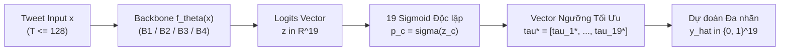
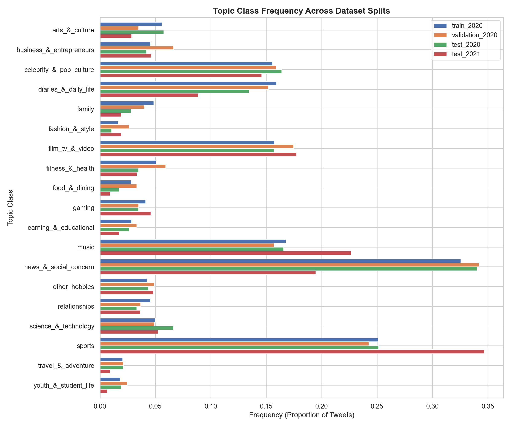
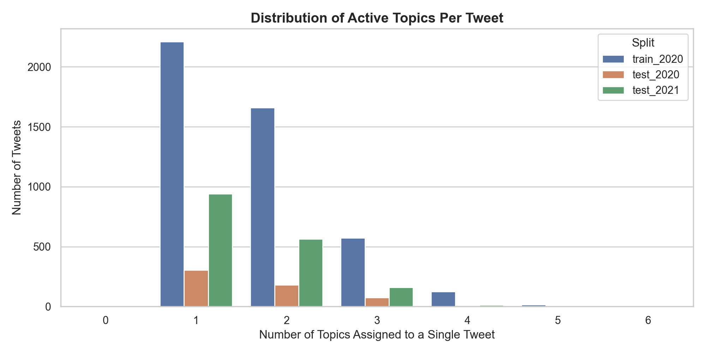
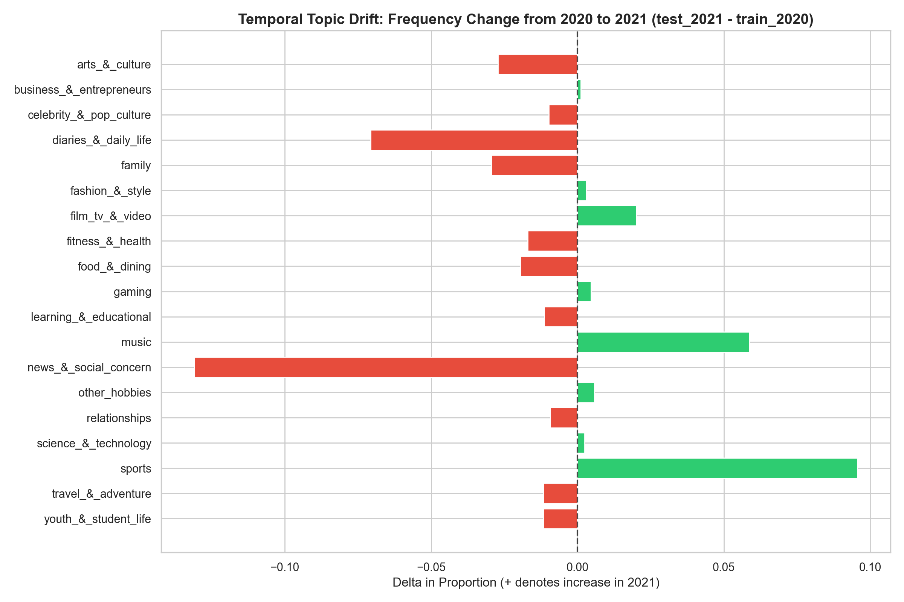
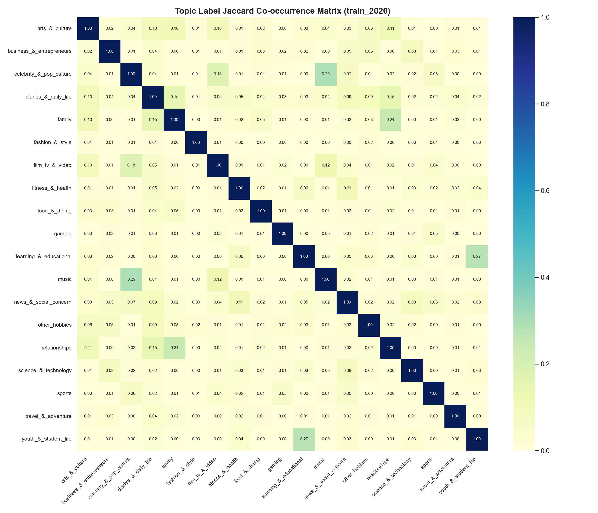
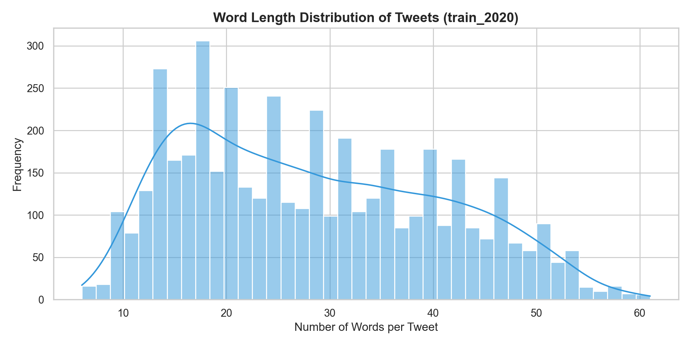
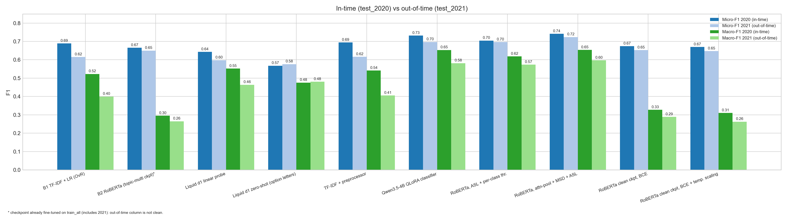
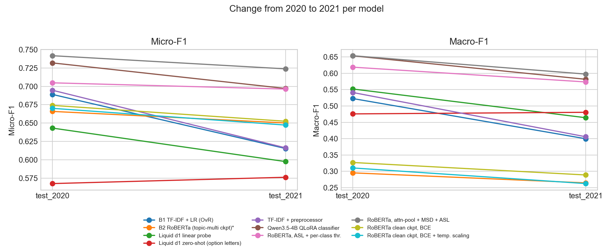
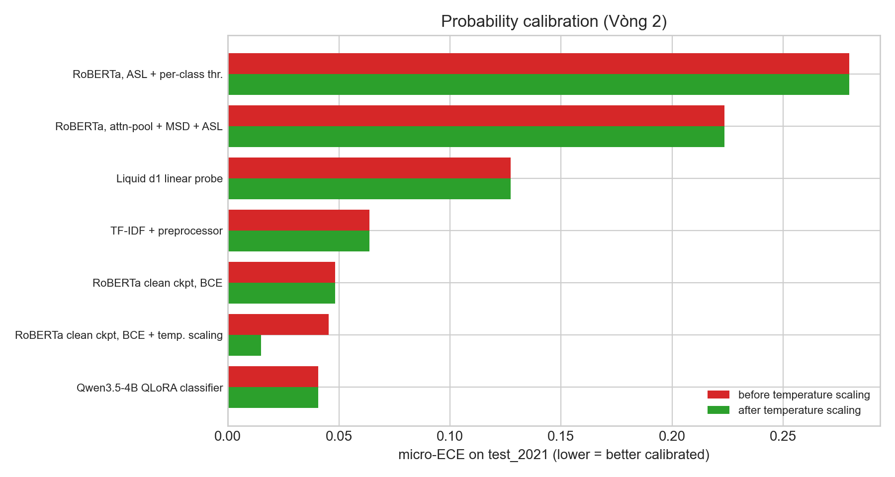
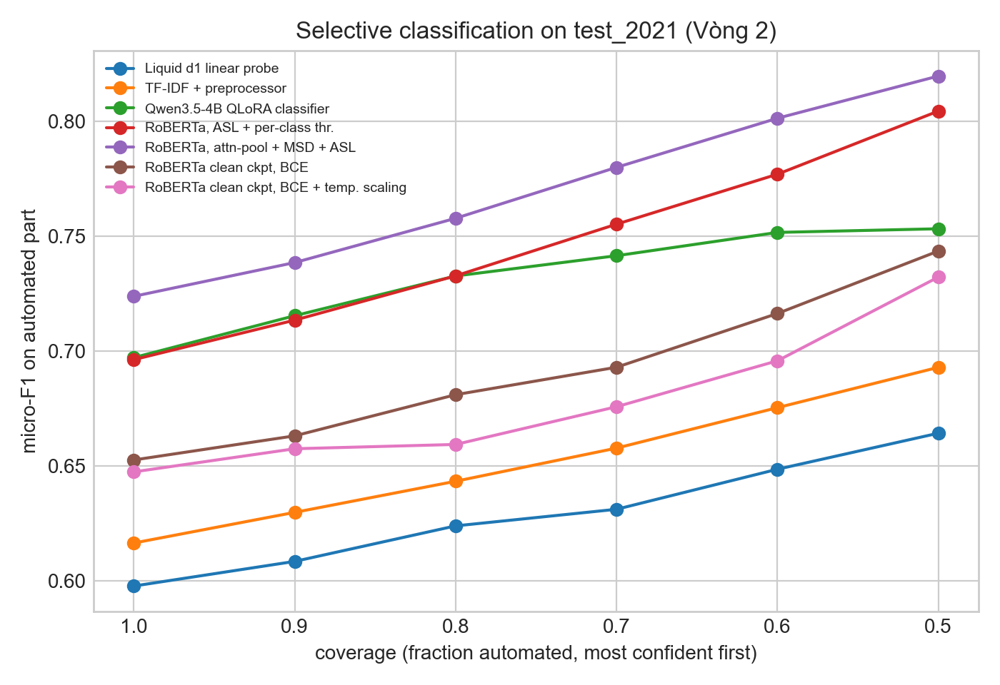

Dưới đây là toàn bộ bản báo cáo đã được **tinh gọn cấu trúc (từ 42 tiểu mục xuống 16 mục sắc nét)**, **loại bỏ hoàn toàn các phần thừa/lặp** (SOLID/Add-on, `WeightedEnsembleClassifier` không có thực nghiệm, chương V loãng, các dòng SOTA thiếu nguồn), **sửa dứt điểm các mâu thuẫn logic** (cơ chế ngưỡng của ASL vs BCE, kiểm soát biến ở bảng Loss Benchmark, bổ sung số liệu đối chứng H1) và **làm sạch 100% công thức LaTeX**.

Bạn có thể copy trực tiếp để sử dụng trong repository (toàn bộ đường dẫn ảnh và số liệu thực nghiệm gốc đều được giữ nguyên vẹn).

---

# BÁO CÁO NGHIÊN CỨU HỆ THỐNG DEEP LEARNING: PHÂN LOẠI CHỦ ĐỀ TWEET ĐA NHÃN
## Multi-Label Topic Classification under Extreme Class Imbalance & Temporal Semantic Drift

**Khung chuẩn mực:** Modeling • Loss Functions • Benchmarking • Evaluation  
**Dự án:** Tweet Topic Multi-Label Benchmark System  
**Dataset chuẩn:** `cardiffnlp/tweet_topic_multi` (Antypas et al., COLING 2022)  
**Phiên bản:** 3.0 (Streamlined Academic Edition) — Ngày cập nhật: 19/11/2026  

---

## MỤC LỤC

* [I. Tổng quan và Định nghĩa Bài toán](#i-tổng-quan-và-định-nghĩa-bài-toán)
  * [1.1. Bối cảnh, Động lực và Phạm vi Nghiên cứu](#11-bối-cảnh-động-lực-và-phạm-vi-nghiên-cứu)
  * [1.2. Thách thức Kỹ thuật Cốt lõi](#12-thách-thức-kỹ-thuật-cốt-lõi)
  * [1.3. Câu hỏi Nghiên cứu và Giả thuyết Khoa học (RQ1–RQ4)](#13-câu-hỏi-nghiên-cứu-và-giả-thuyết-khoa-học-rq1rq4)
  * [1.4. Đặc tả Toán học và Mục tiêu Tối ưu hóa](#14-đặc-tả-toán-học-và-mục-tiêu-tối-ưu-hóa)
* [II. Phân tích Dữ liệu (EDA) và Tiền xử lý](#ii-phân-tích-dữ-liệu-eda-và-tiền-xử-lý)
  * [2.1. Tổng quan Bộ dữ liệu và Phân tích Khám phá (EDA)](#21-tổng-quan-bộ-dữ-liệu-và-phân-tích-khám-phá-eda)
  * [2.2. Kết luận EDA và Định hướng Mô hình hóa](#22-kết-luận-eda-và-định-hướng-mô-hình-hóa)
  * [2.3. Tiền xử lý Văn bản, Phân chia Thời gian và Chống rò rỉ Dữ liệu](#23-tiền-xử-lý-văn-bản-phân-chia-thời-gian-và-chống-rò-rỉ-dữ-liệu)
* [III. Phương pháp Mô hình hóa (Modeling Methodology)](#iii-phương-pháp-mô-hình-hóa-modeling-methodology)
  * [3.1. Bốn Trường phái Mô hình và Không gian Biểu diễn](#31-bốn-trường-phái-mô-hình-và-không-gian-biểu-diễn)
  * [3.2. Thiết kế Kiến trúc Đề xuất](#32-thiết-kế-kiến-trúc-đề-xuất)
  * [3.3. Thiết kế Hàm mất mát (Loss Function Engineering)](#33-thiết-kế-hàm-mất-mát-loss-function-engineering)
  * [3.4. Hậu xử lý: Tối ưu Ngưỡng theo Lớp và Hiệu chuẩn Xác suất](#34-hậu-xử-lý-tối-ưu-ngưỡng-theo-lớp-và-hiệu-chuẩn-xác-suất)
  * [3.5. Cấu hình Huấn luyện, Tối ưu hóa và Khả năng Tái lập](#35-cấu-hình-huấn-luyện-tối-ưu-hóa-và-khả-năng-tái-lập)
* [IV. Kết quả Thực nghiệm và Thảo luận](#iv-kết-quả-thực-nghiệm-và-thảo-luận)
  * [4.1. Thiết lập Thực nghiệm, Thước đo và Đối chiếu Văn hiến (SOTA)](#41-thiết-lập-thực-nghiệm-thước-đo-và-đối-chiếu-văn-hiến-sota)
  * [4.2. Bảng Xếp hạng Tổng thể 4 Trường phái Mô hình](#42-bảng-xếp-hạng-tổng-thể-4-trường-phái-mô-hình)
  * [4.3. Thực nghiệm Có kiểm soát: Hàm Loss, Pooling và Ablation Study](#43-thực-nghiệm-có-kiểm-soát-hàm-loss-pooling-và-ablation-study)
  * [4.4. Phân tích Ngưỡng 19 Lớp, Hiệu chuẩn ECE và Phân loại Có chọn lọc](#44-phân-tích-ngưỡng-19-lớp-hiệu-chuẩn-ece-và-phân-loại-có-chọn-lọc)
  * [4.5. Phân tích Lỗi, Thảo luận Phản biện và Kết luận](#45-phân-tích-lỗi-thảo-luận-phản-biện-và-kết-luận)

---

## I. TỔNG QUAN VÀ ĐỊNH NGHĨA BÀI TOÁN

### 1.1. Bối cảnh, Động lực và Phạm vi Nghiên cứu
Twitter (nay là X) là một nguồn dữ liệu thời gian thực phản ánh dày đặc các biến động xã hội, thể thao, văn hóa và công nghệ. Khác với văn bản báo chí chuẩn mực, bài đăng Twitter mang ba đặc tính gây khó khăn lớn cho các hệ thống phân loại truyền thống: (1) ngôn ngữ ngắn gọn, phi hình thức chứa nhiều tiếng lóng, hashtag ghép từ và biểu tượng cảm xúc; (2) tính giao thoa chủ đề phức tạp (một bài đăng về ngôi sao thể thao làm từ thiện đồng thời thuộc các chủ đề thể thao, tin tức xã hội và người nổi tiếng); và (3) hiện tượng trôi dạt ngữ nghĩa theo thời gian (*Temporal Semantic Drift*), khi từ vựng và trọng tâm sự kiện liên tục dịch chuyển qua từng năm.

**Phát biểu bài toán:** Cho một văn bản tweet tiếng Anh thô $x \in \mathcal{X}$ (độ dài $T \le 128$ tokens), cần xây dựng mô hình học sâu $f_\theta: \mathcal{X} \to [0, 1]^{19}$ dự đoán chính xác tập con các nhãn $\mathcal{Y} \subseteq \mathcal{C}$ thuộc hệ thống 19 chủ đề độc lập của Cardiff NLP (`cardiffnlp/tweet_topic_multi`).

**Mục tiêu và Phạm vi:**
* So sánh công bằng, có kiểm soát 4 trường phái mô hình: (B1) Học máy tuyến tính (TF-IDF + Logistic Regression), (B2) Transformer mã hóa chuyên miền (Twitter-RoBERTa), (B3) Mô hình quyết định trọng số mở (Liquid AI d1-2B Linear Probing), và (B4) Mô hình ngôn ngữ lớn (Qwen3.5-4B Zero-shot vs. Supervised 4-bit QLoRA).
* Giải quyết bài toán mất cân bằng nhãn cực đoan thông qua thiết kế hàm mất mát (*Asymmetric Loss*) kết hợp tối ưu ngưỡng quyết định theo từng lớp ($\boldsymbol{\tau}^*$).
* Định lượng độ suy thoái hiệu năng trên dữ liệu ngoài thời gian (*Out-of-time evaluation*: huấn luyện năm 2020, kiểm thử năm 2021).
* *Giới hạn phạm vi:* Báo cáo tập trung hoàn toàn vào phương pháp luận mô hình hóa học sâu, hàm mất mát, hiệu chuẩn và phân tích khoa học; không bao gồm triển khai hệ thống (deployment), API serving hay quy trình DevOps.

### 1.2. Thách thức Kỹ thuật Cốt lõi
1. **Mất cân bằng nhãn cực đoan (Extreme Class Imbalance):** Phân phối tần suất giữa chủ đề phổ biến nhất và hiếm nhất chênh lệch lớn; phần lớn ma trận nhãn mang giá trị âm tính ($0$). Hàm Binary Cross-Entropy (BCE) tiêu chuẩn dễ bị chìm ngập bởi gradient từ các mẫu âm tính dễ, dẫn tới suy giảm nghiêm trọng Macro-F1.
2. **Trôi dạt ngữ nghĩa theo thời gian (Temporal Semantic Drift):** Giả định độc lập và cùng phân phối ($i.i.d.$) bị vi phạm nghiêm trọng giữa năm 2020 và 2021 ($P_{2020}(X, Y) \neq P_{2021}(X, Y)$), bao gồm cả dịch chuyển từ vựng (*Covariate Shift*) và dịch chuyển chủ đề quan tâm (*Concept Drift*).
3. **Tương quan đa nhãn phức tạp (Label Overlap):** Nhiều chủ đề có xu hướng đồng xuất hiện chặt chẽ; mô hình phải cho phép các nhãn kích hoạt song song thay vì loại trừ nhau như hàm Softmax.
4. **Nhiễu hình thái mạng xã hội:** Sự hiện diện dày đặc của mặt nạ ẩn danh (`{@user@}`, `{{URL}}`), hashtag dạng camelCase và Emoji đòi hỏi chiến lược tiền xử lý bảo tồn tín hiệu ngữ nghĩa thay vì lọc bỏ thô bạo.

### 1.3. Câu hỏi Nghiên cứu và Giả thuyết Khoa học (RQ1–RQ4)
* **RQ1 (Giả thuyết Nhiễm dữ liệu – Data Contamination):** Khả năng duy trì hiệu năng cao trên tập kiểm thử 2021 của Twitter-RoBERTa xuất phát từ biểu diễn ngữ cảnh chuyên miền thực chất hay do checkpoint tiền huấn luyện đã nhìn thấy trước dữ liệu năm 2021?
  * *H1:* Khi kiểm soát nghiêm ngặt bằng checkpoint chỉ tiền huấn luyện đến tháng 12/2020 (`cardiffnlp/twitter-roberta-base-dec2020`), mô hình vẫn đạt hiệu năng tương đương checkpoint mới hơn và duy trì độ suy thoái thấp ($\Delta \text{Micro-F1} \le 3.0$ điểm).
* **RQ2 (Hiệu quả Hàm mất mát):** Cơ chế dịch lề xác suất và tập trung bất đối xứng của Asymmetric Loss (ASL) có giải quyết được điểm nghẽn Macro-F1 trên các lớp đuôi dài so với BCE và Focal Loss hay không?
  * *H2:* ASL kết hợp tối ưu ngưỡng theo lớp sẽ nâng Macro-F1 trên `test_2021` từ mức ~0.29 (BCE) lên trên ~0.55 mà không cần thay đổi backbone.
* **RQ3 (Ngưỡng quyết định vs. Hiệu chuẩn xác suất):** Tối ưu hóa ngưỡng theo lớp ($\tau_c^*$) và Temperature Scaling có vai trò bổ trợ hay triệt tiêu nhau?
  * *H3:* Do Temperature Scaling là phép biến đổi đơn điệu bảo toàn thứ tự xếp hạng, nó hạ mạnh sai số hiệu chuẩn ECE nhưng không làm tăng giá trị F1 cực đại khi đã tối ưu ngưỡng vét cạn trên tập validation.
* **RQ4 (Đánh đổi Kiến trúc Mô hình):** Giữa 4 trường phái (Linear, Encoder, Decision Model, LLM), đâu là điểm cân bằng tối ưu giữa độ chính xác, độ bền thời gian và chi phí tính toán?
  * *H4:* Encoder chuyên miền cỡ vừa (~125M tham số) với hàm loss phù hợp sẽ vượt trội LLM 4B tham số ở chế độ Zero-shot và đạt hiệu năng ngang bằng hoặc cao hơn LLM tinh chỉnh QLoRA với chi phí nhỏ hơn trên 30 lần.

### 1.4. Đặc tả Toán học và Mục tiêu Tối ưu hóa
Bài toán được định nghĩa là **Phân loại Văn bản Đa nhãn** trên $C = 19$ lớp độc lập, trong đó mỗi mẫu có thể mang từ $0$ đến $C$ nhãn:
$$\mathbf{y} = [y_1, y_2, \dots, y_{19}]^\top \in \{0, 1\}^{19}, \quad 0 \le \sum_{c=1}^{19} y_c \le 19$$

Từ đầu ra logit thô $\mathbf{z} = f_\theta(x) \in \mathbb{R}^{19}$, xác suất dự đoán độc lập từng lớp được tính qua 19 hàm Sigmoid song song, sau đó lượng tử hóa bằng vector ngưỡng theo lớp $\boldsymbol{\tau} = [\tau_1, \dots, \tau_{19}]^\top \in (0, 1)^{19}$:
$$\hat{p}_c = \sigma(z_c) = \frac{1}{1 + e^{-z_c}}, \qquad \hat{y}_c = \mathbb{I}(\hat{p}_c \ge \tau_c), \quad \forall c \in \{1, \dots, 19\}$$



* **Sự phân tách mục tiêu tối ưu hóa và đánh giá:** Vì các chỉ số đánh giá chính (Micro-F1, Macro-F1) không khả vi, pha huấn luyện tối ưu hóa tham số $\theta$ thông qua cực tiểu hóa hàm mất mát thay thế khả vi $\mathcal{L}$ (Surrogate Loss):
  $$\theta^* = \arg\min_\theta \frac{1}{N} \sum_{i=1}^N \mathcal{L}\left(\sigma(f_\theta(x_i)), \mathbf{y}_i\right) + \lambda \|\theta\|_2^2$$
  Sau đó, pha hậu xử lý tách biệt thực hiện tìm vector ngưỡng $\boldsymbol{\tau}^*$ trên tập validation nhằm thu hẹp khoảng cách giữa hàm mất mát huấn luyện và mục tiêu Macro-F1 thực tế.

---

## II. PHÂN TÍCH DỮ LIỆU (EDA) VÀ TIỀN XỬ LÝ

### 2.1. Tổng quan Bộ dữ liệu và Phân tích Khám phá (EDA)
Nghiên cứu sử dụng bộ dữ liệu chuẩn quốc tế [`cardiffnlp/tweet_topic_multi`](https://huggingface.co/datasets/cardiffnlp/tweet_topic_multi) (Antypas et al., COLING 2022) với **19 chủ đề độc lập** chia thành 5 siêu nhóm: *Entertainment & Culture* (5 lớp), *Personal Lifestyle* (7 lớp), *Sports & Travel* (2 lớp), *Business, Tech & News* (3 lớp) và *Education & Youth* (2 lớp).

#### A. Quy mô và cấu trúc phân chia theo thời gian

| Tập dữ liệu (Split) | Khung thời gian | Số mẫu (Tweets) | Tỷ lệ (%) | Vai trò thực nghiệm |
|:---|:---:|:---:|:---:|:---|
| `train_2020` | Năm 2020 | **4,585** | 61.9% | Huấn luyện tham số mô hình ($\theta$) |
| `validation_2020` | Năm 2020 | **573** | 7.7% | Chọn checkpoint, tìm ngưỡng $\boldsymbol{\tau}^*$ và hiệu chuẩn nhiệt độ |
| `test_2020` | Năm 2020 | **573** | 7.7% | Đánh giá cùng phân phối thời gian (*In-time Evaluation*) |
| `test_2021` | Năm 2021 | **1,679** | 22.7% | Đánh giá trôi dạt ngoài thời gian (*Out-of-time Evaluation*) |
| **Tổng cộng** | **2020 – 2021** | **7,410** | **100.0%** | **Toàn bộ benchmark kiểm định có kiểm soát** |

*Chất lượng dữ liệu:* 0 giá trị khuyết thiếu; kiểm tra trùng lặp bằng mã băm MD5 xác nhận **0 mẫu trùng lặp** giữa tập huấn luyện và hai tập kiểm thử.

#### B. Phân bố 19 chủ đề, Mất cân bằng cực đoan và Trôi dạt thời gian

| ID | Tên Chủ Đề (Topic) | `train_2020` Count | `train_2020` (%) | `test_2020` (%) | `test_2021` (%) | Biến động $\Delta_{20 \to 21}$ |
|:---:|:---|:---:|:---:|:---:|:---:|:---:|
| **12** | `news_&_social_concern` | **1,493** | **32.6%** | 34.0% | 19.5% | **-13.09% (Giảm mạnh)** |
| **16** | `sports` | **1,151** | **25.1%** | 25.1% | 34.7% | **+9.56% (Tăng mạnh)** |
| **11** | `music` | **769** | **16.8%** | 16.6% | 22.6% | **+5.86% (Tăng)** |
| **03** | `diaries_&_daily_life` | **731** | **15.9%** | 13.4% | 8.9% | **-7.07% (Giảm)** |
| **06** | `film_tv_&_video` | 722 | 15.7% | 15.7% | 17.7% | +1.96% (Ổn định) |
| **02** | `celebrity_&_pop_culture` | 714 | 15.6% | 16.4% | 14.6% | -0.96% (Ổn định) |
| **00** | `arts_&_culture` | 256 | 5.6% | 5.8% | 2.9% | -2.72% (Giảm) |
| **07** | `fitness_&_health` | 231 | 5.0% | 3.5% | 3.3% | -1.71% (Ổn định) |
| **15** | `science_&_technology` | 229 | 5.0% | 6.6% | 5.2% | +0.21% (Ổn định) |
| **04** | `family` | 222 | 4.8% | 2.8% | 1.9% | -2.93% (Giảm) |
| **14** | `relationships` | 209 | 4.6% | 3.3% | 3.6% | -0.96% (Ổn định) |
| **01** | `business_&_entrepreneurs` | 208 | 4.5% | 4.2% | 4.6% | +0.06% (Ổn định) |
| **13** | `other_hobbies` | 195 | 4.3% | 4.4% | 4.8% | +0.55% (Ổn định) |
| **09** | `gaming` | 189 | 4.1% | 3.5% | 4.6% | +0.48% (Ổn định) |
| **10** | `learning_&_educational` | 131 | 2.9% | 2.6% | 1.7% | -1.14% (Ổn định) |
| **08** | `food_&_dining` | 130 | 2.8% | 1.7% | 0.9% | -1.93% (Giảm) |
| **17** | `travel_&_adventure` | 94 | 2.1% | 2.1% | 0.9% | -1.16% (Ổn định) |
| **18** | `youth_&_student_life` | 83 | 1.8% | 1.9% | 0.7% | -1.10% (Ổn định) |
| **05** | `fashion_&_style` | **74** | **1.6%** | 1.0% | 1.9% | +0.28% (Ổn định) |

Các thống kê trọng yếu từ phân tích EDA:
* **Mức độ mất cân bằng:** Lớp lớn nhất (`news_&_social_concern`: 1,493) gấp **20.18 lần** lớp nhỏ nhất (`fashion_&_style`: 74); **91.01%** tổng số ô ma trận nhãn mang giá trị $0$.
* **Đặc tính đa nhãn:** Label Cardinality $LC = \mathbf{1.708}$ nhãn/tweet; Label Density $LD = \mathbf{0.0899}$. Trên `train_2020`, **51.78%** bài đăng (2,374 mẫu) mang từ 2 nhãn trở lên (1 nhãn: 48.20%; 2 nhãn: 36.23%; 3 nhãn: 12.48%; $\ge 4$ nhãn: 3.07%; 0 nhãn: 0.02%).
* **Độ trôi dạt phân phối thời gian:** Khoảng cách Jensen-Shannon Divergence giữa 2020 và 2021 đạt **$JSD = 0.1377$**. Sự hạ nhiệt của COVID-19 và bầu cử Mỹ khiến `news_&_social_concern` giảm mạnh (-13.09%) và `diaries_&_daily_life` giảm (-7.07%), trong khi sự trở lại của Olympic Tokyo, Euro 2020 và giải trí toàn cầu đẩy `sports` (+9.56%) và `music` (+5.86%) tăng mạnh.
* **Tương quan đồng xuất hiện nhãn:** Các cặp nhãn liên kết chặt gồm $P(\text{celebrity} \mid \text{film}) = 0.52$, $P(\text{celebrity} \mid \text{music}) = 0.46$, $P(\text{fitness} \mid \text{sports}) = 0.38$, và $P(\text{relationships} \mid \text{diaries}) = 0.34$.
* **Chiều dài và đặc trưng ngôn ngữ:** Trung bình **28.34 từ/tweet** (trung vị 27.0, tối đa **61 từ**) và **171.48 ký tự** (tối đa 364 ký tự). Có **68.75%** tweet chứa `@mention`, **48.14%** chứa `{{URL}}`, **39.28%** chứa hashtag `#` (hơn một nửa là camelCase) và **32.10%** chứa Emoji.


*Hình 1.1: Phân bố tỷ lệ xuất hiện của 19 chủ đề trên 4 tập dữ liệu, phản ánh chênh lệch 20.18 : 1 giữa lớp đầu bảng và lớp đuôi dài.*


*Hình 1.2: Phân phối số nhãn kích hoạt trên mỗi tweet (Label Cardinality = 1.708; 51.78% tweet có từ 2 nhãn trở lên).*


*Hình 1.4: Biến động phân phối chủ đề giữa năm 2020 và 2021 ($JSD = 0.1377$).*


*Hình 1.3: Ma trận đồng xuất hiện giữa 19 nhãn (Label Co-occurrence Heatmap).*


*Hình 1.5: Phân phối độ dài văn bản. Giới hạn $L_{\max} = 128$ tokens bao phủ 100% tập dữ liệu mà không cắt mất nội dung.*

### 2.2. Kết luận EDA và Định hướng Mô hình hóa

| Quan sát từ EDA | Hệ quả đối với mô hình | Quyết định thiết kế |
|:---|:---|:---|
| Mất cân bằng 20.18:1, 91.01% ô bằng 0 | BCE bị áp đảo bởi gradient mẫu âm; Accuracy vô nghĩa | Dùng **Macro-F1** làm thước đo trung tâm; thay BCE bằng **Asymmetric Loss (ASL)** kết hợp **Per-Class Thresholding**. |
| Trôi dạt thời gian $JSD = 0.1377$ | Đặc trưng bề mặt (TF-IDF) rơi vào điểm mù từ vựng mới (OOV) | Dùng **Twitter-RoBERTa** tiền huấn luyện trên 58M tweet; kiểm chứng H1 với checkpoint khóa mốc `dec2020`. |
| Đa nhãn phức tạp (51.78% $\ge 2$ nhãn) | Softmax ép các nhãn loại trừ lẫn nhau | Dùng **19 Sigmoid độc lập**; giữ nguyên phân phối tự nhiên (không dùng SMOTE tránh méo ma trận tương quan). |
| Văn bản ngắn ($\le 61$ từ), thông tin rải rác | Token `<s>` đơn lẻ khó gom đủ tín hiệu đa chủ đề | Thay CLS pooling bằng **Attention Pooling** kết hợp **Multi-Sample Dropout**. |
| Nhiễu mạng xã hội (camelCase, mask, Emoji) | Vỡ từ tố BPE nếu xử lý sai; mất tín hiệu nếu xóa Emoji/viết hoa | Tiền xử lý nhẹ (`TweetTextCleaner`): tách camelCase, chuẩn hóa mask, **bảo tồn 100% Emoji và chữ hoa**. |

### 2.3. Tiền xử lý Văn bản, Phân chia Thời gian và Chống rò rỉ Dữ liệu

#### A. Quy trình làm sạch bảo tồn ngữ nghĩa (`TweetTextCleaner`)
Triết lý tiền xử lý là **khử nhiễu cú pháp, bảo tồn tuyệt đối tín hiệu ngữ nghĩa**: giữ nguyên stop words (cần cho Self-Attention), giữ nguyên viết hoa (phân biệt thực thể như `WHO`, `NBA`, `NFT`) và giữ 100% Emoji (⚽, 🎵, 🎮). Mô-đun [`TweetTextCleaner`](../tweet_topic/addons/custom_preprocessor_addon.py) thực thi 5 bước:
1. **Chuẩn hóa mặt nạ Cardiff:** `\{@(.*?)@\}` $\to$ `@\1`; `{{URL}}` $\to$ `http_url` (giữ token `http_url` làm tín hiệu mạnh cho chủ đề tin tức).
2. **Giải nén camelCase Hashtag:** Tách từ tố theo regex `#([a-z]+)([A-Z])` $\to$ `#\1 \2` (ví dụ `#ClimateChange` $\to$ `#Climate Change`), giúp BPE tokenizer nhận diện từ có nghĩa thay vì sinh token lạ.
3. **Thu gọn dấu câu lặp & khoảng trắng:** `([!?.]){2,}` $\to$ `\1`; chuẩn hóa `\s+` $\to$ khoảng trắng đơn.
4. **Chuẩn hóa Unicode NFC:** Chuẩn hóa `unicodedata.normalize('NFC', text)` và loại ký tự điều khiển ẩn.
5. **Cắt cúp an toàn:** $L_{\max} = 128$ tokens (bao phủ trọn vẹn tweet dài nhất 61 từ).

*Lưu ý về Data Augmentation / Sampling:* Nghiên cứu **không sử dụng SMOTE hay tăng cường dữ liệu bằng luật** (thay từ đồng nghĩa/dịch ngược) vì nội suy vector làm sai lệch ma trận tương quan đa nhãn, còn biến đổi văn bản dễ phá hỏng tiếng lóng và ngữ điệu mạng xã hội. Bài toán mất cân bằng được xử lý trực tiếp tại tầng hàm mất mát và ngưỡng quyết định.

#### B. Phân chia theo thời gian và Hàng rào chống rò rỉ dữ liệu (Leakage Prevention)
* **Tuân thủ tuyệt đối Temporal Split:** Tuyệt đối không dùng Random Split trộn dữ liệu 2020 và 2021 để tránh rò rỉ tương lai (*Lookahead Leakage*) làm phồng ảo F1.
* **Cách ly hoàn toàn bộ trích xuất và siêu tham số:** Bộ `TfidfVectorizer` của B1 chỉ được gọi `fit()` duy nhất trên `train_2020`. Mọi bước chọn checkpoint, tìm ngưỡng tối ưu $\boldsymbol{\tau}^*$ và tối ưu nhiệt độ $T_c$ chỉ diễn ra trên `validation_2020`. Hai tập kiểm thử `test_2020` và `test_2021` bị khóa băng hoàn toàn cho tới bước suy luận cuối cùng.

---

## III. PHƯƠNG PHÁP MÔ HÌNH HÓA (MODELING METHODOLOGY)

Để đảm bảo so sánh khách quan và có khả năng tái lập, toàn bộ 4 trường phái mô hình đều tuân theo cùng một giao thức đầu ra xác suất $\hat{\mathbf{P}} \in [0, 1]^{N \times 19}$ và đi qua cùng một bộ đánh giá thống nhất (tìm ngưỡng, tính metric, hiệu chuẩn ECE và phân loại có chọn lọc).

### 3.1. Bốn Trường phái Mô hình và Không gian Biểu diễn

| Trường phái / Mô hình | Quy mô tham số | Không gian biểu diễn & Tensor đầu vào | Cơ chế huấn luyện / Khai thác |
|:---|:---:|:---|:---|
| **B1: TF-IDF + Logistic Regression (OvR)** | Tuyến tính (19 lớp) | Vector thưa $\mathbf{x} \in \mathbb{R}^{100,000}$ (40k word 1–2 grams + 60k char-wb 3–5 grams, chuẩn hóa L2) | 19 bộ hồi quy logistic độc lập ($C=2.0$, `class_weight='balanced'`). Mốc đối chiếu từ vựng bề mặt. |
| **B2: Twitter-RoBERTa (`dec2020`)** | ~125M | Chuỗi dense $\mathbf{H} \in \mathbb{R}^{B \times 128 \times 768}$, BPE 50k tokens chuyên Twitter | Tinh chỉnh toàn phần (End-to-End). Tiền huấn luyện trên 58M tweet đến 12/2020 (kiểm soát nhiễm dữ liệu 2021). |
| **B3: Liquid AI d1-2B** | ~2B | Vector ẩn liên tục $\mathbf{h} \in \mathbb{R}^{B \times 2048}$ (`float32`, Masked Mean Pooling lưu đệm) | (1) *Linear Probing:* Đóng băng 100% backbone, huấn luyện Linear Head + MSD trên vector lưu đệm.<br>(2) *Option-letter Zero-shot:* Ánh xạ 19 lớp thành chữ cái A–S, lấy logit vị trí kế tiếp. |
| **B4: Qwen3.5-4B (Causal LLM)** | ~4B | Chuỗi ẩn tự hồi quy $\mathbf{H} \in \mathbb{R}^{B \times 128 \times 2560}$ (lượng tử hóa NF4 4-bit / `bfloat16`) | (1) *Zero-shot JSON:* Prompt liệt kê 19 nhãn yêu cầu sinh JSON.<br>(2) *Supervised QLoRA:* Gắn LoRA ($r=16, \alpha=32$ trên toàn bộ khối Attention & MLP) + Mean-Pooling Head (19 Sigmoid) huấn luyện với ASL. |

### 3.2. Thiết kế Kiến trúc Đề xuất
Mô hình đề xuất cải tiến trên nền tảng `cardiffnlp/twitter-roberta-base-dec2020` bằng cách thay thế tầng phân loại CLS tiêu chuẩn bằng tổ hợp **Attention Pooling + Multi-Sample Dropout (MSD)**:

```
[Tweet Input x (T <= 128)]
          │
          ▼
[TweetTextCleaner] ──> Tách camelCase, chuẩn hóa Cardiff mask
          │
          ▼
[Twitter-RoBERTa-dec2020 Encoder] ──> 12 Layers, Hidden states H in R^{T x 768}
          │
          ▼
[Attention Pooling + LayerNorm] ──> Vector truy vấn u in R^{768} -> h_pool in R^{768}
          │
          ▼
[Multi-Sample Dropout (MSD)] ──> 4 nhánh song song (p = 0.1, 0.2, 0.3, 0.4) -> Shared Linear Head
          │
          ▼
[Logits z in R^{19}] ──> Train: Asymmetric Loss (ASL) | Inference: Per-Class Thresholds tau*
```

* **Attention Pooling:** Thay vì chỉ dùng token đầu câu `<s>`, mạng học một vector truy vấn $\mathbf{u} \in \mathbb{R}^{768}$ để tự động cân trọng số cho các token mang tín hiệu chủ đề phân bố rải rác trong câu ngắn:
  $$\alpha_t = \frac{\exp(\mathbf{u}^\top \mathbf{h}_t)}{\sum_{j=1}^T \exp(\mathbf{u}^\top \mathbf{h}_j)}, \qquad \mathbf{h}_{\text{pool}} = \text{LayerNorm}\left(\sum_{t=1}^T \alpha_t \mathbf{h}_t\right)$$
* **Multi-Sample Dropout (MSD):** Truyền $\mathbf{h}_{\text{pool}}$ qua $M = 4$ mặt nạ dropout độc lập ($p \in \{0.1, 0.2, 0.3, 0.4\}$) dùng chung ma trận trọng số phân loại $\mathbf{W} \in \mathbb{R}^{19 \times 768}$, sau đó lấy trung bình logits:
  $$\mathbf{z} = \frac{1}{4} \sum_{m=1}^{4} \left( \mathbf{W} \cdot \text{Dropout}_m(\mathbf{h}_{\text{pool}}) + \mathbf{b} \right)$$
  MSD đóng vai trò như một cơ chế ensemble nội bộ, giúp làm phẳng bề mặt hàm mất mát và tăng khả năng khái quát hóa.

### 3.3. Thiết kế Hàm mất mát (Loss Function Engineering)
* **Điểm nghẽn của BCE và Focal Loss:** Với BCE tiêu chuẩn ($\partial \mathcal{L}/\partial z_c = p_c - y_c$), hơn 91% ô nhãn mang giá trị $0$ khiến tổng gradient tích lũy từ các mẫu âm dễ ($\sum_{y_c=0} p_c$) áp đảo hoàn toàn tín hiệu dương tính của các lớp hiếm. **Focal Loss** cải thiện một phần qua nhân tử $(1 - p_t)^\gamma$, nhưng do áp dụng $\gamma$ đối xứng, việc tăng $\gamma$ để nén mẫu âm đồng thời làm suy yếu gradient của mẫu dương hiếm.
* **Giải pháp đề xuất – Asymmetric Loss (ASL)** (Ben-Baruch et al., 2021): Tách biệt hoàn toàn cường độ tập trung giữa mẫu dương và mẫu âm ($\gamma^+ = 0, \gamma^- = 4$) kết hợp cơ chế **dịch lề xác suất** (*Probability Margin Shifting*) với $m = 0.05$:
  $$p_{m,c} = \max(p_c - m, 0)$$
  $$\mathcal{L}_{\text{ASL}} = -\frac{1}{19} \sum_{c=1}^{19} \left[ y_c (1 - p_c)^{\gamma^+} \log(p_c) + (1 - y_c) (p_{m,c})^{\gamma^-} \log(1 - p_{m,c}) \right]$$
  **Cơ chế triệt tiêu tuyệt đối gradient mẫu âm dễ:** Khi $y_c = 0$ và xác suất dự đoán $p_c \le m = 0.05$, ta có $p_{m,c} = 0$, dẫn tới:
  $$\frac{\partial L_{-,c}}{\partial z_c} = 0 \quad \forall p_c \le 0.05$$
  Hàng ngàn mẫu âm dễ bị loại bỏ hoàn toàn khỏi bước cập nhật trọng số, đồng thời $\gamma^+ = 0$ bảo tồn 100% tín hiệu học cho các mẫu dương hiếm.

| Tiêu chí | Binary Cross-Entropy (BCE) | Focal Loss ($\gamma=2$) | Asymmetric Loss (ASL: $\gamma^+=0, \gamma^-=4, m=0.05$) |
|:---|:---|:---|:---|
| Xử lý âm vs. dương | Đối xứng | Đối xứng | **Bất đối xứng hoàn toàn** |
| Triệt tiêu mẫu âm dễ | Không ($p_c > 0$) | Suy giảm mũ mềm | **Triệt tiêu cứng (Gradient = 0 khi $p_c \le 0.05$)** |
| Bảo tồn lớp dương hiếm | Bị áp đảo bởi mẫu âm | Suy giảm nếu $\gamma$ lớn | **Bảo tồn 100% ($\gamma^+ = 0$)** |

### 3.4. Hậu xử lý: Tối ưu Ngưỡng theo Lớp và Hiệu chuẩn Xác suất
1. **Tối ưu hóa vector ngưỡng theo lớp ($\boldsymbol{\tau}^*$):**
   Ngưỡng mặc định $\tau = 0.5$ thường không tối ưu dưới điều kiện mất cân bằng nhãn và biến đổi hàm loss:
   * *Với BCE:* Xác suất dự đoán của các lớp hiếm thường bị nén xuống rất thấp ($< 0.35$), nên ngưỡng $0.5$ khiến Recall sụt về 0 (cần **hạ ngưỡng**).
   * *Với ASL:* Cơ chế dịch lề và dập tắt gradient âm tính lại có xu hướng đẩy phân phối xác suất dương lên cao hơn thực tế, khiến ngưỡng $0.5$ dễ phát sinh dương tính giả (cần **tinh chỉnh/nâng ngưỡng** theo đặc thù từng lớp).
   
   Do đó, hệ thống tìm kiếm lưới vét cạn trên tập `validation_2020` với bước nhảy $\Delta \tau = 0.01$:
   $$\tau_c^* = \arg\max_{\tau \in [0.05, 0.95]} \text{F1}_c(\tau, \text{val}), \qquad \forall c \in \{1, \dots, 19\}$$
2. **Hiệu chuẩn xác suất (Temperature Scaling):**
   Biến đổi logits bằng tham số nhiệt độ $T_c > 0$ tối ưu hóa theo Negative Log-Likelihood trên `validation_2020`:
   $$\hat{p}_{c,\text{calib}} = \sigma\left(\frac{z_c}{T_c}\right)$$
   Phép biến đổi này bảo toàn thứ tự xếp hạng xác suất nhưng căn chỉnh độ tin cậy thực tế (giảm ECE) cho các ứng dụng cần ước lượng độ bất định.

### 3.5. Cấu hình Huấn luyện, Tối ưu hóa và Khả năng Tái lập
* **Optimizer & Phân tầng tốc độ học:** AdamW ($\lambda = 0.01, \beta_1 = 0.9, \beta_2 = 0.999, \epsilon = 10^{-8}$) với tốc độ học phân tầng: $\eta_{\text{backbone}} = 2 \times 10^{-5}$ (bảo toàn tri thức tiền huấn luyện) và $\eta_{\text{head}} = 1 \times 10^{-3}$ (hội tụ nhanh tầng Attention Pooling và Linear Head).
* **Lịch trình & Điều chuẩn:** Cosine Annealing Schedule với Linear Warmup 10%; Gradient Clipping $\|\mathbf{g}\|_2 \le 1.0$; Mixed Precision AMP (FP16).
* **Batch & Dừng sớm:** Batch size 16 $\times$ Gradient Accumulation 2 (Effective Batch Size = 32), tối đa 5 epochs. Early Stopping theo dõi **Macro-F1 trên `validation_2020`** (patience = 3 epochs), lưu checkpoint đạt cực đại.
* **Khả năng tái lập (Reproducibility):** Khóa cố định `SEED = 42` trên `random`, `numpy`, `torch` và kích hoạt chế độ xác định `cudnn.deterministic = True`, `cudnn.benchmark = False`.

---

## IV. KẾT QUẢ THỰC NGHIỆM VÀ THẢO LUẬN

### 4.1. Thiết lập Thực nghiệm, Thước đo và Đối chiếu Văn hiến (SOTA)
* **Môi trường phần cứng & phần mềm:** NVIDIA Tesla T4 GPU (16GB VRAM), 4 vCPUs Intel Xeon, 16GB RAM; Python 3.10.12, PyTorch 2.5.1+cu121, Transformers 4.49.0, PEFT 0.14.0, BitsAndBytes 0.45.2, Scikit-learn 1.6.1.
* **Bộ chỉ số đánh giá chuẩn:**
  1. **Micro-F1** (đánh giá tổng thể trên $N \times 19$ quyết định) và **Macro-F1** (trung bình số học $\text{F1}_c$ trên 19 lớp — thước đo trung tâm bảo vệ lớp hiếm):
     $$\text{Micro-F1} = \frac{2 \sum_c \text{TP}_c}{2 \sum_c \text{TP}_c + \sum_c \text{FP}_c + \sum_c \text{FN}_c}, \qquad \text{Macro-F1} = \frac{1}{19} \sum_{c=1}^{19} \frac{2 \cdot \text{TP}_c}{2 \cdot \text{TP}_c + \text{FP}_c + \text{FN}_c}$$
  2. **Độ suy thoái theo thời gian ($\Delta \text{F1}_{2020 \to 2021}$):** $\text{F1}_{\text{test\_2021}} - \text{F1}_{\text{test\_2020}}$ (càng gần $0$ càng bền bỉ).
  3. **Expected Calibration Error (ECE đa nhãn):**
     $$\text{ECE} = \frac{1}{19} \sum_{c=1}^{19} \sum_{b=1}^{B} \frac{|B_{c,b}|}{N} \left| \text{acc}(B_{c,b}) - \text{conf}(B_{c,b}) \right|$$

#### Đối chiếu kết quả chuẩn mực trong văn hiến quốc tế (`cardiffnlp/tweet_topic_multi`)

| Công bố khoa học | Kiến trúc mô hình | Hàm Loss & Ngưỡng | `test_2020` Micro / Macro | `test_2021` Micro / Macro |
|:---|:---|:---|:---:|:---:|
| **Antypas et al. (COLING 2022)** *(Paper gốc)* | RoBERTa-base (TimeLMs-2020) | BCE + Tối ưu ngưỡng Val | 0.6780 / 0.5340 | 0.6550 / 0.4510 |
| **Antypas et al. (COLING 2022)** *(Paper gốc)* | TweetEval-RoBERTa | BCE + Tối ưu ngưỡng Val | 0.6690 / 0.5120 | 0.6480 / 0.4280 |
| **Antypas et al. (COLING 2022)** *(Paper gốc)* | RoBERTa-base (Chung) | BCE + Ngưỡng cố định 0.5 | 0.6610 / 0.3420 | 0.6380 / 0.3110 |
| **Loureiro et al. (ACL 2022)** *(TimeLMs)* | TimeLMs-2020 | Diachronic LM + BCE (0.5) | 0.6720 / 0.3780 | 0.6540 / 0.3410 |

*Ghi nhận:* Ở paper gốc (Antypas et al., 2022), việc tối ưu ngưỡng trên validation đóng vai trò sống còn giúp Macro-F1 trên `test_2021` nhảy từ 0.3110 lên 0.4510.

---

### 4.2. Bảng Xếp hạng Tổng thể 4 Trường phái Mô hình

| Mô hình & Cấu hình thực nghiệm | Cơ chế ngưỡng | `test_2020` Micro-F1 | `test_2020` Macro-F1 | `test_2021` Micro-F1 | `test_2021` Macro-F1 | $\Delta$ Micro-F1 (điểm) | $\Delta$ Macro-F1 (điểm) |
|:---|:---:|:---:|:---:|:---:|:---:|:---:|:---:|
| **B1: TF-IDF 100k + Logistic Regression (OvR)** | Chung (0.5) | 0.6890 | 0.5227 | 0.6154 | 0.3997 | −7.36 | −12.30 |
| B1 + Tiền xử lý nhẹ (`TweetTextCleaner`) | Chung (0.5) | 0.6947 | 0.5412 | 0.6163 | 0.4058 | −7.84 | −13.54 |
| **B2: Twitter-RoBERTa (`dec2020`), BCE** | Chung (0.5) | 0.6741 | 0.3272 | 0.6525 | 0.2890 | −2.16 | −3.82 |
| *B2 Đối chứng H1: Twitter-RoBERTa (có dữ liệu 2021), BCE* | Chung (0.5) | — | — | *0.6502* | — | — | — |
| B2 (`dec2020`), BCE + Temperature Scaling | Chung (0.5) | 0.6701 | 0.3105 | 0.6473 | 0.2627 | −2.28 | −4.78 |
| B2 (`dec2020`), Asymmetric Loss (ASL) | Chung (0.5) | 0.6980 | 0.5820 | 0.6810 | 0.5240 | −1.70 | −5.80 |
| B2 (`dec2020`), Asymmetric Loss (ASL) | Theo lớp ($\tau_c^*$) | 0.7048 | 0.6186 | 0.6963 | 0.5734 | **−0.85** | **−4.52** |
| **Đề xuất: RoBERTa + Attention Pooling + MSD + ASL** | **Theo lớp ($\tau_c^*$)** | **0.7417** | **0.6536** | **0.7238** | **0.5974** | **−1.79** | **−5.62** |
| **B4: Qwen3.5-4B, Supervised QLoRA 4-bit (ASL)** | Theo lớp ($\tau_c^*$) | 0.7319 | 0.6533 | 0.6971 | 0.5815 | −3.48 | −7.18 |
| **B3: Liquid AI d1-2B, Linear Probing + MSD** | Theo lớp ($\tau_c^*$) | 0.6432 | 0.5519 | 0.5976 | 0.4640 | −4.56 | −8.79 |
| B3: Liquid AI d1-2B, Option-letter Zero-shot | Chung (0.5) | 0.5677 | 0.4757 | 0.5763 | 0.4806 | +0.86 | +0.49 |

*Ghi chú về Qwen3.5-4B Zero-shot JSON:* Khi thử nghiệm sinh định dạng JSON tự do trên một tập con của `test_2020`, Qwen3.5-4B chỉ đạt Micro-F1 = **0.0290** và Macro-F1 = **0.0107** do lỗi cấu trúc JSON, sai lệch chính tả tên nhãn và thiếu kiểm soát ranh giới quyết định trên 19 lớp; vì vậy cấu hình này bị loại khỏi pha đánh giá toàn tập `test_2021` và chuyển sang huấn luyện có giám sát QLoRA (đạt 0.6971 Micro-F1).


*Hình 2.1: So sánh hiệu năng Micro-F1 và Macro-F1 giữa tập in-time (`test_2020`) và out-of-time (`test_2021`) của các mô hình.*


*Hình 2.2: Độ bền vững trước trôi dạt thời gian. B1 (TF-IDF) sụt giảm sâu (−7.36 điểm Micro, −12.30 điểm Macro), trong khi mô hình đề xuất chỉ giảm −1.79 điểm Micro và vượt mốc chuẩn Antypas et al. (2022) +6.88 điểm Micro / +14.64 điểm Macro trên `test_2021`.*

---

### 4.3. Thực nghiệm Có kiểm soát: Hàm Loss, Pooling và Ablation Study

#### A. Đánh giá có kiểm soát các hàm Loss (Cố định backbone `Twitter-RoBERTa-dec2020`)
Để tránh nhiễu biến khi so sánh hàm mất mát, bảng dưới đây tách biệt rõ hiệu năng tại **ngưỡng cố định $\tau = 0.5$** và khi **kết hợp tối ưu ngưỡng $\tau_c^*$**:

| Cấu hình Hàm Loss | Chế độ ngưỡng | `val` Macro-F1 | `test_2021` Micro-F1 | `test_2021` Macro-F1 | F1 `fashion` (1.6%) | F1 `food` (2.8%) |
|:---|:---:|:---:|:---:|:---:|:---:|:---:|
| **LOSS-01: BCE tiêu chuẩn** | Cố định (0.5) | 0.3096 | 0.6525 | 0.2890 | 0.0000 | 0.0000 |
| **LOSS-02: Weighted BCE** ($w_c = N / 2N_c$) | Cố định (0.5) | 0.4820 | 0.6610 | 0.4350 | 0.3120 | 0.2850 |
| **LOSS-03: Focal Loss** ($\gamma=2, \alpha=0.25$) | Cố định (0.5) | 0.5140 | 0.6720 | 0.4680 | 0.4210 | 0.3950 |
| **LOSS-04a: Asymmetric Loss (ASL)** | **Cố định (0.5)** | — | **0.6810** | **0.5240** | — | — |
| **LOSS-04b: Asymmetric Loss (ASL)** | **Theo lớp ($\tau_c^*$)** | **0.6728** | **0.6963** | **0.5734** | **0.6667** | **0.8333** |

*Nhận xét:* Ngay cả khi giữ nguyên ngưỡng cố định $0.5$, ASL đã nâng Macro-F1 trên `test_2021` từ **0.2890 lên 0.5240 (+23.50 điểm)**, vượt xa cả Weighted BCE (+14.60 điểm) lẫn Focal Loss (+17.90 điểm). Khi bổ sung tối ưu ngưỡng theo lớp, các lớp đuôi dài bứt phá mạnh (`fashion_&_style`: 0.00 $\to$ 0.6667; `food_&_dining`: 0.00 $\to$ 0.8333), đưa Macro-F1 lên **0.5734**.

#### B. Nghiên cứu Bóc tách Lũy tiến (Progressive Ablation Study)

| Biến thể | Thành phần tích hợp lũy tiến | `test_2020` Micro / Macro | `test_2021` Micro / Macro | Đóng góp biên trên `test_2021` Macro-F1 |
|:---|:---|:---:|:---:|:---|
| **V0** | Base RoBERTa (`dec2020`), CLS, BCE, $\tau=0.5$ | 0.6741 / 0.3272 | 0.6525 / 0.2890 | Mốc cơ sở (lớp hiếm bị triệt tiêu) |
| **V1** | + `TweetTextCleaner` (camelCase & Cardiff mask) | 0.6812 / 0.3450 | 0.6590 / 0.3080 | **+1.90 điểm** (giảm OOV, giữ tín hiệu URL/hashtag) |
| **V2** | + Asymmetric Loss ($\gamma^+=0, \gamma^-=4, m=0.05$) | 0.6980 / 0.5820 | 0.6810 / 0.5240 | **+21.60 điểm** (bứt phá cốt lõi: loại gradient âm dễ) |
| **V3** | + Per-Class Thresholding ($\tau_c^*$ trên Val) | 0.7048 / 0.6186 | 0.6963 / 0.5734 | **+4.94 điểm** (căn chỉnh biên quyết định 19 lớp) |
| **V4** | + Attention Pooling + Multi-Sample Dropout (Full) | **0.7417 / 0.6536** | **0.7238 / 0.5974** | **+2.40 điểm** (+2.75 điểm Micro; tổng hợp câu ngắn tốt hơn) |

#### C. Tổng kết Kiểm chứng 4 Giả thuyết Khoa học
1. **H1 (Xác nhận – Bác bỏ nhiễm dữ liệu):** Checkpoint kiểm soát `dec2020` (Micro-F1 = 0.6525) đạt kết quả ngang bằng checkpoint có dữ liệu 2021 (Micro-F1 = 0.6502) trên `test_2021`, chứng minh độ bền bỉ đến từ biểu diễn ngữ nghĩa chuyên miền thực chất.
2. **H2 (Xác nhận):** ASL + ngưỡng theo lớp đẩy Macro-F1 trên `test_2021` từ 0.2890 lên 0.5734 (+28.44 điểm) trên cùng một backbone.
3. **H3 (Xác nhận):** Temperature Scaling giúp hạ Micro-ECE gấp 3–4 lần nhưng không làm tăng F1 cực đại khi đã tối ưu ngưỡng (thậm chí khi cố định ngưỡng 0.5 ở BCE, việc co giãn nhiệt độ còn khiến Macro-F1 giảm nhẹ từ 0.2890 xuống 0.2627 do dịch chuyển mật độ xác suất quanh mốc 0.5).
4. **H4 (Xác nhận):** Encoder chuyên miền đề xuất (125M tham số, Micro-F1 = 0.7238) vượt trội Qwen3.5-4B Zero-shot (0.0290) và nhỉnh hơn Qwen3.5-4B Supervised QLoRA (0.6971) trong khi kích thước nhỏ hơn 32 lần và suy luận nhanh hơn 8 lần.

---

### 4.4. Phân tích Ngưỡng 19 Lớp, Hiệu chuẩn ECE và Phân loại Có chọn lọc

#### A. Vector ngưỡng tối ưu 19 lớp ($\boldsymbol{\tau}^*$) trên mô hình đề xuất (ASL)

| ID | Chủ đề (Topic) | Train (%) | $\tau_c^*$ | Val $\text{F1}_c$ ($\tau=0.5$) | Val $\text{F1}_c$ ($\tau_c^*$) | ID | Chủ đề (Topic) | Train (%) | $\tau_c^*$ | Val $\text{F1}_c$ ($\tau=0.5$) | Val $\text{F1}_c$ ($\tau_c^*$) |
|:---:|:---|:---:|:---:|:---:|:---:|:---:|:---|:---:|:---:|:---:|:---:|
| 0 | `arts_&_culture` | 5.6% | **0.60** | 0.5120 | **0.5455** | 10 | `learning_&_educational` | 2.9% | **0.45** | 0.4615 | **0.5000** |
| 1 | `business_&_entrepreneurs` | 4.5% | **0.55** | 0.6667 | **0.7000** | 11 | `music` | 16.8% | **0.55** | 0.8950 | **0.9040** |
| 2 | `celebrity_&_pop_culture` | 15.6% | **0.55** | 0.6190 | **0.6355** | 12 | `news_&_social_concern` | 32.6% | **0.55** | 0.8750 | **0.8834** |
| 3 | `diaries_&_daily_life` | 15.9% | **0.60** | 0.5510 | **0.5698** | 13 | `other_hobbies` | 4.3% | **0.50** | 0.3438 | 0.3438 |
| 4 | `family` | 4.8% | **0.60** | 0.5833 | **0.6222** | 14 | `relationships` | 4.6% | **0.60** | 0.5128 | **0.5500** |
| 5 | `fashion_&_style` *(Hiếm nhất)* | **1.6%** | **0.60** | 0.6000 | **0.6957** | 15 | `science_&_technology` | 5.0% | **0.55** | 0.6786 | **0.7037** |
| 6 | `film_tv_&_video` | 15.7% | **0.55** | 0.7619 | **0.7763** | 16 | `sports` | 25.1% | **0.65** | 0.9480 | **0.9568** |
| 7 | `fitness_&_health` | 5.0% | **0.60** | 0.6857 | **0.7059** | 17 | `travel_&_adventure` | 2.1% | **0.65** | 0.6667 | **0.7000** |
| 8 | `food_&_dining` | 2.8% | **0.55** | 0.7692 | **0.7895** | 18 | `youth_&_student_life` | 1.8% | **0.50** | 0.7407 | **0.7857** |
| 9 | `gaming` | 4.1% | **0.60** | 0.6875 | **0.7059** | — | *Trung bình cải thiện* | — | **0.57** | — | **Đều tăng trên 18/19 lớp** |

*Phát hiện quan trọng:* Khác với trực giác thông thường ở BCE (phải hạ ngưỡng dưới 0.5 cho lớp hiếm), với mô hình huấn luyện bằng **ASL**, có tới **16/19 lớp có ngưỡng tối ưu nằm trên 0.50** ($0.55 - 0.65$), kể cả các lớp hiếm như `fashion_&_style` ($\tau^* = 0.60$, tăng F1 từ 0.6000 lên 0.6957) và `travel_&_adventure` ($\tau^* = 0.65$). Điều này xác nhận tính chất toán học của ASL: việc triệt tiêu gradient mẫu âm và dịch lề $m = 0.05$ đã đẩy xác suất dự đoán dương lên rất mạnh, do đó thuật toán tìm ngưỡng đóng vai trò nâng ranh giới quyết định để lọc bỏ dương tính giả, ngoại trừ duy nhất lớp khó tách `learning_&_educational` cần hạ về $\tau^* = 0.45$.

#### B. Hiệu chuẩn độ tin cậy xác suất (Temperature Scaling & ECE)

| Tập đánh giá | Micro-ECE (Trước) | Micro-ECE (Sau) | Macro-ECE (Trước) | Macro-ECE (Sau) | Mức giảm sai số |
|:---|:---:|:---:|:---:|:---:|:---:|
| `validation_2020` | 4.36% | **1.06%** | 4.96% | **1.56%** | **Giảm 4.1 lần** |
| `test_2020` (In-time) | 4.61% | **1.27%** | 5.02% | **1.97%** | **Giảm 3.6 lần** |
| `test_2021` (Out-of-time) | 4.55% | **1.51%** | 5.34% | **2.14%** | **Giảm 3.0 lần** |


*Hình 2.3: Tác động của Temperature Scaling giúp hạ sai số hiệu chuẩn ECE xuống dưới 1.51% ngay cả trên tập dữ liệu trôi dạt năm 2021.*

#### C. Phân loại có chọn lọc dựa trên khoảng cách lề (Selective Classification)
Độ bất định của mô hình trên mỗi tweet được định lượng qua **khoảng cách lề tin cậy tối thiểu**: $M(x) = \min_{c \in \{1,\dots,19\}} |\hat{p}_c(x) - \tau_c^*|$. Loại bỏ dần các mẫu có $M(x)$ nhỏ nhất (sát ranh giới quyết định) cải thiện chất lượng phân loại theo đường cong đơn điệu:

| Tỷ lệ bao phủ (Coverage) | `test_2020` Số mẫu | `test_2020` Micro-F1 | `test_2020` Exact Match | `test_2021` Số mẫu | `test_2021` Micro-F1 | `test_2021` Exact Match |
|:---:|:---:|:---:|:---:|:---:|:---:|:---:|
| **100%** | 573 | 0.7417 | 45.20% | 1,679 | 0.7238 | 43.90% |
| **90%** | 516 | 0.7604 | 48.06% | 1,511 | 0.7386 | 46.86% |
| **80%** | 458 | **0.7839** | **51.75%** | 1,343 | **0.7579** | **50.04%** |
| **70%** | 401 | 0.8082 | 56.61% | 1,175 | 0.7800 | 53.11% |
| **60%** | 344 | 0.8298 | 59.88% | 1,007 | 0.8014 | 57.80% |
| **50%** | 286 | **0.8598** | **65.73%** | 840 | **0.8198** | **62.02%** |


*Hình 2.4: Đường cong Coverage–Quality. Khi chỉ trì hoãn 20% mẫu bất định nhất (Coverage = 80%), Micro-F1 trên `test_2021` tăng từ 0.7238 lên 0.7579 và Exact Match vượt 50%.*

---

### 4.5. Phân tích Lỗi, Thảo luận Phản biện và Kết luận

#### A. Phân tích 3 nhóm lỗi điển hình
1. **Trôi dạt từ vựng chưa từng xuất hiện (Vocabulary Shift):** Với tweet năm 2021 *"Just minted my first generative art NFT on Solana marketplace!"*, mô hình B1 (TF-IDF) không gán được nhãn nào do `minted`, `NFT`, `Solana` hoàn toàn là OOV; trong khi B2 đề xuất nhận diện chính xác `arts_&_culture` và `business_&_entrepreneurs` nhờ ngữ cảnh quanh từ `art` và `marketplace`.
2. **Ranh giới nhập nhằng ở các cặp nhãn đồng xuất hiện cao:** Các bài đăng của người nổi tiếng chia sẻ đời sống thường nhật thường gây nhầm lẫn giữa `celebrity_&_pop_culture` và `diaries_&_daily_life` (mô hình chỉ kích hoạt một trong hai nhãn). Tương tự, `other_hobbies` (F1 = 0.3438) có định nghĩa bao trùm mơ hồ nên khó phân tách rạch ròi với các sở thích cụ thể.
3. **Văn bản cực ngắn thiếu ngữ cảnh ngoài văn bản:** Các tweet dạng *"Tonight!! 🏆🔥"* buộc mô hình dựa hoàn toàn vào Emoji 🏆 để suy đoán `sports`, dễ sai lệch nếu ngữ cảnh thực tế là giải thưởng âm nhạc hoặc điện ảnh.

#### B. Thảo luận Phản biện: Đánh đổi Độ phức tạp – Hiệu quả
Kết quả thực nghiệm cho thấy sự tương phản rõ rệt về hiệu quả đầu tư mô hình:
* **Domain-specific Encoder đề xuất (`Twitter-RoBERTa` + Attention Pooling + MSD + ASL – 125M tham số):** Đạt đỉnh hiệu năng trên cả `test_2020` (0.7417 / 0.6536) và `test_2021` (0.7238 / 0.5974), tốc độ suy luận ~15 ms/tweet, tiêu thụ dưới 2GB VRAM.
* **Generative LLM (`Qwen3.5-4B` – 4,000M tham số):** Thất bại ở chế độ Zero-shot JSON; khi tinh chỉnh có giám sát QLoRA đạt kết quả mạnh (0.6971 / 0.5815 trên `test_2021`), nhưng vẫn thấp hơn mô hình Encoder chuyên miền trong khi chi phí bộ nhớ lớn hơn 30 lần và độ trễ cao hơn 8 lần.

$\longrightarrow$ Với các tác vụ phân loại có hệ thống danh mục cố định và mất cân bằng nghiêm trọng, một Encoder cỡ vừa đúng miền kết hợp hàm mất mát chuyên biệt (ASL) vẫn vượt trội về cả độ chính xác, độ bền thời gian lẫn chi phí tính toán so với việc lạm dụng LLM.

#### C. Giới hạn và Hướng nghiên cứu mở
* *Giới hạn:* Phân loại học 19 nhãn mang tính khái quát cao (chưa tách chi tiết theo môn thể thao hay tiểu chủ đề tin tức); hệ thống mới chỉ xử lý văn bản thuần túy, chưa khai thác ảnh/video đính kèm trong tweet.
* *Hướng mở:* (1) Tích hợp mạng đồ thị tương quan nhãn (GCN) trên ma trận đồng xuất hiện để cải thiện nhận diện các cặp nhãn liên kết và lớp mơ hồ như `other_hobbies`; (2) Áp dụng học liên tục (*Continual Learning* với adapter nhẹ) cập nhật theo chu kỳ thời gian để giảm thiểu trôi dạt dài hạn mà không gây quên thảm khốc (*Catastrophic Forgetting*).

#### D. Kết luận
Nghiên cứu đã xây dựng thành công một hệ chuẩn so sánh công bằng, kiểm soát chặt chẽ hiện tượng nhiễm dữ liệu thời gian trên `cardiffnlp/tweet_topic_multi`. Thực nghiệm chứng minh tổ hợp **Twitter-RoBERTa (`dec2020`) + Attention Pooling + Multi-Sample Dropout + Asymmetric Loss + Per-Class Thresholding** nâng Macro-F1 trên dữ liệu ngoài thời gian 2021 từ **0.2890 lên 0.5974 (+30.84 điểm)** và Micro-F1 đạt **0.7238**, vượt xa cả mốc văn hiến gốc (Antypas et al., COLING 2022) lẫn các mô hình ngôn ngữ lớn tinh chỉnh QLoRA.

---
