# Phân loại chủ đề tweet đa nhãn (Multi-Label Tweet Topic Classification)

**Dataset:** [`cardiffnlp/tweet_topic_multi`](https://huggingface.co/datasets/cardiffnlp/tweet_topic_multi) (Antypas và cộng sự, COLING 2022)
**Phiên bản:** 5.0, ngày 19/11/2026. Báo cáo này gộp báo cáo kỹ thuật Vòng 1 và Vòng 2 (`TWEET_TOPIC_REPORT.md`) với thực nghiệm Vòng 3 và tham số của từng mô hình, trình bày theo bảy phần: Problem Understanding, Problem Formulation, Dataset Understanding & EDA, Data Preparation & Preprocessing, Data Representation, Modeling Methodology, Experimental Results & Discussion.

> **Nguồn số liệu.** Số của Vòng 3 lấy từ `outputs/v3_*/`; số của Vòng 2 lấy từ `outputs/v2_results/`; số của Vòng 1 (B1, B2) lấy từ các notebook `01` đến `04`; thống kê dữ liệu lấy từ `eda/`. Số nào chưa đo thì không xuất hiện. Các điểm đã sửa so với báo cáo gốc nằm ở Phụ lục C.

---

## TỔNG QUAN (EXECUTIVE SUMMARY)

**Bài toán.** Mỗi tweet có thể thuộc nhiều chủ đề cùng lúc trong 19 chủ đề (thể thao, âm nhạc, tin tức...). Mô hình đưa ra 19 quyết định có/không độc lập, mỗi quyết định là một xác suất so với một ngưỡng.

**Ba khó khăn của dữ liệu**

1. **Đa nhãn:** trung bình 1.708 nhãn mỗi tweet; 51.8% tweet có từ hai nhãn trở lên.
2. **Mất cân bằng lớp đuôi dài:** `news_&_social_concern` chiếm 32.6% (1,493 mẫu), `fashion_&_style` chỉ 1.6% (74 mẫu); tỷ lệ 20.18 : 1.
3. **Trôi dạt theo thời gian:** khoảng cách Jensen-Shannon giữa phân phối nhãn `train_2020` và `test_2021` là 0.1377.

**Ba vòng thực nghiệm**

| Vòng | Nội dung | Cấu hình |
|:---|:---|:---|
| Vòng 1 | Bốn baseline: B1 TF-IDF + Logistic Regression, B2 Twitter-RoBERTa, B3 Liquid d1-2B, B4 Qwen3.5-4B | notebook `01` đến `04`, `configs/0*.yaml` |
| Vòng 2 | Kiểm chứng: RoBERTa sạch dữ liệu 2021, ASL, attention pooling + MSD, temperature scaling, d1 probe, Qwen QLoRA, LLM auditor, bộ làm sạch | `configs/v2/` |
| Vòng 3 | BERT-base: so sánh hàm mất mát, thang kỹ thuật cộng dồn, ba seed, ngưỡng và hiệu chuẩn, Liquid d1 với API gốc `system_one` | `configs/v3/`, `v3_head/`, `v3_seeds/` |

**Năm phát hiện chính** (kết quả trên `test_2021`, tập ngoài thời gian)

1. **Head quan trọng hơn loss.** BERT-base + BCE với head mặc định của thư viện chỉ đạt Macro-F1 **0.26**, nhiều lớp hiếm có F1 bằng 0. Đổi sang head tùy chỉnh, cùng BCE đó đạt **0.57**. Khi head đã ổn, Weighted BCE và Focal chỉ lệch từ +0.006 đến -0.022 so với BCE.
2. **Hệ quả cho ASL (Vòng 2).** RoBERTa + BCE ở Vòng 2 (head mặc định) cũng chỉ đạt 0.289, còn ASL đạt 0.573. Cùng mô thức "một loss cứu một head học chưa đủ", nên lợi thế của ASL có thể một phần là hiệu ứng này. Chưa kiểm chứng; ASL được dành cho `doc/Future.md`.
3. **Kỹ thuật cộng thêm đóng góp nhỏ.** Qua ba seed, mô hình BERT + Cleaner + Weighted BCE + Attention pooling + MSD (P6) so với BERT + BCE (P0) giảm 1.3 điểm Micro-F1 (khá rõ) và tăng 1.3 điểm Macro-F1 (sát ngưỡng nhiễu); phần lớn các bước còn lại nằm trong nhiễu giữa các seed.
4. **Đòn bẩy lớn nằm sau huấn luyện.** Chọn ngưỡng (với Weighted BCE tăng 7.9 điểm Micro-F1 so với ngưỡng 0.5) và chuyển tweet kém chắc chắn cho người (giữ 80% tweet chắc chắn nhất: Micro-F1 từ 0.701 lên 0.744).
5. **Liquid d1-2B dùng đúng API gốc không cần huấn luyện** đạt 0.664 / 0.523, vượt đầu dò tuyến tính của Vòng 2 (0.598 / 0.464) nhưng thấp hơn BERT tinh chỉnh khoảng 5 điểm.

**Quy ước.** *Micro-F1* gộp mọi quyết định nên do các chủ đề lớn quyết định; *Macro-F1* lấy trung bình F1 của 19 chủ đề nên nhạy với lớp hiếm. Mọi bảng ghi "Micro / Macro". "Ngưỡng chung" là một ngưỡng cho mọi lớp; "ngưỡng theo lớp" là 19 ngưỡng; cả hai tìm trên `validation_2020`.

### Bản đồ báo cáo

| Phần | Nội dung | Trả lời câu hỏi |
|:---|:---|:---|
| **I. Problem Understanding** | Bối cảnh, mục tiêu, khó khăn, câu hỏi nghiên cứu, tiêu chí nghiệm thu | Bài toán là gì và vì sao khó? |
| **II. Problem Formulation** | Ký hiệu, mục tiêu học, giao thức dữ liệu, chỉ số đánh giá | Bài toán được định nghĩa và đo thế nào? |
| **III. Dataset Understanding & EDA** | Quy mô, 19 chủ đề, số nhãn, đồng xuất hiện, trôi dạt, độ dài văn bản | Dữ liệu trông thế nào? |
| **IV. Data Preparation & Preprocessing** | Bộ làm sạch tweet, chia dữ liệu, chống rò rỉ | Văn bản được chuẩn bị ra sao? |
| **V. Data Representation** | TF-IDF thưa, embedding ngữ cảnh, trạng thái ẩn của LLM, nhãn multi-hot | Mô hình nhìn thấy dữ liệu dưới dạng nào? |
| **VI. Modeling Methodology** | Sơ đồ pipeline từng họ mô hình, hàm mất mát, huấn luyện và tối ưu, hậu xử lý | Mô hình được xây và huấn luyện thế nào? |
| **VII. Experimental Results & Discussion** | Benchmark, trôi dạt, ablation, hiệu chuẩn, phân tích lỗi, rủi ro, kết luận | Kết quả là gì và có ý nghĩa gì? |
| **Phụ lục A đến D** | Tham số từng mô hình; nguồn số liệu và tái lập; điểm đã sửa so với báo cáo gốc; kiến trúc add-on | Muốn kiểm tra hoặc chạy lại thì xem ở đâu? |

---

## PHẦN I. PROBLEM UNDERSTANDING

*Hiểu bối cảnh và mục tiêu bài toán.*

### 1.1. Bối cảnh

Mạng xã hội sinh ra rất nhiều văn bản ngắn. Gán chủ đề cho từng tweet giúp định tuyến nội dung, thống kê xu hướng và sàng lọc trước khi người đọc xem xét. Một tweet thường chạm tới nhiều chủ đề cùng lúc (ví dụ minh họa: tweet về buổi hòa nhạc của một người nổi tiếng có thể vừa thuộc `music` vừa thuộc `celebrity_&_pop_culture`), nên đây là bài toán **đa nhãn**, không phải đa lớp.

Bộ dữ liệu `cardiffnlp/tweet_topic_multi` có 19 chủ đề. Mô hình được huấn luyện và kiểm định trên tweet năm 2020, rồi kiểm thử hai lần: cùng thời gian (`test_2020`) và ngoài thời gian (`test_2021`). Cách chia này mô phỏng tình huống thực tế: mô hình được xây một lần, còn chủ đề người dùng bàn luận thì thay đổi theo thời gian.

### 1.2. Mục tiêu và ràng buộc

**Mục tiêu**

1. So sánh công bằng bốn họ mô hình: TF-IDF + Logistic Regression, Transformer encoder, Liquid d1-2B và Qwen3.5-4B.
2. Đo độ bền vững của từng mô hình khi phân phối nhãn đổi từ 2020 sang 2021.
3. Kiểm tra xem các kỹ thuật xử lý mất cân bằng lớp (Weighted BCE, Focal, ASL) và các kỹ thuật cộng thêm (bộ làm sạch, pooling, multi-sample dropout) có thật sự cần thiết.
4. Xây dựng cách vận hành có kiểm soát độ tin cậy: chọn ngưỡng, hiệu chuẩn xác suất và chuyển các tweet kém chắc chắn cho người xử lý.

**Ràng buộc.** Giải pháp phải đơn giản và giải thích được; việc huấn luyện nặng chạy trên Kaggle; mọi số trong báo cáo là kết quả chạy đầy đủ trên toàn bộ dữ liệu, không phải chạy thử.

### 1.3. Ba khó khăn của dữ liệu

| Khó khăn | Số đo | Hệ quả cho thiết kế | Xem |
|:---|:---|:---|:---:|
| Đa nhãn | 1.708 nhãn mỗi tweet; 51.8% tweet có từ hai nhãn | 19 đầu ra sigmoid độc lập, không dùng softmax | Mục 2.1, 3.3 |
| Mất cân bằng lớp đuôi dài | Tỷ lệ 20.18 : 1; 91.01% ô nhãn bằng 0 | Loss cân bằng lớp, báo cáo cả Macro-F1, chọn ngưỡng theo dữ liệu | Mục 3.2, 6.6 |
| Trôi dạt theo thời gian | Khoảng cách Jensen-Shannon 0.1377 giữa `train_2020` và `test_2021` | Đánh giá cả trong và ngoài thời gian | Mục 3.5, 7.3 |

### 1.4. Câu hỏi nghiên cứu

| Mã | Câu hỏi | Trả lời ở |
|:---:|:---|:---:|
| RQ1 | Họ mô hình nào tốt nhất trong thời gian và ngoài thời gian? | Mục 7.2, 7.3, 7.5 |
| RQ2 | Loss cân bằng lớp có cần không, và kết quả phụ thuộc vào điều gì? | Mục 7.7 |
| RQ3 | Từng kỹ thuật cộng thêm đóng góp bao nhiêu? | Mục 7.8 |
| RQ4 | Ngưỡng, hiệu chuẩn và chọn lọc đem lại gì? | Mục 7.4, 7.9 |
| RQ5 | LLM có thay được huấn luyện có giám sát không? | Mục 7.5, 7.6 |
| RQ6 | Các lớp hiếm sai ở đâu? | Mục 7.10 |

### 1.5. Tiêu chí nghiệm thu

Bốn rủi ro kỹ thuật và tiêu chí nghiệm thu của chúng (trạng thái theo số đo ở Mục 7.11):

| Mã | Rủi ro | Giải pháp trong hệ thống | Tiêu chí nghiệm thu |
|:---:|:---|:---|:---|
| **R01** | Mất cân bằng lớp đuôi dài (20.2 : 1) | Loss cân bằng (ASL, Weighted BCE, Focal), MSD | Macro-F1 các lớp đuôi tăng ≥ 5.0 |
| **R02** | Trôi dạt thời gian | Backbone Twitter-RoBERTa; cập nhật adapter định kỳ (chưa thực hiện) | Suy giảm Micro-F1 giữa hai năm ≤ 2.0 |
| **R03** | Quá tự tin ở ngưỡng cố định 0.5 | Ngưỡng theo lớp; temperature scaling | ECE < 0.04; Micro-F1 tăng ≥ 2.5 so với ngưỡng 0.5 |
| **R04** | Lỗi định dạng và ảo giác của LLM | d1 `system_one` và QLoRA không sinh JSON; parser cho B4 | Tỷ lệ lỗi parse = 0.00% |

**Điểm chốt Phần I.** Bài toán khó ở ba điểm cùng lúc (đa nhãn, lệch lớp, trôi dạt thời gian); toàn bộ thiết kế thí nghiệm xoay quanh ba điểm này.

---

## PHẦN II. PROBLEM FORMULATION

*Định nghĩa bài toán và mục tiêu học.*

### 2.1. Bài toán phân loại đa nhãn

* **Không gian mẫu:** mỗi điểm dữ liệu gồm văn bản tweet $x$ và vector nhãn nhị phân $\mathbf{y} = [y_1, \dots, y_C]^\top \in \{0, 1\}^C$ với $C = 19$.
* **Label Cardinality:** số nhãn trung bình mỗi mẫu, $LC(\mathcal{D}) = \frac{1}{|\mathcal{D}|} \sum_{i} \sum_{c} y_{i,c} = 1.708$ trên `train_2020`.
* **Phân loại độc lập từng lớp:** đầu ra là 19 hàm Sigmoid, $\hat{p}_c = \sigma(z_c) = 1 / (1 + e^{-z_c})$, nên một tweet có thể có nhiều nhãn cùng lúc.

### 2.2. Mục tiêu học và quy tắc quyết định

Mô hình có tham số $\theta$ được huấn luyện để cực tiểu hóa tổng loss nhị phân trên 19 lớp:
$$\min_{\theta} \; \frac{1}{N} \sum_{i=1}^{N} \sum_{c=1}^{C} \ell\big(y_{i,c},\, \hat{p}_{i,c}(\theta)\big)$$
với $\ell$ là BCE, Weighted BCE, Focal hoặc ASL (Mục 6.6). Quyết định cuối cùng là $\hat{y}_{i,c} = \mathbb{I}(\hat{p}_{i,c} \ge \tau_c)$. Ngưỡng $\tau_c$ **không** học bằng gradient mà được tìm trên `validation_2020` (Mục 6.8).

Báo cáo vì vậy tách ba bước: **chấm điểm** (mô hình cho xác suất), **hiệu chuẩn** (tùy chọn, temperature scaling) và **quyết định** (ngưỡng, chọn lọc). Hai bước sau tính từ xác suất đã lưu nên có thể đổi mà không huấn luyện lại; đây là cơ sở của phát hiện 4 ở phần Tổng quan. Với mô hình không huấn luyện (d1 option-letter, d1 `system_one`) chỉ có bước chấm điểm và quyết định.

### 2.3. Giao thức dữ liệu và đánh giá

* Huấn luyện chỉ dùng `train_2020`.
* `validation_2020` dùng để chọn epoch (Vòng 3), chọn ngưỡng và học nhiệt độ $T$ của temperature scaling.
* `test_2020` (cùng thời gian) và `test_2021` (ngoài thời gian) chỉ dùng để báo cáo, không dùng để chọn tham số nào.
* B2 dùng checkpoint đã thấy dữ liệu 2021, nên cột `test_2021` của B2 không sạch (Mục 4.4).

Quy mô các tập nằm ở Mục 3.1.

### 2.4. Chỉ số đánh giá

| Chỉ số | Định nghĩa | Đặc điểm |
|:---|:---|:---|
| **Micro-F1** | $F1_{micro} = \frac{2\,TP}{2\,TP + FP + FN}$, đếm gộp mọi ô (tweet, chủ đề) | Chủ đề lớn quyết định |
| **Macro-F1** | Trung bình F1 của 19 chủ đề | Nhạy với lớp hiếm |
| **Exact Match** | Tỷ lệ tweet có cả 19 quyết định đúng | Chỉ số nghiêm ngặt nhất |
| **Hamming loss** | Tỷ lệ ô (tweet, chủ đề) bị đoán sai | Có lưu trong artifact, không dùng làm chỉ số chính |
| **ECE (micro)** | $ECE = \sum_{b} \frac{n_b}{n} \left| \overline{y}_b - \overline{p}_b \right|$ với 10 bin đều trên $[0, 1]$, gộp mọi ô (tweet, chủ đề) | Do khoảng 91% ô là âm, ECE micro bị chi phối bởi các bin xác suất thấp; macro-ECE cũng được lưu |
| **Coverage và Micro-F1 phần tự động** | Tỷ lệ tweet được tự động hóa và Micro-F1 trên phần đó | Mục 6.8.3 |

**Điểm chốt Phần II.** Bài toán là 19 quyết định nhị phân độc lập; mô hình chỉ cho xác suất, còn ngưỡng và chọn lọc là bước riêng nên mọi so sánh phải nêu rõ ngưỡng nào đã dùng.

---

## PHẦN III. DATASET UNDERSTANDING & EDA

*Hiểu dữ liệu và phân tích khám phá.*

### 3.1. Quy mô và các tập dữ liệu

| Tập | Năm | Số tweet | Vai trò |
|:---|:---:|:---:|:---|
| `train_2020` | 2020 | 4,585 | Huấn luyện |
| `validation_2020` | 2020 | 573 | Chọn epoch, chọn ngưỡng, hiệu chuẩn |
| `test_2020` | 2020 | 573 | Đánh giá cùng thời gian (in-time) |
| `test_2021` | 2021 | 1,679 | Đánh giá ngoài thời gian (out-of-time) |

### 3.2. Taxonomy 19 chủ đề và mất cân bằng lớp

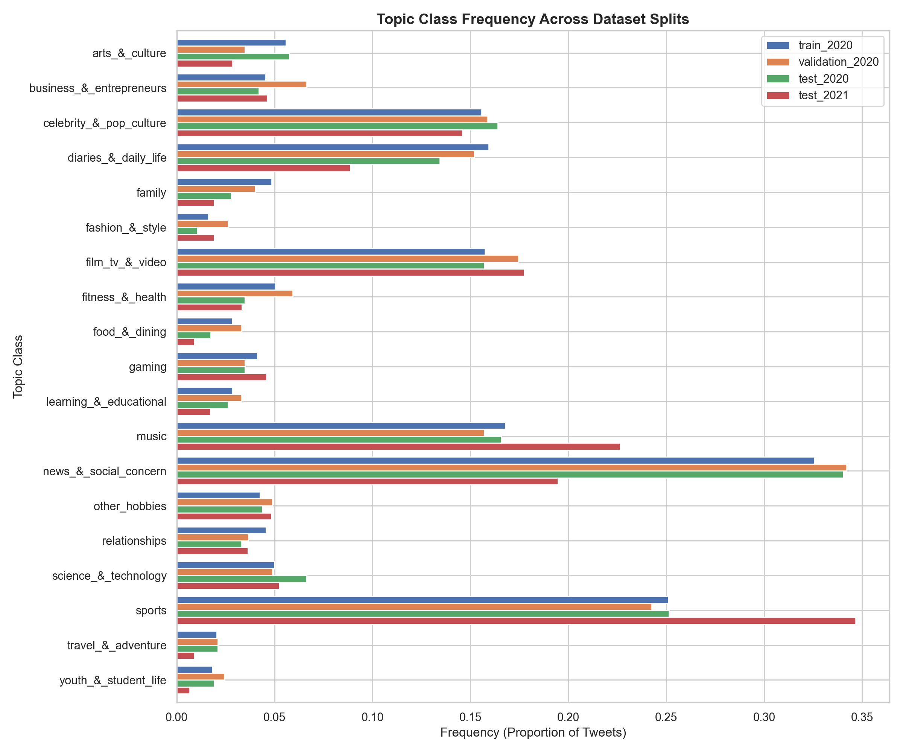
*Hình 1. Tỷ lệ 19 chủ đề trên `train_2020`, `test_2020`, `test_2021`. Nhóm dẫn đầu (`news`, 32.6%) gấp 20.18 lần nhóm cuối (`fashion`, 1.6%); 91.01% ô nhãn bằng 0.*

Cột cuối là độ chênh tỷ lệ của `test_2021` so với `train_2020` (đơn vị: điểm phần trăm), cùng mốc tham chiếu với khoảng cách Jensen-Shannon ở Mục 3.5.

| ID | Mã nhãn | Tên tiếng Việt | Trọng tâm ngữ nghĩa | `train_2020` (số mẫu, %) | `test_2020` | `test_2021` | Chênh lệch |
|:---:|:---|:---|:---|:---:|:---:|:---:|:---:|
| 12 | `news_&_social_concern` | Tin tức & Xã hội | Chính trị, bầu cử, biểu tình, chính sách, COVID-19, phong trào xã hội | 1,493 (32.6%) | 34.0% | 19.5% | -13.1 (giảm mạnh) |
| 16 | `sports` | Thể thao | Bóng đá, NBA, Premier League, Olympics, tỷ số, chuyển nhượng | 1,151 (25.1%) | 25.1% | 34.7% | +9.6 (tăng mạnh) |
| 11 | `music` | Âm nhạc | Ca sĩ, album, Billboard, bài hát, concert, MV, streaming | 769 (16.8%) | 16.6% | 22.6% | +5.9 (tăng mạnh) |
| 03 | `diaries_&_daily_life` | Nhật ký & Cuộc sống | Trạng thái cá nhân, tâm sự, thức dậy, ngủ, suy nghĩ vụn vặt | 731 (15.9%) | 13.4% | 8.9% | -7.1 (giảm mạnh) |
| 06 | `film_tv_&_video` | Phim ảnh & Truyền hình | Netflix, rạp chiếu, diễn viên, đạo diễn, Oscar, trailer | 722 (15.7%) | 15.7% | 17.7% | +2.0 (tăng) |
| 02 | `celebrity_&_pop_culture` | Người nổi tiếng & Pop | Idol, scandal, drama showbiz, thảm đỏ, xu hướng viral | 714 (15.6%) | 16.4% | 14.6% | -1.0 (ổn định) |
| 00 | `arts_&_culture` | Nghệ thuật & Văn hóa | Hội họa, bảo tàng, lịch sử, văn học, triển lãm tranh | 256 (5.6%) | 5.8% | 2.9% | -2.7 (giảm) |
| 07 | `fitness_&_health` | Sức khỏe & Thể hình | Gym, chạy bộ, chế độ ăn, vaccine, bệnh viện, tinh thần | 231 (5.0%) | 3.5% | 3.3% | -1.7 (ổn định) |
| 15 | `science_&_technology` | Khoa học & Công nghệ | AI, smartphone, NASA, không gian vũ trụ, phần mềm | 229 (5.0%) | 6.6% | 5.2% | +0.2 (ổn định) |
| 04 | `family` | Gia đình | Bố mẹ, con cái, anh chị em, gia đình quây quần | 222 (4.8%) | 2.8% | 1.9% | -2.9 (giảm) |
| 14 | `relationships` | Mối quan hệ | Tình yêu, hẹn hò, bạn thân, chia tay, kết hôn | 209 (4.6%) | 3.3% | 3.6% | -0.9 (ổn định) |
| 01 | `business_&_entrepreneurs` | Kinh doanh & Doanh nhân | Khởi nghiệp, thị trường chứng khoán, crypto, CEO, tài chính | 208 (4.5%) | 4.2% | 4.6% | +0.1 (ổn định) |
| 13 | `other_hobbies` | Sở thích khác | Làm vườn, câu cá, may vá, thủ công mỹ nghệ, sưu tầm | 195 (4.3%) | 4.4% | 4.8% | +0.6 (ổn định) |
| 09 | `gaming` | Trò chơi điện tử | PlayStation, Xbox, Steam, esports, livestream game | 189 (4.1%) | 3.5% | 4.6% | +0.5 (ổn định) |
| 10 | `learning_&_educational` | Giáo dục & Học tập | Trường đại học, khóa học trực tuyến, thi cử, bài giảng | 131 (2.9%) | 2.6% | 1.7% | -1.1 (ổn định) |
| 08 | `food_&_dining` | Ẩm thực & Ăn uống | Món ăn, nhà hàng, nấu nướng, công thức, đồ uống | 130 (2.8%) | 1.7% | 0.9% | -1.9 (ổn định) |
| 17 | `travel_&_adventure` | Du lịch & Trải nghiệm | Khách sạn, bãi biển, phượt, vé máy bay, khám phá | 94 (2.1%) | 2.1% | 0.9% | -1.2 (ổn định) |
| 18 | `youth_&_student_life` | Giới trẻ & Đời sinh viên | Ký túc xá, hoạt động câu lạc bộ, tuổi trẻ, đồ án tốt nghiệp | 83 (1.8%) | 1.9% | 0.7% | -1.2 (ổn định) |
| 05 | `fashion_&_style` | Thời trang & Phong cách | Quần áo, túi xách, giày sneaker, người mẫu, trang điểm | 74 (1.6%) | 1.0% | 1.9% | +0.3 (ổn định) |

### 3.3. Phân phối số lượng nhãn trên mỗi tweet

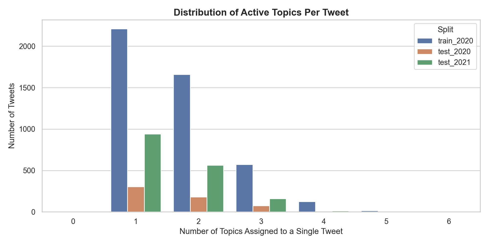
*Hình 2. Trên `train_2020`: 48.2% tweet có đúng 1 nhãn, 36.2% có 2 nhãn, 12.5% có 3 nhãn, 3.1% có 4 đến 6 nhãn (và 1 tweet không có nhãn).*

### 3.4. Ma trận đồng xuất hiện giữa các nhãn

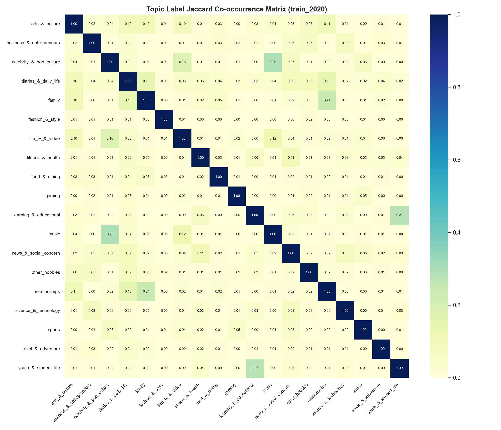
*Hình 3. Chỉ số Jaccard giữa các cặp nhãn trên `train_2020`. Các cặp đồng xuất hiện mạnh nhất: `music` và `celebrity_&_pop_culture` (0.29), `learning_&_educational` và `youth_&_student_life` (0.27), `family` và `relationships` (0.24), `film_tv_&_video` và `celebrity_&_pop_culture` (0.18). Hầu hết các cặp khác dưới 0.1.*

Các nhãn không độc lập, nhưng mức đồng xuất hiện nói chung thấp, nên 19 bộ phân loại độc lập vẫn là cách làm hợp lý. Classifier Chains (Mục 6.2) là cách khai thác sự phụ thuộc này; chưa có kết quả đo của nó trong báo cáo này.

### 3.5. Trôi dạt thời gian giữa 2020 và 2021

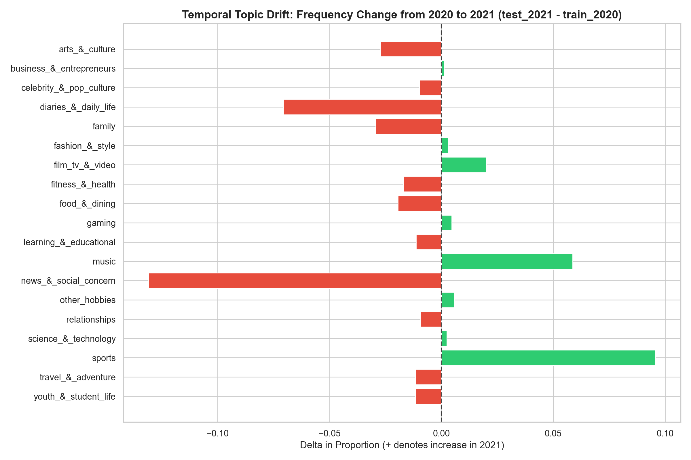
*Hình 4. Chênh lệch tỷ lệ từng chủ đề giữa `test_2021` và `train_2020`.*

* **Khoảng cách Jensen-Shannon** giữa phân phối nhãn `train_2020` và `test_2021`: **0.1377**.
* Dịch chuyển lớn nhất: `news_&_social_concern` giảm 13.09 điểm phần trăm (32.6% xuống 19.5%), `sports` tăng 9.56 (25.1% lên 34.7%), `diaries_&_daily_life` giảm 7.07, `music` tăng 5.86.
* Hệ quả: điểm trên `test_2021` thường thấp hơn `test_2020`; Mục 7.3 đo mức suy giảm này.

### 3.6. Thống kê văn bản

**Thống kê văn bản `train_2020`** (Hình 5): 28.34 từ mỗi tweet (độ lệch chuẩn 12.31, trung vị 27, dài nhất 61 từ và 364 ký tự); 68.75% tweet có mention, 48.14% có URL, 39.28% có hashtag. Ngưỡng cắt 128 token được chọn rộng so với tweet dài nhất; tỷ lệ tweet vượt ngưỡng chưa được đo bằng số token.

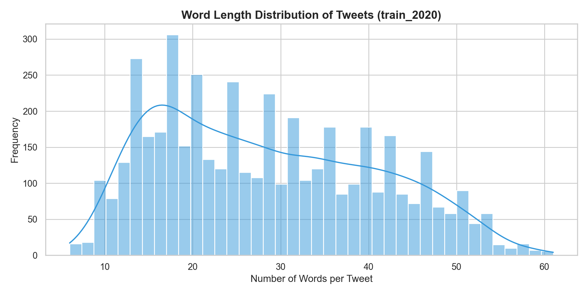
*Hình 5. Phân phối số từ và số ký tự của tweet trên `train_2020`.*

**Điểm chốt Phần III.** Dữ liệu vừa đa nhãn, vừa lệch (20 : 1), vừa đổi phân phối theo năm. Vì vậy báo cáo luôn nêu cả Micro-F1 và Macro-F1 và đo cả `test_2020` lẫn `test_2021`.

---

## PHẦN IV. DATA PREPARATION & PREPROCESSING

*Chuẩn bị và xử lý dữ liệu.*

### 4.1. Nguyên tắc

Nguyên tắc là **làm sạch nhẹ, bảo tồn thông tin**: không xóa emoji, không hạ chữ thường, giữ dấu `#`.

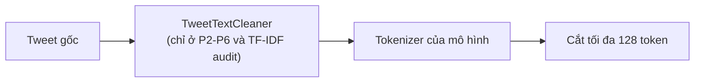

### 4.2. Bộ làm sạch `TweetTextCleaner`

**TweetTextCleaner** (`tweet_topic/addons/custom_preprocessor_addon.py`) thực hiện bốn việc:

1. **Chuẩn hóa mặt nạ ẩn danh của bộ dữ liệu:** `{@user@}` thành `@user`; `{{URL}}` thành `http_url`.
2. **Tách hashtag viết liền tại mọi ranh giới chữ hoa**, giữ dấu `#`: `#ClimateChange` thành `#Climate Change`, `#NBAFinals` thành `#NBA Finals`, `#climateChangeNow` thành `#climate Change Now`; chữ số giữ dính (`#WorldCup2022` thành `#World Cup2022`).
3. **Gộp dấu câu lặp:** `!!!`, `???`, `...` thành một dấu.
4. **Gọn khoảng trắng.**

Emoji và chữ hoa/thường được bộ làm sạch giữ nguyên (⚽ và 🏀 là tín hiệu cho `sports`, 🎵 cho `music`, 🎮 cho `gaming`; chữ hoa phân biệt NASA, WHO, NBA với từ thông thường). Lợi ích này chỉ phát huy ở mô hình còn nhìn thấy chúng: TF-IDF (đặt chữ thường) và `bert-base-uncased` (tokenizer tự hạ chữ thường) không giữ chữ hoa, và từ vựng WordPiece của BERT có thể không chứa emoji (chưa kiểm tra). RoBERTa, d1 và Qwen thường giữ cả hai (chưa đo riêng tác dụng).

### 4.3. Nơi áp dụng và phiên bản bộ làm sạch

**Nơi áp dụng bộ làm sạch:** chỉ ở hàng TF-IDF + cleaner của Vòng 2 và các cấu hình P2 đến P6 của Vòng 3. Các mô hình còn lại dùng văn bản gốc.

**Bộ làm sạch đã được sửa sau Vòng 2.** Bản cũ dùng một biểu thức chính quy chỉ tách hashtag bắt đầu bằng chữ thường và chỉ tại ranh giới đầu tiên (`#climateChange`), không tách `#ClimateChange`. Hàng TF-IDF + cleaner của Vòng 2 chạy với bản cũ; P2 trở đi dùng bản mới.

### 4.4. Chia dữ liệu và chống rò rỉ

* Bộ làm sạch dựa trên quy tắc, không học tham số từ dữ liệu, nên không có rò rỉ từ `validation_2020` hay các tập test.
* Mọi mô hình huấn luyện trên `train_2020` (4,585 tweet, trong đó 1 tweet không có nhãn nào và vẫn được giữ lại).
* Ngưỡng, nhiệt độ và epoch tốt nhất chỉ được chọn trên `validation_2020`.
* Độ dài tối đa 128 token cho mọi mô hình encoder và LLM; tweet dài hơn bị cắt.
* **B2 (Vòng 1)** dùng checkpoint `cardiffnlp/twitter-roberta-base-2021-124m-topic-multi`, đã được tinh chỉnh trên dữ liệu có cả năm 2021, nên điểm `test_2021` của B2 có thể được hưởng lợi từ việc đã thấy dữ liệu năm đó (dấu \* trong Hình 13). **Vòng 2** vì vậy dùng `cardiffnlp/twitter-roberta-base-dec2020`, chỉ huấn luyện trước, để loại ảnh hưởng này (Mục 7.3).

**Điểm chốt Phần IV.** Tiền xử lý rất nhẹ và dựa trên quy tắc. Đóng góp của nó rất nhỏ ở cả hai vòng (Mục 7.6 và bước P2 ở Mục 7.8).

---

## PHẦN V. DATA REPRESENTATION

*Biểu diễn dữ liệu cho mô hình.*

### 5.1. Tổng quan

Cùng một tweet được biểu diễn theo ba cách tùy họ mô hình, còn nhãn luôn là vector multi-hot 19 chiều (Hình 6).

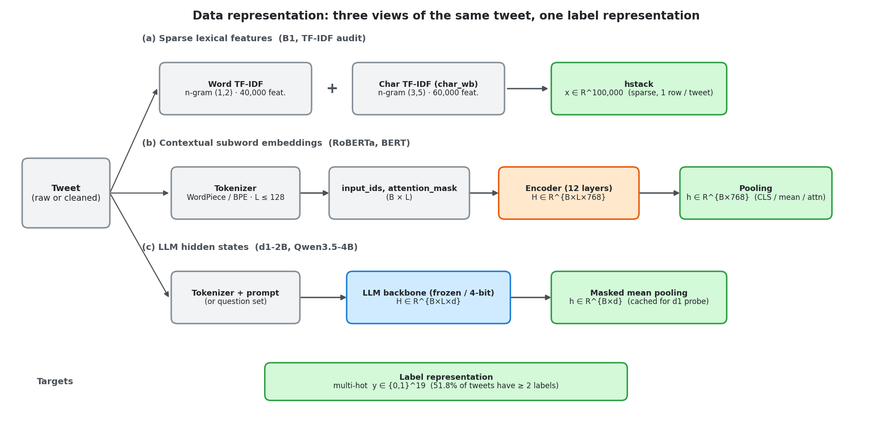
*Hình 6. Ba cách biểu diễn tweet (đặc trưng thưa, embedding ngữ cảnh, trạng thái ẩn của LLM) và biểu diễn nhãn. Màu cam: mô-đun được huấn luyện; xanh dương: mô-đun đóng băng.*

### 5.2. Biểu diễn thưa cho học máy cổ điển

* **Không gian đặc trưng:** TF-IDF mức từ, n-gram $(1, 2)$, 40,000 đặc trưng; TF-IDF mức ký tự `char_wb`, n-gram $(3, 5)$, 60,000 đặc trưng, để bắt tiếng lóng, viết tắt và hashtag viết liền. Tổng $\mathbf{x} \in \mathbb{R}^{100{,}000}$. Cả hai bộ dùng `sublinear_tf`; không loại stop words.

Vector $\mathbf{x}$ rất thưa và mỗi tweet là một hàng; không có tham số biểu diễn nào được học, chỉ có trọng số của bộ phân loại ở phía sau.

### 5.3. Biểu diễn ngữ cảnh của Transformer encoder

* **Tokenizer:** Twitter-RoBERTa dùng byte-level BPE; `bert-base-uncased` dùng WordPiece và tự hạ chữ thường. Đầu vào gồm `input_ids` và `attention_mask`, độ dài tối đa $L = 128$.
* **Encoder** (12 lớp, hidden 768) biến chuỗi token thành các trạng thái ẩn $H \in \mathbb{R}^{B \times L \times 768}$; toàn bộ encoder được tinh chỉnh cùng bộ phân loại, nên biểu diễn được học theo bài toán.
* **Gộp thành một vector** $\mathbf{h} \in \mathbb{R}^{B \times 768}$ bằng một trong ba cách: lấy token đầu (`[CLS]` hoặc `<s>`), trung bình có mặt nạ (mean pooling) hoặc chú ý học được (attention pooling). Công thức ở Mục 6.3.

### 5.4. Biểu diễn từ mô hình ngôn ngữ lớn

* **d1 linear probe:** backbone d1-2B đóng băng; trạng thái ẩn lớp cuối được gộp bằng Masked Mean Pooling và lưu đệm một lần, sau đó chỉ huấn luyện head trên các vector đã lưu (Mục 6.4).
* **d1 option-letter và `system_one`:** không có bước biểu diễn riêng; tweet cùng câu hỏi và tập đáp án đi vào mô hình, đầu ra là điểm cho từng đáp án.
* **Qwen3.5-4B QLoRA:** tweet đi qua backbone 4-bit có gắn LoRA, trạng thái ẩn cuối được gộp bằng Masked Mean Pooling rồi vào head (Mục 6.5).

### 5.5. Biểu diễn nhãn

Nhãn là vector multi-hot $\mathbf{y} \in \{0, 1\}^{19}$, thứ tự theo ID của taxonomy (00 đến 18, Mục 3.2). Mật độ nhãn (label density) là 0.0899: trung bình một tweet kích hoạt khoảng 9.0% trong 19 chiều, tức 91.01% ô bằng 0. Vì vậy loss phải xử lý mất cân bằng giữa ô dương và ô âm (Mục 6.6).

**Điểm chốt Phần V.** Cùng một tweet có ba cách biểu diễn (thưa, ngữ cảnh, trạng thái ẩn của LLM) nhưng chung một biểu diễn nhãn multi-hot; so sánh giữa các họ mô hình vì thế là so sánh cả cách biểu diễn lẫn bộ phân loại.

---

## PHẦN VI. MODELING METHODOLOGY

*Thiết kế kiến trúc, Loss Functions, kỹ thuật huấn luyện và tối ưu.*

### 6.1. Tổng quan pipeline

Mọi họ mô hình cùng đưa ra 19 xác suất độc lập rồi đi qua cùng một chuỗi hậu xử lý (Hình 7). Các sơ đồ từ Mục 6.2 đến 6.5 dùng chung quy ước màu: xám là dữ liệu hoặc tensor, xanh dương là mô-đun đóng băng, cam là mô-đun được huấn luyện, xanh lá là đầu ra hoặc loss, tím là hậu xử lý không cần huấn luyện.

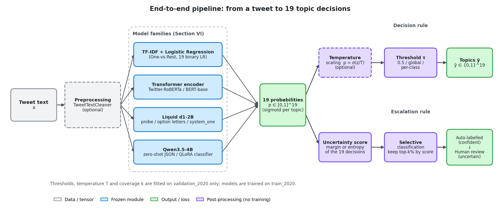
*Hình 7. Pipeline từ tweet đến 19 quyết định chủ đề: tiền xử lý tùy chọn, bốn họ mô hình, 19 xác suất, rồi nhánh quyết định (hiệu chuẩn, ngưỡng) và nhánh chuyển người xử lý (điểm bất định, chọn lọc).*

| Họ | Mô hình | Cách dùng | Phần được huấn luyện | Vòng |
|:---|:---|:---|:---|:---:|
| Học máy cổ điển | TF-IDF + Logistic Regression (OvR) | Huấn luyện | 19 bộ Logistic Regression | 1, 2 |
| Transformer encoder | Twitter-RoBERTa (khoảng 125 triệu tham số), BERT-base (khoảng 110 triệu) | Tinh chỉnh | Toàn bộ encoder và head | 1, 2, 3 |
| Liquid d1-2B | Khoảng 1.92 tỷ tham số | Option-letter; linear probe; `system_one` | Chỉ head tuyến tính (probe); không huấn luyện (hai cách còn lại) | 1, 2, 3 |
| Qwen3.5-4B | Tên gọi 4 tỷ tham số | Zero-shot JSON; QLoRA classifier | Không (zero-shot); LoRA và head, 21,282,323 tham số (0.815%) | 1, 2 |

### 6.2. Học máy cổ điển (TF-IDF + Logistic Regression)

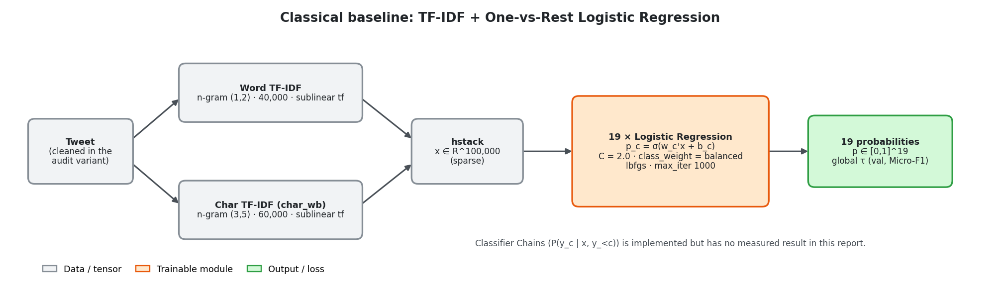
*Hình 8. Hai bộ TF-IDF chạy song song trên cùng tweet, được nối thành một vector thưa 100,000 chiều rồi đưa vào 19 bộ Logistic Regression.*

* **One-vs-Rest:** 19 bộ Logistic Regression nhị phân độc lập, $P(y_c = 1 \mid \mathbf{x}) = \sigma(\mathbf{w}_c^\top \mathbf{x} + b_c)$, với `class_weight='balanced'`, $C = 2.0$, `lbfgs`, tối đa 1,000 vòng lặp.
* **Classifier Chains** (`configs/ml/classifier_chains.yaml`): mô hình hóa phụ thuộc giữa các nhãn, $P(y_c = 1 \mid \mathbf{x}, y_1, \dots, y_{c-1})$. Được cài đặt nhưng chưa có kết quả đo trong báo cáo này.

### 6.3. Transformer encoder

**A. Hai backbone.** Vòng 1 và 2 dùng Twitter-RoBERTa (12 lớp, 12 đầu chú ý, hidden 768, khoảng 125 triệu tham số, byte-level BPE). Vòng 3 dùng `bert-base-uncased` (12 lớp, hidden 768, khoảng 110 triệu tham số, WordPiece). B2 (Vòng 1) dùng checkpoint `cardiffnlp/twitter-roberta-base-2021-124m-topic-multi`; Vòng 2 dùng `cardiffnlp/twitter-roberta-base-dec2020` (Mục 4.4).

**B. Head: nơi tạo ra phát hiện chính.** Có ba loại head, khác nhau ở nhiều điểm cùng lúc:

| Thành phần | Head mặc định BERT | Head mặc định RoBERTa | Head tùy chỉnh (Vòng 3, `force_custom_head`) |
|:---|:---|:---|:---|
| Đầu vào | `[CLS]` qua pooler tiền huấn luyện (dense + tanh) | `<s>` qua dense **mới** (768 → 768) + tanh | `[CLS]` thô (hoặc mean / attention pooling) |
| Dropout | 0.1 | 0.1, hai lần | 0.2 (MSD: nhiều nhánh) |
| Lớp cuối | Linear 768 → 19 | Linear 768 → 19 | Linear 768 → 19 |
| Tốc độ học | 2e-5 (như thân) | 2e-5 (như thân) | 1e-3 cho head, 2e-5 cho thân |

Vòng 3 chia thí nghiệm theo head: **L1 đến L5** dùng head mặc định BERT; **H2 đến H5 và P0 đến P6** dùng head tùy chỉnh. Vì head tùy chỉnh khác head mặc định ở bốn điểm (tốc độ học, bỏ pooler tiền huấn luyện, dropout, khởi tạo), chưa biết điểm nào tạo ra khác biệt (Mục 7.7).

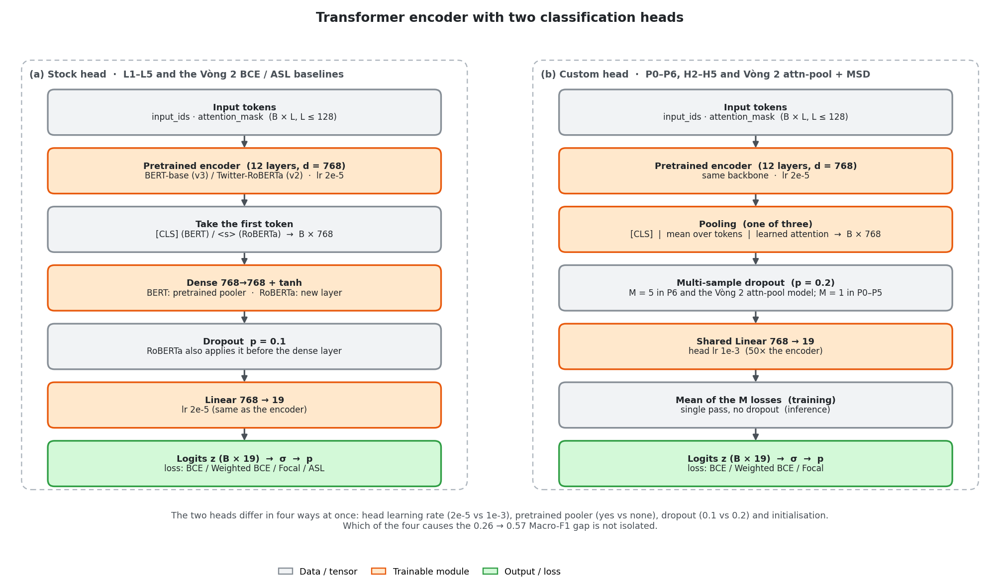
*Hình 9. Cùng một encoder với hai head: (a) head mặc định của thư viện, (b) head tùy chỉnh với pooling tùy chọn, multi-sample dropout và tốc độ học riêng.*

**C. Learned Attention Pooling.** Thay vì chỉ lấy token đầu câu, học trọng số chú ý $\alpha_i$ cho từng từ:
$$u_i = \tanh(\mathbf{W}_a \mathbf{h}_i + \mathbf{b}_a), \quad \alpha_i = \frac{\exp(u_i^\top \mathbf{v}_a)}{\sum_{j} \exp(u_j^\top \mathbf{v}_a)}, \quad \mathbf{h}_{\text{pool}} = \sum_{i} \alpha_i \mathbf{h}_i$$
với $\mathbf{W}_a \in \mathbb{R}^{256 \times 768}$ và $\mathbf{v}_a \in \mathbb{R}^{256}$.

**D. Multi-Sample Dropout (MSD).** Khi huấn luyện, nhân bản $\mathbf{h}_{\text{pool}}$ qua $M$ mặt nạ dropout độc lập ($M = 5$, $p = 0.2$ ở Vòng 2 và P6), cùng đi qua một lớp tuyến tính, rồi lấy trung bình loss; khi dự đoán không có tác dụng:
$$\mathbf{z}_m = \mathbf{W}_{\text{head}} \left( \frac{\mathbf{m}_m \odot \mathbf{h}_{\text{pool}}}{1 - p} \right) + \mathbf{b}$$

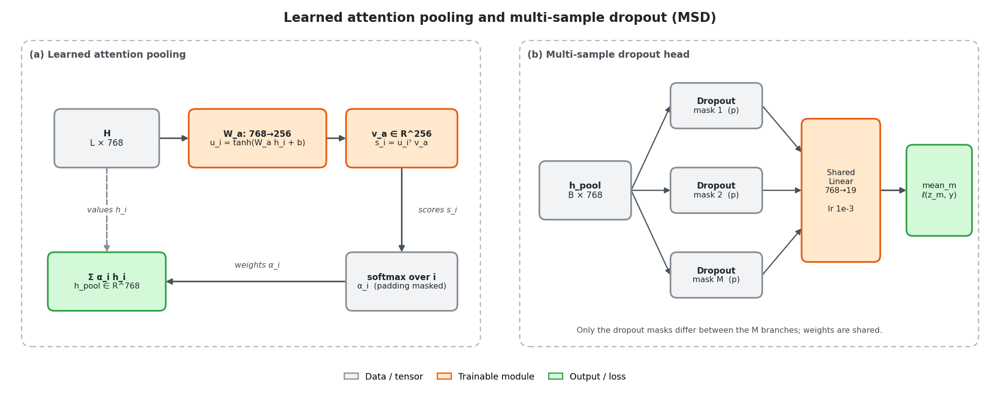
*Hình 10. (a) Attention pooling tính trọng số từng token rồi lấy tổng có trọng số; (b) multi-sample dropout dùng chung một lớp tuyến tính cho M mặt nạ dropout.*

**E. Tham số chính.** Vòng 2: 3 epoch, batch 32, tốc độ học 2e-5, tối đa 128 token. Vòng 3: 4 epoch, cùng các tham số còn lại, thêm cắt gradient 1.0, seed cố định, chọn epoch theo validation (Mục 6.7, Phụ lục A.2 và A.3).

### 6.4. Liquid AI d1-2B

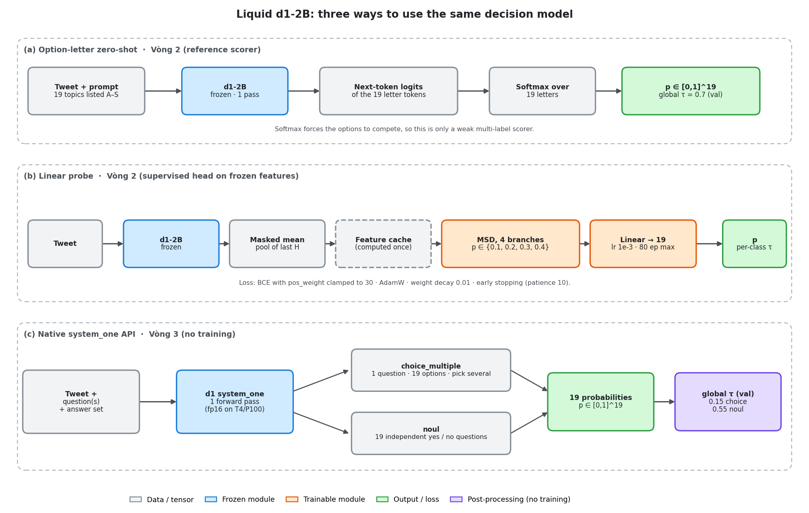
*Hình 11. Ba cách khai thác cùng một mô hình quyết định: (a) đọc điểm các chữ cái đáp án, (b) linear probe trên đặc trưng đóng băng, (c) API gốc `system_one` không huấn luyện.*

`LiquidAI/d1-2B` (khoảng 1.92 tỷ tham số, xây trên LFM3-VL-2B) là mô hình *quyết định*: nhận một tweet và danh sách câu hỏi, trả về xác suất cho từng câu chỉ trong một lượt tính. Ba cách khai thác đã được thử (Hình 11):

1. **Linear probe (Vòng 2):** đóng băng backbone, Masked Mean Pooling lấy vector trạng thái ẩn lớp cuối, lưu đệm một lần, chỉ huấn luyện một Linear Head với Multi-Sample Dropout (4 nhánh, $p \in \{0.1, 0.2, 0.3, 0.4\}$). Tham số: 80 epoch tối đa, tốc độ học 1e-3, batch 128, weight decay 0.01, BCE có trọng số dương (giới hạn 30), dừng sớm sau 10 epoch không cải thiện loss validation.
2. **Option-letter zero-shot (Vòng 2):** liệt kê 19 chủ đề thành A đến S, đọc điểm 19 token chữ cái ở bước sinh kế tiếp. Softmax buộc các lựa chọn triệt tiêu lẫn nhau, nên chỉ là bộ chấm đa nhãn yếu, dùng làm tham chiếu. Lần thử đầu (B3) đọc nhầm 19 token đầu của từ vựng và cho Micro-F1 chỉ 0.1820; đó là lỗi khai thác đầu ra, không phản ánh kiến trúc.
3. **API gốc `system_one` (Vòng 3):** hai chế độ câu hỏi. *choice*: một câu "tweet này bàn về chủ đề nào?" với 19 đáp án, được chọn nhiều. *noul*: 19 câu có/không độc lập. Không huấn luyện; cần `transformers>=5.19`; trên GPU Kaggle chạy ở fp16 (xem Phụ lục A.4).

### 6.5. Qwen3.5-4B

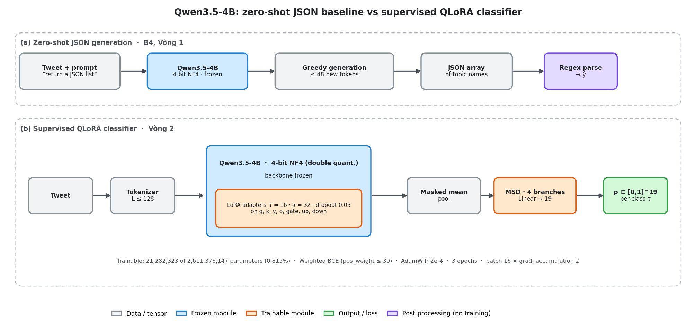
*Hình 12. (a) Zero-shot sinh JSON (B4); (b) bộ phân loại QLoRA có giám sát: backbone 4-bit đóng băng, adapter LoRA và head được huấn luyện.*

* **Zero-shot JSON (B4, Vòng 1):** `Qwen/Qwen3.5-4B` lượng tử hóa 4-bit NF4 (tính toán fp16), sinh tham lam tối đa 48 token một mảng JSON các chủ đề, phân tích bằng regex. Micro-F1 chỉ 0.0290 trên 200 tweet đầu của `test_2020`. Nguyên nhân chưa được chẩn đoán: đầu ra thô chưa được kiểm tra, và giới hạn 48 token sinh cùng bộ phân tích regex có thể làm mất phần lớn câu trả lời, nên con số này không nên đọc là năng lực zero-shot thực sự của Qwen.
* **QLoRA có giám sát (Vòng 2):** backbone 4-bit NF4 (lượng tử hóa kép, tính toán fp16) bị đóng băng; gắn LoRA (hạng $r = 16$, $\alpha = 32$, dropout 0.05) vào các phép chiếu `q, k, v, o, gate, up, down`, rồi Masked Mean Pooling, MSD 4 nhánh và Linear Head 19 chiều. Suy luận là một lượt forward, không còn bước sinh JSON. Số tham số huấn luyện được theo log: **21,282,323 trên 2,611,376,147 (0.815%)**. Loss trung bình mỗi epoch: 0.8113, 0.3617, 0.1727.
* **Vai trò auditor:** Qwen zero-shot với chain-of-thought được thử làm bộ kiểm tra các tweet mơ hồ (Mục 7.6).

### 6.6. Hàm mất mát cho đa nhãn lệch lớp

Với tỷ lệ 20.18 : 1 và 91.01% ô nhãn bằng 0, tổng gradient của BCE bị chi phối bởi mẫu âm dễ. Ba hướng sửa:

#### 6.6.1. Positive-Weighted BCE (W-BCE)

Nhân trọng số cho mẫu dương của lớp hiếm:
$$\mathcal{L}_{\text{W-BCE}} = - \frac{1}{C} \sum_{c=1}^{C} \left[ w_c \, y_c \log \sigma(z_c) + (1 - y_c) \log (1 - \sigma(z_c)) \right], \quad w_c = \frac{N - N_c}{N_c}$$
$N_c$ là số mẫu dương của lớp $c$ trên tập huấn luyện. Trong hệ thống, $w_c$ bị giới hạn trong $[1, 30]$.

#### 6.6.2. Multi-Label Focal Loss

$$\mathcal{L}_{\text{Focal}} = - \frac{1}{C} \sum_{c} \alpha_{t,c} (1 - p_{t,c})^{\gamma} \log (p_{t,c}), \quad p_{t,c} = \begin{cases} \hat{p}_c & y_c = 1 \\ 1 - \hat{p}_c & y_c = 0 \end{cases}$$
Hệ số $(1 - p_t)^{\gamma}$ giảm trọng số các mẫu đã dễ. Tham số $\alpha$ đổi trọng số giữa hai phía: $\alpha_t = \alpha$ cho mẫu dương và $1 - \alpha$ cho mẫu âm; với $\alpha = 0.25$ mẫu dương chỉ còn 0.25 so với 0.75 của mẫu âm, tức **làm yếu đúng nhóm hiếm**. Vòng 3 thử $(\gamma, \alpha) \in \{(2, 0.25), (1, 0.25), (2, \text{không có})\}$.

#### 6.6.3. Asymmetric Loss (ASL, Ridnik và cộng sự, ICCV 2021)

$$\mathcal{L}_{\text{ASL}} = \frac{1}{C} \sum_{c} \left[ - y_c (1 - \hat{p}_c)^{\gamma_+} \log \hat{p}_c - (1 - y_c)\, \hat{p}_{m,c}^{\,\gamma_-} \log (1 - \hat{p}_{m,c}) \right], \quad \hat{p}_{m,c} = \max(\hat{p}_c - m, 0)$$
Vòng 2 dùng $\gamma_+ = 1$, $\gamma_- = 4$, $m = 0.05$ (mặc định của mã tại thời điểm đó; bài báo gốc dùng $\gamma_+ = 0$). Mẫu âm có $\hat{p}_c \le m$ bị loại hẳn khỏi loss.

#### 6.6.4. Loss nào được dùng ở đâu

| Loss | Vòng 2 | Vòng 3 |
|:---|:---:|:---:|
| BCE | RoBERTa (ngưỡng chung) | L1, P0, P2 |
| Weighted BCE | d1 probe, Qwen QLoRA | L2, H2, P3 đến P6 |
| Focal | | L3 đến L5, H3 đến H5 |
| ASL | RoBERTa (hai cấu hình) | không (xem bên dưới) |

> **Lưu ý về ASL.** `AsymmetricLoss` có trong mã nguồn ở Vòng 2 nhưng **không có** trong `tweet_topic/models/bert/losses.py` hiện tại (chỉ còn `bce`, `weighted_bce`, `focal`), nên `configs/v2/*asl*.yaml` không chạy lại được nếu chưa khôi phục. Vòng 3 cho thấy BCE với head mặc định thua BCE với head tùy chỉnh tới 31 điểm Macro-F1; vì vậy chưa thể quy toàn bộ lợi thế của ASL ở Vòng 2 cho chính hàm mất mát. Thiết kế thí nghiệm kiểm chứng nằm ở `doc/Future.md`.

### 6.7. Kỹ thuật huấn luyện và tối ưu

Bảng dưới tóm tắt cách huấn luyện và tối ưu từng họ mô hình; giá trị đầy đủ của từng cấu hình nằm ở Phụ lục A.

| Thành phần | TF-IDF + LR | RoBERTa (Vòng 2) | BERT-base (Vòng 3) | d1 linear probe | Qwen QLoRA |
|:---|:---|:---|:---|:---|:---|
| Bộ tối ưu | `lbfgs` (không dùng gradient descent) | AdamW | AdamW | AdamW (chỉ trên head) | AdamW (tham số LoRA và head) |
| Tốc độ học | không có | 2e-5 (head tùy chỉnh: 1e-3) | 2e-5 cho thân; head tùy chỉnh 1e-3 | 1e-3 | 2e-4 |
| Weight decay | không có | 0.01 | 0.01 | 0.01 | 0.01 |
| Lịch học | không có | warmup tuyến tính 10% rồi giảm tuyến tính | như Vòng 2 | không có | warmup tuyến tính 10% nhân với giảm tuyến tính về 0 tính từ bước đầu (đỉnh khoảng 0.9 lần tốc độ học) |
| Epoch, batch | tối đa 1,000 vòng lặp | 3 epoch, batch 32 | 4 epoch, batch 32 | tối đa 80 epoch, batch 128 | 3 epoch, batch 16 và tích lũy gradient 2 |
| Cắt gradient | không có | không | 1.0 | không | 1.0 |
| Độ chính xác số | không có | mixed precision | mixed precision (fp16 autocast) | không (đặc trưng đã lưu đệm) | fp16 autocast và loss scaling |
| Chọn mô hình | không có | lấy checkpoint cuối epoch 3 | epoch tốt nhất theo Macro-F1 validation sau khi chọn ngưỡng; dừng sớm, kiên nhẫn 2 | dừng sớm theo BCE không trọng số trên validation, kiên nhẫn 10 | lấy mô hình cuối epoch 3 |
| Xử lý mất cân bằng | `class_weight='balanced'` | tùy cấu hình (BCE, ASL) | tùy cấu hình (BCE, Weighted BCE, Focal) | pos_weight, giới hạn 30 | pos_weight, giới hạn 30 |
| Seed | 42 | không đặt | 42 (thêm 1337, 2024 cho P0, P6, L2) | 42 | 42 |

Với encoder, các kỹ thuật ổn định hóa huấn luyện (cắt gradient, chọn epoch theo validation, dừng sớm, đặt seed) chỉ có ở BERT Vòng 3, không có ở RoBERTa Vòng 2 (d1 probe và Qwen QLoRA của Vòng 2 có dùng một số kỹ thuật này, xem bảng); đây là một trong các khác biệt khiến so sánh chéo giữa Vòng 2 và Vòng 3 chỉ mang tính bối cảnh (Mục 7.1). Với encoder, hai nhóm tham số có tốc độ học riêng (thân và head); tham số `head_lr` chỉ có tác dụng với head tùy chỉnh.

Ba lưu ý về bảng trên. (1) Cột RoBERTa (Vòng 2) mô tả mã đã chạy Vòng 2 (commit `9ddc5f6`, khớp bản chụp trên Kaggle và log). Mã hiện tại trong cây làm việc đã đổi mặc định của encoder: seed 42, cắt gradient 1.0 và chọn epoch tốt nhất đều bật, nên chạy lại cấu hình Vòng 2 ngày nay không tái lập đúng quy trình huấn luyện đó. (2) Ở Vòng 3, epoch tốt nhất được chọn theo Macro-F1 sau khi tìm ngưỡng theo lớp trên chính validation, còn số báo cáo dùng ngưỡng chung, nên việc chọn epoch hơi lạc quan. (3) Khởi tạo head được thực hiện trước bước đặt seed nên không được cố định theo seed; cùng một seed chạy lại có thể lệch nhẹ, và độ lệch giữa các seed ở Mục 7.8 gồm cả phần ngẫu nhiên này.

### 6.8. Hậu xử lý: ngưỡng, hiệu chuẩn và phân loại có chọn lọc

#### 6.8.1. Chọn ngưỡng

Ngưỡng mặc định 0.5 thường không phù hợp cho dữ liệu lệch. Có hai cách, đều tìm trên `validation_2020` bằng grid search bước 0.05:

* **Ngưỡng chung:** một $\tau$ cho mọi lớp, quét 0.10 đến 0.90, tối đa hóa Micro-F1 (hoặc Macro-F1 ở một số cấu hình Vòng 2).
* **Ngưỡng theo lớp:** $\tau_c^* = \arg\max_{\tau \in [0.05, 0.85]} F1_c(\mathbf{y}_{:,c}, \mathbb{I}(\hat{\mathbf{p}}_{:,c} \ge \tau))$ cho từng lớp, ra vector 19 ngưỡng. Lớp không có mẫu dương trong validation giữ ngưỡng 0.5.

**Rủi ro.** `validation_2020` chỉ có 573 mẫu và lớp hiếm có rất ít mẫu dương nên ngưỡng theo lớp dễ khớp quá mức; Mục 7.9 cho một ví dụ cụ thể.

#### 6.8.2. Temperature scaling

Chia logit của từng lớp cho một nhiệt độ $T_c > 0$ học trên validation bằng cách cực tiểu hóa log-likelihood âm nhị phân: $\hat{p}_c^{\text{calib}} = \sigma(z_c / T_c)$. Phép chia này đơn điệu nên thứ hạng tweet trong một lớp không đổi; nếu ngưỡng theo lớp được tìm vét cạn thì F1 tốt nhất của từng lớp không đổi, còn với lưới thô (bước 0.05) F1 có thể lệch nhẹ do lưới. Phương pháp cải thiện sai số hiệu chuẩn ECE và ảnh hưởng đến các thiết lập dùng ngưỡng chung hoặc dùng xác suất làm điểm tin cậy.

#### 6.8.3. Phân loại có chọn lọc

Mỗi tweet có một điểm kém chắc chắn. Có hai cách tính:

* **margin:** $1 - \min_c |p_c - \tau_c| / \max(\tau_c, 1 - \tau_c)$; tweet càng mơ hồ khi có một nhãn nằm sát ngưỡng quyết định của nhãn đó. Đây là cách dùng mặc định.
* **entropy:** tổng entropy nhị phân qua 19 lớp.

Giữ lại phần tweet chắc chắn nhất để tự động hóa, chuyển phần còn lại cho người; đo Micro-F1 trên từng phần theo tỷ lệ tự động hóa (coverage) 100% đến 50%.

Với xác suất $p_c$, entropy nhị phân của một lớp là $H_c = -[p_c \log_2 p_c + (1 - p_c) \log_2 (1 - p_c)]$, bằng 0 khi mô hình chắc chắn và bằng 1 khi $p_c = 0.5$; tổng $H_c$ qua 19 lớp là điểm bất định theo entropy.

### 6.9. Tổ chức mã nguồn

Các mô hình, hàm mất mát và bộ tiền xử lý được đăng ký bằng decorator và nạp động nên thêm thành phần mới không cần sửa lõi; xem Phụ lục D.

**Điểm chốt Phần VI.** Bốn họ mô hình dùng chung pipeline đánh giá và cùng cho 19 xác suất. Điểm khác biệt đáng chú ý nhất không phải họ mô hình mà là **head của encoder**; ngoài ra ngưỡng và chọn lọc là bước hậu xử lý không cần huấn luyện lại.

---

## PHẦN VII. EXPERIMENTAL RESULTS & DISCUSSION

*Benchmark, đánh giá, so sánh, Ablation Study và phân tích lỗi.*

### 7.1. Thiết lập thực nghiệm

> **Phạm vi.** Huấn luyện trên `train_2020`, chọn ngưỡng trên `validation_2020`, chạy trên Kaggle. Vòng 2 chạy một seed; Vòng 3 chạy seed 42 cho mọi cấu hình và thêm hai seed (1337, 2024) cho P0, P6, L2. Chênh lệch dưới khoảng 1 đến 2 điểm không nên xem là có ý nghĩa.
> **Khác biệt giữa Vòng 2 và Vòng 3 (khi so sánh chéo).** Các encoder RoBERTa của Vòng 2 lấy checkpoint ở cuối epoch 3, không cắt gradient, không đặt seed (đúng với mã đã chạy Vòng 2, xem Phụ lục A.2); Vòng 3 chọn epoch tốt nhất theo validation, cắt gradient 1.0, đặt seed. Backbone cũng khác (RoBERTa so với BERT). Vì vậy các so sánh giữa hai vòng chỉ mang tính bối cảnh.

Cách đọc phần này: Mục 7.2 và 7.3 là benchmark và độ bền vững trước trôi dạt; Mục 7.4 đến 7.6 là kết quả chẩn đoán của Vòng 2 (hiệu chuẩn, LLM, auditor); Mục 7.7 và 7.8 là hai thí nghiệm ablation của Vòng 3; Mục 7.9 là ngưỡng, hiệu chuẩn và chọn lọc ở Vòng 3; Mục 7.10 là phân tích lỗi; Mục 7.11 và 7.12 đối chiếu rủi ro và rút ra kết luận.

### 7.2. Benchmark tổng hợp (Micro / Macro-F1)

| Vòng | Mô hình / cấu hình | Ngưỡng | `test_2020` | `test_2021` |
|:---:|:---|:---:|:---:|:---:|
| 1 | B1: TF-IDF + Logistic Regression | chung | 0.6890 / 0.5227 | 0.6154 / 0.3997 |
| 1 | B2: RoBERTa, checkpoint có dữ liệu 2021, BCE ⚠️ | chung | 0.6659 / 0.2955 | 0.6502 / 0.2648 |
| 2 | TF-IDF + bộ làm sạch (bản cũ) | chung | 0.6947 / 0.5412 | 0.6163 / 0.4058 |
| 2 | RoBERTa `dec2020`, BCE | chung (0.25) | 0.6741 / 0.3272 | 0.6525 / 0.2890 |
| 2 | RoBERTa `dec2020`, BCE + temperature scaling | chung | 0.6701 / 0.3105 | 0.6473 / 0.2627 |
| 2 | RoBERTa `dec2020`, ASL | theo lớp | 0.7048 / 0.6186 | 0.6963 / 0.5734 |
| 2 | RoBERTa `dec2020`, attention pooling + MSD + ASL | theo lớp | 0.7417 / 0.6536 | 0.7238 / 0.5974 |
| 2 | Qwen3.5-4B, QLoRA có giám sát | theo lớp | 0.7319 / 0.6533 | 0.6971 / 0.5815 |
| 2 | Liquid d1-2B, linear probe | theo lớp | 0.6432 / 0.5519 | 0.5976 / 0.4640 |
| 2 | Liquid d1-2B, option-letter zero-shot | chung | 0.5677 / 0.4757 | 0.5763 / 0.4806 |
| 3 | BERT-base, BCE, head mặc định (L1) | chung | 0.6602 / 0.2805 | 0.6431 / 0.2568 |
| 3 | BERT-base, BCE, head tùy chỉnh (P0, trung bình 3 seed) | chung | 0.7403 / 0.6351 | 0.7178 / 0.5698 |
| 3 | BERT-base + Cleaner + Weighted BCE + Attention pooling + MSD (P6, trung bình 3 seed) | chung | 0.7157 / 0.6356 | 0.7051 / 0.5827 |
| 3 | Liquid d1-2B, `system_one` choice, không huấn luyện | chung | 0.6509 / 0.5384 | 0.6637 / 0.5229 |
| 3 | Liquid d1-2B, `system_one` 19 câu noul, không huấn luyện | chung | 0.6291 / 0.5104 | 0.5922 / 0.4595 |

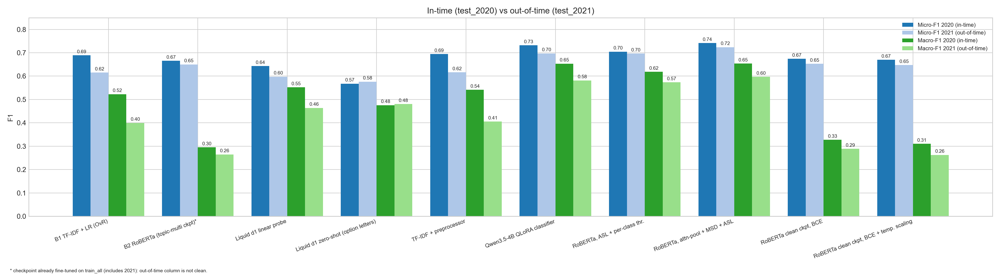
*Hình 13. Micro-F1 và Macro-F1 trên `test_2020` (cùng thời gian) và `test_2021` (ngoài thời gian) của các mô hình Vòng 1 và 2. Dấu * là checkpoint đã thấy dữ liệu 2021.*

* **Xử lý lớp hiếm quyết định Macro-F1.** Các cấu hình RoBERTa Vòng 2 dùng BCE và ngưỡng chung có Micro-F1 cạnh tranh (0.65 đến 0.67) nhưng Macro-F1 chỉ 0.26 đến 0.33; chuyển sang ASL với ngưỡng theo lớp nâng Macro-F1 lên 0.62 (2020) và 0.57 (2021). Hai thay đổi (loss, ngưỡng) được áp dụng cùng lúc, và Vòng 3 cho thấy head cũng là một yếu tố gây nhiễu (Mục 7.7).
* **Cấu hình tốt nhất ở Vòng 2** là RoBERTa với attention pooling, MSD và ASL (0.7417 / 0.6536 trên 2020; 0.7238 / 0.5974 trên 2021); cấu hình này đổi ba yếu tố cùng lúc (pooling, MSD, tốc độ học riêng cho head) nên chưa quy được cho từng kỹ thuật.
* **BERT-base đơn giản (P0)** với head tùy chỉnh đạt 0.718 Micro-F1 trên 2021, gần mức tốt nhất của Vòng 2 (0.724) mà không cần RoBERTa chuyên Twitter, ASL hay pooling đặc biệt.

### 7.3. Độ bền vững trước trôi dạt thời gian

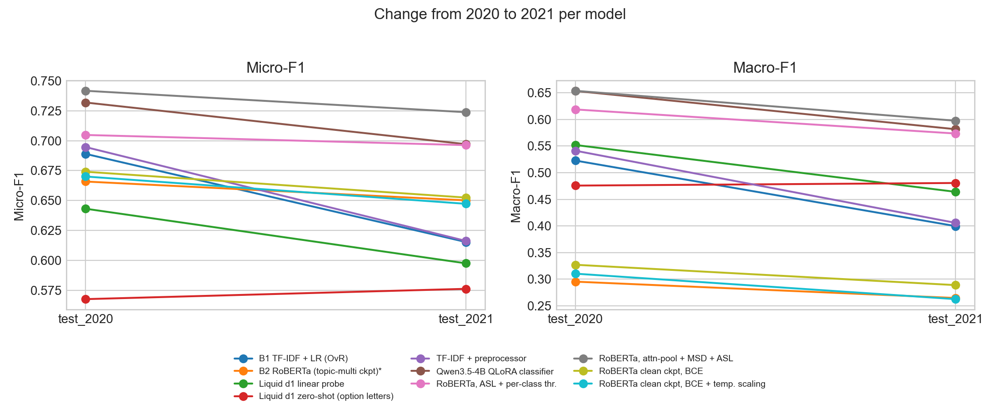
*Hình 14. Thay đổi Micro-F1 (trái) và Macro-F1 (phải) từ `test_2020` sang `test_2021` của các cấu hình Vòng 1 và 2.*

1. **Mức suy giảm Micro-F1 theo họ mô hình** (điểm, từ `test_2020` sang `test_2021`):
   * TF-IDF suy giảm lớn nhất: -7.36 Micro-F1 và -12.30 Macro-F1 (0.5227 xuống 0.3997).
   * Họ RoBERTa Vòng 2: từ -0.85 (ASL) đến -2.28 (BCE + temperature scaling); cấu hình tốt nhất: -1.79.
   * Qwen QLoRA -3.48 và d1 probe -4.56.
   * d1 option-letter zero-shot **tăng** 0.86, vì không học từ phân phối huấn luyện mà chỉ chọn ngưỡng trên validation.
   * Vòng 3 (ngưỡng chung, trung bình 3 seed): BERT + BCE (P0) -2.25, BERT + Cleaner + Weighted BCE + Attention pooling + MSD (P6) -1.05; d1 `system_one` choice **+1.28**.
2. **Nguyên nhân suy giảm của TF-IDF chưa kết luận.** Có hai giải thích cạnh tranh: *từ vựng đổi* (từ khóa nổi bật của 2020 mất hiệu quả ở 2021) và *tỷ lệ nhãn đổi* (khoảng cách Jensen-Shannon 0.1377). Cần phân tích lỗi theo lớp hoặc theo từ khóa để tách hai yếu tố.
3. **Đối chứng về checkpoint.** Chạy lại RoBERTa với checkpoint chỉ huấn luyện trước (`dec2020`), cùng loss, số epoch và cách chọn ngưỡng cho `test_2021` là 0.6525 / 0.2890, so với 0.6502 / 0.2648 của B2; mức suy giảm Micro-F1 là -2.16 (B2: -1.57). Việc B2 đã thấy dữ liệu 2021 không làm đổi đáng kể kết luận, nhưng một seed thì chưa loại trừ được ảnh hưởng nhỏ.
4. **So sánh công bằng TF-IDF và RoBERTa** (checkpoint sạch, cùng ngưỡng chung): RoBERTa suy giảm -2.16 Micro-F1 và -3.82 Macro-F1, so với -7.36 và -12.30 của TF-IDF.

### 7.4. Hiệu chuẩn xác suất và phân loại có chọn lọc (Vòng 2)

**7.4.1. Hiệu chuẩn (micro-ECE trên `test_2021`, càng thấp càng tốt)**

| Cấu hình | ECE trước | ECE sau temperature scaling (T theo lớp) |
|:---|:---:|:---:|
| RoBERTa `dec2020`, BCE | 0.0484 | không áp dụng |
| RoBERTa `dec2020`, BCE + temperature scaling | 0.0455 | **0.0151** |
| Qwen3.5-4B, QLoRA | 0.0407 | không áp dụng |
| TF-IDF + bộ làm sạch | 0.0638 | không áp dụng |
| Liquid d1, linear probe | 0.1273 | không áp dụng |
| RoBERTa `dec2020`, attention pooling + MSD + ASL | 0.2235 | không áp dụng |
| RoBERTa `dec2020`, ASL | 0.2796 | không áp dụng |

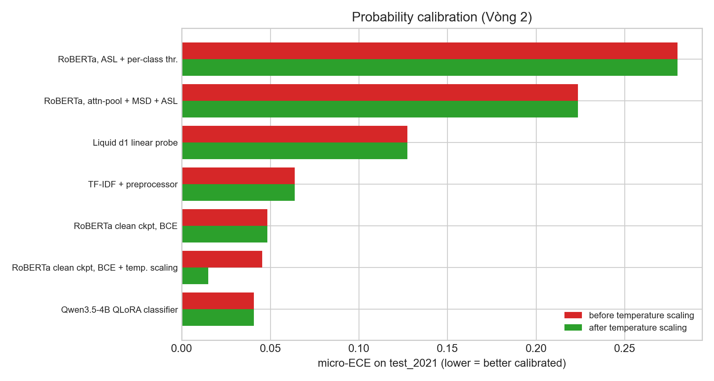
*Hình 15. micro-ECE trên `test_2021`. Chỉ cấu hình có temperature scaling mới có hai giá trị khác nhau.*

* Temperature scaling giảm ECE gần ba lần (0.0455 xuống 0.0151) nhưng không làm tăng F1 (0.6525 xuống 0.6473 giữa hai lần chạy khác nhau); khớp với phân tích ở Mục 6.8.2.
* ASL cho F1 cao nhưng xác suất kém hiệu chuẩn (ECE 0.22 đến 0.28 so với 0.05 của BCE); nếu dùng xác suất làm điểm tin cậy tuyệt đối thì phải hiệu chuẩn lại.

**7.4.2. Phân loại có chọn lọc (margin, `test_2021`, coverage 80%)**

| Cấu hình | Micro-F1 phần tự động hóa | Micro-F1 phần chuyển đi |
|:---|:---:|:---:|
| RoBERTa `dec2020`, attention pooling + MSD + ASL | 0.758 | 0.609 |
| RoBERTa `dec2020`, ASL | 0.733 | 0.579 |
| Qwen3.5-4B, QLoRA | 0.733 | 0.580 |
| RoBERTa `dec2020`, BCE | 0.681 | 0.556 |
| TF-IDF + bộ làm sạch | 0.643 | 0.522 |
| Liquid d1, linear probe | 0.624 | 0.507 |

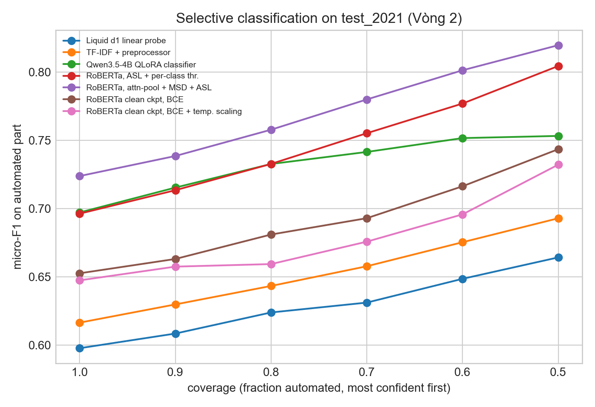
*Hình 16. Micro-F1 trên phần được tự động hóa theo coverage, giữ tweet chắc chắn nhất trước, `test_2021`.*

Ở mọi cấu hình, phần bị chuyển đi có chất lượng thấp hơn rõ rệt phần tự động hóa; với cấu hình tốt nhất, giữ 50% tweet chắc chắn nhất cho Micro-F1 bằng 0.820 trên phần đó. Xác suất tuyệt đối của ASL không đáng tin, nhưng thứ hạng của nó vẫn hữu ích cho chọn lọc.

### 7.5. Tinh chỉnh và khai thác d1, Qwen (Vòng 1, 2 và 3)

| Mô hình | Ngưỡng | `test_2020` Micro / Macro | `test_2021` Micro / Macro | Exact Match (2020 / 2021) |
|:---|:---:|:---:|:---:|:---:|
| Qwen3.5-4B, zero-shot JSON (B4) ‡ | không có (đầu ra rời rạc) | 0.0290 / 0.0107 | chưa đo | 0.0000 / chưa đo |
| **Qwen3.5-4B, QLoRA có giám sát** | theo lớp | **0.7319 / 0.6533** | **0.6971 / 0.5815** | 0.4119 / 0.3996 |
| Liquid d1, cách đọc ở lần thử đầu (B3) † | chung | 0.1820 / 0.1178 | chưa đo | 0.0000 / chưa đo |
| Liquid d1, option-letter zero-shot | chung | 0.5677 / 0.4757 | 0.5763 / 0.4806 | 0.2391 / 0.2674 |
| Liquid d1, linear probe | theo lớp | 0.6432 / 0.5519 | 0.5976 / 0.4640 | 0.2967 / 0.2621 |
| Liquid d1, `system_one` choice (Vòng 3) | chung | 0.6509 / 0.5384 | **0.6637 / 0.5229** | 0.3246 / 0.3621 |
| Liquid d1, `system_one` 19 câu noul (Vòng 3) | chung | 0.6291 / 0.5104 | 0.5922 / 0.4595 | 0.2862 / 0.2174 |

‡ † Đo trên 200 tweet đầu của `test_2020` (không phải đủ 573 tweet) bằng mã nhúng trong notebook 03 và 04 (lệnh `select(range(min(200, ...)))`; log B4: `Test evaluation sample count: 200`); số lấy từ log Kaggle trong `outputs/multi_kaggle_results/`. Hai hàng này chưa đo `test_2021`, và B3 chọn ngưỡng trên 200 tweet đầu của `validation_2020`.

* **Huấn luyện có giám sát là yếu tố then chốt với LLM:** Qwen3.5-4B tăng từ 0.0290 (zero-shot JSON) lên 0.7319 (QLoRA); chênh lệch này gộp hai yếu tố (có giám sát, và không còn bước sinh JSON) và khác cả tập đánh giá (200 so với 573 tweet), nên chưa tách được và không nên đọc là mức tăng do huấn luyện thuần túy.
* **Kích thước mô hình không quyết định:** Qwen QLoRA (4 tỷ tham số) tương đương RoBERTa 125 triệu tham số có attention pooling (0.7319 / 0.6533 so với 0.7417 / 0.6536 trên 2020), kém hơn một chút ở 2021 (0.6971 / 0.5815 so với 0.7238 / 0.5974).
* **Với d1, cách khai thác đúng thay đổi toàn bộ kết quả:** 0.18 ở lần thử đầu, 0.58 với option-letter, 0.60 với linear probe, **0.66 với `system_one` choice**. Dùng đúng cách mô hình được thiết kế (choice) vượt cả linear probe có huấn luyện trên 2021 (0.664 so với 0.598 Micro-F1).
* **Cách hỏi quan trọng:** một câu hỏi nhiều đáp án (choice) tốt hơn 19 câu độc lập (noul) khoảng 7 điểm Micro-F1 trên 2021.
* **d1 không suy giảm theo thời gian** (+1.28 điểm Micro-F1 từ 2020 sang 2021, trong khi BERT P0 giảm 2.25, trung bình 3 seed). Mô hình không được huấn luyện trên 2020 nên không học vẹt phân phối 2020; đây là gợi ý, mới có một lần chạy.
* **So với BERT tinh chỉnh** (P0, trung bình 3 seed: 0.718 / 0.570), d1 `system_one` thấp hơn khoảng 5 điểm ở cả hai thước đo, nhưng không cần huấn luyện; một lượt chạy (cài thư viện, tải mô hình, chấm 2,825 tweet của validation và hai tập test) mất khoảng 10 phút trên GPU Kaggle. Ngưỡng của d1 vẫn được chọn bằng nhãn validation (0.15 cho choice, 0.55 cho noul), nên đây không phải zero-shot thuần theo nghĩa chặt.

### 7.6. Vai trò của LLM auditor và của tiền xử lý (Vòng 2)

**LLM auditor.** TF-IDF quyết định nhãn; 20% tweet mơ hồ nhất (theo margin) được chuyển cho Qwen3.5-4B zero-shot với chain-of-thought, và dự đoán của LLM **thay thế** dự đoán của TF-IDF trên phần đó.

| Tập | Số tweet chuyển đi | Micro-F1 toàn bộ: trước → sau | Micro-F1 trên phần được kiểm tra: trước → sau |
|:---|:---:|:---:|:---:|
| `test_2020` | 115 | 0.6947 → **0.5366** | 0.5652 → **0.2741** |
| `test_2021` | 336 | 0.6163 → **0.4798** | 0.5216 → **0.2756** |

Giả thuyết "LLM hữu ích khi chỉ dùng cho các ca mơ hồ" **bị bác bỏ** với LLM zero-shot và chính sách thay thế: chất lượng giảm ngay trên chính phần được chuyển đi, cùng chiều với kết quả zero-shot của B4 (nguyên nhân của cả hai chưa được chẩn đoán từ đầu ra thô). Chính sách hợp nhất (union) và LLM đã tinh chỉnh làm auditor chưa được kiểm tra.

**Tiền xử lý nhẹ.** TF-IDF + cleaner (bản cũ) đạt 0.6947 / 0.5412 so với 0.6890 / 0.5227 (2020) và 0.6163 / 0.4058 so với 0.6154 / 0.3997 (2021): dưới 1 điểm Micro-F1 và dưới 2 điểm Macro-F1, nằm trong mức dao động của một lần chạy.

### 7.7. Ablation 1 (Vòng 3): hàm mất mát và head

**Câu hỏi.** Weighted BCE hoặc Focal có cứu được lớp hiếm so với BCE không?

**Với head mặc định (L1 đến L5; pooler tiền huấn luyện, dropout 0.1, tốc độ học 2e-5)**

| Mã | Loss | `test_2020` Micro / Macro | `test_2021` Micro / Macro | F1 `fashion` / `food` (2021) |
|:---:|:---|:---:|:---:|:---:|
| L1 | BCE | 0.6602 / 0.2805 | 0.6431 / 0.2568 | 0.00 / 0.00 |
| L2 | Weighted BCE | 0.6500 / 0.5721 | 0.6535 / 0.5219 | 0.59 / 0.47 |
| L3 | Focal (γ=2, α=0.25) | 0.6812 / 0.3996 | 0.6637 / 0.3790 | 0.00 / 0.50 |
| L4 | Focal (γ=1, α=0.25) | 0.6440 / 0.2259 | 0.6252 / 0.2097 | 0.00 / 0.00 |
| L5 | Focal (γ=2, không α) | 0.7061 / 0.5383 | 0.6871 / 0.4996 | 0.33 / 0.63 |

Đọc riêng bảng này, kết luận sẽ là "Weighted BCE cứu Macro-F1 từ 0.26 lên 0.52". Nhưng có dấu hiệu bất thường: với L1, Macro-F1 trên validation sau từng epoch chỉ là 0.24, 0.33, 0.38, 0.40, trong khi P0 (cũng BCE, chỉ khác head) đã đạt 0.56, 0.65, 0.66, 0.68; loss huấn luyện cuối cùng của L1 là 0.184, của P0 là 0.092. Head mặc định học chậm hơn nhiều, nên bảng này có thể đang đo tốc độ học chứ chưa chắc đo tác dụng của loss.

**Cùng loss, đổi sang head tùy chỉnh giống P0 (đọc `[CLS]` trực tiếp, dropout 0.2, tốc độ học 1e-3).** Mỗi cấu hình dưới đây chỉ khác P0 ở loss (đã đối chiếu từng tệp cấu hình).

| Loss | `test_2020` Micro / Macro | `test_2021` Micro / Macro |
|:---|:---:|:---:|
| BCE (P0) | 0.7377 / 0.6374 | 0.7161 / 0.5681 |
| Weighted BCE (H2) | 0.7132 / 0.6447 | 0.6996 / 0.5741 |
| Focal (γ=2, α=0.25) (H3) | 0.7380 / 0.6219 | 0.7194 / 0.5482 |
| Focal (γ=1, α=0.25) (H4) | 0.7441 / 0.6303 | 0.7211 / 0.5463 |
| Focal (γ=2, không α) (H5) | 0.7438 / 0.6401 | 0.7145 / 0.5527 |

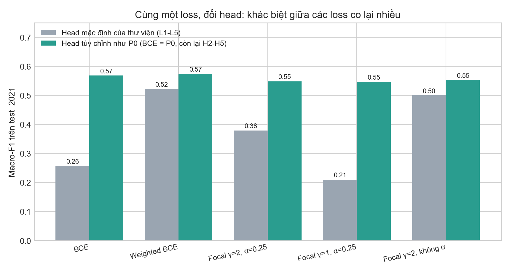
*Hình 17. Cùng một loss, đổi head: BCE tăng từ 0.26 lên 0.57; khoảng cách giữa các loss co lại nhiều.*

* Đổi head làm Macro-F1 của BCE tăng **31 điểm** (0.26 lên 0.57); đổi loss chỉ làm Macro-F1 dao động trong khoảng 0.546 đến 0.574 (rộng 2.8 điểm). Weighted BCE ngang BCE (+0.006); các biến thể Focal thấp hơn 0.015 đến 0.022, tức khoảng 1.5 đến 2 lần độ lệch chuẩn giữa các seed của P0 (0.010); mỗi biến thể chỉ chạy một seed nên chưa kết luận Focal kém hơn.
* Weighted BCE và Focal vì vậy có vẻ hoạt động như cách "tăng tốc" việc học lớp hiếm khi huấn luyện chưa đủ, không phải phần bổ sung cần thiết khi head đã học tốt. Focal với α = 0.25 làm yếu mẫu dương nên kém nhất khi dùng ngưỡng chung ở head mặc định (L4: 0.21); bỏ α (L5) đưa kết quả lên 0.50.
* **Chưa biết yếu tố nào của head tùy chỉnh tạo ra khác biệt** (tốc độ học, bỏ pooler tiền huấn luyện, dropout, khởi tạo). Cách tách rẻ nhất là chạy head tùy chỉnh với tốc độ học 2e-5 (Mục 7.12).
* **Hệ quả cho Vòng 2.** RoBERTa + BCE (head mặc định, 3 epoch, ngưỡng chung 0.25) chỉ đạt Macro-F1 0.289, gần L1 (0.257); RoBERTa + ASL (cũng head mặc định, ngưỡng theo lớp) đạt 0.573, gần L2 (0.522). Mô thức giống nhau: một loss làm yếu tín hiệu âm hoặc tăng tín hiệu dương "cứu" một head huấn luyện chưa đủ. Vì vậy lợi thế của ASL ở Vòng 2 có thể một phần là hiệu ứng này; chưa kiểm chứng.

### 7.8. Ablation 2 (Vòng 3): từng kỹ thuật đóng góp bao nhiêu?

Mỗi bước chỉ thêm một thay đổi so với bước trước:

| Bước | Thay đổi |
|:---:|:---|
| P0 | BERT, `[CLS]`, BCE, ngưỡng chung |
| P1 | Ngưỡng theo từng lớp (tính lại từ xác suất của P0) |
| P2 | Thêm `TweetTextCleaner` (bản mới) |
| P3 | Đổi sang Weighted BCE |
| P4 | Đổi `[CLS]` sang mean pooling |
| P5 | Đổi sang attention pooling |
| P6 | Thêm MSD (5 nhánh) |
| P7 | Thêm temperature scaling |
| P8 | Chỉ tự động hóa 80% tweet chắc chắn nhất |

P0 dùng ngưỡng chung; từ P1 trở đi dùng ngưỡng theo lớp. P1, P7 và P8 là hậu xử lý, tính từ xác suất đã lưu.

**P6 gồm đủ các kỹ thuật cộng dồn từ P0 đến P6:** BERT-base-uncased với head tùy chỉnh (tốc độ học head 1e-3, không dùng pooler tiền huấn luyện), `TweetTextCleaner`, Weighted BCE (trọng số lớp dương giới hạn 1 đến 30), attention pooling (`attn_dim` 256) và Multi-Sample Dropout 5 nhánh (dropout 0.2); 4 epoch, tốc độ học thân 2e-5, batch 32, seed 42. Tham số đầy đủ ở Phụ lục A. Ở các bảng ba seed bên dưới, P6 dùng ngưỡng chung như P0.

| Bước | `test_2020` Micro / Macro | `test_2021` Micro / Macro | Thay đổi so với bước trước (Micro / Macro, 2021) |
|:---:|:---:|:---:|:---:|
| P0 | 0.7377 / 0.6374 | 0.7161 / 0.5681 | |
| P1 | 0.7189 / 0.6317 | 0.6956 / 0.5781 | -0.021 / +0.010 |
| P2 | 0.7338 / 0.6457 | 0.7053 / 0.5708 | +0.010 / -0.007 |
| P3 | 0.7069 / 0.6303 | 0.6801 / 0.5642 | -0.025 / -0.007 |
| P4 | 0.6949 / 0.6242 | 0.6828 / 0.5665 | +0.003 / +0.002 |
| P5 | 0.6953 / 0.6158 | 0.6838 / 0.5738 | +0.001 / +0.007 |
| P6 | 0.7163 / 0.6323 | 0.7012 / 0.5826 | +0.017 / +0.009 |
| P7 | 0.7149 / 0.6283 | 0.6994 / 0.5766 | -0.002 / -0.006 |
| P8 | 0.7566 / 0.6432 | 0.7424 / 0.6045 | chỉ đo trên 80% tweet chắc chắn nhất |

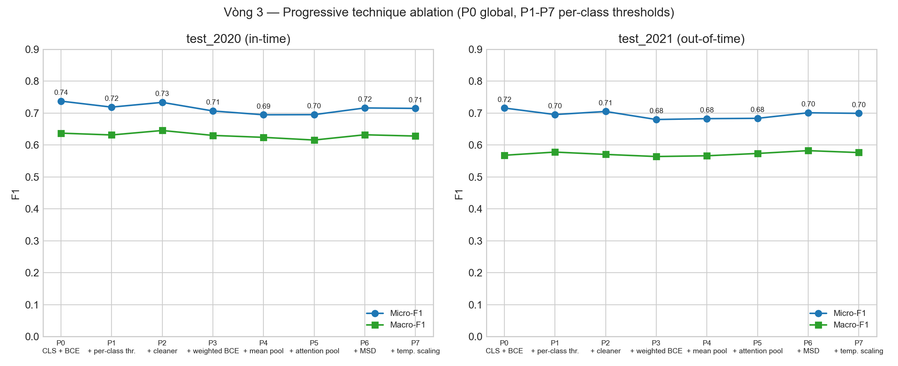
*Hình 18. Hai đường gần như phẳng: không bước nào tạo bước nhảy rõ rệt.*

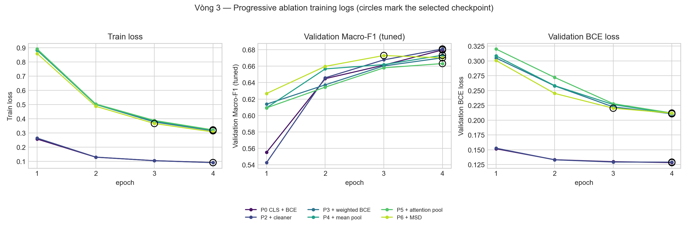
*Hình 19. Loss huấn luyện, Macro-F1 và BCE trên validation theo epoch (vòng tròn: checkpoint được chọn). Hai nhóm loss huấn luyện khác thang vì P0 và P2 dùng BCE còn P3 đến P6 dùng Weighted BCE. P0 đến P5 chọn epoch 4; P6 chọn epoch 3.*

**Mức nhiễu giữa các lần chạy (ba seed, ngưỡng chung)**

| Cấu hình | `test_2021` Micro-F1 | `test_2021` Macro-F1 | Từng seed 42 / 1337 / 2024 (Micro / Macro) |
|:---|:---:|:---:|:---|
| P0: BERT + BCE | 0.718 ± 0.006 | 0.570 ± 0.010 | 0.716 / 0.568; 0.725 / 0.561; 0.712 / 0.581 |
| P6: Cleaner + Weighted BCE + Attention + MSD | 0.705 ± 0.001 | 0.583 ± 0.003 | 0.706 / 0.579; 0.705 / 0.583; 0.705 / 0.586 |
| L2: head mặc định + Weighted BCE | 0.653 ± 0.003 | 0.522 ± 0.007 | 0.654 / 0.522; 0.651 / 0.514; 0.656 / 0.529 |

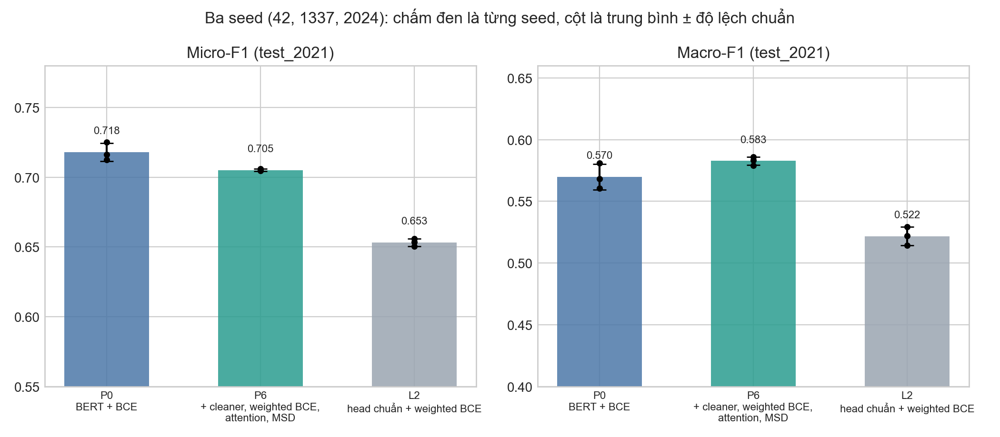
*Hình 20. Chấm đen là từng seed, cột là trung bình ± độ lệch chuẩn.*

* Độ lệch chuẩn giữa seed của P0 là khoảng 0.65 điểm Micro và 1.0 điểm Macro (ước lượng từ ba seed). **Với một lần chạy duy nhất, thay đổi nhỏ hơn khoảng 2 lần mức này, tức 1.3 điểm Micro và 2.0 điểm Macro, chưa thể xem là có tác dụng.** Các bước P2, P4, P5 và P7 đều nằm dưới ngưỡng đó (mỗi chỉ số lệch không quá 1.0 điểm).
* P6 (Cleaner + Weighted BCE + Attention pooling + MSD) so với P0 (BERT + BCE) so sánh hai trung bình ba seed (ngưỡng chung), nên phải dùng sai số chuẩn của hiệu thay vì độ lệch chuẩn của một lần chạy. Micro-F1 thấp hơn 1.3 điểm, khoảng 3.4 lần sai số chuẩn (0.38 điểm): giảm khá rõ. Macro-F1 cao hơn 1.3 điểm, chỉ khoảng 2.1 lần sai số chuẩn (0.62 điểm): tăng sát ngưỡng nhiễu. Vì vậy P6 là một **đánh đổi nhỏ** chứ chưa phải cải thiện, và các sai số này ước lượng từ chỉ ba seed nên rất thô. P6 cũng ổn định hơn (độ lệch chuẩn Micro 0.001 so với 0.006).
* Ngưỡng theo lớp (P1) làm Micro-F1 giảm 2.1 điểm và Macro-F1 tăng 1.0 điểm: 573 mẫu validation chưa đủ để chọn đồng thời 19 ngưỡng ổn định.
* Weighted BCE ở P3 khiến Micro-F1 giảm 2.5 điểm mà Macro-F1 không tăng: khi head đã tốt, trọng số lớp chủ yếu đổi cán cân giữa hai thước đo.

### 7.9. Ngưỡng, hiệu chuẩn và chọn lọc (Vòng 3)

**Ngưỡng quyết định (`test_2021`, Micro / Macro-F1)**

| Cấu hình | Ngưỡng 0.5 | Ngưỡng chung | Ngưỡng theo lớp |
|:---|:---:|:---:|:---:|
| L1: head mặc định + BCE | 0.6239 / 0.1949 | 0.6431 / 0.2568 | 0.4784 / 0.3996 |
| P0: BCE | 0.7220 / 0.5438 | 0.7161 / 0.5681 | 0.6956 / 0.5781 |
| Weighted BCE (H2) | 0.6362 / 0.5245 | 0.6996 / 0.5741 | 0.6873 / 0.5679 |
| P6: Cleaner + Weighted BCE + Attention + MSD | 0.6274 / 0.5065 | 0.7061 / 0.5791 | 0.7012 / 0.5826 |

* **Weighted BCE đẩy xác suất lên cao**, nên ngưỡng tối ưu là 0.8 chứ không phải 0.5; so ở 0.5 làm P6 thua 7.9 điểm Micro-F1 một cách giả tạo. BCE thuần thì ngưỡng chung tối ưu là 0.3.
* **Ngưỡng theo lớp có thể làm hỏng Micro-F1** (L1: 0.478, thấp hơn cả ngưỡng 0.5). Ở L1, ngưỡng theo lớp của ba lớp (`food_&_dining`, `travel_&_adventure`, `youth_&_student_life`) bị đẩy xuống mức thấp nhất (0.05) và F1 trên 2021 chỉ còn 0.032, đúng mức của việc gán nhãn dương cho mọi tweet: mô hình không tách được các lớp này nên F1 trên validation cao nhất khi dự đoán dương hết; Macro-F1 hưởng lợi, Micro-F1 sụp.

**Hiệu chuẩn (micro-ECE trên `test_2021`)**

| Cấu hình | ECE trước | ECE sau temperature scaling (T theo lớp) |
|:---|:---:|:---:|
| L1: BCE (head mặc định) | 0.041 | 0.016 |
| P0: BCE | 0.010 | 0.007 |
| P6: Cleaner + Weighted BCE + Attention + MSD | 0.092 | 0.087 |

BCE đã hiệu chuẩn tốt và temperature scaling cải thiện thêm. Với Weighted BCE, ECE cao (P6: 0.092; riêng L2: 0.225) và temperature scaling gần như không sửa được: hệ số này chỉ co giãn xác suất, còn lỗi ở đây là xác suất bị **đẩy lệch có chủ ý** bởi trọng số lớp. (Biểu đồ ECE của toàn bộ lần chạy Vòng 3 nằm ở `doc/figures/v3_calibration_ece.png`.)

**Chuyển tweet kém chắc chắn cho người xử lý (BERT + Cleaner + Weighted BCE + Attention pooling + MSD, tức P6; `test_2021`)**

| Tỷ lệ tự động hóa | Micro-F1 phần tự động | Micro-F1 phần chuyển người |
|:---:|:---:|:---:|
| 100% | 0.7012 | |
| 90% | 0.7230 | 0.5455 |
| 80% | 0.7439 | 0.5643 |
| 70% | 0.7632 | 0.5862 |
| 60% | 0.7855 | 0.6070 |
| 50% | 0.8090 | 0.6243 |

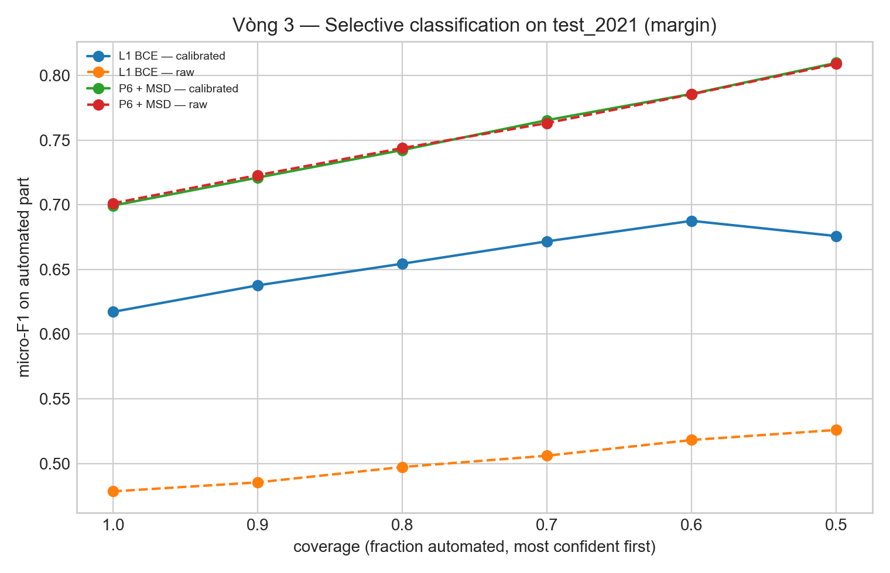
*Hình 21. Càng giữ ít tweet (chỉ những tweet chắc chắn nhất), chất lượng phần tự động càng cao. Chỉ nên đọc đường P6; đường L1 thấp bất thường do ngưỡng theo lớp của L1 bị sụp, nên khoảng cách giữa L1 gốc và L1 đã hiệu chuẩn không phải bằng chứng về tác dụng của temperature scaling lên F1.*

Bảng dùng xác suất gốc của P6 (ngưỡng theo lớp). Hàng P8 ở Mục 7.8 dùng xác suất đã qua temperature scaling (P7) nên là 0.7424 thay vì 0.7439 tại mức 80%. Điểm margin **thật sự tách được tweet dễ khỏi tweet khó**: phần chuyển người có chất lượng thấp hơn rõ rệt phần tự động ở mọi mức; với 80% tự động hóa, chất lượng tăng 4.3 điểm Micro-F1 mà không huấn luyện thêm.

### 7.10. Phân tích lỗi: các lớp hiếm

| Cấu hình | `fashion_&_style` (32 mẫu dương) | `food_&_dining` (15 mẫu dương) | `travel_&_adventure` (15 mẫu dương) | `youth_&_student_life` (11 mẫu dương) | `other_hobbies` (81 mẫu dương) | Số lớp có F1 = 0 (trên 19) | Macro-F1 |
|:---|:---:|:---:|:---:|:---:|:---:|:---:|:---:|
| L1: BCE, head mặc định | 0.00 | 0.00 | 0.00 | 0.00 | 0.00 | 10 | 0.2568 |
| L2: Weighted BCE, head mặc định | 0.59 | 0.47 | 0.13 | 0.40 | 0.31 | 0 | 0.5219 |
| P0: BCE, head tùy chỉnh | 0.55 | 0.59 | 0.26 | 0.40 | 0.28 | 0 | 0.5681 |
| H2: Weighted BCE, head tùy chỉnh | 0.62 | 0.62 | 0.31 | 0.43 | 0.30 | 0 | 0.5741 |
| P6: Cleaner + Weighted BCE + Attention + MSD | 0.62 | 0.59 | 0.26 | 0.46 | 0.29 | 0 | 0.5791 |
| d1 `system_one` choice | 0.64 | 0.69 | 0.38 | 0.26 | 0.06 | 0 | 0.5229 |

* Với head mặc định (L1), **10 trong 19 lớp có F1 bằng 0**, gồm cả năm lớp trong bảng; ở năm cấu hình còn lại của bảng không có lớp nào bằng 0.
* Head tùy chỉnh (P0, H2, P6) và Weighted BCE (L2) đưa `fashion`, `food` và `youth` lên khoảng 0.4 đến 0.6. Hai lớp còn khó là `travel_&_adventure` (0.13 đến 0.31) và `other_hobbies` (0.28 đến 0.31); `travel` thấp nhất ở L2, P0, P6 còn `other_hobbies` thấp nhất ở H2 (chênh với `travel` chỉ 0.01).
* d1 `system_one` choice cho F1 cao nhất ở `fashion` (0.64), `food` (0.69) và `travel` (0.38), nhưng gần như không nhận ra `other_hobbies` (0.06). Nguyên nhân chưa được phân tích; có thể nhóm "sở thích khác" không có ranh giới ngữ nghĩa rõ khi chỉ có tên chủ đề làm gợi ý.
* Hạn chế: bốn lớp đầu chỉ có 11 đến 32 mẫu dương trên `test_2021`, nên đổi nhãn vài tweet đã làm F1 dao động hàng chục điểm phần trăm; chưa phân tích theo tokenizer hay theo độ dài tweet.

**Điểm chốt các mục 7.2 đến 7.10.** (1) Head đổi kết quả nhiều hơn loss; (2) kỹ thuật cộng thêm gần như nằm trong nhiễu seed; (3) hậu xử lý (ngưỡng, chọn lọc) là nơi có lợi lớn nhất; (4) d1 dùng đúng API gốc là lựa chọn tốt khi không có dữ liệu gán nhãn.

### 7.11. Đối chiếu tiêu chí rủi ro với số đo

Giữ nguyên mục tiêu và giải pháp của báo cáo gốc; cột cuối ghi kết quả đo được.

| Mã | Rủi ro | Giải pháp trong hệ thống | Tiêu chí | Trạng thái theo số đo |
|:---:|:---|:---|:---|:---|
| **R01** | Mất cân bằng lớp đuôi dài (20.2 : 1) | Loss cân bằng (ASL, Weighted BCE, Focal), MSD | Macro-F1 các lớp đuôi tăng ≥ 5.0 | **Đạt ở Vòng 2** (0.289 lên 0.573 với ASL) **nhưng nguyên nhân chưa tách**; Vòng 3: khi head đã ổn, Weighted BCE và Focal không tạo mức tăng ≥ 5 điểm (-2.2 đến +0.6) |
| **R02** | Trôi dạt thời gian | Backbone Twitter-RoBERTa; cập nhật adapter định kỳ (chưa thực hiện) | Suy giảm Micro-F1 giữa hai năm ≤ 2.0 | **Đạt một phần:** đạt ở RoBERTa ASL (-0.85), RoBERTa attention + MSD + ASL (-1.79), P6 (-1.05, trung bình 3 seed), d1 (+1.28); **không đạt** ở P0 (-2.25, trung bình 3 seed), TF-IDF (-7.36), Qwen QLoRA (-3.48), d1 probe (-4.56) |
| **R03** | Quá tự tin ở ngưỡng cố định 0.5 | Ngưỡng theo lớp; temperature scaling | ECE < 0.04; Micro-F1 tăng ≥ 2.5 so với ngưỡng 0.5 | **Đạt một phần:** ECE đạt ở P0 (0.010), Qwen QLoRA (0.0407 chỉ gần ngưỡng), RoBERTa BCE sau hiệu chuẩn (0.0151); **không đạt** ở ASL (0.22 đến 0.28) và Weighted BCE (0.092). Micro-F1 tăng so với 0.5: đạt ở P6 (+7.9), **không** ở P0 (-0.6) |
| **R04** | Lỗi định dạng và ảo giác của LLM | d1 `system_one` và QLoRA không sinh JSON; parser cho B4 | Tỷ lệ lỗi parse = 0.00% | **Không còn áp dụng** cho QLoRA và d1 (không có bước sinh văn bản); tỷ lệ lỗi parse của B4 chưa được đo |

### 7.12. Kết luận, hạn chế và bước tiếp theo

**Kết luận**

* Trước khi thay loss, hãy kiểm tra **head có học đủ nhanh không**: đổi head tạo khác biệt (31 điểm Macro-F1 cho BCE) lớn hơn mọi hàm mất mát được thử (tối đa 2.8 điểm khi head đã ổn). Yếu tố cụ thể trong head chưa được tách riêng.
* Với head ổn định, **BCE thuần cộng một ngưỡng chung tìm trên validation** đã gần đủ; các kỹ thuật bổ sung chỉ đổi Micro-F1 lấy Macro-F1 trong biên độ vài điểm.
* **Chọn ngưỡng là một phần của mô hình**: mọi so sánh phải nêu rõ ngưỡng, và Weighted BCE chỉ công bằng khi so ở ngưỡng đã tìm trên validation.
* Nếu cần độ tin cậy khi vận hành, **chuyển tweet kém chắc chắn cho người xử lý** cho mức tăng chất lượng lớn nhất mà không tốn thêm huấn luyện.
* **Liquid d1-2B** dùng đúng API gốc (choice) là lựa chọn tốt khi không có dữ liệu gán nhãn.
* LLM zero-shot làm auditor thay thế dự đoán **làm giảm** chất lượng (Mục 7.6).

**Hạn chế cần nêu rõ**

1. **Số lần chạy ít.** Ba seed cho BERT + BCE (P0), BERT + Cleaner + Weighted BCE + Attention pooling + MSD (P6) và head mặc định + Weighted BCE (L2); một seed cho các cấu hình còn lại; Vòng 2 chỉ một seed. Chênh lệch dưới khoảng 1 đến 2 điểm coi là chưa kết luận.
2. **Chưa tách riêng yếu tố trong head.** Head tùy chỉnh khác head mặc định ở bốn điểm cùng lúc (tốc độ học, bỏ pooler tiền huấn luyện, dropout, khởi tạo). "Đổi head tạo khác biệt lớn" đáng tin; "do tốc độ học" thì chưa.
3. **Huấn luyện chưa hội tụ.** Ở seed 42, mọi cấu hình Vòng 3 đều tốt nhất ở epoch cuối (riêng P6 là epoch 3); ở các seed phụ có hai lần chọn epoch 3 (P0 seed 1337, L2 seed 2024), nên bằng chứng không đồng nhất. 4 epoch có thể chưa đủ, và thứ hạng giữa các loss có thể đổi nếu huấn luyện lâu hơn; chưa kiểm chứng.
4. **Validation chỉ 573 mẫu.** Ngưỡng theo lớp (19 lớp, mỗi lớp thử 17 mức) dễ khớp quá mức.
5. **Bộ làm sạch đã được sửa sau Vòng 2** (Phần IV); kết luận "tiền xử lý nhẹ không khác biệt đáng kể" của Vòng 2 cần đọc kèm lưu ý này.
6. **Thang kỹ thuật phụ thuộc thứ tự.** Đóng góp của từng bước là đóng góp khi đứng sau các bước trước.
7. **Vòng 2 và Vòng 3 khác nhau về backbone, cách chọn epoch, cắt gradient và seed**, nên chỉ so sánh mang tính bối cảnh.
8. **d1 chưa được khảo sát kỹ:** mỗi cách hỏi chạy một lần, `set_size` để mặc định, chưa thử biến thể câu hỏi hay mô tả chủ đề; ngưỡng vẫn chọn bằng nhãn validation.
9. **ASL không nằm trong Vòng 3**; lý do và thiết kế thí nghiệm ở `doc/Future.md`.

**Việc tiếp theo, theo thứ tự ưu tiên**

1. Tách yếu tố trong head: chạy head tùy chỉnh với tốc độ học 2e-5 (chỉ đổi `head_lr`), và huấn luyện lâu hơn (8 đến 10 epoch) cho bộ loss với head mặc định.
2. Khôi phục ASL, chạy tách riêng từng cơ chế trên cùng head (`doc/Future.md`) và kiểm tra lại kết luận của Vòng 2 trên RoBERTa.
3. Thêm seed cho các cấu hình còn lại để đo nhiễu như đã làm với P0 và P6.
4. Thử các chế độ hỏi khác của d1 (đặt `set_size`, đổi câu hỏi) và đầu dò d1 có huấn luyện với loss cân bằng.

---

## PHỤ LỤC A. THAM SỐ CỦA TỪNG MÔ HÌNH

Nguồn của từng giá trị: **cấu hình** = tệp YAML hoặc notebook; **mã nguồn** = giá trị mặc định trong mã (Vòng 2: commit `9ddc5f6`, không đổi so với hiện tại đối với d1 probe, QLoRA và TF-IDF); **log** = lấy từ log Kaggle.

### A.1. Vòng 1: bốn baseline (notebook `01` đến `04`)

| Mô hình | Tham số |
|:---|:---|
| **B1** TF-IDF + Logistic Regression | TF-IDF từ: n-gram (1, 2), 40,000 đặc trưng, `sublinear_tf`, bỏ dấu `unicode`, chữ thường; TF-IDF ký tự `char_wb`: n-gram (3, 5), 60,000 đặc trưng, `sublinear_tf`; Logistic Regression One-vs-Rest: $C = 2.0$, `class_weight='balanced'`, `lbfgs`, 1,000 vòng lặp, `random_state=42`; ngưỡng chung quét 0.10 đến 0.85, bước 0.05, tối đa Micro-F1 |
| **B2** Twitter-RoBERTa | `cardiffnlp/twitter-roberta-base-2021-124m-topic-multi` (đã thấy dữ liệu 2021); head mặc định; BCE; AdamW, tốc độ học 2e-5, weight decay 0.01, warmup tuyến tính 10%; 3 epoch, batch 32, tối đa 128 token; mixed precision; ngưỡng chung quét 0.10 đến 0.85 |
| **B3** d1-2B (lần thử đầu) | `LiquidAI/d1-2B`, bfloat16 trên GPU, xử lý từng tweet một (không batch); chọn ngưỡng chung trên 200 tweet đầu của `validation_2020` (quét 0.10 đến 0.75, bước 0.05, tối đa Micro-F1; kết quả 0.70) rồi đánh giá trên 200 tweet đầu của `test_2020`; điểm là sigmoid của 19 logit đầu tiên trong từ vựng (đọc sai đầu ra, Mục 6.4) |
| **B4** Qwen3.5-4B zero-shot | `Qwen/Qwen3.5-4B`, 4-bit NF4, tính toán fp16, sinh tham lam (`do_sample=False`), `max_new_tokens=48`, system prompt liệt kê 19 chủ đề và yêu cầu mảng JSON, phân tích bằng regex (dự phòng: tìm tên chủ đề trong văn bản), xử lý từng tweet một, 200 tweet đầu của `test_2020`, không dùng validation |

Với B3 và B4, `configs/03_decision_d1_liquid.yaml` và `configs/04_llm_qwen3_5_4b.yaml` ghi `max_eval_samples: 500`, nhưng notebook (mã nhúng) tự đặt 200; số trong bảng lấy từ notebook và log Kaggle.

### A.2. Vòng 2

**Encoder RoBERTa** (`cardiffnlp/twitter-roberta-base-dec2020`). Chung: tối đa 128 token, batch 32 (eval 64), 3 epoch, tốc độ học thân 2e-5, weight decay 0.01, AdamW, warmup tuyến tính 10% (mã nguồn), mixed precision, **không cắt gradient, không đặt seed, lấy checkpoint cuối epoch 3** (mã nguồn của bản đã chạy Vòng 2, đối chiếu với log Kaggle; mã hiện tại đã đổi mặc định, xem Mục 6.7).

| Cấu hình | Loss | Head | Pooling / MSD | Tốc độ học head | Ngưỡng |
|:---|:---|:---|:---|:---:|:---|
| `v2_roberta_dec2020_bce` | BCE | mặc định | `<s>` / 1 | 2e-5 | chung, Micro-F1 |
| `v2_roberta_dec2020_bce_tempscale` | BCE | mặc định | `<s>` / 1 | 2e-5 | chung, Micro-F1; temperature theo lớp |
| `v2_roberta_dec2020_asl_perclass` | ASL ($\gamma_+ = 1$, $\gamma_- = 4$, $m = 0.05$) | mặc định | `<s>` / 1 | 2e-5 | theo lớp, Macro-F1 |
| `v2_roberta_dec2020_attnpool_msd_asl` | ASL (như trên) | tùy chỉnh | attention (`attn_dim` 256) / 5 nhánh, $p = 0.2$ | 1e-3 | theo lớp, Macro-F1 |

**Các mô hình khác của Vòng 2**

| Mô hình | Tham số |
|:---|:---|
| TF-IDF + cleaner (`v2_ml_ovr_preproc_audit`) | Như B1 (cấu hình YAML), thêm `tweet_text_cleaner` (bản cũ); ngưỡng chung, Micro-F1; auditor: 20% tweet mơ hồ nhất theo margin, chính sách `replace`, Qwen3.5-4B 4-bit, batch 4 |
| d1 linear probe (`v2_d1_probe`) | `LiquidAI/d1-2B` đóng băng; Masked Mean Pooling lớp cuối; batch 16, tối đa 128 token; head: 80 epoch tối đa, tốc độ học 1e-3, batch 128 (mã nguồn), weight decay 0.01 (mã nguồn), AdamW; MSD $p \in \{0.1, 0.2, 0.3, 0.4\}$; BCE có trọng số dương giới hạn 30 (mã nguồn); dừng sớm kiên nhẫn 10 (mã nguồn); ngưỡng theo lớp, Macro-F1 |
| d1 option-letter (`v2_d1_zero_shot_letters`) | `LiquidAI/d1-2B`, batch 8, ngưỡng chung (0.7), không huấn luyện |
| Qwen QLoRA (`v2_qwen_qlora_cls`) | `Qwen/Qwen3.5-4B` 4-bit NF4 (lượng tử hóa kép, tính toán fp16); LoRA $r = 16$, $\alpha = 32$, dropout 0.05 (mã nguồn), mô-đun `q, k, v, o, gate, up, down` (mã nguồn); mean pooling, MSD 4 nhánh ($p \in \{0.1, 0.2, 0.3, 0.4\}$, mã nguồn); tối đa 128 token; batch 16, tích lũy gradient 2 (hiệu dụng 32); 3 epoch; tốc độ học 2e-4; weight decay 0.01 (mã nguồn); BCE có trọng số dương giới hạn 30 (mã nguồn); seed 42 (mã nguồn); 21,282,323 / 2,611,376,147 tham số huấn luyện (log); ngưỡng theo lớp, Macro-F1 |

### A.3. Vòng 3: BERT-base (`bert-base-uncased`)

**Tham số chung** (cấu hình): tối đa 128 token; batch 32 (eval 64); 4 epoch; tốc độ học thân 2e-5; weight decay 0.01; AdamW; warmup tuyến tính 10%; cắt gradient 1.0; mixed precision (fp16 autocast trên GPU); seed 42; chọn checkpoint theo Macro-F1 trên validation sau khi chọn ngưỡng (`val_macro_f1_tuned`), dừng sớm với kiên nhẫn 2; ngưỡng chung tối đa Micro-F1; $\mathrm{msd\_p} = 0.2$; `attn_dim` 256; `pos_weight_max` 30 cho Weighted BCE.

| Mã | Loss (tham số) | Head | Pooling | MSD | Cleaner |
|:---:|:---|:---|:---:|:---:|:---:|
| L1 | BCE | mặc định | `[CLS]` | 1 | không |
| L2 | Weighted BCE | mặc định | `[CLS]` | 1 | không |
| L3 | Focal ($\gamma = 2$, $\alpha = 0.25$) | mặc định | `[CLS]` | 1 | không |
| L4 | Focal ($\gamma = 1$, $\alpha = 0.25$) | mặc định | `[CLS]` | 1 | không |
| L5 | Focal ($\gamma = 2$, không $\alpha$) | mặc định | `[CLS]` | 1 | không |
| P0 | BCE | tùy chỉnh (lr head 1e-3) | `[CLS]` | 1 | không |
| H2 đến H5 | như L2 đến L5 | tùy chỉnh (lr head 1e-3) | `[CLS]` | 1 | không |
| P2 | BCE | tùy chỉnh | `[CLS]` | 1 | có |
| P3 | Weighted BCE | tùy chỉnh | `[CLS]` | 1 | có |
| P4 | Weighted BCE | tùy chỉnh | mean | 1 | có |
| P5 | Weighted BCE | tùy chỉnh | attention | 1 | có |
| P6 | Weighted BCE | tùy chỉnh | attention | 5 | có |

Với L1 đến L5, tham số `head_lr` trong tệp cấu hình không có tác dụng (head mặc định dùng một tốc độ học chung 2e-5). Seed 1337 và 2024 chạy lại P0, P6 và L2, chỉ khác `seed`.

### A.4. Vòng 3: Liquid d1-2B với `system_one`

`LiquidAI/d1-2B`, batch 8, không huấn luyện; `question_mode`: `choice_multiple` hoặc `noul`; `set_size` không đặt (mặc định của thư viện); kiểu dữ liệu tự chọn (`auto`): bfloat16 nếu GPU có compute capability từ 8, ngược lại fp16 (trên GPU Kaggle chạy ở fp16, theo log); ngưỡng chung chọn trên validation (0.15 cho choice, 0.55 cho noul); cần `transformers>=5.19`, gỡ `torchaudio`.

---

## PHỤ LỤC B. NGUỒN SỐ LIỆU VÀ TÁI LẬP

| Nội dung | Vị trí |
|:---|:---|
| L1 đến L5 (head mặc định) | `outputs/v3_l1_bce`, `v3_l2_weighted_bce`, `v3_l3_focal_g2`, `v3_l4_focal_g1`, `v3_l5_focal_g2_noalpha` |
| Loss với head tùy chỉnh (H2 đến H5) | `outputs/v3_h2_weighted_bce`, `v3_h3_focal_g2`, `v3_h4_focal_g1`, `v3_h5_focal_g2_noalpha` (BCE chính là P0) |
| Thang kỹ thuật | `outputs/v3_p0_custom_cls_bce`, `v3_p2_cleaner_bce`, `v3_p3_cleaner_weighted_bce`, `v3_p4_cleaner_weighted_mean`, `v3_p5_cleaner_weighted_attention`, `v3_p6_cleaner_weighted_attn_msd` |
| Seed bổ sung | các thư mục có đuôi `_s1337` và `_s2024` |
| d1 `system_one` | `outputs/v3_d1_system_one`, `v3_d1_system_one_noul` |
| Vòng 2 | `outputs/v2_results/*.json` |
| Thống kê dữ liệu | `eda/eda_summary.json`, `eda/eda_report.md` |

Mỗi thư mục Vòng 3 chứa `metrics_summary.json`, `test_predictions.json`, `val_probabilities.json` và `postprocess.json`. Lệnh chạy lại và cách dùng Kaggle nằm trong `README.md`; hình kết quả vẽ bằng `scripts/generate_benchmark_figures.py`, sơ đồ kiến trúc vẽ bằng `scripts/generate_architecture_diagrams.py` (đầu ra `doc/figures/arch_*.png`); các bảng Vòng 3 in bằng `scripts/build_v3_report_tables.py`. Hình chưa nhúng ở trên: `doc/figures/v3_loss_ablation.png`, `doc/figures/v3_calibration_ece.png`.

---

## PHỤ LỤC C. CÁC ĐIỂM ĐÃ SỬA SO VỚI BÁO CÁO GỐC

| Chỗ | Báo cáo gốc | Báo cáo này | Lý do |
|:---|:---|:---|:---|
| Số nhãn mỗi tweet | 37.4% tweet có 2 nhãn; 14.4% có 3 đến 6 nhãn | 36.2% và 15.6% (3 nhãn: 12.5%, 4 đến 6 nhãn: 3.1%) | `eda/eda_report.md` |
| Mốc tham chiếu của trôi dạt | Chênh lệch `test_2021` so với `test_2020` (tin tức -14.5) | `test_2021` so với `train_2020` (tin tức -13.09), cùng mốc với khoảng cách JSD 0.1377 | `eda/run_eda.py` tính JSD giữa `train_2020` và `test_2021` |
| Ma trận đồng xuất hiện | "Xác suất có điều kiện" 0.52, 0.46, 0.38 (`sports` và `fitness`) | Chỉ số Jaccard (0.29, 0.27, 0.24, 0.18); `sports` và `fitness_&_health` chỉ 0.02 | Hình là ma trận Jaccard |
| Tham số huấn luyện của QLoRA | "khoảng 0.2%" (Mục 7 của báo cáo gốc) và 0.815% (Mục 6.4 của báo cáo gốc) | 0.815% | Log Kaggle |
| Xử lý hashtag | "Tách tiền tố `#`" | Giữ `#`, tách tại ranh giới chữ hoa | Mã nguồn bộ làm sạch |
| Bước chuẩn hóa Unicode NFC | Được nêu như một chặng của pipeline | Bỏ: bộ làm sạch không có bước này | Mã nguồn bộ làm sạch |
| Stop words ở TF-IDF | "loại bỏ stop words tiếng Anh" | Không loại stop words | Mã nguồn và notebook 01 |
| Nhãn `health_&_medicine` | Nêu trong ví dụ emoji | Bỏ: không thuộc 19 chủ đề | Taxonomy |
| Exact Match của TF-IDF | 0.4154 / 0.3407 | 0.4258 / 0.3365 cho TF-IDF + cleaner | `outputs/v2_results` |
| ASL | "hàm mất mát tối ưu nhất hiện nay"; "trực tiếp nâng Macro-F1 từ 0.3 lên 0.6" | Bỏ hai khẳng định; ghi chú về head, về $\gamma_+ = 1$ và về việc hàm không còn trong `losses.py` | Kết quả Vòng 3 (Mục 7.7) |
| Mô tả Liquid d1 | "mạng nơ-ron lỏng, ODE trạng thái liên tục" | Chỉ nêu những gì đã kiểm chứng: mô hình nền, khoảng 1.92 tỷ tham số, API `system_one`, một lượt forward | Không có nguồn kiểm chứng cho mô tả ODE |
| Số trong sơ đồ | Micro-F1 ghi trong sơ đồ Mermaid | Bỏ số khỏi sơ đồ; sơ đồ kiến trúc nay là hình vẽ riêng (Hình 6 đến 12) | Tránh số lạc hậu |
| Tiêu chí nghiệm thu rủi ro | Chỉ nêu mục tiêu | Giữ mục tiêu, thêm cột trạng thái theo số đo | Mục 7.11 |
| Tokenizer của Twitter-RoBERTa | "Bộ BPE chuyên biệt cho Twitter, 50,265 token" | Chỉ nêu loại tokenizer (BPE cho RoBERTa, WordPiece chữ thường cho BERT-base) | Không có nguồn kiểm chứng trong kho mã |
| Diễn giải kết quả B4 | "B4 zero-shot (0.0290) là kết quả thực của prompt zero-shot" | Giữ số đo, bỏ diễn giải: đầu ra thô chưa được kiểm tra; giới hạn 48 token sinh và regex có thể làm mất câu trả lời | Mã notebook 04 |
| Giữ chữ hoa và emoji | Nêu như lợi ích chung của pipeline | Giới hạn ở mô hình còn nhìn thấy chúng (RoBERTa, d1, Qwen); TF-IDF và `bert-base-uncased` hạ chữ thường | Cấu hình TF-IDF, tên checkpoint |
| Cách trình bày | Chín phần (I đến IX) | Bảy phần: Problem Understanding đến Experimental Results & Discussion, kèm Phụ lục A đến D | Theo yêu cầu cấu trúc báo cáo |

---

## PHỤ LỤC D. KIẾN TRÚC ADD-ON CỦA HỆ THỐNG

### D.1. Tổng quan

Hệ thống tuân thủ nguyên tắc **Open-Closed** (mở cho mở rộng, đóng cho sửa đổi lõi), để cấu hình mô hình, hàm mất mát, tiền xử lý hay kỹ thuật kết hợp có thể thử liên tục mà không làm hỏng tính tái lập của các baseline trước. Ba trụ cột:

1. **Giao diện chuẩn:** lớp trừu tượng `BaseTopicClassifier` (`tweet_topic/core/base.py`) quy định `fit(...)`, `predict_proba(texts)` trả ma trận xác suất $N \times 19$, và `predict(texts, threshold)`.
2. **Registry bằng decorator** (`tweet_topic/core/registry.py`): `@register_model`, `@register_preprocessor`, `@register_loss`.
3. **Nạp động:** `discover_addons()` quét thư mục `tweet_topic/addons/` khi khởi chạy.

```mermaid
flowchart TD
    subgraph Core["Lõi bất biến"]
        Base["BaseTopicClassifier"] --> Registry["Registry"] --> Factory["Factory từ config"] --> Eval["Evaluator thống nhất"]
    end
    subgraph Add["Mô-đun cắm-và-chạy"]
        A1["TweetTextCleaner"]
        A2["Loss: BCE, Weighted BCE, Focal, ASL (Vòng 2)"]
        A3["d1 probe, d1 system_one"]
        A4["Qwen QLoRA"]
        A5["Weighted Ensemble"]
    end
    Add -->|"tự đăng ký"| Registry
```

### D.2. Danh mục mô-đun

* **D.2.1. `TweetTextCleaner`** (`addons/custom_preprocessor_addon.py`): xem Phần IV. Đã được sửa sau Vòng 2.
* **D.2.2. `AsymmetricLoss`** (`@register_loss("asymmetric")`, có ở Vòng 2): xem Mục 6.6.3 và lưu ý về việc hiện không có trong `losses.py`. Tác dụng của nó chưa tách được khỏi tác dụng của head và của ngưỡng theo lớp.
* **D.2.3. `DecisionD1ProbeModel`** (`models/decision/d1_probe.py`, `decision_d1_probe`): đầu dò tuyến tính trên backbone d1 đóng băng, với cache đặc trưng. Bổ sung ở Vòng 3: `SystemOneLiquidD1Classifier` (`decision_d1_system_one`, `models/decision/local_d1.py`) dùng API `system_one` gốc.
* **D.2.4. `QwenQLoRAClassifier`** (`models/llm/qlora_classifier.py`, `llm_qwen_qlora_cls`): lượng tử hóa NF4 + LoRA + head phân loại; chỉ huấn luyện 0.815% tham số (Mục 6.5).
* **D.2.5. `WeightedEnsembleClassifier`** (`addons/custom_ensemble_addon.py`, `custom_weighted_ensemble`): trung bình có trọng số $\hat{\mathbf{P}} = \sum_m \frac{w_m}{\sum_k w_k} \hat{\mathbf{P}}_m$ của các mô hình con. Được cài đặt nhưng chưa có kết quả đo trong báo cáo này.

### D.3. Mở rộng hàm mất mát

Loss hiện có trong `tweet_topic/models/bert/losses.py`: `bce`, `weighted_bce`, `focal`. Thêm loss mới chỉ cần một tệp trong `addons/` với `@register_loss("tên")`; mô hình tự truy xuất qua cấu hình mà không sửa mã nguồn mô hình.

### D.4. Giới hạn của kiến trúc add-on

`discover_addons()` dùng `try...except` khi nạp từng mô-đun nên một tệp lỗi chỉ gây cảnh báo, nhưng cơ chế này chỉ cô lập lỗi lúc nạp mã; lỗi lúc chạy (sai chiều tensor, hết VRAM) vẫn cần kiểm thử. Ví dụ thực tế: việc `AsymmetricLoss` biến mất khỏi `losses.py` không bị bắt bởi cơ chế này, mà chỉ lộ ra khi chạy lại cấu hình ASL. Hướng dẫn viết add-on: `temp/ADDON_METHODOLOGY.md`.
