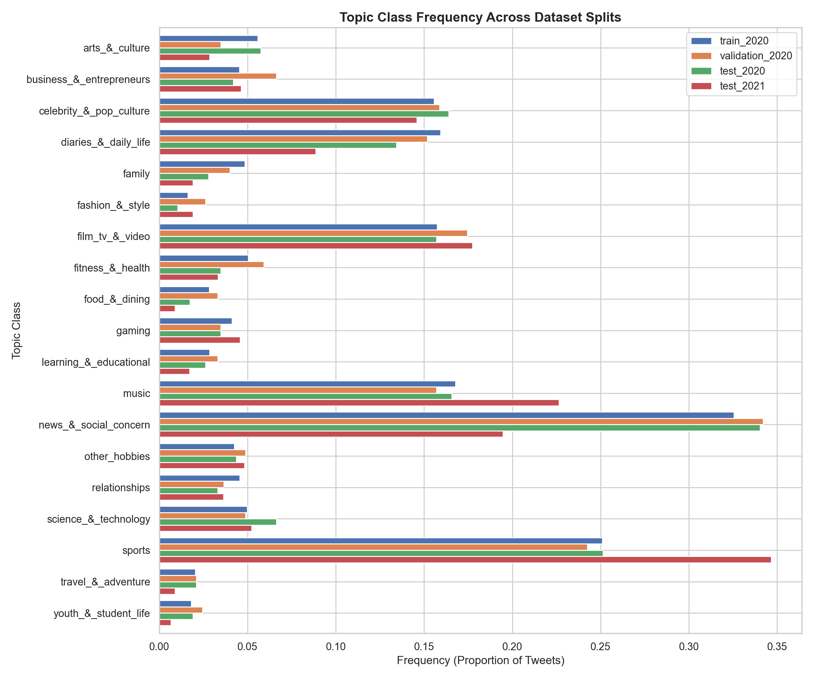
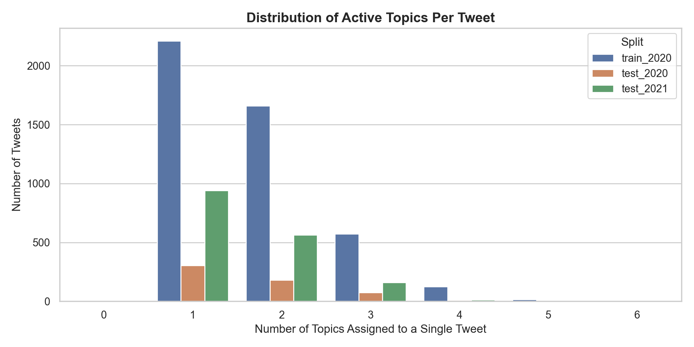
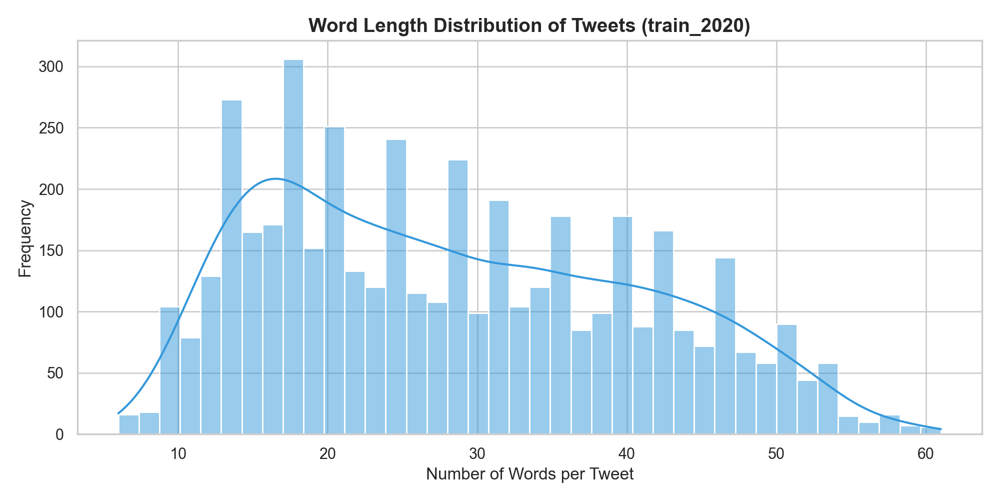
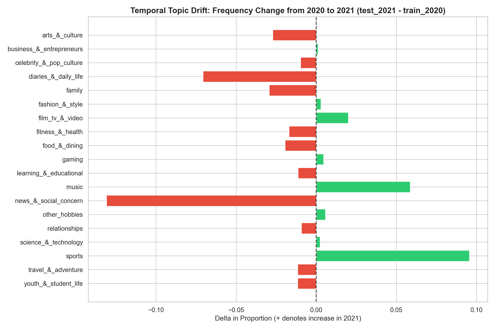
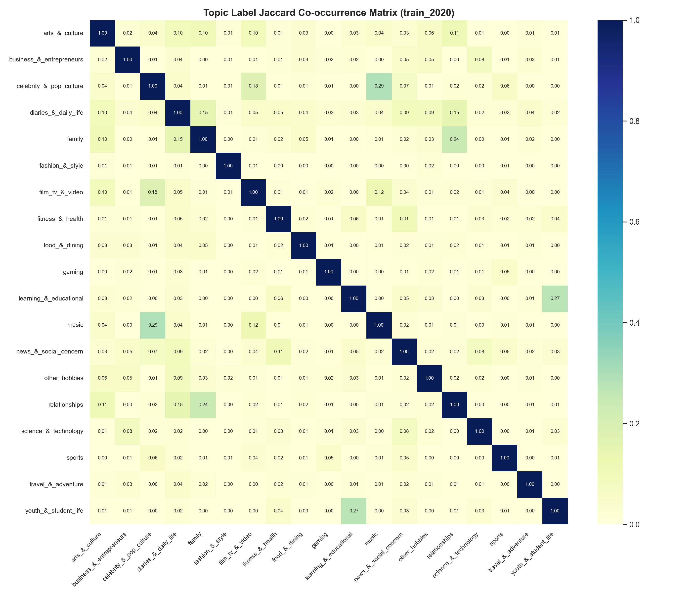
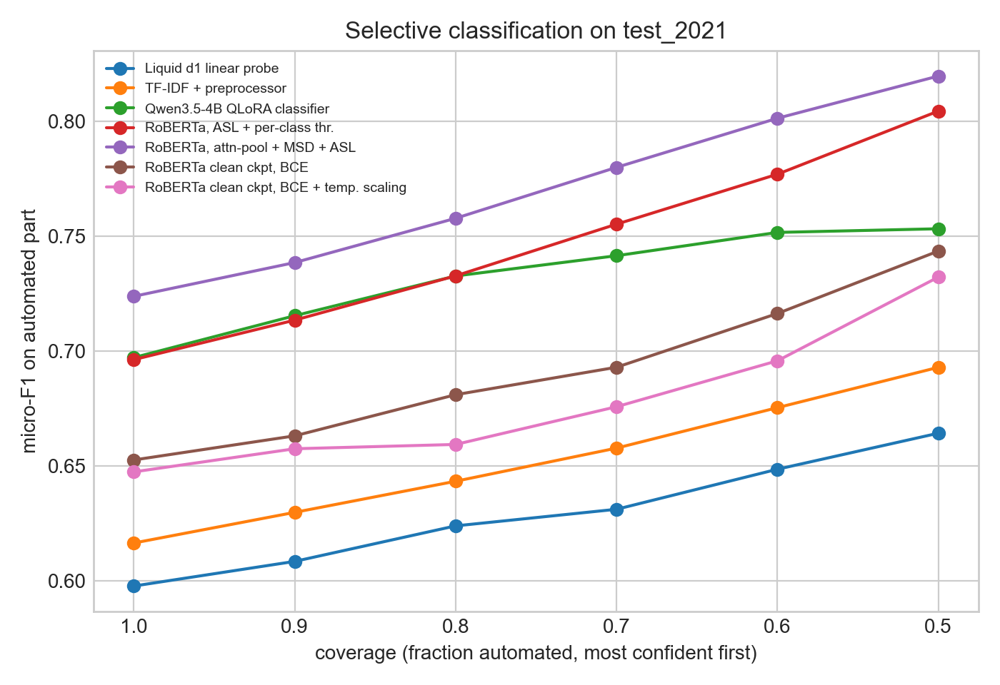
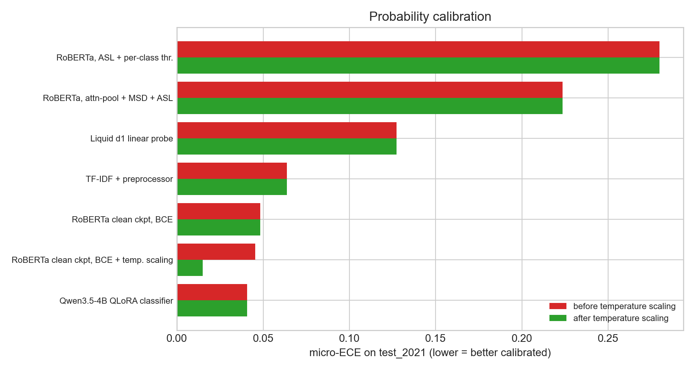
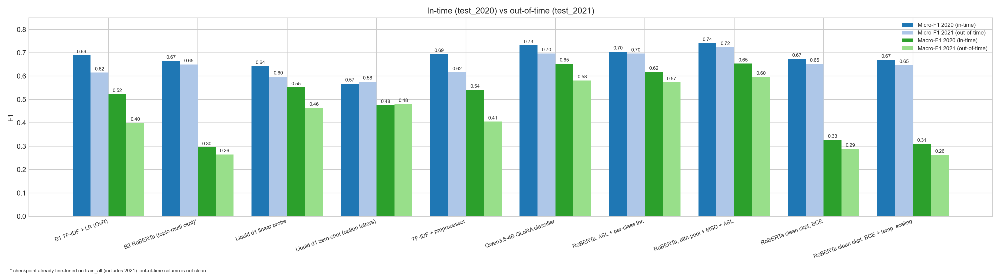
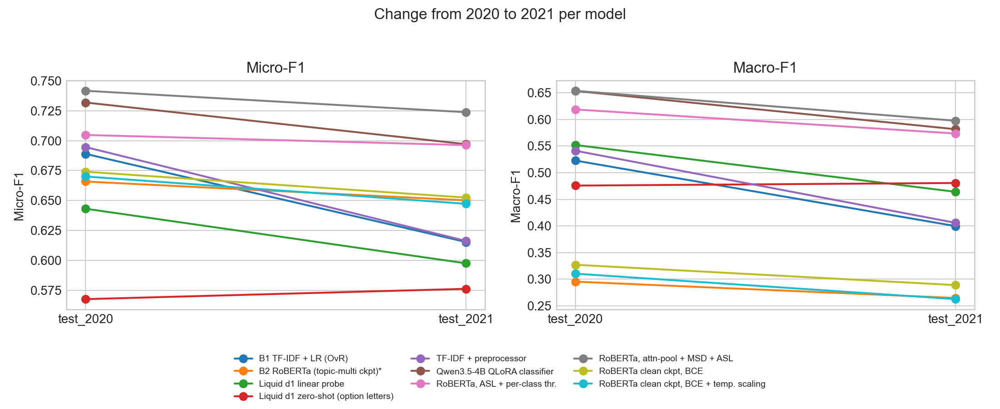
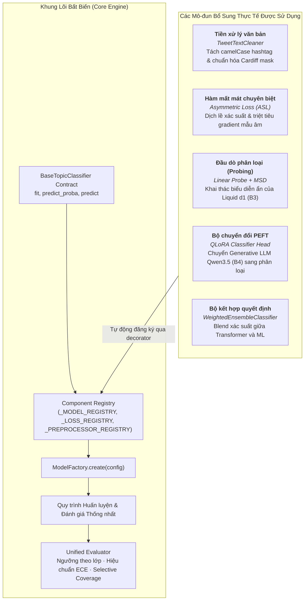

# Phân loại chủ đề tweet đa nhãn: phân tích bài toán và đánh giá các phương pháp tiếp cận

**Dữ liệu:** [`cardiffnlp/tweet_topic_multi`](https://huggingface.co/datasets/cardiffnlp/tweet_topic_multi) (COLING 2022) · 19 chủ đề · đánh giá in-time (2020) và out-of-time (2021)
**Cập nhật:** 11/11/2026

> **Phạm vi tài liệu:** trình bày cách tiếp cận bài toán, cơ sở lựa chọn từng phương pháp, bản chất của các kỹ thuật được sử dụng và các câu hỏi nghiên cứu còn mở. Kết quả thực nghiệm đóng vai trò minh họa cho phân tích, không phải trọng tâm của tài liệu.

---

## 0. Tóm tắt

1. **Bài toán** có ba đặc điểm gây khó khăn độc lập: một tweet có thể thuộc nhiều chủ đề đồng thời, tần suất các chủ đề chênh lệch lớn (tỷ lệ 20 : 1), và phân phối chủ đề thay đổi theo thời gian.
2. **Các họ phương pháp** được so sánh trên cùng dữ liệu và cùng thước đo: TF-IDF kết hợp Logistic Regression, Twitter-RoBERTa (nhiều biến thể), mô hình Liquid d1 và mô hình ngôn ngữ lớn Qwen3.5-4B.
3. **Các phát hiện chính:**
   - **Xử lý mất cân bằng lớp là yếu tố có ảnh hưởng lớn nhất đến Macro-F1.** Với RoBERTa, chuyển từ BCE kèm ngưỡng chung sang ASL kèm ngưỡng theo lớp nâng Macro-F1 từ 0.33 lên 0.62 (2020) và từ 0.29 lên 0.57 (2021). Hai thay đổi này được áp dụng đồng thời nên chưa tách được đóng góp riêng.
   - **Cấu hình tốt nhất** là RoBERTa với attention pooling, Multi-Sample Dropout và ASL: Micro-F1 0.7417 / 0.7238 và Macro-F1 0.6536 / 0.5974 (2020 / 2021). Cấu hình này đổi ba yếu tố cùng lúc nên chưa quy được mức cải thiện cho từng kỹ thuật.
   - **Checkpoint nhiễm dữ liệu 2021 không làm thay đổi đáng kể kết luận** trong thiết lập đối chứng: checkpoint chỉ huấn luyện trước cho kết quả gần bằng (Micro-F1 2021: 0.6525 so với 0.6502).
   - **LLM zero-shot không đủ dùng,** nhưng cùng mô hình đó khi huấn luyện có giám sát (QLoRA) đạt Micro-F1 0.7319 / 0.6971. Dùng LLM zero-shot làm bộ kiểm tra lại các ca mơ hồ **làm giảm** chất lượng (Micro-F1 từ 0.6947 xuống 0.5366 trên 2020).
   - **Liquid d1:** lần thử đầu cho kết quả vô nghĩa do khai thác sai đầu ra; khi khai thác đúng, linear probe đạt Micro-F1 0.6432 / 0.5976 và chấm điểm option-letter zero-shot đạt 0.5677 / 0.5763.
4. **Giới hạn:** mỗi cấu hình chỉ chạy một lần (một seed) và tập validation chỉ có 573 mẫu, nên chênh lệch dưới khoảng 1-2 điểm không nên được xem là có ý nghĩa.

---

## 1. Phân tích bài toán

### 1.1. Phân loại đa nhãn
Mỗi tweet gắn với một vector nhãn nhị phân $\mathbf y\in\{0,1\}^{19}$. Một tweet về trận đấu của một nghệ sĩ có thể đồng thời thuộc `sports` và `celebrity_&_pop_culture`.

- Mỗi lớp sử dụng **hàm sigmoid độc lập** thay vì softmax, do softmax buộc các lớp cạnh tranh nhau trong khi các chủ đề ở đây có thể đồng thời đúng.
- Quyết định nhị phân theo ngưỡng từng lớp: $\hat y_c=\mathbb I(\hat p_c\ge\tau_c)$. Ngưỡng là tham số cần được chọn, không mặc định bằng 0.5.
- Hai đại lượng mô tả dữ liệu: **Label Cardinality** $LC=1.708$ nhãn/tweet và **Label Density** $LD=LC/19\approx0.09$.

### 1.2. Ba thách thức và hệ quả đối với thiết kế

| Thách thức | Số đo từ dữ liệu | Hệ quả thiết kế |
|---|---|---|
| **Đa nhãn** | 1.708 nhãn/tweet; 48.2% tweet có 1 nhãn, 51.8% có từ 2 nhãn trở lên | Cần đầu ra sigmoid; các nhãn có tương quan nên có thể khai thác phụ thuộc nhãn |
| **Mất cân bằng lớp** | `news_&_social_concern` 32.6% so với `fashion_&_style` 1.61%, tỷ lệ **20.18 : 1** | Hơn 90% ô nhãn có giá trị 0 nên hàm mất mát chuẩn bị chi phối bởi các mẫu âm dễ; Micro-F1 che giấu việc lớp hiếm bị bỏ qua, cần theo dõi thêm Macro-F1 |
| **Trôi dạt theo thời gian** | Độ phân kỳ Jensen-Shannon giữa phân phối nhãn 2020 và 2021 là **0.1377** | Điểm trên `test_2020` không đủ để kết luận về khả năng triển khai; cần `test_2021` làm phép thử out-of-time |

### 1.3. Dữ liệu

| Split | Số mẫu | Cardinality | % có mention | % có URL |
|---|---:|---:|---:|---:|
| `train_2020` | 4,585 | 1.708 | 68.75 | 48.14 |
| `validation_2020` | 573 | 1.735 | 69.11 | 49.56 |
| `test_2020` | 573 | 1.648 | 68.76 | 48.52 |
| `test_2021` | 1,679 | 1.551 | 71.77 | 43.95 |

*Hình 1. Phân bố tần suất 19 chủ đề trên bốn split.*

| Số nhãn / tweet | 0 | 1 | 2 | 3 | 4 | 5 | 6 |
|---|--:|--:|--:|--:|--:|--:|--:|
| Số tweet (`train_2020`) | 1 | 2,210 | 1,661 | 572 | 124 | 15 | 2 |
| Tỷ lệ | 0.0% | 48.2% | 36.2% | 12.5% | 2.7% | 0.3% | 0.0% |

*Hình 2. Phân phối số nhãn trên mỗi tweet.*

Độ dài tweet trung bình là **28.34 từ** (độ lệch chuẩn 12.31; dài nhất 61 từ, 364 ký tự). Giới hạn 128 token được chọn rộng so với tweet dài nhất; tỷ lệ tweet vượt giới hạn này chưa được đo trực tiếp bằng số token.

*Hình 3. Phân phối độ dài tweet.*

### 1.4. Trôi dạt theo thời gian ở cấp độ chủ đề
Cột Δ là chênh lệch điểm phần trăm từ `test_2020` sang `test_2021`. Với các lớp hiếm, số mẫu rất ít nên Δ dưới khoảng 1 điểm không nên diễn giải mạnh.

| Nhãn | Số mẫu train | Train % | `test_2020` % | `test_2021` % | Δ (điểm %) |
|:--|--:|--:|--:|--:|--:|
| `news_&_social_concern` | 1,493 | 32.6 | 34.0 | 19.5 | **−14.5** |
| `sports` | 1,151 | 25.1 | 25.1 | 34.7 | **+9.6** |
| `music` | 769 | 16.8 | 16.6 | 22.6 | **+6.0** |
| `diaries_&_daily_life` | 731 | 15.9 | 13.4 | 8.9 | **−4.5** |
| `film_tv_&_video` | 722 | 15.7 | 15.7 | 17.7 | +2.0 |
| `celebrity_&_pop_culture` | 714 | 15.6 | 16.4 | 14.6 | −1.8 |
| `arts_&_culture` | 256 | 5.6 | 5.8 | 2.9 | −2.9 |
| `fitness_&_health` | 231 | 5.0 | 3.5 | 3.3 | −0.2 |
| `science_&_technology` | 229 | 5.0 | 6.6 | 5.2 | −1.4 |
| `family` | 222 | 4.8 | 2.8 | 1.9 | −0.9 |
| `relationships` | 209 | 4.6 | 3.3 | 3.6 | +0.3 |
| `business_&_entrepreneurs` | 208 | 4.5 | 4.2 | 4.6 | +0.4 |
| `other_hobbies` | 195 | 4.3 | 4.4 | 4.8 | +0.4 |
| `gaming` | 189 | 4.1 | 3.5 | 4.6 | +1.1 |
| `learning_&_educational` | 131 | 2.9 | 2.6 | 1.7 | −0.9 |
| `food_&_dining` | 130 | 2.8 | 1.7 | 0.9 | −0.8 |
| `travel_&_adventure` | 94 | 2.1 | 2.1 | 0.9 | −1.2 |
| `youth_&_student_life` | 83 | 1.8 | 1.9 | 0.7 | −1.2 |
| `fashion_&_style` | 74 | 1.6 | 1.0 | 1.9 | +0.9 |

*Hình 4. Dịch chuyển tần suất chủ đề giữa 2020 và 2021.*

**Lưu ý khi diễn giải:** dữ liệu xác nhận *có* dịch chuyển (nhóm tin tức giảm; thể thao và âm nhạc tăng). *Nguyên nhân* của dịch chuyển (giảm nhiệt đại dịch, Olympic Tokyo, sự trở lại của các sự kiện âm nhạc…) chỉ là giả định hợp lý, chưa được kiểm chứng bằng phép đo trong dự án.

### 1.5. Tương quan giữa các nhãn

*Hình 5. Ma trận tương quan Jaccard giữa các cặp nhãn.*

Một số cặp nhãn đồng xuất hiện thường xuyên hơn các cặp khác. Đây là cơ sở để cân nhắc mô hình hóa phụ thuộc nhãn (Classifier Chains). Mức độ tương quan của từng cặp chưa được lượng hóa trong tài liệu này.

---

## 2. Tiền xử lý văn bản

**Quan sát:** dữ liệu đã được ẩn danh sẵn (mention và URL được thay bằng ký hiệu chung); 68.75% tweet có mention, 48.14% có URL, 39.28% có hashtag. Emoji, chữ viết hoa (NASA, NBA) và hashtag đều mang tín hiệu chủ đề.

**Nguyên tắc:** làm sạch *nhẹ*, không loại bỏ thông tin. Các bước gồm thống nhất ký hiệu mention và URL, tách hashtag viết liền kiểu camelCase (ví dụ `#ClimateChange` thành `#Climate Change`, giữ dấu `#`), gộp dấu câu lặp và khoảng trắng. Emoji và chữ hoa được giữ nguyên.

**Thực tế trong các lần chạy hiện có:** văn bản được đưa vào mô hình ở dạng gần như thô.
- B1 chuyển toàn bộ về chữ thường, bỏ dấu Unicode và không loại stop word; do đó mất thông tin chữ hoa.
- B2 dùng tokenizer của checkpoint, giữ nguyên chữ hoa/thường.

**Kết quả ablation:** chạy cùng mô hình TF-IDF có và không có bước làm sạch cho chênh lệch dưới 1 điểm Micro-F1 và dưới 2 điểm Macro-F1 (mục 7.2), nên chưa có bằng chứng về đóng góp đáng kể của tiền xử lý nhẹ trong thiết lập này.

---

## 3. Bốn phương pháp: nguyên lý, cơ sở lựa chọn, giới hạn

Mỗi phương pháp trả lời cùng một câu hỏi: *thông tin chủ đề được biểu diễn và khai thác như thế nào?*

| | Biểu diễn văn bản | Cách ra quyết định | Điểm mạnh kỳ vọng | Điểm yếu kỳ vọng |
|---|---|---|---|---|
| **B1** TF-IDF + LR | Đặc trưng thưa theo từ/ký tự, cố định | 19 bộ phân loại tuyến tính độc lập | Nhanh, ổn định với dữ liệu nhỏ, dễ giải thích | Phụ thuộc từ khóa; không nắm bắt ngữ cảnh |
| **B2** Twitter-RoBERTa | Vector ngữ cảnh học từ lượng lớn tweet | Đầu tuyến tính + sigmoid | Nắm bắt ngữ cảnh và từ lóng | Cần tinh chỉnh; nhạy với mất cân bằng lớp và ngưỡng |
| **B3** Liquid d1-2B | Trạng thái ẩn của mô hình ngôn ngữ nền | Cần bổ sung một đầu ra quyết định | Biểu diễn phong phú, suy luận một lượt | Chưa được huấn luyện cho taxonomy 19 nhãn |
| **B4** Qwen3.5-4B | Trạng thái ẩn của LLM sinh văn bản | Sinh chuỗi JSON | Tri thức rộng, linh hoạt | Sinh văn bản là bước gián tiếp, dễ sai định dạng và sai nhãn |

### 3.1. B1: TF-IDF + Logistic Regression (One-vs-Rest)
**Nguyên lý.** Mỗi tweet được biểu diễn bằng vector thưa gồm n-gram từ (1-2, tối đa 40,000 chiều) và n-gram ký tự trong biên từ (3-5, tối đa 60,000 chiều), tổng cộng 100,000 chiều. N-gram ký tự giúp bắt các dạng viết tắt, tiếng lóng và hashtag ghép mà n-gram từ bỏ sót. Mỗi chủ đề có một bộ Logistic Regression riêng ($C=2.0$, trọng số lớp cân theo tần suất để lớp hiếm không bị bỏ qua):
$$P(y_c=1\mid\mathbf x)=\sigma(\mathbf w_c^\top\mathbf x+b_c)$$

**Cơ sở lựa chọn.** Dữ liệu nhỏ và ranh giới chủ đề có nhiều từ khóa đặc trưng (tên đội, nghệ sĩ, ngành), nên mô hình tuyến tính trên đặc trưng thưa là đối chứng mạnh.
**Giới hạn.** 19 bộ phân loại độc lập, không biết quan hệ giữa các nhãn; vector đặc trưng phụ thuộc hoàn toàn vào từ vựng của tập huấn luyện.
**Biến thể (Classifier Chains).** Dùng dự đoán của nhãn trước làm đặc trưng cho nhãn sau để nắm phụ thuộc nhãn; kết quả phụ thuộc thứ tự chuỗi.

### 3.2. B2: Twitter-RoBERTa
**Nguyên lý.** Transformer được huấn luyện trước trên lượng lớn tweet, tạo vector ngữ cảnh cho từng token; một đầu tuyến tính 19 chiều cùng sigmoid cho ra xác suất.

**Cấu hình đã chạy:** checkpoint `cardiffnlp/twitter-roberta-base-2021-124m-topic-multi`, hàm mất mát BCE, 3 epoch, tốc độ học 2e-5, batch 32, cắt 128 token, **một ngưỡng chung τ = 0.25** chọn theo Micro-F1 trên `validation_2020`.

> **Lưu ý quan trọng:** checkpoint này đã được tinh chỉnh trên `tweet_topic_multi` với `train_all` (gồm dữ liệu 2021) và hiệu chỉnh tham số trên `validation_2021`. Khi tiếp tục tinh chỉnh trên `train_2020`, trọng số khởi tạo đã chứa thông tin của năm 2021, do đó kết quả `test_2021` của B2 **không phải phép thử out-of-time thuần**.

**Các cải tiến đề xuất để kiểm chứng** (chi tiết ở mục 6):
- **Learned Attention Pooling:** thay vì chỉ dùng vector của token đầu câu, học trọng số chú ý cho từng token:
  $$u_i=\tanh(\mathbf W_a\mathbf h_i+\mathbf b_a),\quad\alpha_i=\frac{\exp(u_i^\top\mathbf v_a)}{\sum_j\exp(u_j^\top\mathbf v_a)},\quad\mathbf h_{\text{pool}}=\sum_i\alpha_i\mathbf h_i$$
  Cơ sở lập luận: từ khóa chủ đề của một tweet khoảng 28 từ có thể nằm ở bất kỳ vị trí nào, nên việc để mô hình học vị trí cần chú ý hợp lý hơn việc cố định vào token đầu câu.
- **Multi-Sample Dropout (MSD):** cho cùng một vector đã gộp đi qua nhiều mặt nạ dropout độc lập, dùng chung một lớp tuyến tính.
  **Bản chất:** MSD chỉ là kỹ thuật *tại thời điểm huấn luyện*. Khi suy luận dropout được tắt, mọi nhánh giống hệt nhau và cấu trúc tương đương một lớp tuyến tính. Do đó, cải thiện (nếu có) đến từ việc huấn luyện đầu phân loại ổn định hơn, không phải từ việc tổng hợp nhiều nhánh khi dự đoán.

### 3.3. B3: Liquid AI d1-2B
**Sai sót ở lần thử đầu.** Phiên bản đầu tiên lấy 19 giá trị đầu tiên trong vector điểm đầu ra của mô hình rồi áp dụng sigmoid. Các giá trị này là điểm của **19 token đầu tiên trong từ vựng**, không liên quan đến 19 chủ đề. Do đó kết quả Micro-F1 0.18 phản ánh nhiễu, không thể dùng để đánh giá khả năng của kiến trúc Liquid.

**Hai hướng khai thác phù hợp:**
1. **Linear probe (hướng chính).** Đóng băng backbone, lấy trạng thái ẩn đã gộp và chỉ huấn luyện một đầu tuyến tính 19 chiều:
   $$\text{tweet}\to\text{backbone (đóng băng)}\to\mathbf h\to\text{Linear}\to19\text{ sigmoid}$$
   Đây là phép đo chuẩn cho câu hỏi: *biểu diễn đóng băng chứa bao nhiêu thông tin về chủ đề?* Do backbone đóng băng, mỗi tweet chỉ cần mã hóa **một lần** và lưu đệm, sau đó đầu phân loại được huấn luyện trong vài giây.
2. **Option-letter zero-shot (hướng phụ).** Liệt kê 19 chủ đề thành các lựa chọn A-S, đọc điểm của 19 token chữ cái tại bước sinh kế tiếp.
   **Giới hạn bản chất:** đây là phân phối cho *một lựa chọn* (softmax) nên là bộ chấm điểm đa nhãn yếu, vì một tweet có ba chủ đề sẽ chia nhỏ xác suất. Hướng này chỉ có giá trị tham chiếu.

**Điều kiện kết luận.** Kết quả probe chỉ có thể xem là bằng chứng về khả năng biểu diễn của mô hình nền tảng khi dùng *cùng giao thức* với B1 và B2: cùng split, cùng cách chọn ngưỡng trên validation và đánh giá trên toàn bộ tập kiểm thử.

**Entropy nhị phân** $H_c=-(p\log_2p+(1-p)\log_2(1-p))$ đo độ bất định của từng nhãn (cực đại tại $p=0.5$) và được dùng trong phân loại có chọn lọc (mục 5.3).

### 3.4. B4: Qwen3.5-4B (mô hình ngôn ngữ sinh văn bản)
**Cấu hình đã chạy:** `Qwen/Qwen3.5-4B`, lượng tử hóa 4-bit NormalFloat (NF4), kiểu tính toán float16; prompt zero-shot liệt kê 19 nhãn và yêu cầu trả về danh sách JSON; sinh greedy; bộ phân tích chuyển danh sách thành vector 19 chiều.

**Về kết quả thấp (Micro-F1 0.0290).** Đây là kết quả thực của prompt zero-shot, không phải do lỗi cài đặt. Zero-shot trộn hai nguồn lỗi: (i) mô hình chưa nắm taxonomy 19 nhãn chi tiết, nhiều nhãn chồng lấn và có các lớp hiếm; (ii) bước sinh văn bản/JSON là một lớp gián tiếp bổ sung. Thực nghiệm hiện tại chưa tách được hai nguồn lỗi này.

**Hai hướng khai thác có bản chất khác:**
- *Bộ phân loại QLoRA có giám sát:* loại bỏ bước sinh văn bản. Backbone được lượng tử hóa 4-bit và đóng băng; chỉ huấn luyện các adapter LoRA (hạng thấp) cùng một đầu 19 chiều, nên mô hình 4B vừa với một GPU T4 16GB. Suy luận một lượt, không phát sinh lỗi định dạng JSON.
- *Auditor:* dùng LLM suy luận từng bước (chain-of-thought) chỉ cho các tweet mơ hồ nhất (mục 5.3), thay vì chạy trên toàn bộ dữ liệu.

---

## 4. Hàm mất mát cho phân loại đa nhãn mất cân bằng

Với tỷ lệ 20:1 và hơn 90% ô nhãn bằng 0, BCE chuẩn bị chi phối bởi các mẫu âm dễ. Ba cách xử lý có bản chất khác nhau:

| Phương pháp | Ý tưởng | Công thức then chốt |
|---|---|---|
| **BCE có trọng số dương** | Phạt nặng hơn khi bỏ sót mẫu dương của lớp hiếm | $w_c=\frac{N-N_c}{N_c}$ |
| **Focal loss** (Lin et al., 2017) | Giảm trọng số các mẫu đã được dự đoán dễ | $(1-p_t)^\gamma$, $\gamma=2$ |
| **Asymmetric loss** (Ridnik et al., 2021) | Xử lý mẫu dương và âm *bất đối xứng*: giữ gradient cho mẫu dương, triệt tiêu mạnh mẫu âm dễ, bỏ qua mẫu âm có xác suất rất nhỏ | $\gamma_+=1,\ \gamma_-=4,\ m=0.05$ |

$$\mathcal L_{\text{ASL}}=\frac1C\sum_c\Big[-y_c(1-\hat p_c)^{\gamma_+}\log\hat p_c-(1-y_c)\,\hat p_{m,c}^{\gamma_-}\log(1-\hat p_{m,c})\Big],\quad\hat p_{m,c}=\max(\hat p_c-m,0)$$

**Giả thuyết đã kiểm chứng.** B2 có Macro-F1 thấp (0.2955) so với B1 (0.5227). Giả thuyết là BCE kết hợp một ngưỡng chung không phục vụ tốt các lớp hiếm. Thí nghiệm 6.2 ủng hộ giả thuyết này, kèm một lưu ý về biến gây nhiễu (mục 6).

---

## 5. Ngưỡng quyết định và độ tin cậy của xác suất

### 5.1. Chọn ngưỡng
- **Ngưỡng toàn cục:** một giá trị τ cho mọi lớp, tìm bằng grid search trên `validation_2020` (0.10-0.90, bước 0.05), tối ưu Micro-F1 hoặc Macro-F1.
- **Ngưỡng theo lớp:** mỗi lớp một $\tau_c$ tối ưu F1 của chính lớp đó (0.05-0.85, bước 0.05):
  $$\tau_c^*=\arg\max_\tau F1_c\big(\mathbf y_{:,c},\ \mathbb I(\hat{\mathbf p}_{:,c}\ge\tau)\big)$$
- **Rủi ro:** tập validation chỉ có 573 mẫu, lớp hiếm có rất ít mẫu dương, nên ngưỡng theo lớp dễ quá khớp với validation.

### 5.2. Temperature scaling: phạm vi tác dụng
Hiệu chuẩn xác suất bằng nhiệt độ theo lớp: $\hat p_c=\sigma(z_c/T_c)$, trong đó $T_c$ cực tiểu hóa NLL nhị phân trên validation.

**Tính chất bản chất:** chia logit cho $T_c>0$ là phép biến đổi **đơn điệu** trong từng lớp. Do đó:
- Thứ hạng các tweet trong một lớp **không đổi**.
- Nếu sau đó ngưỡng theo lớp vẫn được chọn bằng tìm kiếm **vét cạn** trên cùng validation, F1 tốt nhất của từng lớp **không đổi**, vì điểm cắt tối ưu chỉ dịch chuyển dọc đường cong đơn điệu đó. Khi dùng lưới ngưỡng thô (bước 0.05 trên thang xác suất), các điểm cắt khả dĩ cũng dịch đi nên F1 có thể lệch nhẹ theo cả hai chiều; đó là hiệu ứng của lưới, không phải cải thiện thực.
- Phương pháp **có** cải thiện chất lượng xác suất (ECE, log-loss) và **có** ảnh hưởng đến các thiết lập dùng ngưỡng *chung* giữa các lớp hoặc dùng xác suất làm điểm tin cậy (như phân loại có chọn lọc).

Vì vậy, temperature scaling là công cụ để có xác suất đáng tin cậy, không phải nguồn tăng F1. Mọi nhận định về F1 cần dựa trên thiết lập ngưỡng toàn cục hoặc thí nghiệm từ chối dự đoán.

### 5.3. Phân loại có chọn lọc (selective classification)
**Ý tưởng.** Không phải tweet nào cũng khó như nhau. Nếu có điểm bất định xếp hạng tweet từ "rõ ràng" đến "sát ranh giới", có thể tự động hóa phần chắc chắn và chuyển phần còn lại cho chuyên viên hoặc mô hình mạnh hơn.

**Hai điểm bất định được xem xét:**
- *Entropy tổng:* $H(\mathbf x)=\sum_c H_c(\hat p_c)$. Chi phí thấp, nhưng một tweet có nhiều nhãn âm chắc chắn và một nhãn lưỡng lự có thể có entropy tổng thấp.
- *Margin:* tweet được xem là mơ hồ khi **bất kỳ** nhãn nào nằm sát ngưỡng của chính nó, vì đó là nơi dự đoán dễ đổi.

**Cách đánh giá:** đường cong **coverage-chất lượng** (thực nghiệm sử dụng điểm margin). Giữ $k\%$ tweet chắc chắn nhất, đo F1 và Exact Match trên phần được tự động, đồng thời kiểm tra phần bị chuyển đi thực sự có chất lượng thấp hơn. Điểm bất định chỉ có giá trị khi hai đường tách biệt rõ.

---

## 6. Thí nghiệm kiểm chứng giả thuyết: kết quả

Tất cả cấu hình dưới đây chạy trên toàn bộ tập dữ liệu, huấn luyện trên `train_2020`, chọn ngưỡng trên `validation_2020`. Mỗi cấu hình chạy **một lần**.

| # | Giả thuyết | Kết quả | Kết luận |
|---|---|---|---|
| 6.1 | Kết luận về độ bền theo thời gian của B2 bị nhiễm do checkpoint | Checkpoint chỉ huấn luyện trước (`dec2020`), BCE, cùng thiết lập với B2: Micro/Macro-F1 `test_2021` là 0.6525 / 0.2890, so với 0.6502 / 0.2648 của B2 cũ. Mức suy giảm Micro-F1 từ 2020 sang 2021 là −2.16 điểm (B2 cũ: −1.57) | **Không bị bác bỏ về cường độ:** nhiễm dữ liệu 2021 không làm thay đổi đáng kể kết quả trong thiết lập này. Một seed nên chưa loại trừ được ảnh hưởng nhỏ |
| 6.2 | Macro-F1 thấp của B2 do BCE và ngưỡng chung | ASL kết hợp ngưỡng theo lớp: Macro-F1 tăng từ 0.3272 lên 0.6186 (2020) và từ 0.2890 lên 0.5734 (2021); Micro-F1 tăng từ 0.6741 lên 0.7048 và từ 0.6525 lên 0.6963 | **Được ủng hộ mạnh.** Lưu ý: hàm mất mát và cách chọn ngưỡng thay đổi cùng lúc; chưa chạy riêng "ASL với ngưỡng chung" và "BCE với ngưỡng theo lớp" nên chưa tách được đóng góp từng yếu tố |
| 6.3 | Attention pooling và MSD giúp huấn luyện ổn định hơn | Thêm attention pooling, MSD và tốc độ học riêng cho đầu phân loại: Micro/Macro-F1 tăng từ 0.7048 / 0.6186 lên 0.7417 / 0.6536 (2020) và từ 0.6963 / 0.5734 lên 0.7238 / 0.5974 (2021) | **Cải thiện có quan sát được nhưng không quy được cho kỹ thuật cụ thể:** ba yếu tố thay đổi cùng lúc và chỉ có một seed. Cần ablation từng yếu tố và nhiều seed |
| 6.4 | Có thể tự động hóa một phần mà không giảm chất lượng | Điểm margin tách được ca dễ khỏi ca khó (xem bảng và Hình 7). Temperature scaling giảm ECE trên `test_2021` từ 0.0455 xuống 0.0151 (BCE) | **Được ủng hộ.** Các cấu hình ASL có ECE cao (0.22-0.28), tức xác suất không được hiệu chuẩn dù F1 tốt |
| 6.5 | Probe phản ánh khả năng biểu diễn của Liquid d1 | Linear probe đạt Micro/Macro-F1 0.6432 / 0.5519 (2020) và 0.5976 / 0.4640 (2021) | Xem mục 7; so sánh với B1/B2 bị giới hạn do khác cách chọn ngưỡng |
| 6.6 | Huấn luyện có giám sát hiệu quả hơn prompt zero-shot đối với LLM | QLoRA classifier đạt 0.7319 / 0.6533 (2020) và 0.6971 / 0.5815 (2021), so với 0.0290 / 0.0107 của prompt zero-shot JSON | **Được ủng hộ rất mạnh.** Chênh lệch này gộp hai yếu tố (có giám sát và không còn bước sinh JSON), chưa tách được từng yếu tố |
| 6.7 | LLM hữu ích khi chỉ dùng cho các ca mơ hồ | Auditor chain-of-thought zero-shot thay thế dự đoán của TF-IDF cho 20% tweet mơ hồ nhất: Micro-F1 toàn bộ giảm từ 0.6947 xuống 0.5366 (2020) và từ 0.6163 xuống 0.4798 (2021); trên chính tập được kiểm tra, từ 0.5652 xuống 0.2741 và từ 0.5216 xuống 0.2756 | **Bị bác bỏ** với LLM zero-shot và chính sách thay thế. Chưa kiểm tra chính sách hợp nhất hoặc LLM đã được tinh chỉnh |

**Chất lượng của điểm bất định (phục vụ 6.4).** Micro-F1 trên phần được tự động hóa so với phần bị chuyển đi, `test_2021`, coverage 80%:

| Cấu hình | Phần tự động hóa | Phần chuyển đi |
|---|--:|--:|
| RoBERTa, attention pooling + MSD + ASL | 0.758 | 0.609 |
| RoBERTa, ASL + ngưỡng theo lớp | 0.733 | 0.579 |
| Qwen3.5-4B QLoRA | 0.733 | 0.580 |
| RoBERTa, BCE | 0.681 | 0.556 |
| TF-IDF | 0.643 | 0.522 |
| Liquid d1 probe | 0.624 | 0.507 |

Ở mọi cấu hình, phần chuyển đi có chất lượng thấp hơn rõ rệt phần được tự động hóa, nên điểm margin có giá trị phân tách. Với cấu hình tốt nhất, giữ 50% tweet chắc chắn nhất cho Micro-F1 bằng 0.820 trên phần đó.

*Hình 7. Micro-F1 trên phần được tự động hóa theo coverage, `test_2021`.*

*Hình 8. Sai số hiệu chuẩn (micro-ECE, `test_2021`) trước và sau temperature scaling. Chỉ cấu hình có áp dụng temperature scaling mới có hai giá trị khác nhau.*

---

## 7. Tổng hợp kết quả thực nghiệm

### 7.1. Bảng kết quả

Micro-F1 / Macro-F1. Cột "Ngưỡng" cho biết cách chọn ngưỡng; vì các cấu hình dùng hai chế độ khác nhau nên không so sánh trực tiếp mọi hàng với nhau.

| Mô hình | Ngưỡng | `test_2020` | `test_2021` | Δ Micro (điểm) | Δ Macro (điểm) |
|:--|:--|:--:|:--:|:--:|:--:|
| **B1** TF-IDF 100k + LR (OvR) | chung | 0.6890 / 0.5227 | 0.6154 / 0.3997 | −7.36 | −12.30 |
| TF-IDF + tiền xử lý nhẹ | chung | 0.6947 / 0.5412 | 0.6163 / 0.4058 | −7.84 | −13.54 |
| **B2** RoBERTa, checkpoint có dữ liệu 2021 ⚠️ | chung | 0.6659 / 0.2955 | 0.6502 / 0.2648 | −1.57 | −3.07 |
| RoBERTa, checkpoint chỉ huấn luyện trước, BCE | chung | 0.6741 / 0.3272 | 0.6525 / 0.2890 | −2.16 | −3.82 |
| RoBERTa, BCE + temperature scaling | chung | 0.6701 / 0.3105 | 0.6473 / 0.2627 | −2.28 | −4.78 |
| RoBERTa, ASL | theo lớp | 0.7048 / 0.6186 | 0.6963 / 0.5734 | −0.85 | −4.52 |
| **RoBERTa, attention pooling + MSD + ASL** | theo lớp | **0.7417 / 0.6536** | **0.7238 / 0.5974** | −1.79 | −5.62 |
| Qwen3.5-4B, QLoRA có giám sát | theo lớp | 0.7319 / 0.6533 | 0.6971 / 0.5815 | −3.48 | −7.18 |
| Liquid d1, linear probe | theo lớp | 0.6432 / 0.5519 | 0.5976 / 0.4640 | −4.56 | −8.79 |
| Liquid d1, option-letter zero-shot | chung | 0.5677 / 0.4757 | 0.5763 / 0.4806 | +0.86 | +0.49 |
| Qwen3.5-4B, zero-shot JSON (tập con 200-500 mẫu) | argmax | 0.0290 / 0.0107 | chưa đo | n/a | n/a |

⚠️ Checkpoint đã được tinh chỉnh trên `train_all` (gồm 2021); số `test_2021` của hàng này không phải out-of-time thuần.
Lần thử đầu của Liquid d1 (Micro-F1 0.1820) không đưa vào bảng vì là kết quả của cách đọc đầu ra sai (mục 3.3).

*Hình 9. Micro-F1 và Macro-F1 trên `test_2020` (in-time) và `test_2021` (out-of-time).*

*Hình 10. Thay đổi Micro-F1 và Macro-F1 từ 2020 sang 2021 của từng mô hình.*

### 7.2. Nhận định

1. **Xử lý lớp hiếm quyết định Macro-F1.** Các cấu hình RoBERTa dùng BCE và ngưỡng chung có Micro-F1 cạnh tranh (0.65-0.67) nhưng Macro-F1 chỉ 0.26-0.33, tức bỏ qua phần lớn các lớp hiếm. Khi chuyển sang ASL kèm ngưỡng theo lớp, Macro-F1 gần gấp đôi. Đây là phát hiện mạnh nhất của thực nghiệm, tuy chưa tách được đóng góp riêng của hàm mất mát và của ngưỡng.
2. **Xác suất từ ASL không đáng tin cậy.** ASL cho F1 cao nhưng ECE rất lớn (0.28 và 0.22 so với 0.05 của BCE). Do đó nếu cần dùng xác suất làm điểm tin cậy tuyệt đối thì phải hiệu chuẩn lại. Thứ hạng vẫn hữu ích trong phân loại có chọn lọc (Hình 7) nhưng giá trị tuyệt đối thì không.
3. **Độ bền theo thời gian.** Họ RoBERTa (BCE, ASL, attention pooling) suy giảm Micro-F1 từ 0.85 đến 2.28 điểm, trong khi TF-IDF suy giảm 7.36 điểm; Macro-F1 của TF-IDF giảm 12.30 điểm. Hai cách giải thích cạnh tranh cho sự suy giảm của TF-IDF vẫn chưa được tách: thay đổi từ vựng và thay đổi tỷ lệ nhãn (Jensen-Shannon 0.1377). Liquid d1 probe (−4.56) và QLoRA (−3.48) nằm ở khoảng giữa; chấm điểm option-letter zero-shot không suy giảm (+0.86) vì không học từ phân phối của tập huấn luyện, chỉ chọn ngưỡng trên validation.
4. **Checkpoint nhiễm dữ liệu không làm đổi kết luận** trong thiết lập đối chứng (thí nghiệm 6.1), tuy chỉ dựa trên một seed.
5. **Kích thước mô hình không quyết định.** Qwen3.5-4B với QLoRA (4 tỷ tham số) đạt kết quả tương đương RoBERTa 125 triệu tham số có attention pooling (0.7319 / 0.6533 so với 0.7417 / 0.6536 trên 2020; 0.6971 / 0.5815 so với 0.7238 / 0.5974 trên 2021), và kém hơn một chút ở 2021.
6. **Liquid d1.** Cách khai thác đúng thay đổi hoàn toàn bức tranh so với lần thử đầu (0.18): chấm điểm option-letter zero-shot đạt 0.5677 / 0.5763 mà không cần dữ liệu huấn luyện, linear probe đạt 0.6432 / 0.5976. Probe có Macro-F1 cao hơn TF-IDF (0.5519 so với 0.5227 trên 2020) nhưng Micro-F1 thấp hơn (0.6432 so với 0.6890); vì hai mô hình dùng chế độ chọn ngưỡng khác nhau (theo lớp tối ưu Macro-F1 so với chung), không nên xếp hạng trực tiếp. So với RoBERTa dùng cùng chế độ ngưỡng theo lớp, probe thấp hơn rõ rệt và suy giảm theo thời gian nhiều hơn.
7. **LLM zero-shot không phù hợp làm bộ kiểm tra.** Thay dự đoán của TF-IDF bằng đầu ra chain-of-thought của Qwen3.5-4B zero-shot làm giảm chất lượng ngay trên những ca mơ hồ nhất (Micro-F1 trên phần được kiểm tra từ 0.5652 xuống 0.2741). Điều này nhất quán với kết quả zero-shot ở B4 và cho thấy vấn đề nằm ở năng lực phân loại theo taxonomy chứ không phải ở việc chọn đúng ca để kiểm tra.
8. **Tiền xử lý nhẹ gần như không tác động.** TF-IDF có tiền xử lý đạt 0.6947 / 0.5412 so với 0.6890 / 0.5227 (2020) và 0.6163 / 0.4058 so với 0.6154 / 0.3997 (2021); chênh lệch dưới 1 điểm Micro-F1 và dưới 2 điểm Macro-F1, nằm trong mức dao động có thể có của một lần chạy.

### 7.3. Giới hạn của kết quả
- Mỗi cấu hình chạy một lần; chưa có ước lượng độ dao động giữa các seed.
- Tập validation chỉ có 573 mẫu, ảnh hưởng đến độ ổn định của ngưỡng theo lớp.
- Hai chế độ chọn ngưỡng (chung và theo lớp) khiến các hàng trong bảng không hoàn toàn so sánh trực tiếp với nhau.
- Các cải tiến được thêm đồng thời (ASL cùng ngưỡng theo lớp; attention pooling cùng MSD cùng tốc độ học đầu phân loại) nên chưa quy được đóng góp cho từng thành phần.
- Kết quả zero-shot JSON của B4 dựa trên tập con (tối đa 500 mẫu).

---

## 8. Thiết kế hệ thống phục vụ thử nghiệm nhanh và so sánh công bằng

### 8.1. Vấn đề kiến trúc trong nghiên cứu thực nghiệm đa mô hình

Trong nghiên cứu so sánh nhiều trường phái mô hình (từ mô hình tuyến tính, Transformer mã hóa, Decision Model đến LLM sinh sinh học), việc thử nghiệm các giả thuyết cải tiến (thay đổi hàm mất mát, thay đổi đầu phân loại, bổ sung bước tiền xử lý) thường đối mặt với rủi ro lớn:
* **Nguy cơ làm gãy đổ mã nguồn gốc (Regression):** Chỉnh sửa trực tiếp vào script huấn luyện của baseline để thử một ý tưởng mới dễ làm sai lệch cấu hình cũ, khiến các kết quả đã chạy không còn khả năng tái lập (reproducibility).
* **Trùng lặp mã nguồn (Code Duplication):** Nếu mỗi lần thử nghiệm lại tạo một file script nguyên khối mới, hệ thống sẽ nhanh chóng phân mảnh, khó bảo trì.
* **Sai lệch thước đo (Evaluation Inconsistency):** Mỗi mô hình nếu tự tính toán chỉ số đánh giá bằng các hàm độc lập sẽ dẫn đến nguy cơ so sánh không công bằng do khác biệt về cách tìm ngưỡng hoặc cách tính Micro/Macro-F1.

### 8.2. Nguyên tắc thiết kế Open-Closed (SOLID)

Để giải quyết triệt để vấn đề trên, hệ thống được xây dựng theo nguyên tắc **Open-Closed Principle (OCP)**: *Mở cho việc mở rộng các phương pháp mới, nhưng đóng đối với các sửa đổi vào logic cốt lõi*.

Kiến trúc phân tách thành hai tầng rõ rệt:
1. **Khung lõi bất biến (Core Engine):**
   * **Giao diện hợp đồng chuẩn (`BaseTopicClassifier`):** Mọi mô hình (từ B1 đến B4 và các mô hình mở rộng) bắt buộc phải triển khai cùng một giao diện:
     - `fit(train_texts, train_labels, val_texts, val_labels)`: Huấn luyện tham số.
     - `predict_proba(texts)`: Trả về ma trận xác suất dự đoán $\hat{\mathbf{P}} \in [0, 1]^{N \times 19}$.
     - `predict(texts, threshold)`: Sinh ma trận nhãn nhị phân $\hat{\mathbf{Y}} \in \{0, 1\}^{N \times 19}$.
   * **Quy trình đánh giá thống nhất (Unified Evaluator):** Tất cả các mô hình đều đi qua cùng một bộ tìm kiếm ngưỡng tối ưu theo lớp (`thresholding.py`), cùng hàm tính toán chỉ số (`metrics.py`), cùng kiểm định độ tin cậy xác suất (`calibration.py`) và phân loại có chọn lọc (`selective.py`).
   * **Cơ chế nạp và phát hiện động (`discover_addons`):** Tự động phát hiện và đăng ký các mô-đun mới thông qua decorator (`@register_model`, `@register_loss`, `@register_preprocessor`) mà không cần sửa đổi mã nguồn quản lý trung tâm.

2. **Tầng mô-đun bổ sung (Pluggable Add-on Modules):**
   Thay vì biến mỗi thử nghiệm thành một mô hình nguyên khối, hệ thống xem các cải tiến như các "khối cắm-và-chạy" được ghép nối linh hoạt vào pipeline.

*Hình 11. Kiến trúc mở rộng theo nguyên tắc Open-Closed và các mô-đun cắm-và-chạy thực tế trong nghiên cứu.*

### 8.3. Danh mục các mô-đun cắm-và-chạy thực tế được áp dụng trong nghiên cứu

Trong toàn bộ quá trình thực nghiệm của dự án, hệ thống đã triển khai và ứng dụng các mô-đun bổ sung sau để trả lời các câu hỏi nghiên cứu cụ thể:

1. **Mô-đun Tiền xử lý dữ liệu đặc thù (`TweetTextCleaner` & Pipeline bảo tồn thông tin):**
   * *Định danh:* `@register_preprocessor("tweet_text_cleaner")` tại `tweet_topic/addons/custom_preprocessor_addon.py`.
   * *Ứng dụng & Cơ chế:* 
     - *Khắc phục OOV do camelCase:* Dùng Regex `#([a-z]+)([A-Z])` $\rightarrow$ `#\1 \2` để giải nén hashtag viết liền (`#ClimateChange` $\rightarrow$ `#Climate Change`, giữ dấu `#`), tránh làm vỡ từ tố trong không gian từ vựng.
     - *Chuẩn hóa mặt nạ Cardiff:* Ánh xạ `{@user@}` $\rightarrow$ `@user` và `{{URL}}` $\rightarrow$ `http_url` (bảo toàn tín hiệu trích dẫn nguồn tin cho nhãn `news_&_social_concern`).
     - *Khử nhiễu cú pháp:* Thu gọn các chuỗi dấu lặp cảm thán `([!?.]){2,}` $\rightarrow$ `\1` và dọn dẹp khoảng trắng `\s+` $\rightarrow$ ` `.
     - *Nguyên tắc bảo tồn tuyệt đối Emoji & Cased:* Giữ 100% Emoji (⚽/sports, 🎵/music, 🎮/gaming) và giữ nguyên chữ hoa/thường để phân biệt tên thực thể viết tắt (NASA, WHO, NBA, BTC) với từ thông thường.
     - *Độ dài cắt cúp an toàn:* Cố định $L_{\max} = 128$ tokens, bao phủ 100% dữ liệu (tweet dài nhất tập train là 61 từ, trung bình 28.3 từ).
     - *Hỗ trợ B1 & B2:* Kết hợp với trích xuất n-gram ký tự trong biên từ (char-wb 3-5, 100k chiều) cho TF-IDF và Twitter BPE Cased Tokenizer cho RoBERTa.
2. **Mô-đun Hàm mất mát chuyên biệt (`AsymmetricLoss`):**
   * *Định danh:* `@register_loss("asymmetric")` tại `tweet_topic/models/bert/losses.py`.
   * *Ứng dụng:* Cắm trực tiếp vào nhánh huấn luyện của Twitter-RoBERTa (B2) để giải quyết thách thức tỷ lệ mất cân bằng nhãn cực đoan 20:1. Bằng cơ chế dịch lề xác suất ($p_m = \max(p - m, 0)$), mô-đun triệt tiêu hoàn toàn gradient của phần lớn các mẫu âm tính dễ, giúp nâng Macro-F1 từ ~0.3 lên ~0.6 mà không cần thay đổi kiến trúc backbone.
3. **Mô-đun Đầu dò phân loại tuyến tính (`DecisionD1ProbeModel`):**
   * *Định danh:* `@register_model("decision_d1_probe")` tại `tweet_topic/models/decision/d1_probe.py`.
   * *Ứng dụng:* Cắm một Linear Projection Head kèm Multi-Sample Dropout (MSD) vào các trạng thái ẩn (hidden states) được lưu đệm từ backbone đóng băng của Liquid d1-2B (B3). Mô-đun này cho phép đánh giá trực tiếp năng lực biểu diễn thông tin chủ đề nội tại của Decision Model mà không tốn chi phí huấn luyện lại 2 tỷ tham số.
4. **Mô-đun Bộ chuyển đổi PEFT cho LLM (`QwenQLoRAClassifier`):**
   * *Định danh:* `@register_model("llm_qwen_qlora_cls")` tại `tweet_topic/models/llm/qlora_classifier.py`.
   * *Ứng dụng:* Cắm adapter LoRA lượng tử hóa 4-bit và một classification head 19 nhãn độc lập vào mô hình ngôn ngữ sinh Qwen3.5-4B (B4). Mô-đun giải quyết triệt để điểm nghẽn về ảo giác định dạng JSON khi sinh văn bản tự do, đồng thời cho phép huấn luyện mô hình 4B tham số trên GPU đơn với bộ nhớ hạn chế.
5. **Mô-đun Kết hợp quyết định đa mô hình (`WeightedEnsembleClassifier`):**
   * *Định danh:* `@register_model("custom_weighted_ensemble")` tại `tweet_topic/addons/custom_ensemble_addon.py`.
   * *Ứng dụng:* Tự động nạp nhiều cấu hình mô hình con và tính toán phân phối xác suất tổng hợp $\hat{\mathbf{P}}_{\text{ensemble}} = \sum_m \frac{w_m}{\sum w_k} \hat{\mathbf{P}}_m$, phục vụ việc kiểm chứng giả thuyết về tính bù trừ giữa các trường phái mô hình (ngữ nghĩa sâu của Transformer kết hợp với độ nhạy từ vựng bề mặt của TF-IDF).

### 8.4. Lợi ích phương pháp luận

Cách tiếp cận này mang lại ba lợi ích cốt lõi cho một nghiên cứu học thuật:
* **Tính so sánh công bằng (Fair Comparison):** Mọi mô hình và cấu hình thử nghiệm đều chạy trên cùng một bộ dữ liệu, cùng cách chọn ngưỡng và cùng một công thức tính toán. Bất kỳ sự chênh lệch nào về chỉ số đều có thể quy chính xác về bản chất của phương pháp, loại trừ các biến số nhiễu do cách cài đặt kỹ thuật.
* **Khả năng tái lập cao (Reproducibility):** Mỗi thử nghiệm được định nghĩa bằng một tệp cấu hình (Config) độc lập; việc bổ sung một ý tưởng mới không bao giờ ghi đè hoặc làm hỏng các cấu hình thực nghiệm trước đó.
* **Tiết kiệm tài nguyên nghiên cứu:** Nhờ tính mô-đun hóa, các thành phần tính toán nặng (như trích xuất đặc trưng của backbone lớn) có thể được lưu đệm và tái sử dụng cho nhiều đầu dò hoặc hàm mất mát khác nhau mà không phải chạy lại toàn bộ mô hình từ đầu.

---

## 9. Các vấn đề thảo luận

**Vì sao không dùng softmax cho bài toán này?**
Các nhãn không loại trừ nhau, trong khi softmax buộc chúng cạnh tranh. Sigmoid độc lập cho phép mỗi chủ đề được quyết định riêng; ngưỡng là tham số cần chọn.

**Điều gì ảnh hưởng nhiều nhất đến kết quả?**
Cách xử lý lớp hiếm. Cùng một mô hình RoBERTa, chỉ thay hàm mất mát và cách chọn ngưỡng đã nâng Macro-F1 từ khoảng 0.3 lên khoảng 0.6. Tuy nhiên chưa tách được đóng góp riêng của hai yếu tố này, và đó là việc cần làm tiếp.

**Kết quả của B2 có đáng tin cậy không?**
Checkpoint ban đầu đã được tinh chỉnh trên dữ liệu có 2021, nhưng thí nghiệm đối chứng với checkpoint chỉ huấn luyện trước cho kết quả gần bằng. Do đó nhiễm dữ liệu không làm thay đổi đáng kể kết luận trong thiết lập này; một seed nên chưa loại trừ ảnh hưởng nhỏ.

**Vì sao TF-IDF suy giảm mạnh hơn RoBERTa khi sang 2021?**
Dữ liệu chưa cho phép kết luận. Có hai giải thích: từ vựng thay đổi, hoặc tỷ lệ nhãn thay đổi. Cần phân tích lỗi theo lớp hoặc theo từ khóa để tách hai yếu tố.

**Vì sao kết quả Liquid d1 lần đầu thấp, và hiện tại?**
Lần đầu đọc nhầm điểm từ vựng thay vì đặc trưng của mô hình. Khi khai thác đúng, probe đạt Micro-F1 0.6432 / 0.5976 và option-letter zero-shot đạt 0.5677 / 0.5763. Probe thấp hơn rõ rệt RoBERTa dùng cùng chế độ ngưỡng, nên biểu diễn đóng băng của d1 chứa ít thông tin chủ đề hơn một bộ mã hóa được tinh chỉnh.

**LLM có vai trò gì trong bài toán này?**
Zero-shot không đủ dùng (Micro-F1 0.0290). Huấn luyện có giám sát bằng QLoRA đưa Qwen3.5-4B lên 0.7319 / 0.6971, tương đương RoBERTa cỡ nhỏ hơn rất nhiều. Dùng LLM zero-shot làm bộ kiểm tra các ca mơ hồ làm giảm chất lượng, nên vai trò khả thi nhất của LLM ở đây là mô hình được tinh chỉnh, không phải prompt zero-shot.

**Temperature scaling có làm tăng F1 không?**
Không nên kỳ vọng như vậy. Phép biến đổi đơn điệu theo từng lớp nên với tìm kiếm ngưỡng vét cạn, F1 tốt nhất của từng lớp không đổi; chênh lệch nhỏ khi dùng lưới ngưỡng thô chỉ là hiệu ứng của lưới. Thực nghiệm khớp với phân tích: F1 không tăng (0.6525 xuống 0.6473 trên `test_2021`) trong khi ECE giảm gần ba lần.

**MSD có tác dụng gì khi suy luận?**
Không có. Dropout được tắt nên các nhánh giống nhau; MSD chỉ hỗ trợ quá trình huấn luyện đầu phân loại. Vì vậy cải thiện của cấu hình tốt nhất, nếu đến từ MSD, chỉ có thể đến từ việc huấn luyện ổn định hơn, và hiện chưa tách được khỏi đóng góp của attention pooling và tốc độ học riêng cho đầu phân loại.

**Làm thế nào phân biệt cải thiện thực sự với dao động ngẫu nhiên?**
Cần chạy lặp với nhiều seed và báo cáo độ dao động. Với một lần chạy trên tập validation 573 mẫu, chênh lệch dưới khoảng 1-2 điểm không nên được xem là có ý nghĩa.

---

## 10. Câu hỏi nghiên cứu còn mở
1. Trong cải thiện Macro-F1 từ BCE sang ASL, **hàm mất mát** và **ngưỡng theo lớp** mỗi yếu tố đóng góp bao nhiêu? (Cần chạy "ASL với ngưỡng chung" và "BCE với ngưỡng theo lớp".)
2. Trong cấu hình tốt nhất, đóng góp riêng của **attention pooling**, **MSD** và **tốc độ học riêng cho đầu phân loại** là bao nhiêu, và kết quả có ổn định qua nhiều seed không?
3. Sự suy giảm của TF-IDF sang 2021 xuất phát từ **thay đổi từ vựng** hay **thay đổi tỷ lệ nhãn**?
4. Với 573 mẫu validation, ngưỡng theo lớp có quá khớp không, và có cách chọn ổn định hơn không (kiểm định chéo, làm mượt)?
5. Có thể hiệu chuẩn xác suất của mô hình ASL (ECE 0.22-0.28) mà vẫn giữ F1 không, và điều đó cải thiện phân loại có chọn lọc đến đâu?
6. LLM đã được tinh chỉnh (QLoRA) có phù hợp làm bộ kiểm tra các ca mơ hồ không, trái với LLM zero-shot?
7. Lỗi còn lại tập trung ở các lớp hiếm hay ở các cặp nhãn thường đi cùng nhau? Có cần mô hình hóa phụ thuộc nhãn hay không?
