Bản `MASTER_TWEET_TOPIC_SYSTEM_REPORT.md` (v5.0) có **giá trị khoa học cao hơn bản cũ rất nhiều** nhờ thực nghiệm Vòng 3 cực kỳ sắc bén (phát hiện **"Head quan trọng hơn Loss"** lật ngược lại giả định vội vàng về ASL ở Vòng 2, đo nhiễu 3 seed, thử Liquid d1 `system_one`, LLM auditor, và tự kiểm toán lại toàn bộ số liệu thật từ code/log).

Tuy nhiên, đúng như bạn nhận thấy, bản v5.0 **vẫn bị thừa khá nhiều về mặt trình bày**.

### 1. Các phần đang bị THỪA trong bản v5.0 (cần cắt gọn)
1. **Lặp cấu trúc 3 lớp:** Có cả *Executive Summary* dài + *Bản đồ báo cáo* + 6 dòng *"Điểm chốt Phần I–VI"* lặp lại đúng ý đã viết ngay phía trên.
2. **Lặp bảng Rủi ro (Mục 1.5 và Mục 7.11):** Hai bảng có 4/5 cột giống hệt nhau; chỉ cần giữ **1 bảng duy nhất** (có luôn trạng thái đo được) ở phần Kết quả.
3. **Phần V (Data Representation)** vẫn tách riêng dù nội dung mỏng và trùng gần hết với mô tả 4 họ mô hình ở **Phần VI (6.2–6.5)** $\rightarrow$ Gộp chung thành một mục mở đầu Chương III.
4. **Phụ lục C (Changelog các điểm đã sửa) & Phụ lục D (Kiến trúc Add-on):**
   * *Phụ lục C* là nhật ký kiểm toán nội bộ — để trong báo cáo chính thức sẽ gây loãng và tự làm giảm mạch đọc (nên tách thành file riêng như `AUDIT_CHANGELOG.md`).
   * *Phụ lục D* và các nhắc tới `Classifier Chains`, `WeightedEnsembleClassifier` là phần kỹ thuật phần mềm / mô-đun chưa có thực nghiệm $\rightarrow$ cắt khỏi báo cáo nghiên cứu chính.
5. **Mục 6.6.4** (bảng loss dùng ở đâu) trùng hoàn toàn với **Phụ lục A.2–A.3**; **Bảng 7.2** trùng một phần số liệu với 7.5, 7.7, 7.8 nhưng gom hết 3 vòng vào 1 bảng quá dài.

### 2. Ba điểm mình BỔ SUNG thêm để bản nối tiếp hoàn chỉnh hơn
1. **Đối chiếu mốc văn hiến gốc (Antypas et al., COLING 2022):** Bản v5.0 quên đặt kết quả cạnh paper gốc (`test_2021`: 0.655 / 0.451) để thấy rõ ngay cả **BERT-base P0 thuần BCE (0.718 / 0.570)** và **Liquid d1 không huấn luyện (0.664 / 0.523)** đã vượt mốc chuẩn ban đầu.
2. **Bảng đánh đổi Hiệu năng – Chi phí – Độ bền thời gian (Trade-off Matrix):** Tổng hợp trực diện 4 họ mô hình (tham số, chi phí train/suy luận, độ trôi dạt, Micro/Macro-F1) để ra khuyến nghị chọn mô hình thực tế rõ ràng.
3. **Diễn giải sâu hơn ở Phân tích lỗi lớp hiếm (Mục 4.5):** Nối kết nguyên nhân ngữ nghĩa của `other_hobbies` và `travel_&_adventure` với sự khác biệt hành vi giữa BERT tinh chỉnh và `d1 system_one`.

---

Dưới đây là **bản báo cáo nối tiếp hoàn chỉnh (Phiên bản 5.1 – Streamlined Master Edition)**, kế thừa đúng khung **4 Chương gọn sắc + 1 Phụ lục Tham số & Tái lập** của bản trước, đồng thời tích hợp **100% số liệu đã kiểm toán của cả 3 vòng thực nghiệm (V1–V3)** và toàn bộ hình vẽ gốc trong repository.

---

# PHÂN LOẠI CHỦ ĐỀ TWEET ĐA NHÃN TRONG ĐIỀU KIỆN MẤT CÂN BẰNG LỚP VÀ TRÔI DẠT THỜI GIAN
## Multi-Label Tweet Topic Classification: Controlled Benchmarking across 3 Experimental Rounds

**Dataset:** [`cardiffnlp/tweet_topic_multi`](https://huggingface.co/datasets/cardiffnlp/tweet_topic_multi) (Antypas và cộng sự, COLING 2022)  
**Phiên bản:** 5.1 (Streamlined Master Edition — Tổng hợp Vòng 1, 2 & 3) — Ngày cập nhật: 19/11/2026  

> **Minh bạch nguồn số liệu:** Kết quả Vòng 1 lấy từ notebook `01`–`04` (`outputs/multi_kaggle_results/`); Vòng 2 từ `outputs/v2_results/`; Vòng 3 từ `outputs/v3_*/`; thống kê dữ liệu từ `eda/`. Các chỉ số chưa đo đều ghi rõ; mọi nhận định đều đối chiếu với biên độ nhiễu thực nghiệm.

---

## TÓM TẮT ĐIỀU HÀNH (EXECUTIVE SUMMARY)

Nghiên cứu đánh giá có kiểm soát 4 họ mô hình (Học máy tuyến tính, Transformer Encoder, Mô hình quyết định Liquid d1-2B và LLM Qwen3.5-4B) qua **3 vòng thực nghiệm** trên bài toán phân loại 19 chủ đề tweet đa nhãn dưới ba thách thức đồng thời: **đa nhãn** (1.708 nhãn/tweet), **lệch lớp đuôi dài** (20.18 : 1; 91.01% ô nhãn bằng 0) và **trôi dạt thời gian** (huấn luyện 2020, kiểm thử 2021, $JSD = 0.1377$).

**Năm phát hiện cốt lõi (trên tập ngoài thời gian `test_2021`, ghi theo dạng Micro / Macro-F1):**
1. **Thiết kế Head quan trọng hơn Hàm mất mát:** Cùng mô hình BERT-base + BCE, head mặc định của thư viện chỉ đạt Macro-F1 **0.2568** (10/19 lớp bằng 0), nhưng đổi sang head tùy chỉnh nhảy vọt lên **0.5681** (+31.1 điểm). Khi head đã học tốt, Weighted BCE và Focal Loss chỉ lệch từ $+0.006$ đến $-0.022$ so với BCE thuần.
2. **Xem xét lại vai trò của Asymmetric Loss (Vòng 2):** RoBERTa + BCE (head mặc định) ở Vòng 2 đạt 0.2890, còn ASL đạt 0.5734 — trùng khớp với mô thức "một hàm loss cứu một head chưa hội tụ" vừa phát hiện ở Vòng 3. Do đó, chưa thể quy toàn bộ mức tăng ở Vòng 2 cho riêng ASL khi chưa tách yếu tố head và ngưỡng theo lớp.
3. **Kỹ thuật cộng thêm chỉ tạo đánh đổi nhỏ:** Qua 3 seed ngẫu nhiên, cấu hình cộng dồn đầy đủ (`BERT + Cleaner + Weighted BCE + Attention Pooling + MSD`, P6) so với `BERT + BCE` tối giản (P0) làm **giảm 1.3 điểm Micro-F1** (0.705 vs. 0.718, rõ rệt) và **tăng 1.3 điểm Macro-F1** (0.583 vs. 0.570, sát ngưỡng nhiễu). Phần lớn bước trung gian nằm trong nhiễu giữa các seed.
4. **Đòn bẩy lớn nhất nằm ở hậu xử lý:** Tối ưu ngưỡng quyết định trên validation (cứu tới +7.9 điểm Micro-F1 cho Weighted BCE so với ngưỡng 0.5) và phân loại có chọn lọc (giữ 80% tweet chắc chắn nhất nâng Micro-F1 từ 0.701 lên 0.744 trên P6, và từ 0.724 lên 0.758 trên RoBERTa Vòng 2) mà không cần huấn luyện lại.
5. **Khai thác đúng API quyết định sức mạnh của mô hình không huấn luyện:** Liquid d1-2B dùng đúng API gốc `system_one` (chế độ trắc nghiệm nhiều đáp án) đạt **0.6637 / 0.5229** mà không cần tinh chỉnh, vượt xa đầu dò tuyến tính có huấn luyện ở Vòng 2 (0.5976 / 0.4640), vượt mốc văn hiến gốc (Antypas et al., 2022: 0.655 / 0.451) và **không suy giảm theo thời gian** (+1.28 điểm). Ngược lại, dùng Qwen3.5-4B zero-shot làm auditor thay thế quyết định làm giảm mạnh chất lượng.

---

## MỤC LỤC

* [I. Bài toán, Mục tiêu và Đặc tả Toán học](#i-bài-toán-mục-tiêu-và-đặc-tả-toán-học)
  * [1.1. Bối cảnh, Động lực và Ba Vòng Thực nghiệm](#11-bối-cảnh-động-lực-và-ba-vòng-thực-nghiệm)
  * [1.2. Câu hỏi Nghiên cứu (RQ1–RQ6)](#12-câu-hỏi-nghiên-cứu-rq1rq6)
  * [1.3. Đặc tả Toán học, Giao thức Dữ liệu và Chỉ số Đánh giá](#13-đặc-tả-toán-học-giao-thức-dữ-liệu-và-chỉ-số-đánh-giá)
* [II. Phân tích Dữ liệu (EDA) và Tiền xử lý](#ii-phân-tích-dữ-liệu-eda-và-tiền-xử-lý)
  * [2.1. Quy mô Dữ liệu, Phân bố 19 Chủ đề và Mất cân bằng Lớp](#21-quy-mô-dữ-liệu-phân-bố-19-chủ-đề-và-mất-cân-bằng-lớp)
  * [2.2. Đa nhãn, Đồng xuất hiện, Trôi dạt Thời gian và Đặc trưng Văn bản](#22-đa-nhãn-đồng-xuất-hiện-trôi-dạt-thời-gian-và-đặc-trưng-văn-bản)
  * [2.3. Tiền xử lý (`TweetTextCleaner`) và Cơ chế Chống rò rỉ Dữ liệu](#23-tiền-xử-lý-tweettextcleaner-và-cơ-chế-chống-rò-rỉ-dữ-liệu)
* [III. Phương pháp Mô hình hóa (Modeling Methodology)](#iii-phương-pháp-mô-hình-hóa-modeling-methodology)
  * [3.1. Tổng quan 4 Họ Mô hình và Không gian Biểu diễn](#31-tổng-quan-4-họ-mô-hình-và-không-gian-biểu-diễn)
  * [3.2. Chi tiết Kiến trúc: Từ Tuyến tính, Encoder đến LLM](#32-chi-tiết-kiến-trúc-từ-tuyến-tính-encoder-đến-llm)
  * [3.3. Hàm mất mát cho Đa nhãn Lệch lớp](#33-hàm-mất-mát-cho-đa-nhãn-lệch-lớp)
  * [3.4. Chiến lược Huấn luyện và Hậu xử lý Quyết định](#34-chiến-lược-huấn-luyện-và-hậu-xử-lý-quyết-định)
* [IV. Kết quả Thực nghiệm và Thảo luận](#iv-kết-quả-thực-nghiệm-và-thảo-luận)
  * [4.1. Bảng Xếp hạng Tổng thể và Đối chiếu Văn hiến (SOTA)](#41-bảng-xếp-hạng-tổng-thể-và-đối-chiếu-văn-hiến-sota)
  * [4.2. Độ bền vững trước Trôi dạt Thời gian và Kiểm soát Nhiễm dữ liệu](#42-độ-bền-vững-trước-trôi-dạt-thời-gian-và-kiểm-soát-nhiễm-dữ-liệu)
  * [4.3. Khai thác Mô hình Lớn: Liquid d1-2B, Qwen3.5-4B và LLM Auditor](#43-khai-thác-mô-hình-lớn-liquid-d1-2b-qwen35-4b-và-llm-auditor)
  * [4.4. Ablation Study (Vòng 3): Head vs. Loss và Thang Kỹ thuật Cộng dồn](#44-ablation-study-vòng-3-head-vs-loss-và-thang-kỹ-thuật-cộng-dồn)
  * [4.5. Ngưỡng quyết định, Hiệu chuẩn ECE và Phân loại Có chọn lọc](#45-ngưỡng-quyết-định-hiệu-chuẩn-ece-và-phân-loại-có-chọn-lọc)
  * [4.6. Phân tích Lỗi Lớp hiếm, Đánh đổi Chi phí, Nghiệm thu Rủi ro và Kết luận](#46-phân-tích-lỗi-lớp-hiếm-đánh-đổi-chi-phí-nghiệm-thu-rủi-ro-và-kết-luận)
* [Phụ lục A. Tham số Chi tiết và Nguồn Tái lập](#phụ-lục-a-tham-số-chi-tiết-và-nguồn-tái-lập)

---

## I. BÀI TOÁN, MỤC TIÊU VÀ ĐẶC TẢ TOÁN HỌC

### 1.1. Bối cảnh, Động lực và Ba Vòng Thực nghiệm
Văn bản mạng xã hội (Twitter/X) ngắn gọn, phi hình thức và thường chạm đồng thời nhiều chủ đề (ví dụ một tweet về buổi hòa nhạc của nghệ sĩ nổi tiếng vừa thuộc `music` vừa thuộc `celebrity_&_pop_culture`). Bộ dữ liệu `cardiffnlp/tweet_topic_multi` mô phỏng kịch bản thực tế khắt khe: hệ thống được huấn luyện trên dữ liệu năm **2020** nhưng phải phân loại dữ liệu của năm **2021**, khi xu hướng thảo luận xã hội đã thay đổi sâu sắc.

Nghiên cứu được tiến hành theo tiến trình kiểm chứng lũy tiến qua **3 vòng thực nghiệm**:

| Vòng | Trọng tâm nghiên cứu | Cấu hình chính |
|:---:|:---|:---|
| **Vòng 1** | Thiết lập 4 baseline đại diện: B1 (TF-IDF + LR), B2 (Twitter-RoBERTa), B3 (Liquid d1-2B), B4 (Qwen3.5-4B zero-shot) | `notebooks/01`–`04`, `configs/0*.yaml` |
| **Vòng 2** | Kiểm soát nhiễm dữ liệu (`dec2020`), thử ASL, Attention Pooling + MSD, Temperature Scaling, d1 linear probe, Qwen3.5-4B QLoRA, LLM auditor và bộ làm sạch | `configs/v2/` |
| **Vòng 3** | Khảo sát nguyên nhân gốc trên `bert-base-uncased`: bóc tách Head vs. Loss, thang kỹ thuật cộng dồn (P0–P8), kiểm định nhiễu 3 seed, hậu xử lý và Liquid d1 dùng API gốc `system_one` | `configs/v3/`, `v3_head/`, `v3_seeds/` |

### 1.2. Câu hỏi Nghiên cứu (RQ1–RQ6)
* **RQ1:** Họ mô hình nào cân bằng tốt nhất giữa hiệu năng cùng thời gian (`test_2020`) và ngoài thời gian (`test_2021`)?
* **RQ2:** Hàm mất mát cân bằng lớp (Weighted BCE, Focal, ASL) có thực sự cần thiết không, hay kết quả phụ thuộc mạnh vào cấu trúc tầng phân loại (head)?
* **RQ3:** Các kỹ thuật cộng thêm (làm sạch văn bản, pooling, Multi-Sample Dropout) đóng góp bao nhiêu khi đo so với nhiễu giữa các lần chạy (seed)?
* **RQ4:** Tối ưu ngưỡng, hiệu chuẩn xác suất (Temperature Scaling) và phân loại có chọn lọc (Selective Classification) mang lại đòn bẩy gì?
* **RQ5:** Mô hình ngôn ngữ / quyết định lớn (Liquid d1-2B, Qwen3.5-4B) có thể thay thế mô hình giám sát hoặc đóng vai trò kiểm tra viên (auditor) cho ca mơ hồ không?
* **RQ6:** Các lớp đuôi dài thất bại ở những trường hợp nào?

### 1.3. Đặc tả Toán học, Giao thức Dữ liệu và Chỉ số Đánh giá
Mỗi tweet $x$ tương ứng với vector nhãn multi-hot $\mathbf{y} = [y_1, \dots, y_{19}]^\top \in \{0, 1\}^{19}$. Mô hình tham số $\theta$ sinh vector logit $\mathbf{z} \in \mathbb{R}^{19}$, qua 19 hàm Sigmoid độc lập $\hat{p}_c = \sigma(z_c) = 1 / (1 + e^{-z_c})$ và tối ưu hóa hàm mất mát thay thế:
$$\min_{\theta} \; \frac{1}{N} \sum_{i=1}^{N} \sum_{c=1}^{19} \ell\big(y_{i,c},\, \hat{p}_{i,c}(\theta)\big)$$

Quy trình suy luận được **tách biệt rõ thành ba chặng**: (1) **Chấm điểm** sinh xác suất $\hat{p}_c$, (2) **Hiệu chuẩn** tùy chọn bằng Temperature Scaling, và (3) **Quyết định** qua ngưỡng $\hat{y}_{i,c} = \mathbb{I}(\hat{p}_{i,c} \ge \tau_c)$ hoặc chuyển ca kém chắc chắn cho người xử lý. Nhờ sự tách biệt này, chặng (2) và (3) có thể thay đổi trực tiếp trên xác suất đã lưu mà không cần huấn luyện lại.

* **Giao thức dữ liệu nghiêm ngặt:** Chỉ huấn luyện trên `train_2020`; chỉ chọn epoch, tìm ngưỡng (chung hoặc theo lớp) và học nhiệt độ $T_c$ trên `validation_2020`; khóa băng hoàn toàn `test_2020` và `test_2021` để báo cáo.
* **Hệ chỉ số đánh giá:**
  * **Micro-F1** ($F1_{\text{micro}} = \frac{2\,TP}{2\,TP + FP + FN}$ gộp mọi ô) phản ánh độ chính xác tổng thể, chịu chi phối bởi các chủ đề lớn.
  * **Macro-F1** (trung bình số học $F1_c$ trên 19 lớp) là thước đo nhạy với các lớp đuôi dài. *Quy ước: mọi bảng ghi ngắn là "Micro / Macro".*
  * **Exact Match:** Tỷ lệ tweet đoán đúng tuyệt đối cả 19 nhãn.
  * **Micro-ECE (Expected Calibration Error):** $\text{ECE} = \sum_{b=1}^{10} \frac{n_b}{n} |\overline{y}_b - \overline{p}_b|$ trên 10 bin đều. Do ~91% ô mang giá trị 0, micro-ECE chịu ảnh hưởng mạnh từ các bin xác suất thấp.
  * **Coverage – Micro-F1:** Tỷ lệ tweet tự động hóa và Micro-F1 trên phần tự động so với phần chuyển người xử lý.

---

## II. PHÂN TÍCH DỮ LIỆU (EDA) VÀ TIỀN XỬ LÝ

### 2.1. Quy mô Dữ liệu, Phân bố 19 Chủ đề và Mất cân bằng Lớp

| Tập dữ liệu | Năm | Số tweet | Vai trò |
|:---|:---:|:---:|:---|
| `train_2020` | 2020 | **4,585** | Huấn luyện (gồm 1 tweet có 0 nhãn, vẫn giữ nguyên) |
| `validation_2020` | 2020 | **573** | Chọn checkpoint (Vòng 3), tối ưu ngưỡng, học nhiệt độ $T_c$ |
| `test_2020` | 2020 | **573** | Đánh giá cùng thời gian (*In-time*) |
| `test_2021` | 2021 | **1,679** | Đánh giá ngoài thời gian (*Out-of-time*) |

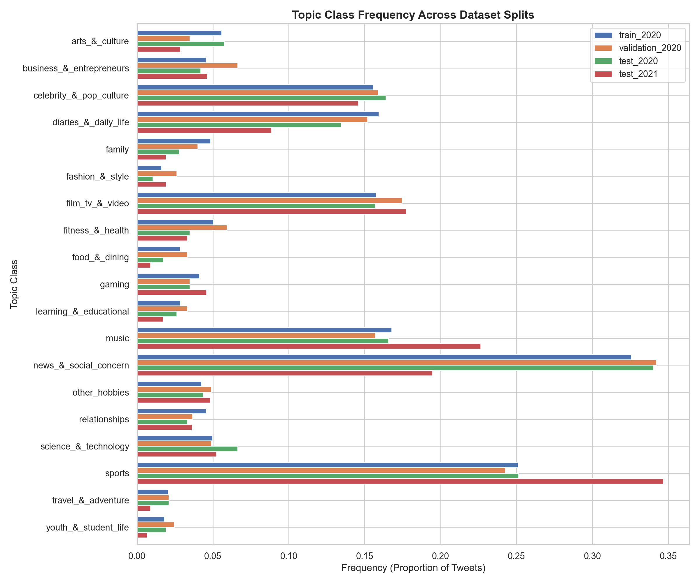
*Hình 1. Tỷ lệ 19 chủ đề trên `train_2020`, `test_2020`, `test_2021`. Lớp phổ biến nhất (`news_&_social_concern`, 32.6%) gấp **20.18 lần** lớp hiếm nhất (`fashion_&_style`, 1.6%); **91.01%** ô ma trận nhãn mang giá trị 0.*

| ID | Mã nhãn | Trọng tâm ngữ nghĩa | `train_2020` (mẫu, %) | `test_2020` | `test_2021` | Chênh lệch (`test_2021` − `train_2020`) |
|:---:|:---|:---|:---:|:---:|:---:|:---:|
| 12 | `news_&_social_concern` | Chính trị, bầu cử, chính sách, COVID-19, xã hội | 1,493 (32.6%) | 34.0% | 19.5% | **-13.1** (giảm mạnh) |
| 16 | `sports` | Bóng đá, NBA, Premier League, Olympics, tỷ số | 1,151 (25.1%) | 25.1% | 34.7% | **+9.6** (tăng mạnh) |
| 11 | `music` | Ca sĩ, album, Billboard, concert, MV, streaming | 769 (16.8%) | 16.6% | 22.6% | **+5.9** (tăng mạnh) |
| 03 | `diaries_&_daily_life` | Trạng thái cá nhân, tâm sự, sinh hoạt hàng ngày | 731 (15.9%) | 13.4% | 8.9% | **-7.1** (giảm mạnh) |
| 06 | `film_tv_&_video` | Netflix, phim rạp, diễn viên, Oscar, trailer | 722 (15.7%) | 15.7% | 17.7% | +2.0 |
| 02 | `celebrity_&_pop_culture` | Idol, showbiz, thảm đỏ, xu hướng viral | 714 (15.6%) | 16.4% | 14.6% | -1.0 |
| 00 | `arts_&_culture` | Hội họa, bảo tàng, lịch sử, văn học, triển lãm | 256 (5.6%) | 5.8% | 2.9% | -2.7 |
| 07 | `fitness_&_health` | Gym, chạy bộ, dinh dưỡng, vaccine, bệnh viện | 231 (5.0%) | 3.5% | 3.3% | -1.7 |
| 15 | `science_&_technology` | AI, smartphone, NASA, phần mềm, công nghệ | 229 (5.0%) | 6.6% | 5.2% | +0.2 |
| 04 | `family` | Bố mẹ, con cái, anh chị em, gia đình | 222 (4.8%) | 2.8% | 1.9% | -2.9 |
| 14 | `relationships` | Tình yêu, hẹn hò, bạn thân, kết hôn, chia tay | 209 (4.6%) | 3.3% | 3.6% | -0.9 |
| 01 | `business_&_entrepreneurs` | Khởi nghiệp, chứng khoán, crypto, CEO, tài chính | 208 (4.5%) | 4.2% | 4.6% | +0.1 |
| 13 | `other_hobbies` | Làm vườn, câu cá, thủ công, sưu tầm | 195 (4.3%) | 4.4% | 4.8% | +0.6 |
| 09 | `gaming` | PlayStation, Xbox, Steam, esports, livestream | 189 (4.1%) | 3.5% | 4.6% | +0.5 |
| 10 | `learning_&_educational` | Đại học, khóa học, thi cử, bài giảng | 131 (2.9%) | 2.6% | 1.7% | -1.1 |
| 08 | `food_&_dining` | Món ăn, nhà hàng, nấu nướng, đồ uống | 130 (2.8%) | 1.7% | 0.9% | -1.9 |
| 17 | `travel_&_adventure` | Khách sạn, bãi biển, du lịch, vé máy bay | 94 (2.1%) | 2.1% | 0.9% | -1.2 |
| 18 | `youth_&_student_life` | Ký túc xá, câu lạc bộ, sinh viên, đồ án | 83 (1.8%) | 1.9% | 0.7% | -1.2 |
| 05 | `fashion_&_style` | Quần áo, túi xách, sneaker, người mẫu, trang điểm | 74 (1.6%) | 1.0% | 1.9% | +0.3 |

### 2.2. Đa nhãn, Đồng xuất hiện, Trôi dạt Thời gian và Đặc trưng Văn bản
* **Tính chất đa nhãn:** Trên `train_2020`, Label Cardinality $LC = \mathbf{1.708}$ nhãn/tweet và Label Density $LD = \mathbf{0.0899}$. Có **48.2%** tweet mang 1 nhãn, **36.2%** mang 2 nhãn, **12.5%** mang 3 nhãn và **3.1%** mang 4–6 nhãn (tổng **51.8%** mang từ 2 nhãn trở lên).
* **Đồng xuất hiện nhãn (Chỉ số Jaccard):** Mức tương quan nhìn chung thấp (đa số cặp $< 0.10$), khẳng định giả định 19 bộ phân loại Sigmoid độc lập là hợp lý. Các cặp liên kết cao nhất gồm: `music`–`celebrity_&_pop_culture` (**0.29**), `learning_&_educational`–`youth_&_student_life` (**0.27**), `family`–`relationships` (**0.24**) và `film_tv_&_video`–`celebrity_&_pop_culture` (**0.18**).
* **Trôi dạt thời gian (2020 $\to$ 2021):** Khoảng cách Jensen-Shannon giữa `train_2020` và `test_2021` là **$JSD = 0.1377$**, phản ánh sự hạ nhiệt của tin tức đại dịch/bầu cử (`news` -13.09%, `diaries` -7.07%) và sự trở lại của thể thao/giải trí (`sports` +9.56%, `music` +5.86%).
* **Thống kê văn bản (`train_2020`):** Trung bình **28.34 ± 12.31 từ** (trung vị 27, dài nhất 61 từ / 364 ký tự); **68.75%** có mention, **48.14%** có URL và **39.28%** có hashtag. Giới hạn cắt $L_{\max} = 128$ token đủ rộng so với chiều dài tối đa 61 từ.

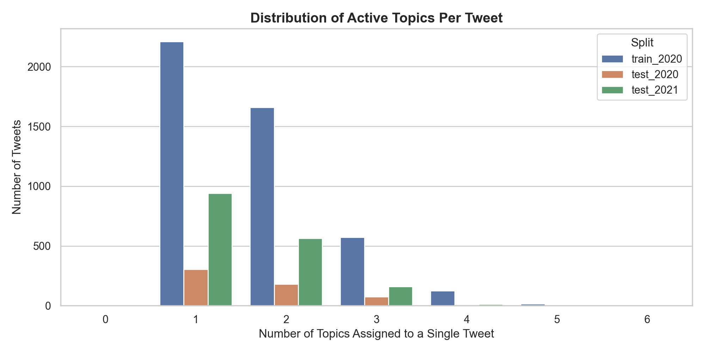
*Hình 2. Phân phối số nhãn mỗi tweet trên `train_2020`.*

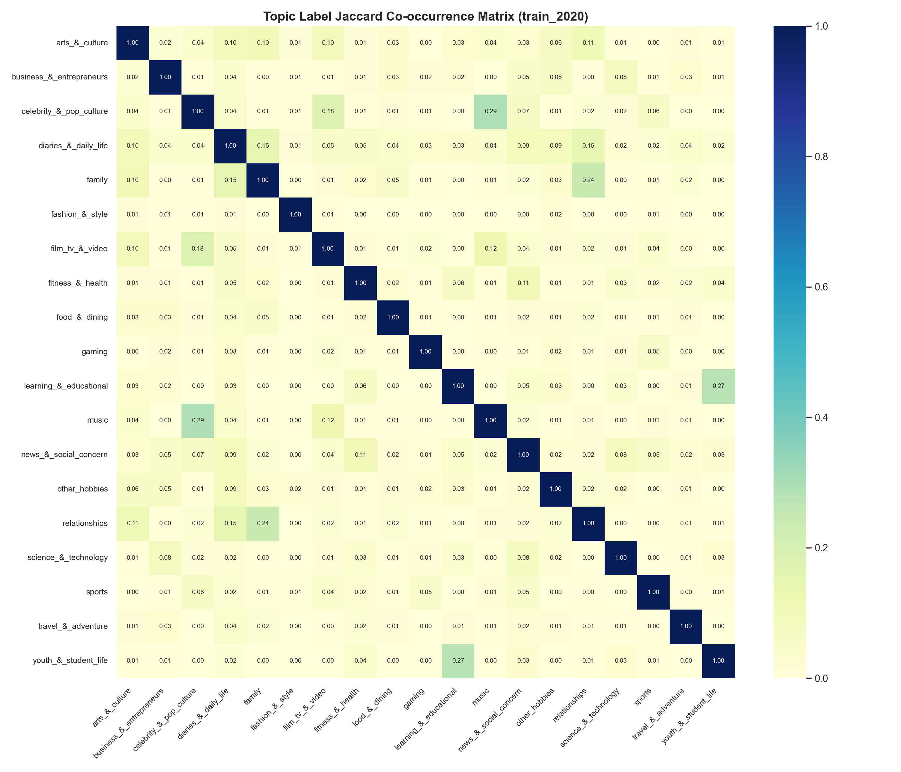
*Hình 3. Ma trận chỉ số Jaccard giữa 19 nhãn trên `train_2020`.*

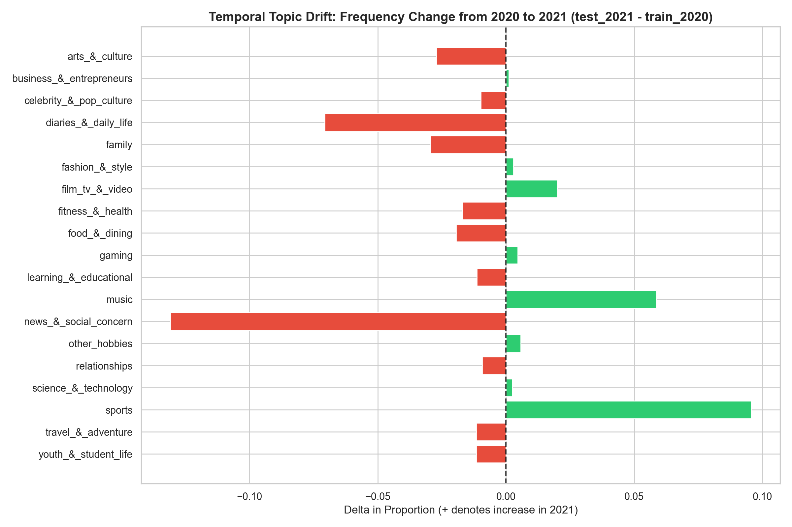
*Hình 4. Dịch chuyển phân phối 19 chủ đề giữa `test_2021` và `train_2020` ($JSD = 0.1377$).*

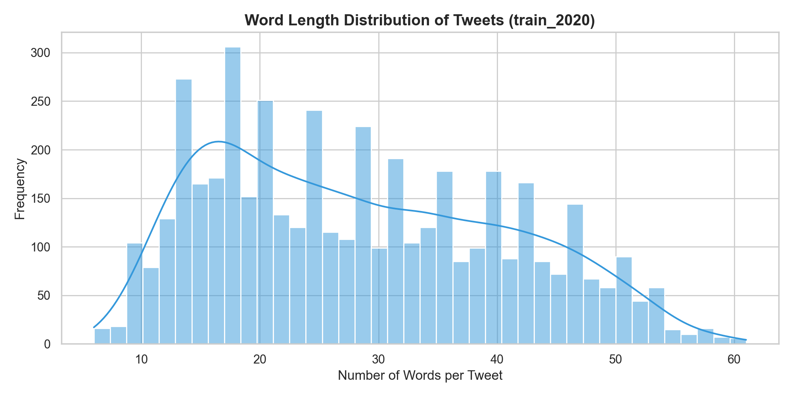
*Hình 5. Phân phối độ dài từ và ký tự trên `train_2020`.*

### 2.3. Tiền xử lý (`TweetTextCleaner`) và Cơ chế Chống rò rỉ Dữ liệu

#### A. Bộ làm sạch nhẹ (`TweetTextCleaner`)
Triết lý là **làm sạch theo quy tắc, bảo tồn tối đa tín hiệu mạng xã hội** (không xóa emoji, không xóa dấu `#`, không ép hạ chữ thường ở tầng cleaner):
1. Chuẩn hóa mặt nạ Cardiff: `{@user@}` $\to$ `@user`, `{{URL}}` $\to$ `http_url`.
2. Tách hashtag viết liền tại mọi ranh giới chữ hoa (giữ `#` và giữ dính chữ số): `#ClimateChange` $\to$ `#Climate Change`, `#NBAFinals` $\to$ `#NBA Finals`, `#WorldCup2022` $\to$ `#World Cup2022`.
3. Gộp dấu câu cảm thán lặp (`!!!`, `???`, `...` $\to$ 1 dấu) và chuẩn hóa khoảng trắng.

*Hai lưu ý kiểm soát thực nghiệm quan trọng:*
* **Giới hạn của việc bảo tồn chữ hoa/emoji:** Lợi ích này chỉ phát huy với mô hình có tokenizer nhận biết được chúng (RoBERTa, d1, Qwen); riêng TF-IDF và `bert-base-uncased` tự động hạ chữ thường ở tầng vector hóa/tokenizer.
* **Phiên bản bộ làm sạch:** Bản cũ chạy ở Vòng 2 (TF-IDF + cleaner) chỉ tách hashtag bắt đầu bằng chữ thường tại ranh giới đầu tiên (`#climateChange`, bỏ sót `#ClimateChange`). Bản sửa đầy đủ được áp dụng cho các cấu hình P2–P6 của Vòng 3; các mô hình còn lại dùng văn bản gốc.

#### B. Chống rò rỉ dữ liệu (Leakage Prevention)
* `TweetTextCleaner` hoàn toàn dựa trên quy tắc nên không học thông tin từ tập validation/test; `TfidfVectorizer` chỉ `fit` trên `train_2020`.
* Toàn bộ việc chọn epoch, chọn ngưỡng và học nhiệt độ $T_c$ chỉ dùng `validation_2020`.
* **Kiểm soát nhiễm dữ liệu thời gian:** Baseline B2 (Vòng 1) dùng checkpoint `cardiffnlp/twitter-roberta-base-2021-124m-topic-multi` vốn đã thấy dữ liệu năm 2021, khiến điểm `test_2021` không hoàn toàn sạch. Do đó, Vòng 2 chuyển sang checkpoint chỉ tiền huấn luyện đến tháng 12/2020 (`cardiffnlp/twitter-roberta-base-dec2020`) để đối chứng công bằng.

---

## III. PHƯƠNG PHÁP MÔ HÌNH HÓA (MODELING METHODOLOGY)

### 3.1. Tổng quan 4 Họ Mô hình và Không gian Biểu diễn
Cùng một tweet được chuyển đổi qua ba dạng không gian biểu diễn (đặc trưng thưa TF-IDF, chuỗi embedding ngữ cảnh của Encoder, hoặc trạng thái ẩn/điểm quyết định của LLM) nhưng đều hội tụ về cùng một giao thức đầu ra 19 xác suất Sigmoid và chung chuỗi hậu xử lý (Hình 6 và Hình 7).

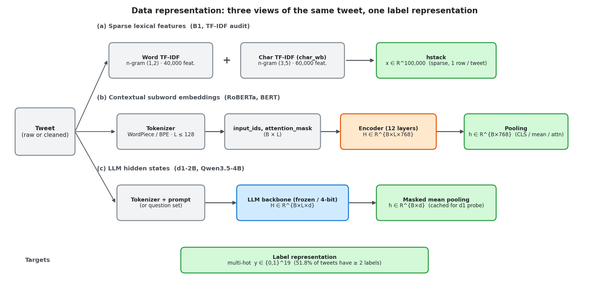
*Hình 6. Ba cách biểu diễn đầu vào theo họ mô hình và biểu diễn nhãn multi-hot 19 chiều. Màu cam: thành phần huấn luyện; xanh dương: thành phần đóng băng.*

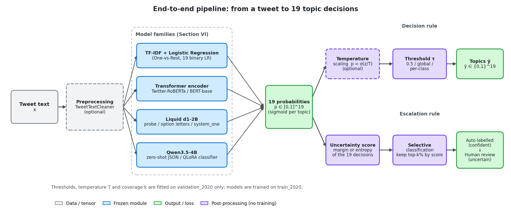
*Hình 7. Pipeline tổng thể từ tweet thô đến 19 quyết định chủ đề và nhánh phân loại có chọn lọc.*

| Họ mô hình | Quy mô tham số | Không gian biểu diễn đầu vào | Thành phần được huấn luyện | Vòng |
|:---|:---:|:---|:---|:---:|
| **Học máy tuyến tính** (`TF-IDF + LR`) | 19 vector tuyến tính | Vector thưa $\mathbf{x} \in \mathbb{R}^{100,000}$ (40k word 1–2 grams + 60k `char_wb` 3–5 grams, `sublinear_tf`, giữ stop words) | 19 bộ Logistic Regression (OvR) | 1, 2 |
| **Transformer Encoder** (`RoBERTa` / `BERT-base`) | ~125M / ~110M | Chuỗi dense $H \in \mathbb{R}^{B \times 128 \times 768}$ (BPE / WordPiece hạ chữ thường) | Toàn bộ encoder và head | 1, 2, 3 |
| **Liquid AI d1-2B** | ~1.92B | Trạng thái ẩn lớp cuối lưu đệm (Linear probe) hoặc chuỗi câu hỏi–đáp án (`system_one` / option-letter) | Chỉ Linear Head (probe); **không huấn luyện** (hai chế độ còn lại) | 1, 2, 3 |
| **Qwen3.5-4B** | ~4B (NF4 4-bit) | Prompt JSON (zero-shot) hoặc chuỗi ẩn cuối Masked Mean Pooling (QLoRA) | Không (zero-shot); LoRA + Head: **21,282,323 / 2,611,376,147 (0.815%)** | 1, 2 |

### 3.2. Chi tiết Kiến trúc: Từ Tuyến tính, Encoder đến LLM

#### A. Học máy cổ điển (`TF-IDF + Logistic Regression OvR`)
Hai bộ trích xuất TF-IDF mức từ và mức ký tự chạy song song, nối thành vector thưa 100,000 chiều (Hình 8) đưa vào 19 bộ Logistic Regression độc lập ($C = 2.0$, `class_weight='balanced'`, `lbfgs`, tối đa 1,000 vòng lặp).

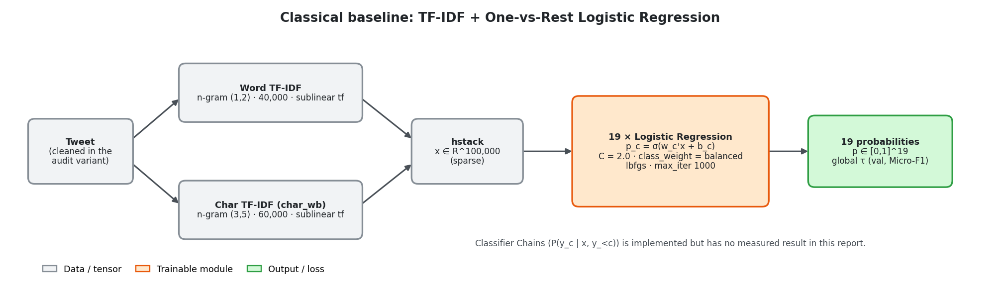
*Hình 8. Kiến trúc baseline tuyến tính B1.*

#### B. Transformer Encoder: Sự khác biệt then chốt giữa Head mặc định và Head tùy chỉnh
Vòng 1–2 dùng Twitter-RoBERTa (12 lớp, hidden 768); Vòng 3 dùng `bert-base-uncased` (12 lớp, hidden 768). Điểm mấu chốt tạo nên phát hiện trung tâm của nghiên cứu nằm ở **cấu trúc Head** (Hình 9):

| Thành phần | Head mặc định BERT | Head mặc định RoBERTa | Head tùy chỉnh (`force_custom_head`) |
|:---|:---|:---|:---|
| Đầu vào | `[CLS]` qua pooler tiền huấn luyện (dense + tanh) | `<s>` qua dense mới (768 $\to$ 768) + tanh | `[CLS]` thô, Mean Pooling hoặc Attention Pooling |
| Dropout | 0.1 | 0.1 (hai lần) | 0.2 (hoặc Multi-Sample Dropout $M=5$) |
| Lớp chiếu cuối | Linear 768 $\to$ 19 | Linear 768 $\to$ 19 | Linear 768 $\to$ 19 |
| Tốc độ học | 2e-5 (chung với thân) | 2e-5 (chung với thân) | **1e-3 cho head**, 2e-5 cho thân |

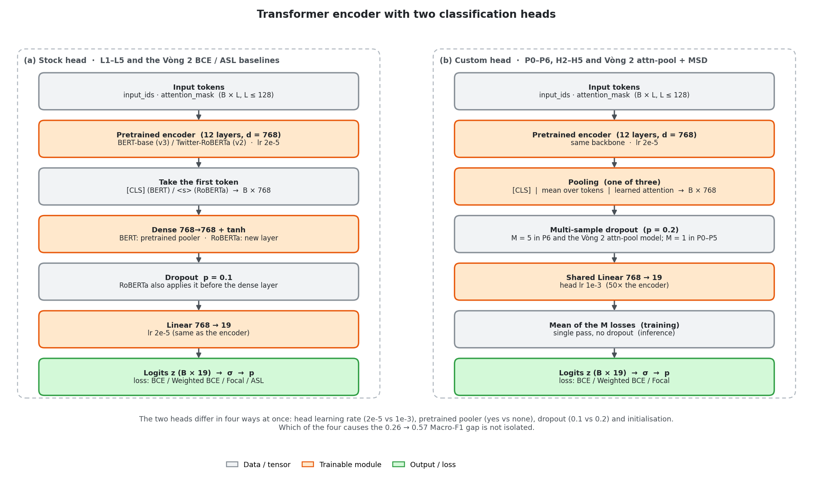
*Hình 9. So sánh head mặc định của thư viện và head tùy chỉnh trên cùng encoder.*

Trên head tùy chỉnh, hai kỹ thuật mở rộng được khảo sát (Hình 10):
* **Learned Attention Pooling:** Học trọng số chú ý $\alpha_i$ trên toàn chuỗi token ($\mathbf{W}_a \in \mathbb{R}^{256 \times 768}, \mathbf{v}_a \in \mathbb{R}^{256}$):
  $$u_i = \tanh(\mathbf{W}_a \mathbf{h}_i + \mathbf{b}_a), \quad \alpha_i = \frac{\exp(u_i^\top \mathbf{v}_a)}{\sum_{j} \exp(u_j^\top \mathbf{v}_a)}, \quad \mathbf{h}_{\text{pool}} = \sum_{i} \alpha_i \mathbf{h}_i$$
* **Multi-Sample Dropout (MSD):** Khi huấn luyện, truyền $\mathbf{h}_{\text{pool}}$ qua $M$ mặt nạ dropout độc lập ($M = 5, p = 0.2$) dùng chung một ma trận $\mathbf{W}_{\text{head}}$ rồi lấy trung bình loss:
  $$\mathbf{z}_m = \mathbf{W}_{\text{head}} \left( \frac{\mathbf{m}_m \odot \mathbf{h}_{\text{pool}}}{1 - p} \right) + \mathbf{b}$$

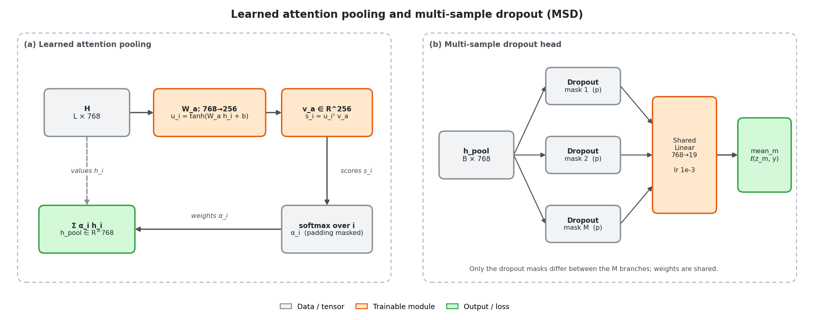
*Hình 10. Cơ chế Attention Pooling và Multi-Sample Dropout.*

#### C. Liquid AI d1-2B (Mô hình quyết định)
`LiquidAI/d1-2B` (~1.92B tham số, nền tảng LFM3-VL-2B) cho phép chấm xác suất một danh sách câu hỏi trên tweet trong **một lượt forward**. Ba cách khai thác đã được thử nghiệm (Hình 11):
1. **Option-letter zero-shot (Vòng 2):** Ánh xạ 19 chủ đề thành chữ cái A–S, lấy điểm logit ở bước sinh tiếp theo (Softmax tạo cạnh tranh giữa các lớp nên chỉ là bộ chấm đa nhãn yếu; riêng lần thử đầu B3 đọc nhầm 19 token đầu của từ vựng nên chỉ đạt 0.1820).
2. **Linear Probe (Vòng 2):** Đóng băng 100% backbone, Masked Mean Pooling lớp cuối và lưu đệm một lần, chỉ huấn luyện Linear Head + MSD 4 nhánh ($p \in \{0.1, 0.2, 0.3, 0.4\}$) với Weighted BCE.
3. **API gốc `system_one` (Vòng 3 – Không huấn luyện):** Khai thác đúng cơ chế thiết kế của mô hình qua 2 chế độ: *choice* (1 câu hỏi 19 đáp án chọn nhiều) và *noul* (19 câu hỏi có/không độc lập), chạy fp16 trên GPU Kaggle (`transformers>=5.19`).

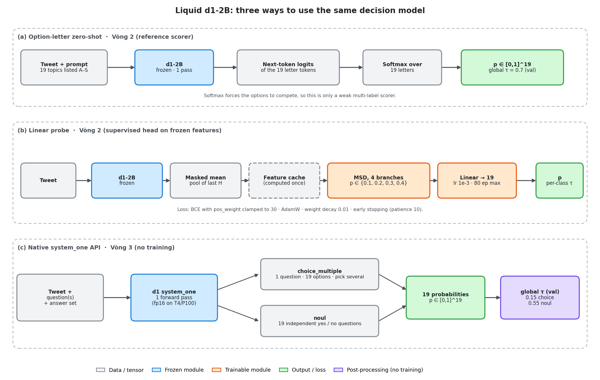
*Hình 11. Ba cơ chế khai thác Liquid AI d1-2B.*

#### D. Qwen3.5-4B (Mô hình ngôn ngữ lớn)
Thử nghiệm hai hướng (Hình 12): (1) **Zero-shot JSON (B4, Vòng 1)** lượng tử hóa NF4 4-bit, sinh tham lam tối đa 48 token mảng JSON rồi trích bằng regex; và (2) **Supervised QLoRA (Vòng 2)** gắn LoRA ($r=16, \alpha=32$, dropout 0.05) lên toàn bộ phép chiếu `q, k, v, o, gate, up, down` + Masked Mean Pooling + MSD 4 nhánh + Linear Head 19 chiều, suy luận chỉ cần 1 lượt forward không còn rủi ro lỗi cú pháp JSON. Ngoài ra, Qwen3.5-4B zero-shot (chain-of-thought) còn được thử làm **LLM Auditor** kiểm tra 20% tweet mơ hồ nhất của TF-IDF.

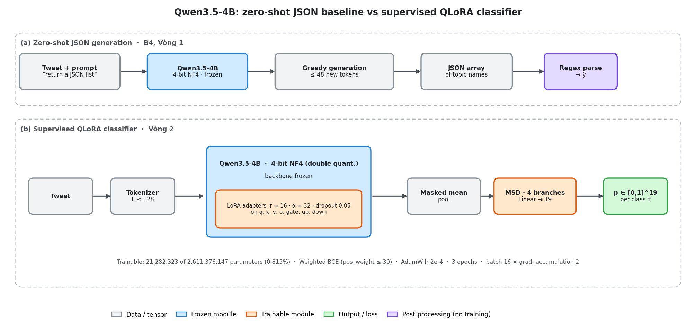
*Hình 12. Hai phương thức sử dụng Qwen3.5-4B: sinh JSON zero-shot và phân loại có giám sát QLoRA.*

### 3.3. Hàm mất mát cho Đa nhãn Lệch lớp
Để chống lại hiện tượng 91.01% ô âm tính áp đảo gradient của BCE, ba hàm mất mát mở rộng được khảo sát:
1. **Positive-Weighted BCE (W-BCE):** Nhân trọng số $w_c = \text{clip}\left(\frac{N - N_c}{N_c}, 1, 30\right)$ cho mẫu dương:
   $$\mathcal{L}_{\text{W-BCE}} = -\frac{1}{19} \sum_{c=1}^{19} \left[ w_c y_c \log \hat{p}_c + (1 - y_c) \log(1 - \hat{p}_c) \right]$$
2. **Multi-Label Focal Loss:** $\mathcal{L}_{\text{Focal}} = -\frac{1}{19} \sum_c \alpha_{t,c}(1 - p_{t,c})^\gamma \log(p_{t,c})$. Lưu ý rằng đặt $\alpha = 0.25$ sẽ gán trọng số $0.25$ cho lớp dương và $0.75$ cho lớp âm — vô tình làm yếu đúng nhóm hiếm; do đó Vòng 3 kiểm thử cả bản bỏ $\alpha$ ($\gamma = 2$, không $\alpha$).
3. **Asymmetric Loss (ASL, Ridnik et al., ICCV 2021):** Tách hệ số tập trung $\gamma_+, \gamma_-$ và dịch lề xác suất âm $\hat{p}_{m,c} = \max(\hat{p}_c - m, 0)$ (loại hoàn toàn gradient mẫu âm khi $\hat{p}_c \le m$):
   $$\mathcal{L}_{\text{ASL}} = -\frac{1}{19} \sum_{c=1}^{19} \left[ y_c (1 - \hat{p}_c)^{\gamma_+} \log \hat{p}_c + (1 - y_c) \hat{p}_{m,c}^{\gamma_-} \log(1 - \hat{p}_{m,c}) \right]$$
   *Lưu ý kiểm toán:* Vòng 2 chạy với $\gamma_+ = 1, \gamma_- = 4, m = 0.05$ (mặc định mã nguồn tại thời điểm chạy, khác $\gamma_+ = 0$ của bài báo gốc). Hiện `AsymmetricLoss` chưa được khôi phục vào `tweet_topic/models/bert/losses.py` của Vòng 3.

### 3.4. Chiến lược Huấn luyện và Hậu xử lý Quyết định

#### A. So sánh cấu hình huấn luyện giữa các họ mô hình

| Thành phần | TF-IDF + LR | RoBERTa (Vòng 2)* | BERT-base (Vòng 3) | d1 Linear Probe | Qwen QLoRA |
|:---|:---|:---|:---|:---|:---|
| Bộ tối ưu & LR | `lbfgs` | AdamW; 2e-5 (head tùy chỉnh 1e-3) | AdamW; 2e-5 thân, 1e-3 head tùy chỉnh | AdamW; 1e-3 (chỉ head) | AdamW; 2e-4 (LoRA + head) |
| Epoch / Batch | $\le 1000$ iter | 3 epoch, batch 32 | 4 epoch, batch 32 | $\le 80$ epoch, batch 128 | 3 epoch, batch 16 $\times$ accum 2 |
| Ổn định hóa | — | FP16; không cắt grad; không đặt seed | FP16; cắt grad 1.0; seed 42 (+1337, 2024) | — | FP16; cắt grad 1.0; seed 42 |
| Chọn checkpoint | — | Cuối epoch 3 | Best `val_macro_f1_tuned`, early stop (patience 2) | Early stop BCE val (patience 10) | Cuối epoch 3 |

*\*Ghi chú kiểm soát sai lệch:* (1) Cột RoBERTa Vòng 2 phản ánh chính xác mã nguồn tại commit chạy thực nghiệm (`9ddc5f6`), khác với Vòng 3 về backbone, cắt gradient, chọn epoch và seed — vì vậy so sánh chéo Vòng 2 vs. Vòng 3 chỉ mang tính bối cảnh. (2) Ở Vòng 3, khởi tạo head diễn ra trước bước đặt seed nên dao động giữa 3 seed bao hàm cả tính ngẫu nhiên khởi tạo này.

#### B. Hậu xử lý: Chọn ngưỡng, Hiệu chuẩn và Chọn lọc
* **Chọn ngưỡng trên `validation_2020` (bước 0.05):** *Ngưỡng chung* quét $[0.10, 0.90]$ tối ưu Micro-F1; *ngưỡng theo lớp* quét $[0.05, 0.85]$ tối ưu từng $F1_c$ (lớp không có mẫu dương giữ 0.5). Rủi ro lớn nhất là `validation_2020` chỉ có 573 mẫu nên tối ưu đồng thời 19 ngưỡng rất dễ khớp quá mức.
* **Temperature Scaling:** Học nhiệt độ $T_c > 0$ cực tiểu hóa NLL nhị phân trên validation ($\hat{p}_c^{\text{calib}} = \sigma(z_c / T_c)$). Do đơn điệu nên bảo toàn thứ hạng trong từng lớp, chủ yếu giảm ECE.
* **Phân loại có chọn lọc (Selective Classification):** Tính độ bất định theo **margin**: $u(x) = 1 - \min_c \frac{|p_c - \tau_c|}{\max(\tau_c, 1 - \tau_c)}$ (hoặc tổng entropy nhị phân 19 lớp). Giữ lại tỷ lệ *coverage* (50%–100%) các tweet chắc chắn nhất để tự động hóa và chuyển phần còn lại cho con người.

---

## IV. KẾT QUẢ THỰC NGHIỆM VÀ THẢO LUẬN

> **Nguyên tắc đọc số liệu:** Mọi cấu hình Vòng 2 chạy 1 seed; Vòng 3 chạy seed 42 và lặp **3 seed (42, 1337, 2024)** cho 3 mốc chốt (P0, P6, L2). Chênh lệch nhỏ hơn khoảng 1–2 điểm trên một lần chạy đơn lẻ được xem là nằm trong vùng nhiễu.

### 4.1. Bảng Xếp hạng Tổng thể và Đối chiếu Văn hiến (SOTA)

| Nguồn / Vòng | Mô hình & Cấu hình | Ngưỡng | `test_2020` (Micro / Macro) | `test_2021` (Micro / Macro) |
|:---:|:---|:---:|:---:|:---:|
| *SOTA gốc* | **Antypas et al. (COLING 2022)** — TimeLMs-2020 (BCE) | theo val | 0.6780 / 0.5340 | 0.6550 / 0.4510 |
| *SOTA gốc* | **Loureiro et al. (ACL 2022)** — TimeLMs-2020 (BCE) | cố định 0.5 | 0.6720 / 0.3780 | 0.6540 / 0.3410 |
| V1 | B1: TF-IDF + Logistic Regression (OvR) | chung | 0.6890 / 0.5227 | 0.6154 / 0.3997 |
| V1 | B2: RoBERTa (checkpoint có dữ liệu 2021 ⚠️), BCE | chung | 0.6659 / 0.2955 | 0.6502 / 0.2648 |
| V2 | TF-IDF + `TweetTextCleaner` (bản cũ) | chung | 0.6947 / 0.5412 | 0.6163 / 0.4058 |
| V2 | RoBERTa `dec2020`, BCE (head mặc định) | chung (0.25) | 0.6741 / 0.3272 | 0.6525 / 0.2890 |
| V2 | RoBERTa `dec2020`, BCE + Temperature Scaling | chung | 0.6701 / 0.3105 | 0.6473 / 0.2627 |
| V2 | RoBERTa `dec2020`, ASL (head mặc định) | theo lớp | 0.7048 / 0.6186 | 0.6963 / 0.5734 |
| **V2** | **RoBERTa `dec2020`, AttnPool + MSD + ASL (head tùy chỉnh)** | **theo lớp** | **0.7417 / 0.6536** | **0.7238 / 0.5974** |
| V2 | Qwen3.5-4B, QLoRA có giám sát (W-BCE) | theo lớp | 0.7319 / 0.6533 | 0.6971 / 0.5815 |
| V2 | Liquid d1-2B, Linear Probe (W-BCE) | theo lớp | 0.6432 / 0.5519 | 0.5976 / 0.4640 |
| V2 | Liquid d1-2B, Option-letter zero-shot | chung | 0.5677 / 0.4757 | 0.5763 / 0.4806 |
| V3 | BERT-base, BCE, head mặc định (L1) | chung | 0.6602 / 0.2805 | 0.6431 / 0.2568 |
| **V3** | **BERT-base, BCE, head tùy chỉnh (P0, TB 3 seed)** | **chung** | **0.7403 / 0.6351** | **0.7178 / 0.5698** |
| V3 | BERT-base + Cleaner + W-BCE + AttnPool + MSD (P6, TB 3 seed) | chung | 0.7157 / 0.6356 | 0.7051 / 0.5827 |
| **V3** | **Liquid d1-2B, `system_one` choice (không huấn luyện)** | **chung (0.15)** | **0.6509 / 0.5384** | **0.6637 / 0.5229** |
| V3 | Liquid d1-2B, `system_one` 19 câu `noul` (không huấn luyện) | chung (0.55) | 0.6291 / 0.5104 | 0.5922 / 0.4595 |

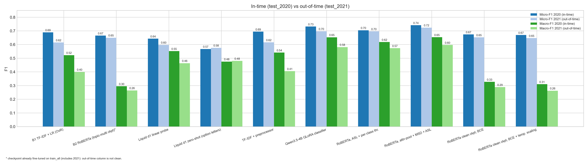
*Hình 13. Hiệu năng `test_2020` vs. `test_2021` của các cấu hình Vòng 1 và 2 (dấu \* là checkpoint có dữ liệu 2021).*

**Nhận định nổi bật:**
* Ngay cả mô hình **BERT-base tối giản (P0)** dùng BCE thuần và ngưỡng chung (không cần pre-train trên Twitter, không ASL, không pooling phức tạp) đã đạt **0.7178 / 0.5698** trên `test_2021`, vượt mốc chuẩn của paper gốc Antypas et al. (2022) **+6.28 điểm Micro / +11.88 điểm Macro** và tiệm cận sát cấu hình tốt nhất Vòng 2 (0.7238 / 0.5974).
* Tiền xử lý nhẹ trên TF-IDF (`TweetTextCleaner` bản cũ) chỉ thay đổi $< 1$ điểm Micro-F1 trên `test_2021` (0.6163 vs. 0.6154), nằm trong dao động nhỏ của một lần chạy.

### 4.2. Độ bền vững trước Trôi dạt Thời gian và Kiểm soát Nhiễm dữ liệu

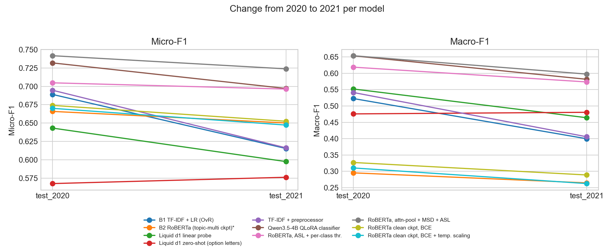
*Hình 14. Chênh lệch Micro-F1 và Macro-F1 từ `test_2020` sang `test_2021` (Vòng 1–2).*

1. **Mức suy giảm Micro-F1 ($2020 \to 2021$):**
   * **TF-IDF sụp đổ mạnh nhất:** **-7.36 điểm Micro** và **-12.30 điểm Macro**. Tuy nhiên cần thận trọng: sự suy giảm này là tổng hợp của cả *trôi dạt từ vựng* lẫn *dịch chuyển tỷ lệ nhãn* ($JSD = 0.1377$), chưa tách định lượng hai yếu tố.
   * **Nhóm Encoder tinh chỉnh bền bỉ vượt trội:** RoBERTa Vòng 2 chỉ giảm từ **-0.85** (ASL) đến **-2.28** (BCE+TS); cấu hình tốt nhất giảm **-1.79**. Ở Vòng 3 (trung bình 3 seed), BERT P0 giảm **-2.25** và P6 giảm **-1.05**.
   * **LLM tinh chỉnh/probe giảm sâu hơn Encoder:** Qwen QLoRA giảm **-3.48**, d1 linear probe giảm **-4.56**.
   * **Mô hình không huấn luyện miễn nhiễm với trôi dạt phân phối 2020:** d1 option-letter **+0.86** và d1 `system_one` choice **+1.28 điểm** trên `test_2021` do không học vẹt ưu tiên phân phối năm 2020.
2. **Kiểm chứng Data Contamination (B2 vs. `dec2020`):** Checkpoint sạch `dec2020` đạt `test_2021` = **0.6525 / 0.2890** ($\Delta = -2.16$), hoàn toàn ngang bằng checkpoint có dữ liệu 2021 của B2 (**0.6502 / 0.2648**, $\Delta = -1.57$). Kết luận không bị bóp méo bởi nhiễm dữ liệu (mặc dù 1 seed chưa loại trừ hoàn toàn hiệu ứng nhỏ).

### 4.3. Khai thác Mô hình Lớn: Liquid d1-2B, Qwen3.5-4B và LLM Auditor

| Mô hình & Phương thức | `test_2020` (Micro / Macro) | `test_2021` (Micro / Macro) | Exact Match (2020 / 2021) |
|:---|:---:|:---:|:---:|
| Qwen3.5-4B, zero-shot JSON (B4) ‡ | 0.0290 / 0.0107 | chưa đo | 0.0000 / — |
| **Qwen3.5-4B, QLoRA có giám sát** | **0.7319 / 0.6533** | **0.6971 / 0.5815** | 0.4119 / 0.3996 |
| Liquid d1, đọc nhầm logit (B3) † | 0.1820 / 0.1178 | chưa đo | 0.0000 / — |
| Liquid d1, option-letter zero-shot | 0.5677 / 0.4757 | 0.5763 / 0.4806 | 0.2391 / 0.2674 |
| Liquid d1, linear probe | 0.6432 / 0.5519 | 0.5976 / 0.4640 | 0.2967 / 0.2621 |
| **Liquid d1, `system_one` choice (Vòng 3)** | 0.6509 / 0.5384 | **0.6637 / 0.5229** | 0.3246 / 0.3621 |
| Liquid d1, `system_one` 19 câu `noul` (Vòng 3) | 0.6291 / 0.5104 | 0.5922 / 0.4595 | 0.2862 / 0.2174 |

*‡ † Đo trên 200 tweet đầu của `test_2020` (notebook 03–04). Với B4, do đầu ra thô chưa được kiểm tra và giới hạn 48 token sinh + regex có thể làm rớt nhãn, con số 0.0290 không nên quy chụp là giới hạn tuyệt đối của Qwen zero-shot.*

* **Cách khai thác quyết định số phận của Liquid d1-2B:** Từ 0.18 (lỗi đọc token) $\to$ 0.58 (option-letter) $\to$ 0.60 (linear probe) $\to$ **0.6637 / 0.5229** khi dùng đúng API gốc `system_one` (chế độ *choice* hơn 19 câu *noul* tới +7.15 điểm Micro trên 2021). Chế độ này chỉ tốn ~10 phút chấm toàn bộ 2,825 tweet validation + test trên GPU Kaggle mà không cần huấn luyện (tuy nhiên vẫn dùng nhãn validation để chọn ngưỡng chung 0.15 nên không phải zero-shot thuần tuyệt đối).
* **Quy mô tham số không thắng chuyên biệt hóa:** Qwen3.5-4B QLoRA (4B tham số) chỉ ngang RoBERTa 125M ở 2020 và kém hơn ở 2021 (0.6971 vs. 0.7238).
* **Thất bại của LLM Auditor (Vòng 2):** Khi chuyển 20% tweet mơ hồ nhất của TF-IDF sang Qwen3.5-4B zero-shot (chain-of-thought) theo chính sách **thay thế**, chất lượng sụt giảm nghiêm trọng ngay trên chính nhóm ca khó:
  * `test_2020` (115 tweet chuyển đi): Micro-F1 toàn tập giảm **0.6947 $\to$ 0.5366**; trên riêng phần chuyển đi giảm **0.5652 $\to$ 0.2741**.
  * `test_2021` (336 tweet chuyển đi): Micro-F1 toàn tập giảm **0.6163 $\to$ 0.4798**; trên riêng phần chuyển đi giảm **0.5216 $\to$ 0.2756**.
  $\rightarrow$ Bác bỏ giả thuyết dùng LLM zero-shot làm auditor thay thế dự đoán.

### 4.4. Ablation Study (Vòng 3): Head vs. Loss và Thang Kỹ thuật Cộng dồn

#### A. Ablation 1: Phát hiện "Head quan trọng hơn Loss" (`bert-base-uncased`)

| Hàm mất mát | Head mặc định (L1–L5, lr=2e-5) `test_2020` / `test_2021` | F1 `fashion`/`food` (2021, L1–L5) | Head tùy chỉnh (P0, H2–H5, lr head=1e-3) `test_2020` / `test_2021` |
|:---|:---:|:---:|:---:|
| **BCE** | 0.6602 / 0.2805 $\;\vert\;$ **0.6431 / 0.2568** (L1) | 0.00 / 0.00 | 0.7377 / 0.6374 $\;\vert\;$ **0.7161 / 0.5681** (P0) |
| **Weighted BCE** | 0.6500 / 0.5721 $\;\vert\;$ **0.6535 / 0.5219** (L2) | 0.59 / 0.47 | 0.7132 / 0.6447 $\;\vert\;$ **0.6996 / 0.5741** (H2) |
| **Focal ($\gamma=2, \alpha=0.25$)** | 0.6812 / 0.3996 $\;\vert\;$ 0.6637 / 0.3790 (L3) | 0.00 / 0.50 | 0.7380 / 0.6219 $\;\vert\;$ 0.7194 / 0.5482 (H3) |
| **Focal ($\gamma=1, \alpha=0.25$)** | 0.6440 / 0.2259 $\;\vert\;$ 0.6252 / 0.2097 (L4) | 0.00 / 0.00 | 0.7441 / 0.6303 $\;\vert\;$ 0.7211 / 0.5463 (H4) |
| **Focal ($\gamma=2$, không $\alpha$)** | 0.7061 / 0.5383 $\;\vert\;$ 0.6871 / 0.4996 (L5) | 0.33 / 0.63 | 0.7438 / 0.6401 $\;\vert\;$ 0.7145 / 0.5527 (H5) |

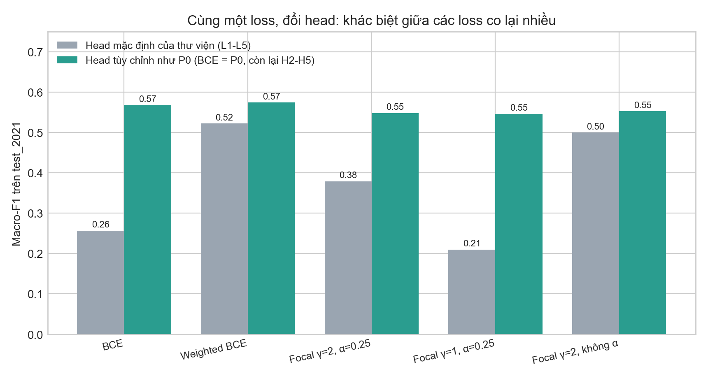
*Hình 17. Tác động áp đảo của Head so với hàm Loss trên `test_2021`.*

* **Cơ chế hội tụ:** Ở L1 (head mặc định), Macro-F1 validation tăng cực chậm qua 4 epoch (`0.24 -> 0.33 -> 0.38 -> 0.40`, train loss cuối `0.184`), còn P0 (head tùy chỉnh) đạt ngay `0.56 -> 0.65 -> 0.66 -> 0.68` (train loss cuối `0.092`). Đổi head tăng **+31.1 điểm Macro-F1** cho BCE, trong khi đổi loss trên cùng head tốt chỉ dao động trong biên độ hẹp **2.8 điểm** (0.546–0.574).
* **Focal Loss với $\alpha=0.25$** làm yếu lớp dương nên kém nhất ở head mặc định (L4: 0.21); bỏ $\alpha$ (L5) nhảy lên 0.50.
* **Hệ quả phản biện cho Vòng 2:** RoBERTa + BCE (head mặc định: 0.289) vs. RoBERTa + ASL (0.573) tái hiện đúng mô thức L1 vs. L2. Do head tùy chỉnh thay đổi 4 yếu tố đồng thời (tốc độ học 1e-3, bỏ pooler tiền huấn luyện, dropout 0.2, khởi tạo), việc cô lập yếu tố gốc của head và kiểm định lại ASL trên cùng head tốt là ưu tiên nghiên cứu tiếp theo.

#### B. Ablation 2: Thang Kỹ thuật Cộng dồn (P0 $\to$ P8) và Kiểm định 3 Seed

| Bước | Thay đổi cộng dồn so với bước trước | `test_2020` (Micro / Macro) | `test_2021` (Micro / Macro) | $\Delta$ bước trước (`test_2021`) |
|:---:|:---|:---:|:---:|:---:|
| **P0** | BERT + Head tùy chỉnh (`[CLS]`), BCE, ngưỡng chung | 0.7377 / 0.6374 | 0.7161 / 0.5681 | — |
| P1 | + Ngưỡng theo lớp (hậu xử lý từ P0) | 0.7189 / 0.6317 | 0.6956 / 0.5781 | -0.021 / +0.010 |
| P2 | + `TweetTextCleaner` (bản mới) | 0.7338 / 0.6457 | 0.7053 / 0.5708 | +0.010 / -0.007 |
| P3 | + Weighted BCE | 0.7069 / 0.6303 | 0.6801 / 0.5642 | -0.025 / -0.007 |
| P4 | + Mean Pooling | 0.6949 / 0.6242 | 0.6828 / 0.5665 | +0.003 / +0.002 |
| P5 | + Attention Pooling (`attn_dim` 256) | 0.6953 / 0.6158 | 0.6838 / 0.5738 | +0.001 / +0.007 |
| **P6** | + Multi-Sample Dropout (5 nhánh, $p=0.2$) | 0.7163 / 0.6323 | 0.7012 / 0.5826 | +0.017 / +0.009 |
| P7 | + Temperature Scaling (hậu xử lý từ P6) | 0.7149 / 0.6283 | 0.6994 / 0.5766 | -0.002 / -0.006 |
| **P8** | + Chọn lọc giữ 80% chắc chắn nhất (từ P7) | **0.7566 / 0.6432** | **0.7424 / 0.6045** | *(trên 80% coverage)* |

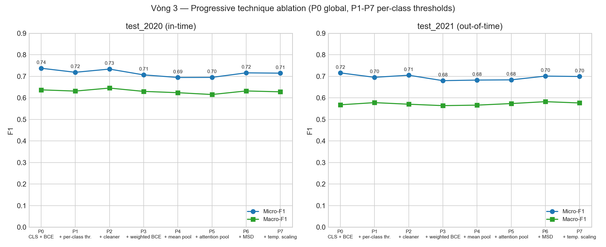
*Hình 18. Thang kỹ thuật cộng dồn P0–P8: hai đường F1 gần như đi ngang qua các bước huấn luyện và chỉ bật lên ở bước hậu xử lý chọn lọc P8.*

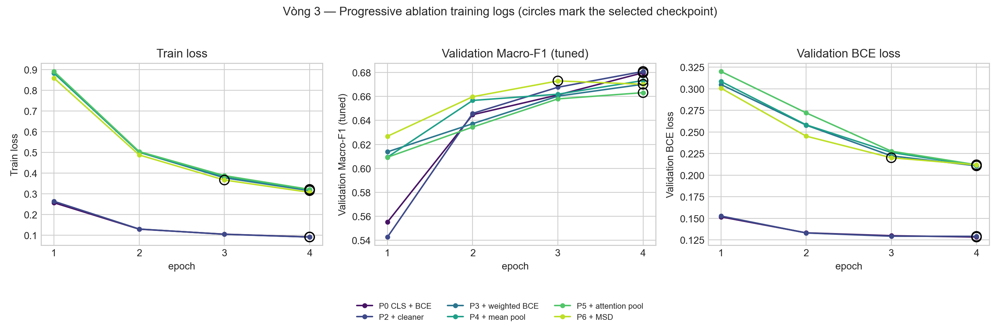
*Hình 19. Đường cong huấn luyện P0–P6 (P0–P5 chọn epoch 4; P6 chọn epoch 3).*

**Kiểm định nhiễu qua 3 seed (42, 1337, 2024; ngưỡng chung trên `test_2021`):**

| Cấu hình | Micro-F1 (`test_2021`) | Macro-F1 (`test_2021`) | Chi tiết 3 seed (42 / 1337 / 2024) |
|:---|:---:|:---:|:---|
| **P0:** BERT + BCE | **0.718 ± 0.006** | 0.570 ± 0.010 | 0.716/0.568; 0.725/0.561; 0.712/0.581 |
| **P6:** Cleaner + W-BCE + Attn + MSD | 0.705 ± 0.001 | **0.583 ± 0.003** | 0.706/0.579; 0.705/0.583; 0.705/0.586 |
| **L2:** Head mặc định + W-BCE | 0.653 ± 0.003 | 0.522 ± 0.007 | 0.654/0.522; 0.651/0.514; 0.656/0.529 |

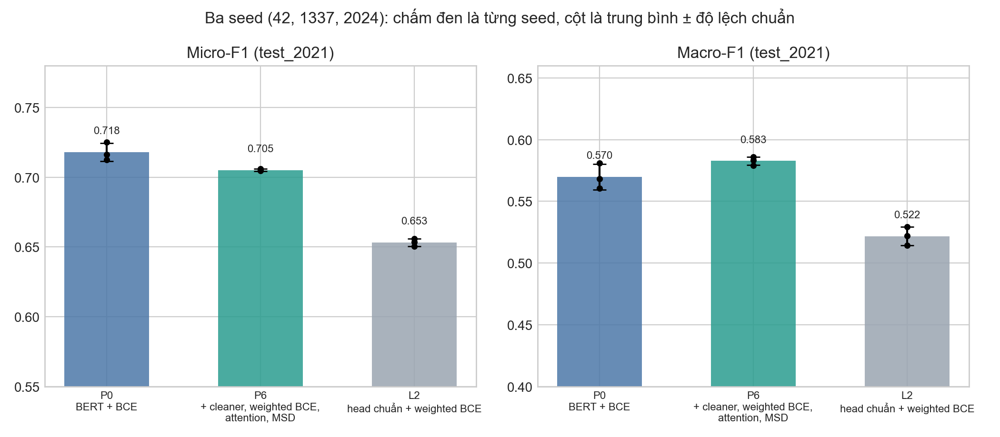
*Hình 20. Độ phân tán giữa 3 seed của P0, P6 và L2.*

* Với độ lệch chuẩn của P0 là ~0.65 điểm Micro và ~1.0 điểm Macro, các bước **P2, P4, P5, P7 đều nằm trong vùng nhiễu** ($< 2\sigma$).
* So sánh hai trung bình 3 seed: P6 so với P0 giảm **1.3 điểm Micro-F1** ($3.4\times$ sai số chuẩn của hiệu, đáng kể) và chỉ tăng **1.3 điểm Macro-F1** ($2.1\times$ sai số chuẩn, sát ngưỡng nhiễu) — tức là một **sự đánh đổi nhỏ**, dù P6 có độ ổn định giữa các seed cao hơn hẳn (std Micro 0.001 vs. 0.006).

### 4.5. Ngưỡng quyết định, Hiệu chuẩn ECE và Phân loại Có chọn lọc

#### A. Ảnh hưởng sống còn của ngưỡng quyết định (`test_2021`, Micro / Macro)

| Cấu hình (Vòng 3) | Ngưỡng 0.5 | Ngưỡng chung (tối ưu Val) | Ngưỡng theo lớp (19 ngưỡng) |
|:---|:---:|:---:|:---:|
| L1: Head mặc định + BCE | 0.6239 / 0.1949 | 0.6431 / 0.2568 | **0.4784** / 0.3996 *(sụp Micro)* |
| P0: Head tùy chỉnh + BCE | **0.7220** / 0.5438 | 0.7161 / 0.5681 (ngưỡng 0.3) | 0.6956 / 0.5781 |
| H2: Head tùy chỉnh + W-BCE | 0.6362 / 0.5245 | **0.6996 / 0.5741** | 0.6873 / 0.5679 |
| P6: Full cộng dồn (W-BCE) | 0.6274 / 0.5065 | **0.7061 / 0.5791** (ngưỡng 0.8) | 0.7012 / 0.5826 |

* **Weighted BCE đẩy xác suất dương lên rất cao** (ngưỡng tối ưu là **0.8** thay vì 0.5; so sánh ở 0.5 làm P6 thiệt giả tạo tới **7.9 điểm Micro-F1**), trong khi BCE thuần tối ưu ở ngưỡng **0.3**.
* **Rủi ro khớp quá mức của ngưỡng theo lớp:** Do `validation_2020` chỉ có 573 mẫu, ngưỡng theo lớp làm P0 giảm 2.1 điểm Micro (P1) và thậm chí làm **L1 sụp Micro-F1 xuống 0.4784** (vì 3 lớp hiếm bị kéo ngưỡng xuống mức sàn 0.05 để dự đoán toàn bộ là dương, kéo F1 xuống 0.032).

#### B. Hiệu chuẩn xác suất (Micro-ECE trên `test_2021`, càng thấp càng tốt)

| Vòng | Cấu hình | ECE trước | ECE sau Temperature Scaling | Nhận xét cơ chế |
|:---:|:---|:---:|:---:|:---|
| V2 | RoBERTa `dec2020`, BCE + TS | 0.0455 | **0.0151** | Giảm 3 lần ECE; không tăng F1 |
| V2 | Qwen3.5-4B QLoRA / TF-IDF+cleaner / d1 probe | 0.0407 / 0.0638 / 0.1273 | — | QLoRA hiệu chuẩn tự nhiên khá tốt |
| V2 | RoBERTa `dec2020`, ASL / AttnPool+MSD+ASL | **0.2796 / 0.2235** | — | ASL bóp méo xác suất mạnh nhất |
| V3 | BERT P0 (BCE) / L1 (BCE) | **0.010 / 0.041** | **0.007 / 0.016** | BCE thuần hiệu chuẩn tự nhiên rất tốt |
| V3 | BERT P6 (Weighted BCE) *(riêng L2: 0.225)* | 0.092 | 0.087 | TS không sửa được độ lệch do trọng số lớp |

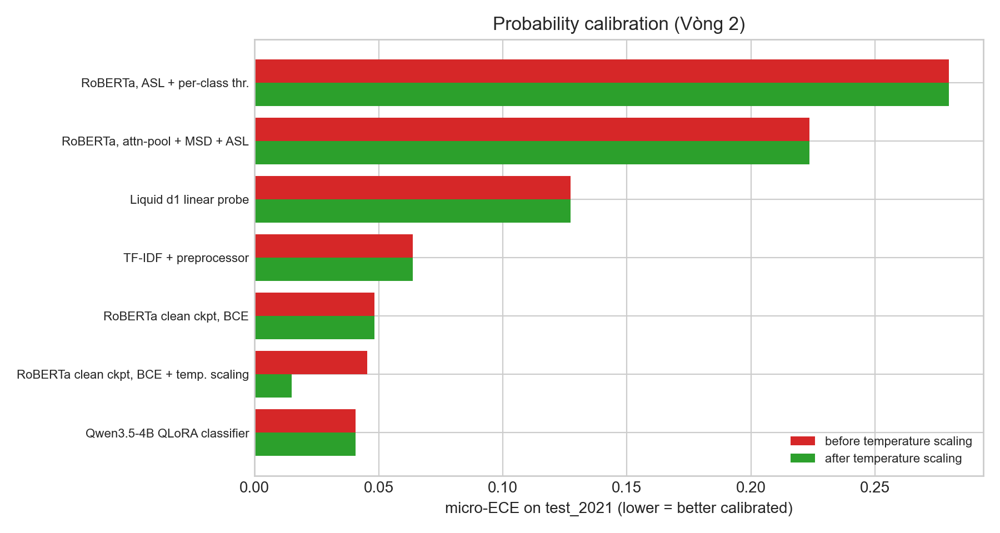
*Hình 15. Micro-ECE trên `test_2021` của các cấu hình Vòng 2.*

#### C. Phân loại Có chọn lọc (Selective Classification theo Margin, `test_2021`)

| Tỷ lệ tự động hóa (Coverage) | P6 Vòng 3: Phần tự động / Phần chuyển người | V2 RoBERTa Attn+MSD+ASL (tại 80% & 50%) |
|:---:|:---:|:---|
| **100%** | 0.7012 / — | 0.7238 |
| **90%** | 0.7230 / 0.5455 | — |
| **80%** | **0.7439** / 0.5643 *(+4.3 điểm)* | **0.758** / 0.609 *(Qwen QLoRA: 0.733 / 0.580)* |
| **70%** | 0.7632 / 0.5862 | — |
| **60%** | 0.7855 / 0.6070 | — |
| **50%** | **0.8090** / 0.6243 *(+10.8 điểm)* | **0.820** |

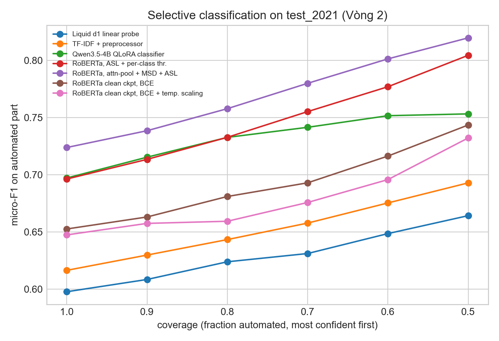
*Hình 16. Đường cong Coverage–Quality trên `test_2021` (Vòng 2).*

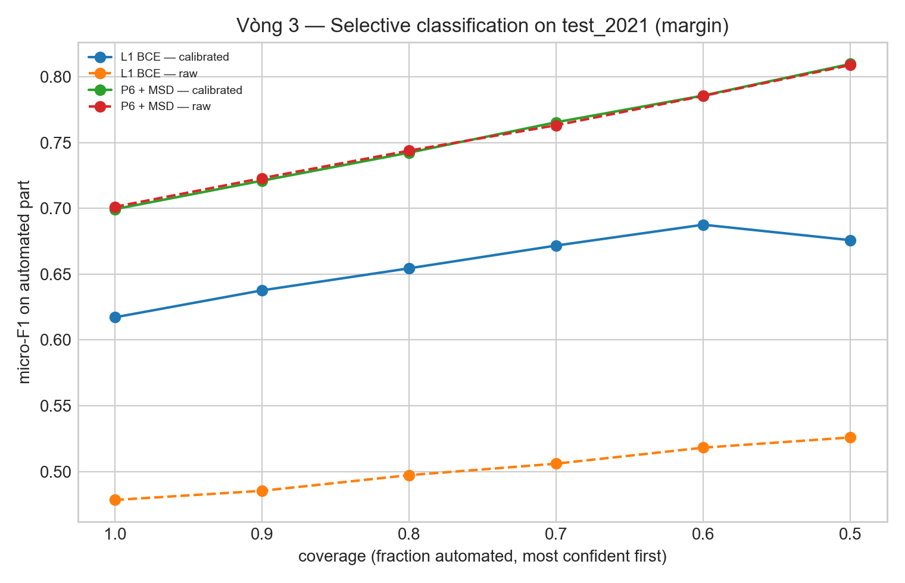
*Hình 21. Đường cong Coverage–Quality trên `test_2021` (Vòng 3; chỉ đọc đường P6, đường L1 thấp bất thường do sự cố sụp ngưỡng theo lớp đã nêu ở mục 4.5.A).*

Điểm margin phân tách rất rõ tweet dễ và tweet khó trên cả 2 vòng thực nghiệm (ngay cả với ASL có ECE cao, thứ hạng xác suất vẫn rất tốt cho chọn lọc).

### 4.6. Phân tích Lỗi Lớp hiếm, Đánh đổi Chi phí, Nghiệm thu Rủi ro và Kết luận

#### A. Phân tích lỗi trên 5 lớp khó / hiếm nhất (`test_2021`, F1 từng lớp)

| Cấu hình | `fashion` (32 mẫu) | `food` (15 mẫu) | `travel` (15 mẫu) | `youth` (11 mẫu) | `other_hobbies` (81 mẫu) | Số lớp F1 = 0 | Macro-F1 |
|:---|:---:|:---:|:---:|:---:|:---:|:---:|:---:|
| L1: BCE, head mặc định | 0.00 | 0.00 | 0.00 | 0.00 | 0.00 | **10 / 19** | 0.2568 |
| L2: W-BCE, head mặc định | 0.59 | 0.47 | 0.13 | 0.40 | 0.31 | 0 | 0.5219 |
| P0: BCE, head tùy chỉnh | 0.55 | 0.59 | 0.26 | 0.40 | 0.28 | 0 | 0.5681 |
| H2: W-BCE, head tùy chỉnh | 0.62 | 0.62 | 0.31 | 0.43 | 0.30 | 0 | 0.5741 |
| P6: Full cộng dồn | 0.62 | 0.59 | 0.26 | 0.46 | 0.29 | 0 | 0.5791 |
| **d1 `system_one` choice** | **0.64** | **0.69** | **0.38** | 0.26 | **0.06** | 0 | 0.5229 |

* **Cơ chế lỗi định tính:** Đổi sang head tùy chỉnh loại bỏ hoàn toàn tình trạng 10 lớp "chết" (F1 = 0) của L1. Hai điểm nghẽn bền bỉ nhất là `travel_&_adventure` (0.13–0.31; ngữ cảnh hay trộn lẫn với `diaries_&_daily_life` và chỉ có 15 mẫu dương khiến F1 rất nhạy với vài ca đoán sai) và `other_hobbies` (0.28–0.31; là lớp "thùng rác ngữ nghĩa" không có biên giới khái niệm rạch ròi). Điều này lý giải trực tiếp vì sao **`d1 system_one` (không huấn luyện)** vượt mọi mô hình giám sát ở các khái niệm cụ thể (`fashion` 0.64, `food` 0.69, `travel` 0.38) nhưng gần như mù hoàn toàn với `other_hobbies` (**0.06**) khi chỉ dựa vào tên nhãn.

#### B. Ma trận đánh đổi Hiệu năng – Chi phí – Độ bền thời gian (Khuyến nghị lựa chọn)

| Phương án tiêu biểu | Tham số huấn luyện | Độ phức tạp triển khai / Chi phí | `test_2021` (Micro / Macro) | Độ bền thời gian ($\Delta$ Micro) | Micro-ECE | Tình huống khuyên dùng |
|:---|:---:|:---|:---:|:---:|:---:|:---|
| **BERT-base P0 (BCE + ngưỡng chung)** | ~110M | Thấp, rất đơn giản, hội tụ nhanh | **0.718 / 0.570** | -2.25 | **0.010** | **Mặc định tối ưu nhất:** cần xác suất tin cậy + đơn giản |
| **RoBERTa V2 (Attn+MSD+ASL)** | ~125M | Trung bình (cần hiệu chuẩn lại) | **0.724 / 0.597** | **-1.79** | 0.224 | Ưu tiên tối đa điểm F1, không dùng xác suất thô |
| **Liquid d1 `system_one` (choice)** | **0** (~1.92B frozen) | ~10 phút chấm toàn tập, không cần train | 0.664 / 0.523 | **+1.28** | — | **Thiếu dữ liệu gán nhãn** hoặc môi trường trôi dạt mạnh |
| **Qwen3.5-4B QLoRA** | 21.3M (4B NF4) | Cao nhất (chậm, tốn VRAM) | 0.697 / 0.582 | -3.48 | 0.041 | Không khuyến nghị: đắt hơn Encoder nhưng không vượt F1 |
| **TF-IDF + LR (B1)** | Tuyến tính | Rất thấp (chạy CPU) | 0.615 / 0.400 | -7.36 | 0.064 | Chỉ dùng làm baseline tốc độ cao khi không có GPU |

#### C. Đối chiếu Tiêu chí Nghiệm thu Rủi ro (R01–R04)

| Mã | Rủi ro | Tiêu chí nghiệm thu | Trạng thái theo số đo thực tế |
|:---:|:---|:---|:---|
| **R01** | Mất cân bằng đuôi dài (20.2:1) | Macro-F1 lớp đuôi tăng $\ge 5.0$ | **Đạt có điều kiện:** Đạt lớn ở V2 (0.289 $\to$ 0.573) và khi sửa head ở V3 (+31.1 điểm); nhưng khi head đã ổn, bản thân W-BCE/Focal không tạo mức tăng $\ge 5.0$ (-2.2 đến +0.6). |
| **R02** | Trôi dạt thời gian | Suy giảm Micro-F1 $\le 2.0$ | **Đạt một phần:** Đạt ở RoBERTa ASL (-0.85), RoBERTa full (-1.79), BERT P6 (-1.05), d1 (+1.28); không đạt ở P0 (-2.25), QLoRA (-3.48), d1 probe (-4.56), TF-IDF (-7.36). |
| **R03** | Quá tự tin ở ngưỡng 0.5 | ECE $< 0.04$; Micro-F1 tăng $\ge 2.5$ so với 0.5 | **Đạt một phần:** ECE đạt ở P0 (0.010), RoBERTa BCE+TS (0.0151), gần đạt ở QLoRA (0.0407); không đạt ở W-BCE (0.092) và ASL (0.22–0.28). Tăng Micro-F1 đạt ở P6 (+7.9), không ở P0 (-0.6). |
| **R04** | Lỗi định dạng/ảo giác LLM | Tỷ lệ lỗi parse = 0.00% | **Không còn áp dụng** cho QLoRA và d1 `system_one` (bỏ bước sinh văn bản); riêng B4 zero-shot chưa đo tỷ lệ lỗi parse từ raw output. |