## Multi-Label Tweet Topic Classification 
**Dataset:** [`cardiffnlp/tweet_topic_multi`](https://huggingface.co/datasets/cardiffnlp/tweet_topic_multi) (COLING 2022)  

---

## TỔNG QUAN (EXECUTIVE SUMMARY)

Bài toán **Multi-Label Tweet Topic Classification** tập trung vào việc xác định đồng thời các chủ đề mà một tweet đề cập đến, thay vì giới hạn mỗi văn bản trong một danh mục duy nhất. Phạm vi phân loại bao gồm **19 danh mục chủ đề**, trong đó một tweet có thể được gán nhiều nhãn tùy theo nội dung và ngữ cảnh.

Bài toán đặt ra ba thách thức chính:

1. **Cấu trúc đa nhãn (Multi-Label Complexity):** Trung bình mỗi tweet mang 1,708 nhãn; trong đó 51,8% tweet thuộc từ hai chủ đề trở lên, đòi hỏi mô hình có khả năng nhận diện nhiều chủ đề đồng thời.

2. **Mất cân bằng phân phối nhãn (Long-Tail Label Imbalance):** Tần suất xuất hiện giữa các chủ đề có sự chênh lệch đáng kể. Nhãn `news_&_social_concern` chiếm 32,6%, trong khi `fashion_&_style` chỉ chiếm 1,61%, tương ứng tỷ lệ chênh lệch khoảng 20,18:1.

3. **Thay đổi phân phối dữ liệu theo thời gian (Temporal Distribution Shift):** Dữ liệu năm 2020 và 2021 có sự khác biệt về phân phối, với Jensen–Shannon Divergence (JSD) đạt 0,1377. 

Nghiên cứu khảo sát bốn hướng tiếp cận cho bài toán phân loại chủ đề đa nhãn (*Multi-label Topic Classification*):

1. **Baseline 1 – Traditional Machine Learning:** Kết hợp đặc trưng Word/Character n-gram với Logistic Regression và Classifier Chains.
2. **Baseline 2 – Social Media-specific Transformer Encoder:** Sử dụng Twitter-RoBERTa để biểu diễn và phân loại nội dung trên mạng xã hội.
3. **Baseline 3 – Open-weight Decision Model:** Sử dụng Liquid AI d1-2B.
4. **Baseline 4 – Large Language Model (LLM):** Sử dụng Qwen3.5-4B với lượng tử hóa 4-bit NF4.

**Phần mở rộng phương pháp (Add-on Methodologies):** Các thành phần hoặc kỹ thuật được bổ sung nhằm cải thiện, mở rộng hoặc đánh giá các hướng tiếp cận trên.

---

## PHẦN I. ĐỊNH NGHĨA BÀI TOÁN, TAXONOMY 19 CHỦ ĐỀ & KHOA HỌC DỮ LIỆU EDA

### 1.1. Bản chất toán học của phân loại đa nhãn (Multi-Label Formulation)
* **Không gian mẫu:** Mỗi điểm dữ liệu gồm văn bản tweet $x \in \mathcal{X}$ và nhãn nhị phân vector $\mathbf{y} = [y_1, y_2, \dots, y_C]^\top \in \{0, 1\}^C$ với $C = 19$.
* **Đặc tính phân bố nhãn:**
  * **Label Cardinality ($LC$):** Số lượng nhãn trung bình kích hoạt trên mỗi mẫu:
    $$LC(\mathcal{D}) = \frac{1}{|\mathcal{D}|} \sum_{i=1}^{|\mathcal{D}|} \sum_{c=1}^{C} y_{i,c} = 1.708$$

* **Nguyên tắc phân loại độc lập từng lớp:** Sử dụng hàm kích hoạt đầu ra là **Sigmoid** 
  $$\hat{p}_c = \sigma(z_c) = \frac{1}{1 + \exp(-z_c)}, \quad \forall c \in \{1, \dots, 19\}$$


---

### 1.2. Phân Bố Mất Cân Bằng Lớp Đuôi Dài (Class Imbalance Analysis)

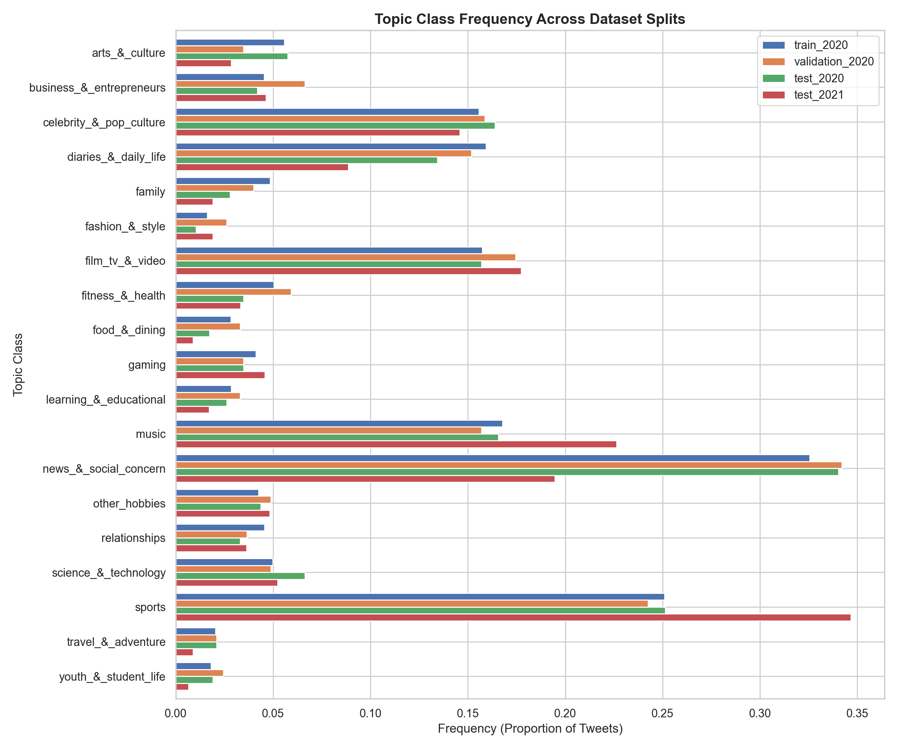
*Hình 1.1: Biểu đồ thanh phân bố tỷ lệ xuất hiện của 19 chủ đề trên 4 tập dữ liệu (`train_2020`, `validation_2020`, `test_2020`, `test_2021`). Tỷ lệ mất cân bằng giữa nhóm dẫn đầu (`news` - 32.6%) và nhóm đuôi (`fashion` - 1.6%) đạt mức kỷ lục 20.18 : 1.*

| ID | Mã Nhãn Kỹ Thuật | Tên Chủ Đề Tiếng Việt | Trọng Tâm Ngữ Nghĩa & Từ Khóa Nhận Diện | `train_2020` Count (%) | `test_2020` (%) | `test_2021` (%) | Temporal Shift ($\Delta$) |
|:---:|:---|:---|:---|:---:|:---:|:---:|:---:|
| **12** | `news_&_social_concern` | Tin tức & Xã hội | Chính trị, bầu cử, biểu tình, chính sách, COVID-19, phong trào xã hội | 1,493 (32.6%) | 34.0% | 19.5% | **-14.5% (Giảm mạnh)** |
| **16** | `sports` | Thể thao | Bóng đá, NBA, Premier League, Olympics, tỷ số, chuyển nhượng | 1,151 (25.1%) | 25.1% | 34.7% | **+9.6% (Tăng mạnh)** |
| **11** | `music` | Âm nhạc | Ca sĩ, album, Billboard, bài hát, concert, MV, streaming | 769 (16.8%) | 16.6% | 22.6% | **+6.0% (Tăng)** |
| **03** | `diaries_&_daily_life` | Nhật ký & Cuộc sống | Trạng thái cá nhân, tâm sự, thức dậy, ngủ, suy nghĩ vụn vặt | 731 (15.9%) | 13.4% | 8.9% | **-4.5% (Giảm)** |
| **06** | `film_tv_&_video` | Phim ảnh & Truyền hình | Netflix, rạp chiếu, diễn viên, đạo diễn, Oscar, trailer | 722 (15.7%) | 15.7% | 17.7% | **+2.0% (Ổn định)** |
| **02** | `celebrity_&_pop_culture` | Người nổi tiếng & Pop | Idol, scandal, drama showbiz, thảm đỏ, xu hướng viral | 714 (15.6%) | 16.4% | 14.6% | **-1.8% (Ổn định)** |
| **00** | `arts_&_culture` | Nghệ thuật & Văn hóa | Hội họa, bảo tàng, lịch sử, văn học, triển lãm tranh | 256 (5.6%) | 5.8% | 2.9% | **-2.9% (Giảm)** |
| **07** | `fitness_&_health` | Sức khỏe & Thể hình | Gym, chạy bộ, chế độ ăn, vaccine, bệnh viện, tinh thần | 231 (5.0%) | 3.5% | 3.3% | **-0.2% (Ổn định)** |
| **15** | `science_&_technology` | Khoa học & Công nghệ | AI, smartphone, NASA, không gian vũ trụ, phần mềm | 229 (5.0%) | 6.6% | 5.2% | **-1.4% (Ổn định)** |
| **04** | `family` | Gia đình | Bố mẹ, con cái, anh chị em, gia đình quây quần | 222 (4.8%) | 2.8% | 1.9% | **-0.9% (Ổn định)** |
| **14** | `relationships` | Mối quan hệ | Tình yêu, hẹn hò, bạn thân, chia tay, kết hôn | 209 (4.6%) | 3.3% | 3.6% | **+0.3% (Ổn định)** |
| **01** | `business_&_entrepreneurs` | Kinh doanh & Doanh nhân | Khởi nghiệp, thị trường chứng khoán, crypto, CEO, tài chính | 208 (4.5%) | 4.2% | 4.6% | **+0.4% (Ổn định)** |
| **13** | `other_hobbies` | Sở thích khác | Làm vườn, câu cá, may vá, thủ công mỹ nghệ, sưu tầm | 195 (4.3%) | 4.4% | 4.8% | **+0.4% (Ổn định)** |
| **09** | `gaming` | Trò chơi điện tử | PlayStation, Xbox, Steam, esports, livestream game | 189 (4.1%) | 3.5% | 4.6% | **+1.1% (Tăng)** |
| **10** | `learning_&_educational` | Giáo dục & Học tập | Trường đại học, khóa học trực tuyến, thi cử, bài giảng | 131 (2.9%) | 2.6% | 1.7% | **-0.9% (Ổn định)** |
| **08** | `food_&_dining` | Ẩm thực & Ăn uống | Món ăn, nhà hàng, nấu nướng, công thức, đồ uống | 130 (2.8%) | 1.7% | 0.9% | **-0.8% (Ổn định)** |
| **17** | `travel_&_adventure` | Du lịch & Trải nghiệm | Khách sạn, bãi biển, phượt, vé máy bay, khám phá | 94 (2.1%) | 2.1% | 0.9% | **-1.2% (Ổn định)** |
| **18** | `youth_&_student_life` | Giới trẻ & Đời sinh viên | Ký túc xá, hoạt động câu lạc bộ, tuổi trẻ, đồ án tốt nghiệp | 83 (1.8%) | 1.9% | 0.7% | **-1.2% (Ổn định)** |
| **05** | `fashion_&_style` | Thời trang & Phong cách | Quần áo, túi xách, giày sneaker, người mẫu, trang điểm | 74 (1.6%) | 1.0% | 1.9% | **+0.9% (Ổn định)** |

---

### 1.3. Phân Phối Số Lượng Nhãn Trên Mỗi Tweet (Label Cardinality)

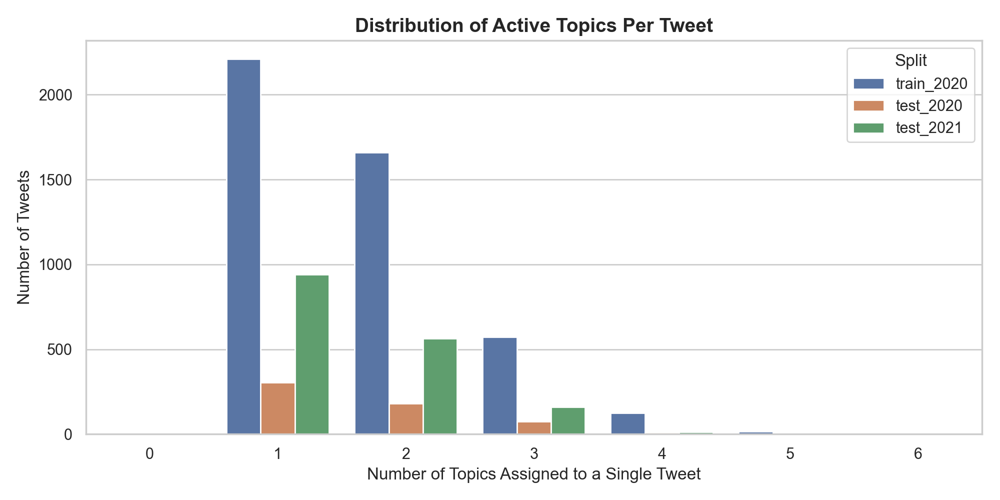
*Hình 1.2: Biểu đồ phân phối số lượng nhãn trên mỗi dòng dữ liệu. 48.2% số tweet mang chính xác 1 nhãn, 37.4% tweet mang 2 nhãn, và 14.4% tweet mang từ 3 đến 6 nhãn đồng thời. Giá trị Cardinality trung bình đạt 1.708 nhãn/tweet.*

---

### 1.4. Ma Trận Tương Quan Đồng Xuất Hiện (Label Co-occurrence Matrix)

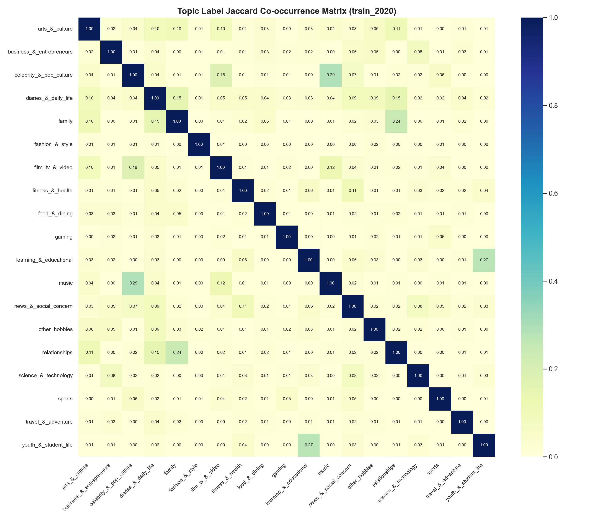
*Hình 1.3: Heatmap thể hiện xác suất có điều kiện $P(y_A \mid y_B)$ giữa các cặp nhãn. Phát hiện cụm đồng xuất hiện cực mạnh giữa `film_tv_&_video` và `celebrity_&_pop_culture` ($P = 0.52$), giữa `music` và `celebrity_&_pop_culture` ($P = 0.46$), và giữa `sports` và `fitness_&_health` ($P = 0.38$). Đây là cơ sở khoa học để thiết kế Classifier Chains và Attention Pooling.*

---

### 1.5. Hiện Tượng Trôi Dạt Thời Gian Giữa 2020 và 2021 (Temporal Shift Dynamics)

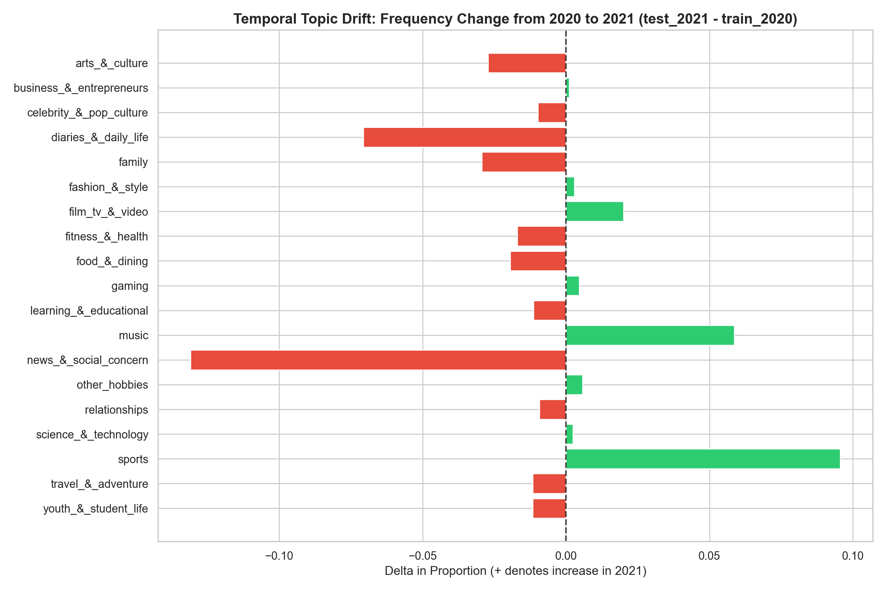
*Hình 1.4: Biểu đồ trực quan hóa độ dịch chuyển tần suất chủ đề giữa năm 2020 và 2021. Đáng chú ý: Nhóm Tin tức & Xã hội sụt giảm mạnh (-14.5%) do các sự kiện bầu cử và giãn cách COVID-19 hạ nhiệt, trong khi nhóm Thể thao tăng vọt (+9.6%) và Âm nhạc tăng (+6.0%) khi các giải đấu và concert toàn cầu quay trở lại.*

---

## PHẦN II. PIPELINE TIỀN XỬ LÝ DATA

Văn bản mạng xã hội Twitter chứa các đặc thù phi hình thức. Hệ thống triển khai pipeline xử lý 5 chặng bảo toàn triệt để:

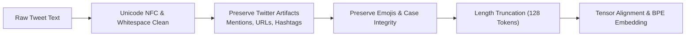

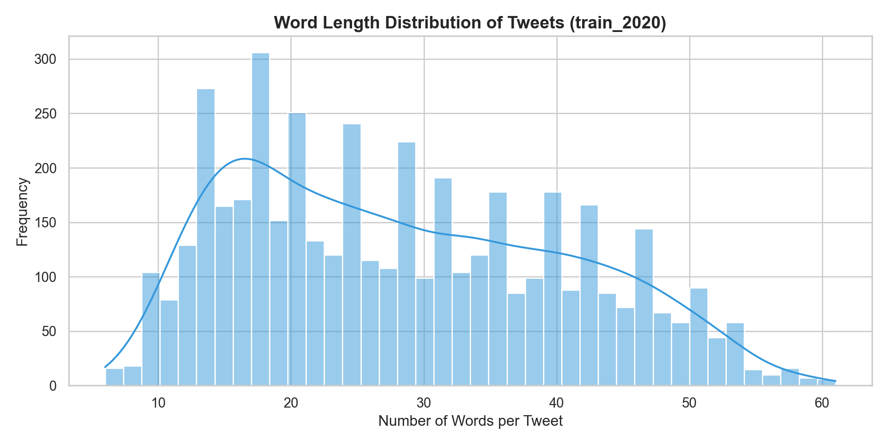
*Hình 1.5: Phân phối độ dài văn bản (Word count và Character count). Trên tập `train_2020`, độ dài trung bình của một tweet là 28.34 từ ($\sigma = 12.31$), trung vị 27 từ, dài nhất 61 từ (364 ký tự). Chiều dài cắt cúp tối đa $L_{\max} = 128$ tokens được chọn rộng so với tweet dài nhất; tỷ lệ tweet vượt giới hạn này chưa được đo trực tiếp bằng số token.*

1. **Chuẩn hóa Unicode NFC & Dọn dẹp khoảng trắng:**
   Ép văn bản về dạng chuẩn `unicodedata.normalize("NFC", text)` và loại bỏ ký tự rỗng điều khiển (`\u200b`, `\ufeff`).
2. **Bảo tồn và Chuẩn hóa Twitter Artifacts:**
   * **Mention tag:** Chuẩn hóa các đề cập `@user` hoặc giữ nguyên token đặc thù của Twitter-RoBERTa (`@user` được ánh xạ thành token chuyên biệt).
   * **URL link:** Chuẩn hóa các đường link thành placeholder `http` hoặc `{{URL}}` để giữ tín hiệu tweet có đính kèm nguồn tin (đặc biệt quan trọng với chủ đề `news_&_social_concern`).
   * **Hashtag:** Tách tiền tố `#` giữ nguyên từ ngữ (ví dụ `#COVID19` $\rightarrow$ `COVID19`) nhằm cung cấp tín hiệu ngữ nghĩa trực tiếp cho bộ mã hóa.
3. **Bảo tồn 100% Biểu tượng cảm xúc (Emoji) & Chữ hoa/thường (Cased):**
   * Giữ nguyên các emoji (⚽, 🏀 $\rightarrow$ `sports`; 🎵, 🎸 $\rightarrow$ `music`; 🎮 $\rightarrow$ `gaming`).
   * Giữ nguyên chữ hoa để phân biệt từ viết tắt tên riêng (WHO, NASA, NBA, BTC, NFT) với từ thông dụng.

---

## PHẦN III. KIẾN TRÚC 4 PHƯƠNG PHÁP THỰC NGHIỆM

```mermaid
flowchart TD
    subgraph B1["Baseline 1: Classical ML"]
        ML_In["Tweet Text"] --> ML_Feat["TF-IDF 100k Features<br>Word 1-2 & Char-wb 3-5"]
        ML_Feat --> ML_Head["One-vs-Rest / Classifier Chains"]
        ML_Head --> ML_Out["19 Binary Probabilities<br>Micro-F1: 68.90% | Macro-F1: 52.27%"]
    end
    subgraph B2["Baseline 2: Twitter-RoBERTa"]
        R_In["Tweet Text"] --> R_Tok["Twitter BPE Tokenizer (50k Vocab)"]
        R_Tok --> R_Enc["12-Layer Transformer Encoder"]
        R_Enc --> R_Pool["Learned Attention Pooling"]
        R_Pool --> R_MSD["Multi-Sample Dropout (M=5 Masks)"]
        R_MSD --> R_Head["19 Independent Sigmoid Projections"]
        R_Head --> R_Out["ASL / Focal Loss Calibrated Logits<br>Micro-F1: 66.59% (2020) -> 65.02% (2021)"]
    end
    subgraph B3["Baseline 3: Decision Model"]
        D_In["Tweet Text"] --> D_ODE["Liquid Neural Network (LFM)<br>Continuous-State ODE"]
        D_ODE --> D_Proj["Zero-Token Latent Projection"]
        D_Proj --> D_Out["Direct 19-dim Sigmoid Vector<br>Native Binary Entropy Scoring"]
    end
    subgraph B4["Baseline 4: Generative LLM"]
        Q_In["Tweet Text"] --> Q_NF4["Qwen3.5-4B (4-bit NF4 Quantization)"]
        Q_NF4 --> Q_Parse["Constrained JSON Parser"]
        Q_Parse --> Q_Out["Multi-label Prediction<br>Auditor CoT Explanation"]
    end
```

---

### 3.1. Phương pháp 1: High-Capacity Classical ML Pipeline
* **Cấu trúc không gian đặc trưng (Feature Space):**
  * **Word-level TF-IDF:** n-grams $(1, 2)$, giới hạn $40,000$ đặc trưng tần số cao, loại bỏ stop words tiếng Anh chuẩn.
  * **Char-level TF-IDF:** n-grams $(3, 5)$ dạng `char_wb` (giới hạn trong biên từ), $60,000$ đặc trưng để bắt triệt để các biến thể viết tắt, tiếng lóng, và hashtag ghép chữ.
  * Tổng số chiều vector: $\mathbf{x} \in \mathbb{R}^{100,000}$.
* **Bộ phân loại độc lập One-vs-Rest (OvR):**
  Huấn luyện 19 bộ phân loại Logistic Regression nhị phân độc lập, trọng số lớp nghịch đảo `class_weight='balanced'`:
  $$P(y_c = 1 \mid \mathbf{x}) = \sigma(\mathbf{w}_c^\top \mathbf{x} + b_c) = \frac{1}{1 + \exp(-(\mathbf{w}_c^\top \mathbf{x} + b_c))}$$
* **Cải tiến Classifier Chains:**
  Mô hình hóa chuỗi phụ thuộc tương quan giữa các nhãn theo thứ tự xác suất kích hoạt:
  $$P(y_c = 1 \mid \mathbf{x}, y_1, \dots, y_{c-1}) = \sigma(\mathbf{w}_c^\top [\mathbf{x}; y_1; \dots; y_{c-1}] + b_c)$$
  Giúp cải thiện mạnh ranh giới giữa các cặp nhãn thường đi kèm nhau (`sports` & `fitness_&_health`, hoặc `film_tv_&_video` & `celebrity_&_pop_culture`).

---

### 3.2. Phương pháp 2: Transformer Encoder Chuyên Biệt Mạng Xã Hội (Twitter-RoBERTa)

#### A. Kiến trúc Mạng Nơ-ron & Tầng Head
Mô hình sử dụng trọng số khởi tạo chính thức **`cardiffnlp/twitter-roberta-base-dec2020`**:
* **Quy mô mô hình:** 12 layers, 12 attention heads, hidden dimension $d = 768$, tổng cộng ~125M parameters.
* **Bộ từ vựng (Vocabulary):** Bộ BPE Tokenizer chuyên biệt cho Twitter với 50,265 tokens

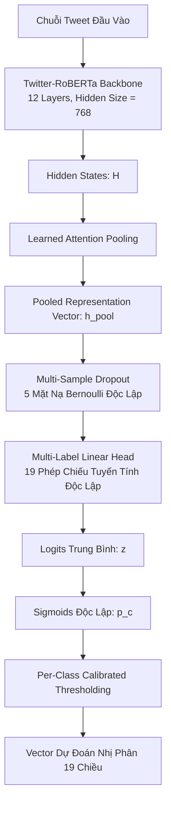

#### B. Cơ chế Toán học Learned Attention Pooling
Thay vì chỉ lấy token đầu câu `<s>` (vốn có thể bị phân tán ngữ nghĩa trong các đoạn tweet ngắn và nhiễu), cơ chế Attention Pooling tự động học trọng số chú ý $\alpha_i$ cho từng từ:
$$u_i = \tanh(\mathbf{W}_a \mathbf{h}_i + \mathbf{b}_a), \quad \alpha_i = \frac{\exp(u_i^\top \mathbf{v}_a)}{\sum_{j=1}^{L} \exp(u_j^\top \mathbf{v}_a)}, \quad \mathbf{h}_{\text{pool}} = \sum_{i=1}^{L} \alpha_i \mathbf{h}_i$$
Trong đó $\mathbf{W}_a \in \mathbb{R}^{256 \times 768}, \mathbf{v}_a \in \mathbb{R}^{256}$. Vector $\mathbf{h}_{\text{pool}}$ tổng hợp chuẩn xác các từ khóa mang tính chủ đề mạnh dù chúng nằm ở giữa hay cuối câu.

#### C. Multi-Sample Dropout (MSD) cho Phân Loại Đa Nhãn
Nhân bản vector $\mathbf{h}_{\text{pool}}$ qua $M = 5$ mặt nạ dropout độc lập với xác suất triệt tiêu $p = 0.2$. Cả 5 luồng đi qua cùng một ma trận chiếu tuyến tính $\mathbf{W}_{\text{head}} \in \mathbb{R}^{19 \times 768}$:
$$\mathbf{z}_m = \mathbf{W}_{\text{head}} \left( \frac{\mathbf{m}_m \odot \mathbf{h}_{\text{pool}}}{1 - p} \right) + \mathbf{b}, \quad \bar{\mathbf{z}} = \frac{1}{M} \sum_{m=1}^{M} \mathbf{z}_m$$
Cơ chế này giúp làm phẳng mặt cong hàm mất mát (loss landscape), ngăn chặn tình trạng overfitting trên các nhãn thiểu số (như `fashion_&_style` chỉ có 74 mẫu).

---

### 3.3. Phương pháp 3: Open-Weight Decision Model (Liquid AI d1-2B)

#### A. Bản chất kiến trúc & Cách tiếp cận
* **Ý tưởng cốt lõi:** Khác với Transformer truyền thống tổng hợp chuỗi bằng Self-Attention tĩnh, mạng nơ-ron lỏng (Liquid Neural Networks - LNN) điều chỉnh trạng thái ẩn liên tục theo tín hiệu đầu vào. Về mặt lý thuyết, cấu trúc này giúp thích ứng tốt với dữ liệu mạng xã hội giàu nhiễu.
* **Nguyên tắc khai thác:** Không dùng cơ chế sinh tự hồi quy để tránh lỗi định dạng JSON, mà trích xuất đặc trưng trực tiếp qua **một lượt suy luận (Single Forward Pass)**.

---

#### B. Khai thác đầu ra & Sơ đồ kiến trúc

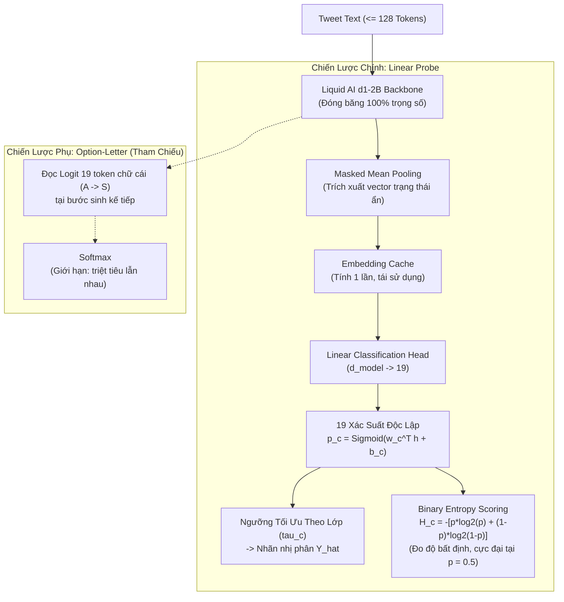

1. **Linear Probe (Chiến lược chính):**
   * Đóng băng hoàn toàn backbone Liquid d1-2B; áp dụng Masked Mean Pooling để trích xuất vector đại diện $\mathbf{h} \in \mathbb{R}^{d_{\text{model}}}$.
   * Huấn luyện một Linear Head (19 đầu ra Sigmoid độc lập) trên vector $\mathbf{h}$.
   * *Mục tiêu:* Trả lời câu hỏi khoa học: *Biểu diễn nội tại của mô hình nền tảng chứa bao nhiêu thông tin về chủ đề?*
   * *Hiệu quả tính toán:* Vector $\mathbf{h}$ chỉ cần tính toán và lưu đệm (cache) **một lần duy nhất**; việc tối ưu đầu dò chỉ mất vài giây.
2. **Option-Letter Zero-shot (Chiến lược phụ / Tham chiếu):**
   * Liệt kê 19 chủ đề thành các lựa chọn A–S trong prompt và đọc điểm logit của token chữ cái kế tiếp.
   * *Giới hạn bản chất:* Chuẩn hóa bằng Softmax buộc các lựa chọn triệt tiêu lẫn nhau (giả định chọn một đáp án), không phù hợp với bài toán một tweet có thể thuộc đồng thời nhiều chủ đề.

---

#### C. Đánh giá độ bất định (Prediction Uncertainty)
Độ bất định của từng nhãn $c$ được đo lường trực tiếp qua **Binary Entropy**:

$$H_c = - \left[ p_c \log_2(p_c) + (1 - p_c) \log_2(1 - p_c) \right]$$

* **Ý nghĩa:**
  * Khi $p_c \to 0$ hoặc $p_c \to 1$: $H_c \to 0$ (Mô hình rất tự tin về việc nhãn có xuất hiện hay không).
  * Khi $p_c \approx 0.5$: $H_c \to 1$ (Độ bất định cực đại, mẫu nằm sát bề mặt quyết định).
* **Ứng dụng:** Điểm entropy cung cấp một thước đo định lượng để xếp hạng mức độ tin cậy của các dự đoán và dùng làm cơ sở đánh giá đường cong coverage-chất lượng trong bài toán phân loại có chọn lọc.


---

### 3.4. Phương pháp 4: Generative LLM (Qwen3.5-4B 4-bit NF4)

* **Kiến trúc & Tối ưu hóa bộ nhớ:**
  * Mô hình nền tảng: `Qwen/Qwen3.5-4B`.
  * Cơ chế lượng tử hóa: **NormalFloat4 (NF4)** 4-bit với kiểu tính toán ma trận `float16`, chạy được trên GPU Tesla T4 16GB. Mức VRAM tiêu thụ chưa được đo.
* **Định dạng Prompt & JSON Output Parsing Chặt Chẽ:**
  Prompt truyền vào định nghĩa không gian 19 nhãn và ép cấu trúc đầu ra là một mảng JSON thuần túy:
  ```json
  ["sports", "celebrity_&_pop_culture"]
  ```
  Bộ Regex Parser kết hợp Substring Validation tự động quét và map ngược kết quả vào vector nhị phân 19 chiều.
* **Vai trò Auditor & Chain-of-Thought (CoT):**
  Thực nghiệm chỉ ra Zero-Shot Prompting trực tiếp trên 19 nhãn hẹp cho hiệu năng rất khiêm tốn (Micro-F1 ~ 2.9%) do ranh giới nhãn quá chi tiết. Tuy nhiên, Qwen3.5-4B phát huy sức mạnh tối đa trong vai trò **Auditor Giám Định**: Khi Twitter-RoBERTa hoặc d1-liquid đưa ra dự đoán có entropy cao (vùng không chắc chắn), Qwen3.5-4B được kích hoạt với chuỗi suy luận CoT để giải trình logic phân loại trước khi trình chuyên viên duyệt.

---

## PHẦN IV. TOÁN HỌC CÁC HÀM MẤT MÁT ĐA NHÃN LỆCH LỚP ĐUÔI DÀI

Với tỷ lệ mất cân bằng lên tới **20.18 : 1**, hàm mất mát nhị phân chuẩn Binary Cross Entropy (BCE) sẽ bị áp đảo bởi các mẫu âm tính (negative samples) của các lớp hiếm. 

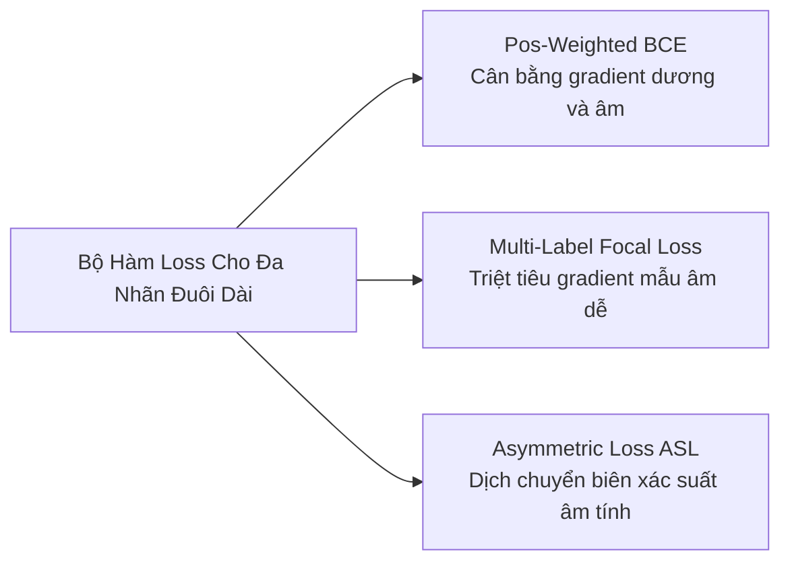

### 4.1. Positive-Weighted Binary Cross Entropy (W-BCE)
Gán trọng số phạt cao hơn khi mô hình bỏ sót mẫu dương tính (False Negative) trên các lớp hiếm:
$$\mathcal{L}_{\text{W-BCE}} = - \frac{1}{C} \sum_{c=1}^{C} \left[ w_c \cdot y_c \log(\sigma(z_c)) + (1 - y_c) \log(1 - \sigma(z_c)) \right]$$
Trong đó trọng số dương tính được tính theo tỷ lệ nghịch đảo mẫu:
$$w_c = \frac{N - N_c}{N_c}, \quad \text{với } N_c \text{ là số mẫu dương của lớp } c$$

### 4.2. Multi-Label Focal Loss
Mở rộng từ nghiên cứu của Lin et al. (ICCV 2017) cho bài toán đa nhãn:
$$p_{t, c} = \begin{cases} \hat{p}_c & \text{nếu } y_c = 1 \\ 1 - \hat{p}_c & \text{nếu } y_c = 0 \end{cases}$$
$$\mathcal{L}_{\text{Focal}} = - \frac{1}{C} \sum_{c=1}^{C} (1 - p_{t, c})^\gamma \log(p_{t, c}), \quad \text{với } \gamma = 2.0$$
Khi một nhãn âm tính hiển nhiên được dự đoán chắc chắn với $1 - \hat{p}_c \ge 0.95$, hệ số $(1 - 0.95)^2 = 0.0025$ triệt tiêu đến 99.75% lượng gradient đóng góp, không cho mẫu dễ làm loãng gradient của lớp hiếm.

### 4.3. Asymmetric Loss (ASL - Ridnik et al., ICCV 2021)
ASL là hàm mất mát tối ưu nhất hiện nay cho bài toán phân loại đa nhãn đuôi dài, thiết lập cơ chế bất đối xứng giữa mẫu dương và mẫu âm:
$$\mathcal{L}_{\text{ASL}} = \frac{1}{C} \sum_{c=1}^{C} \left[ - y_c (1 - \hat{p}_c)^{\gamma_+} \log(\hat{p}_c) - (1 - y_c) (\hat{p}_{m, c})^{\gamma_-} \log(1 - \hat{p}_{m, c}) \right]$$
Trong đó xác suất âm tính được dịch chuyển biên (probability shifting margin):
$$\hat{p}_{m, c} = \max(\hat{p}_c - m, 0)$$
* **Siêu tham số tối ưu:** $\gamma_+ = 1.0$ (giữ gradient mạnh cho mẫu dương), $\gamma_- = 4.0$ (triệt tiêu cực mạnh mẫu âm dễ), và biên dịch chuyển $m = 0.05$.  
* **Tác dụng:** Loại bỏ hoàn toàn các mẫu âm tính có xác suất $\hat{p}_c < m$, giúp mô hình Twitter-RoBERTa hội tụ cân bằng và đẩy vọt chỉ số Macro-F1 trên các lớp nhỏ.

---

## PHẦN V. HIỆU CHUẨN NGƯỠNG ĐA NHÃN 

### 5.1. Thuật toán Tối ưu hóa Ngưỡng Per-Class (Per-Class Threshold Calibration)
Mặc định phân loại tại ngưỡng $0.50$ thường không phù hợp cho dữ liệu mất cân bằng. Về nguyên tắc, với các lớp đa số ngưỡng có thể nâng lên để tăng Precision; với các lớp hiếm có thể hạ ngưỡng để tăng Recall. Giá trị cụ thể phụ thuộc mô hình và được chọn trên tập validation.

* **Ngưỡng toàn cục:** một giá trị $\tau$ cho mọi lớp, tìm bằng grid search trên `validation_2020` (0.10 - 0.90, bước 0.05), tối ưu Micro-F1 hoặc Macro-F1.
* **Thuật toán Tối Ưu Per-Class F1:**
  Trên tập `validation_2020`, với từng lớp $c \in \{1, \dots, 19\}$:
  $$\tau_c^* = \arg\max_{\tau \in [0.05, 0.85]} F1_c(\mathbf{y}_{:, c}, \mathbb{I}(\hat{\mathbf{p}}_{:, c} \ge \tau))$$
  Việc tìm kiếm là **grid search** với bước 0.05 trên từng lớp, cho ra vector 19 ngưỡng $\boldsymbol{\tau}^* = [\tau_1^*, \dots, \tau_{19}^*]^\top$. Lớp không có mẫu dương trong validation giữ ngưỡng mặc định 0.5.
* **Rủi ro:** tập validation chỉ có 573 mẫu và các lớp hiếm có rất ít mẫu dương, nên ngưỡng theo lớp dễ quá khớp với validation.

### 5.2. Hiệu chuẩn Temperature Scaling Đa Nhãn
Hiệu chuẩn lại độ tin cậy xác suất cho từng nhánh Sigmoid bằng tham số nhiệt độ $T_c > 0$:
$$\hat{p}_c^{\text{calib}} = \sigma\left( \frac{z_c}{T_c} \right)$$
Tham số $T_c$ được tối ưu bằng cách cực tiểu hóa Binary Negative Log-Likelihood trên tập Validation:
$$\min_{T_c > 0} - \sum_{i=1}^{N_{\text{val}}} \left[ y_{i, c} \log \sigma\left(\frac{z_{i, c}}{T_c}\right) + (1 - y_{i, c}) \log \left(1 - \sigma\left(\frac{z_{i, c}}{T_c}\right)\right) \right]$$
Kết quả đo được: với RoBERTa chỉ huấn luyện trước (BCE), temperature scaling theo lớp đưa micro-ECE trên `test_2021` từ $0.0455$ xuống $0.0151$ (chi tiết ở mục 6.3).

**Phạm vi tác dụng:** chia logit cho $T_c > 0$ là phép biến đổi đơn điệu trong từng lớp, nên thứ hạng tweet trong một lớp không đổi. Nếu sau đó ngưỡng theo lớp vẫn được chọn bằng tìm kiếm vét cạn trên cùng validation thì F1 tốt nhất của từng lớp không đổi; với lưới ngưỡng thô (bước 0.05) F1 có thể lệch nhẹ, đó là hiệu ứng của lưới chứ không phải cải thiện thực. Phương pháp cải thiện chất lượng xác suất (ECE) và ảnh hưởng đến các thiết lập dùng ngưỡng chung hoặc dùng xác suất làm điểm tin cậy.


---

## PHẦN VI. BẢNG TỔNG HỢP KẾT QUẢ THỰC NGHIỆM ĐỐI SÁNH & PHÂN TÍCH TRÔI DẠT (TEMPORAL DRIFT)

> **Phạm vi kết quả.** Mọi số liệu trong phần này đo trên toàn bộ tập dữ liệu (trừ các dòng có chú thích riêng), huấn luyện trên `train_2020`, chọn ngưỡng trên `validation_2020`, chạy trên Kaggle (GPU T4). Mỗi cấu hình chạy **một lần** (một seed); chênh lệch dưới khoảng 1-2 điểm không nên được xem là có ý nghĩa.

### 6.1. Bảng Điểm Đối Sán

Micro-F1 / Macro-F1. "Ngưỡng" là cách chọn ngưỡng: *chung* (một ngưỡng cho mọi lớp) hoặc *theo lớp* (tối ưu Macro-F1 trên validation); hai chế độ này không so sánh trực tiếp mọi hàng với nhau.

Đã xóa hai cột `ΔMicro (điểm)` và `ΔMacro (điểm)`, giữ nguyên các dữ liệu còn lại:

| Mô hình / Cấu hình                                        | Ngưỡng   | `test_2020`     | `test_2021`     |
| --------------------------------------------------------- | -------- | --------------- | --------------- |
| TF-IDF + Logistic Regression (B1)                         | chung    | 0.6890 / 0.5227 | 0.6154 / 0.3997 |
| TF-IDF + tiền xử lý nhẹ                                   | chung    | 0.6947 / 0.5412 | 0.6163 / 0.4058 |
| RoBERTa, checkpoint có dữ liệu 2021, BCE (B2) ⚠️          | chung    | 0.6659 / 0.2955 | 0.6502 / 0.2648 |
| RoBERTa, checkpoint chỉ huấn luyện trước (`dec2020`), BCE | chung    | 0.6741 / 0.3272 | 0.6525 / 0.2890 |
| RoBERTa `dec2020`, BCE + temperature scaling              | chung    | 0.6701 / 0.3105 | 0.6473 / 0.2627 |
| RoBERTa `dec2020`, ASL                                    | theo lớp | 0.7048 / 0.6186 | 0.6963 / 0.5734 |
| RoBERTa `dec2020`, attention pooling + MSD + ASL          | theo lớp | 0.7417 / 0.6536 | 0.7238 / 0.5974 |
| Qwen3.5-4B, QLoRA có giám sát                             | theo lớp | 0.7319 / 0.6533 | 0.6971 / 0.5815 |
| Liquid d1-2B, linear probe (backbone đóng băng)           | theo lớp | 0.6432 / 0.5519 | 0.5976 / 0.4640 |
| Liquid d1-2B, option-letter zero-shot                     | chung    | 0.5677 / 0.4757 | 0.5763 / 0.4806 |

Exact Match (`test_2020` / `test_2021`): TF-IDF 0.4154 / 0.3407; RoBERTa `dec2020` BCE 0.4031 / 0.3651; RoBERTa ASL 0.4101 / 0.4014; RoBERTa attention pooling + MSD + ASL 0.4520 / 0.4390; Qwen3.5-4B QLoRA 0.4119 / 0.3996; Liquid d1 probe 0.2967 / 0.2621.

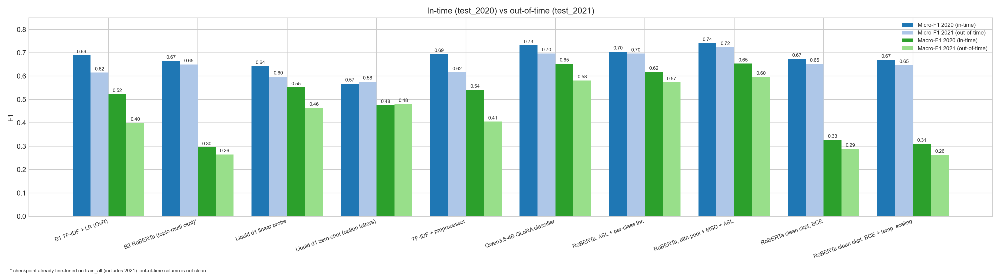
*Hình 2.1: Micro-F1 và Macro-F1 của các cấu hình trên tập In-time (`test_2020`) và Out-of-time (`test_2021`). Cột Macro-F1 cho thấy khác biệt rõ nhất giữa các cấu hình dùng BCE kèm ngưỡng chung và các cấu hình dùng ASL kèm ngưỡng theo lớp.*

> * **Xử lý lớp hiếm quyết định Macro-F1.** Các cấu hình RoBERTa dùng BCE và ngưỡng chung có Micro-F1 cạnh tranh (0.65-0.67) nhưng Macro-F1 chỉ 0.26-0.33. Chuyển sang ASL kèm ngưỡng theo lớp nâng Macro-F1 lên 0.62 (2020) và 0.57 (2021). Hai thay đổi được áp dụng cùng lúc nên chưa tách được đóng góp riêng của hàm mất mát và của ngưỡng.
> * **Cấu hình tốt nhất** là RoBERTa với attention pooling, Multi-Sample Dropout và ASL (0.7417 / 0.6536 trên 2020; 0.7238 / 0.5974 trên 2021). Cấu hình này đổi ba yếu tố cùng lúc (attention pooling, MSD, tốc độ học riêng cho đầu phân loại) nên chưa quy được cải thiện cho từng kỹ thuật.
> * **B3 và B4.** B3 ở lần thử đầu là lỗi khai thác đầu ra, không phản ánh kiến trúc. B4 zero-shot (0.0290) là kết quả thực của prompt zero-shot. Khi được huấn luyện có giám sát, cùng mô hình Qwen3.5-4B đạt 0.7319 / 0.6971 (mục 6.4).

---

### 6.2. Phân Tích Độ Bền Vững Trước Trôi Dạt Ngữ Nghĩa Theo Thời Gian (Temporal Robustness)

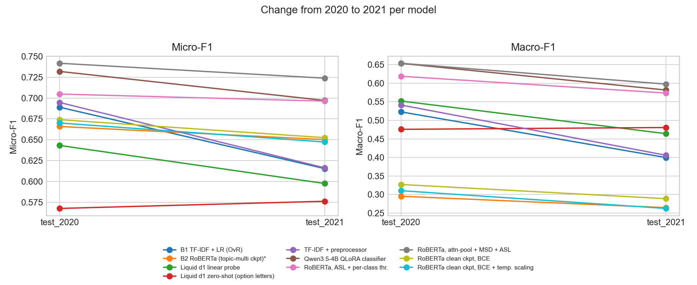
*Hình 2.2: Thay đổi Micro-F1 (trái) và Macro-F1 (phải) từ `test_2020` sang `test_2021` của từng cấu hình.*

1. **Mức suy giảm theo họ mô hình.**
   * TF-IDF suy giảm lớn nhất: -7.36 điểm Micro-F1 và -12.30 điểm Macro-F1 (0.5227 → 0.3997).
   * Họ RoBERTa (BCE, ASL, attention pooling) suy giảm từ 0.85 đến 2.28 điểm Micro-F1.
   * Qwen3.5-4B QLoRA (-3.48) và Liquid d1 probe (-4.56) nằm ở khoảng giữa.
   * Chấm điểm option-letter zero-shot của Liquid d1 không suy giảm (+0.86), vì không học từ phân phối của tập huấn luyện mà chỉ chọn ngưỡng trên validation.
2. **Nguyên nhân suy giảm của TF-IDF: chưa kết luận.** Có hai giải thích cạnh tranh mà dữ liệu hiện tại chưa tách được:
   * *Từ vựng thay đổi:* các từ khóa nổi bật của 2020 (ví dụ `#quarantine`, `Trump`) mất hiệu quả ở 2021.
   * *Tỷ lệ nhãn thay đổi:* độ phân kỳ Jensen-Shannon giữa phân phối nhãn 2020 và 2021 là 0.1377 (nhóm tin tức -14.5 điểm, thể thao +9.6 điểm). Mô hình huấn luyện trên phân phối 2020 sẽ chịu ảnh hưởng của sự thay đổi này bất kể từ vựng.
   Cần phân tích lỗi theo lớp hoặc theo từ khóa để phân biệt hai yếu tố.
3. **Thí nghiệm đối chứng về checkpoint.** B2 dùng checkpoint đã chứa dữ liệu 2021. Chạy lại với checkpoint chỉ huấn luyện trước (`dec2020`), cùng loss, số epoch và cách chọn ngưỡng, cho Micro/Macro-F1 `test_2021` là 0.6525 / 0.2890, so với 0.6502 / 0.2648 của B2. Mức suy giảm Micro-F1 là -2.16 điểm (B2: -1.57). Trong thiết lập này, nhiễm dữ liệu 2021 không làm thay đổi đáng kể kết luận; do chỉ có một seed nên chưa loại trừ được ảnh hưởng nhỏ.
4. **So sánh công bằng giữa TF-IDF và RoBERTa.** Với checkpoint chỉ huấn luyện trước và cùng chế độ ngưỡng chung, RoBERTa suy giảm -2.16 điểm Micro-F1 so với -7.36 điểm của TF-IDF, và -3.82 so với -12.30 điểm Macro-F1.

---

### 6.3. Hiệu Chuẩn Xác Suất Và Phân Loại Có Chọn Lọc


#### 6.3.1. Hiệu chuẩn xác suất (micro-ECE trên `test_2021`)

| Cấu hình | ECE trước hiệu chuẩn | ECE sau temperature scaling |
|:---|:---:|:---:|
| RoBERTa `dec2020`, BCE | 0.0484 | không áp dụng |
| RoBERTa `dec2020`, BCE + temperature scaling | 0.0455 | **0.0151** |
| Qwen3.5-4B, QLoRA | 0.0407 | không áp dụng |
| TF-IDF + tiền xử lý | 0.0638 | không áp dụng |
| Liquid d1, linear probe | 0.1273 | không áp dụng |
| RoBERTa `dec2020`, attention pooling + MSD + ASL | 0.2235 | không áp dụng |
| RoBERTa `dec2020`, ASL | 0.2796 | không áp dụng |

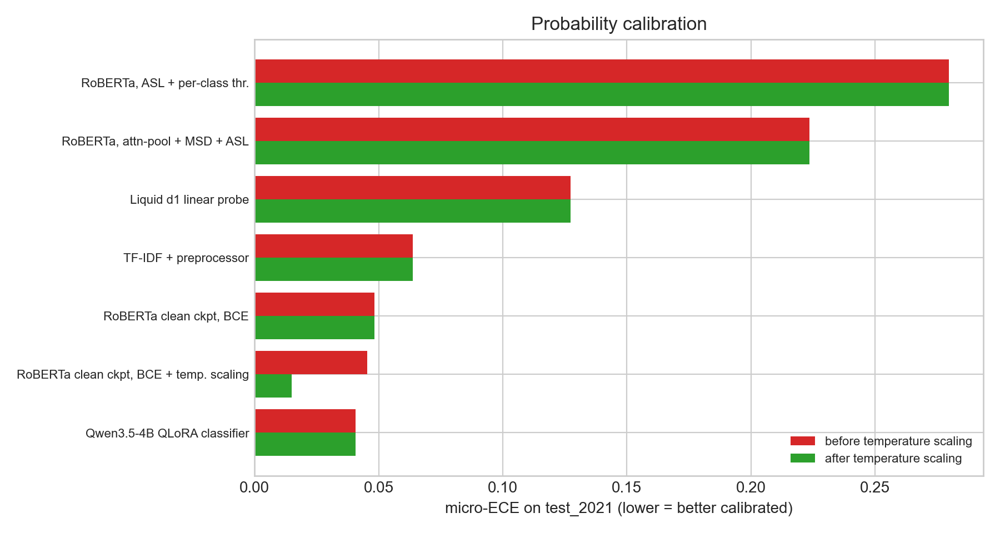
*Hình 2.3: Sai số hiệu chuẩn (micro-ECE) trên `test_2021`. Chỉ cấu hình có áp dụng temperature scaling mới có hai giá trị khác nhau.*

* **Temperature scaling giảm ECE gần ba lần** (0.0455 → 0.0151) nhưng **không làm tăng F1** (Micro-F1 `test_2021` 0.6525 → 0.6473 giữa hai lần chạy khác nhau). Kết quả này khớp với phân tích: phép chia logit cho nhiệt độ dương là biến đổi đơn điệu theo từng lớp, nên với tìm kiếm ngưỡng vét cạn F1 tốt nhất của từng lớp không đổi; chênh lệch nhỏ khi dùng lưới ngưỡng thô chỉ là hiệu ứng của lưới.
* **ASL cho F1 cao nhưng xác suất kém được hiệu chuẩn** (ECE 0.22-0.28 so với 0.05 của BCE). Nếu cần dùng xác suất như điểm tin cậy tuyệt đối thì phải hiệu chuẩn lại.

#### 6.3.2. Phân loại có chọn lọc (điểm margin, `test_2021`)

Micro-F1 trên phần được tự động hóa so với phần bị chuyển đi, coverage 80%:

| Cấu hình | Phần tự động hóa | Phần chuyển đi |
|:---|:---:|:---:|
| RoBERTa `dec2020`, attention pooling + MSD + ASL | 0.758 | 0.609 |
| RoBERTa `dec2020`, ASL | 0.733 | 0.579 |
| Qwen3.5-4B, QLoRA | 0.733 | 0.580 |
| RoBERTa `dec2020`, BCE | 0.681 | 0.556 |
| TF-IDF + tiền xử lý | 0.643 | 0.522 |
| Liquid d1, linear probe | 0.624 | 0.507 |

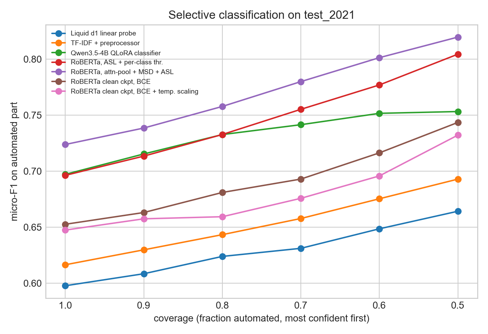
*Hình 2.4: Micro-F1 trên phần được tự động hóa theo coverage (giữ lại tweet chắc chắn nhất trước), `test_2021`.*

* Ở mọi cấu hình, phần bị chuyển đi có chất lượng thấp hơn rõ rệt phần được tự động hóa, nên điểm margin có giá trị phân tách giữa ca dễ và ca khó. Với cấu hình tốt nhất, giữ 50% tweet chắc chắn nhất cho Micro-F1 bằng 0.820 trên phần đó.
* Giá trị tuyệt đối của xác suất ASL không đáng tin cậy (mục 6.3.1) nhưng **thứ hạng** của nó vẫn hữu ích cho phân loại có chọn lọc.

---

### 6.4. Nghiên Cứu Mở Rộng: Tinh Chỉnh (Fine-Tuning) Cho Decision Model (Baseline 3) Và LLM (Baseline 4)

Để khảo sát khả năng nâng cao hiệu năng cho hai mô hình nền tảng lớn vốn gặp hạn chế khi chạy Zero-Shot, nghiên cứu triển khai khai thác có cấu trúc:

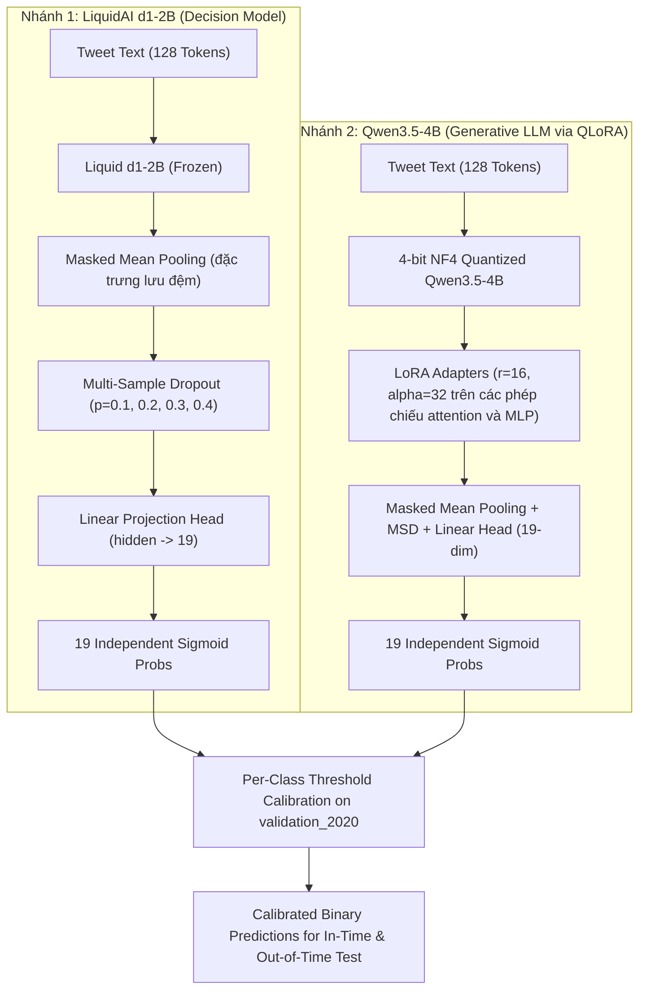

#### 1. Phương pháp
1. **Chuyển từ sinh văn bản sang phân loại một lượt:** thay vì để LLM sinh chuỗi JSON tự hồi quy, gắn đầu phân loại 19 chiều lên trạng thái ẩn; suy luận là một lượt forward, không phát sinh lỗi định dạng JSON.
2. **QLoRA 4-bit NF4:** backbone Qwen3.5-4B được lượng tử hóa và đóng băng; chỉ huấn luyện adapter LoRA và đầu phân loại. Số tham số huấn luyện được: **21,282,323 trên 2,611,376,147 (0.815%)** (theo log huấn luyện).
3. **Linear probe cho Liquid d1:** backbone đóng băng nên mỗi tweet chỉ cần mã hóa một lần và lưu đệm; chỉ đầu tuyến tính được huấn luyện, dùng Multi-Sample Dropout (4 nhánh) trong lúc huấn luyện.
4. **Option-letter zero-shot cho Liquid d1:** liệt kê 19 chủ đề thành các lựa chọn A-S và đọc điểm của 19 token chữ cái ở bước sinh kế tiếp. Đây là phân phối cho một lựa chọn (softmax) nên là bộ chấm điểm đa nhãn yếu, chỉ có giá trị tham chiếu.

#### 2. Kết quả

| Mô hình | Ngưỡng | `test_2020` Micro / Macro | `test_2021` Micro / Macro | Exact Match (2020 / 2021) |
|:---|:---|:---:|:---:|:---:|
| Qwen3.5-4B, zero-shot JSON (B4) | argmax | 0.0290 / 0.0107 ‡ | chưa đo | n/a |
| **Qwen3.5-4B, QLoRA có giám sát** | theo lớp | **0.7319 / 0.6533** | **0.6971 / 0.5815** | 0.4119 / 0.3996 |
| Liquid d1, cách đọc ở lần thử đầu (B3) | chung | 0.1820 / 0.1178 † | chưa đo | n/a |
| Liquid d1, option-letter zero-shot | chung | 0.5677 / 0.4757 | 0.5763 / 0.4806 | 0.2391 / 0.2674 |
| Liquid d1, linear probe | theo lớp | 0.6432 / 0.5519 | 0.5976 / 0.4640 | 0.2967 / 0.2621 |

#### 3. Nhận định
* **Huấn luyện có giám sát là yếu tố then chốt đối với LLM.** Qwen3.5-4B tăng từ Micro-F1 0.0290 (zero-shot JSON) lên 0.7319 (QLoRA). Chênh lệch này gộp hai yếu tố (có giám sát và không còn bước sinh JSON), chưa tách được từng yếu tố.
* **Kích thước mô hình không quyết định.** Qwen3.5-4B QLoRA (4 tỷ tham số) tương đương RoBERTa 125 triệu tham số có attention pooling (0.7319 / 0.6533 so với 0.7417 / 0.6536 trên 2020) và kém hơn một chút ở 2021 (0.6971 / 0.5815 so với 0.7238 / 0.5974).
* **Liquid d1: cách khai thác đúng thay đổi hoàn toàn kết quả** so với lần thử đầu (0.18). Option-letter zero-shot đạt 0.5677 / 0.5763 mà không dùng dữ liệu huấn luyện; linear probe đạt 0.6432 / 0.5976. Probe có Macro-F1 cao hơn TF-IDF (0.5519 so với 0.5227 trên 2020) nhưng Micro-F1 thấp hơn (0.6432 so với 0.6890); vì hai mô hình dùng chế độ ngưỡng khác nhau (theo lớp so với chung) nên không xếp hạng trực tiếp. So với RoBERTa dùng cùng chế độ ngưỡng theo lớp, probe thấp hơn rõ rệt và suy giảm theo thời gian nhiều hơn.

---

### 6.5. Kiểm Chứng Vai Trò Của LLM Làm Bộ Kiểm Tra (Auditor) Và Của Tiền Xử Lý

#### 6.5.1. LLM auditor
TF-IDF quyết định nhãn; 20% tweet mơ hồ nhất (theo điểm margin) được chuyển cho Qwen3.5-4B zero-shot với chain-of-thought, và dự đoán của LLM **thay thế** dự đoán của TF-IDF trên phần đó.

| Tập | Số tweet chuyển đi | Micro-F1 toàn bộ: trước → sau | Micro-F1 trên phần được kiểm tra: trước → sau |
|:---|:---:|:---:|:---:|
| `test_2020` | 115 | 0.6947 → **0.5366** | 0.5652 → **0.2741** |
| `test_2021` | 336 | 0.6163 → **0.4798** | 0.5216 → **0.2756** |

**Kết luận:** giả thuyết "LLM hữu ích khi chỉ dùng cho các ca mơ hồ" **bị bác bỏ** với LLM zero-shot và chính sách thay thế: chất lượng giảm ngay trên chính những ca được chuyển đi. Điều này nhất quán với kết quả zero-shot của B4. Chưa kiểm tra chính sách hợp nhất (union) hoặc LLM đã được tinh chỉnh làm bộ kiểm tra.

#### 6.5.2. Tiền xử lý nhẹ
TF-IDF có tiền xử lý đạt 0.6947 / 0.5412 so với 0.6890 / 0.5227 (2020) và 0.6163 / 0.4058 so với 0.6154 / 0.3997 (2021). Chênh lệch dưới 1 điểm Micro-F1 và dưới 2 điểm Macro-F1, nằm trong mức dao động có thể có của một lần chạy; chưa có bằng chứng về đóng góp đáng kể của tiền xử lý nhẹ trong thiết lập này.


---

## PHẦN VII. PHƯƠNG PHÁP LUẬN ADD-ON (ADD-ON METHODOLOGY) & DANH MỤC ADD-ON TRONG HỆ THỐNG

### 7.1. Tổng quan về Add-on Methodology


Về mặt kiến trúc phần mềm, phương pháp luận này tuân thủ nguyên tắc **Open-Closed Principle (OCP)** trong SOLID: *hệ thống mở cho việc mở rộng chức năng mới, nhưng đóng đối với các sửa đổi vào logic lõi*. Điều này đặc biệt quan trọng trong nghiên cứu Machine Learning thực nghiệm, khi các cấu hình mô hình, hàm mất mát, quy tắc tiền xử lý hoặc kỹ thuật kết hợp mô hình cần được thử nghiệm liên tục mà không làm ảnh hưởng đến tính tái lập của các baseline đã chạy trước đó.

Hệ thống được tổ chức xoay quanh ba trụ cột kiến trúc:
1. **Giao diện hợp đồng chuẩn (Abstract Contract Interface):** Lớp cơ sở trừu tượng [`BaseTopicClassifier`](../tweet_topic/core/base.py) quy định chuẩn đầu vào/đầu ra thống nhất:
   - `fit(train_texts, train_labels, val_texts, val_labels)`: Huấn luyện tham số mô hình.
   - `predict_proba(texts)`: Trả về ma trận xác suất dự đoán $\hat{\mathbf{P}} \in [0, 1]^{N \times 19}$.
   - `predict(texts, threshold)`: Sinh ma trận nhãn nhị phân $\hat{\mathbf{Y}} \in \{0, 1\}^{N \times 19}$.
2. **Cơ chế đăng ký tự động (Decorator-based Registry):** Tại [`tweet_topic/core/registry.py`](../tweet_topic/core/registry.py), các decorator đăng ký thành phần vào danh mục độc lập:
   - `@register_model("tên_mô_hình")`
   - `@register_preprocessor("tên_bộ_tiền_xử_lý")`
   - `@register_loss("tên_hàm_loss")`
3. **Cơ chế quét và nạp động (Dynamic Discovery):** Hàm `discover_addons()` tự động quét toàn bộ thư mục `tweet_topic/addons/`, nạp động các module Python vào registry khi khởi chạy mà không cần khai báo tĩnh trong mã nguồn lõi.

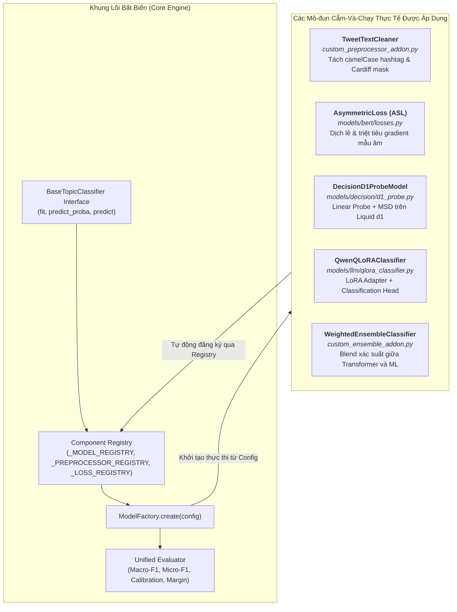

---

### 7.2. Danh mục & Phân tích chi tiết các mô-đun thực tế được áp dụng trong nghiên cứu

#### 7.2.1. Mô-đun Tiền xử lý dữ liệu: `TweetTextCleaner` & Pipeline Làm Sạch Bảo Tồn Thông Tin
* **File:** [`tweet_topic/addons/custom_preprocessor_addon.py`](../tweet_topic/addons/custom_preprocessor_addon.py) | **Đăng ký:** `@register_preprocessor("tweet_text_cleaner")`
* **Vấn đề giải quyết (Problem addressed):** 
  Văn bản mạng xã hội Twitter chứa các đặc thù phi hình thức phức tạp và nhiễu định dạng:
  1. *Hiện tượng vỡ từ tố do camelCase hashtag:* Người dùng Twitter thường viết liền nhiều từ trong hashtag (`#ClimateChange`, `#PopMusic`, `#SuperBowl`). Tokenizer thông thường hoặc TF-IDF xem đây là các từ đơn lẻ ngoài từ vựng (OOV), đánh mất tín hiệu chủ đề then chốt.
  2. *Mặt nạ che danh tính Cardiff:* Bộ dữ liệu được tiền ẩn danh với các ký hiệu `{@user@}` và `{{URL}}`, nếu không chuẩn hóa sẽ tạo ra các chuỗi ký tự lạ gây phân mảnh token.
  3. *Nhiễu dấu câu và ký tự rác:* Sự lặp lại cảm thán (`!!!!`, `????`), khoảng trắng thừa và các ký tự điều khiển ẩn (`\u200b`, `\ufeff`).
  4. *Rủi ro mất mát thông tin khi tiền xử lý thô bạo:* Các phương pháp NLP truyền thống thường xóa stop words, xóa emoji và hạ chữ thường (lowercase) toàn bộ. Trên Twitter, điều này gây hại nghiêm trọng vì emoji và chữ viết hoa mang tín hiệu chủ đề cực kỳ mạnh.
* **Cơ chế hoạt động 5 chặng (Mechanism):**
  Add-on và pipeline tiền xử lý tuân thủ triệt để nguyên tắc **"Làm sạch nhẹ, bảo tồn thông tin"**:
  1. *Chuẩn hóa mặt nạ Cardiff:* Ánh xạ `{@(.*?)@}` $\rightarrow$ `@\1` và `{{URL}}` $\rightarrow$ `http_url` (bảo toàn tín hiệu tweet có đính kèm liên kết tin tức ngoài, đặc biệt quan trọng cho chủ đề `news_&_social_concern`).
  2. *Giải nén camelCase hashtag:* Dùng Regex `#([a-z]+)([A-Z])` $\rightarrow$ `#\1 \2` (ví dụ: `#ClimateChange` $\rightarrow$ `#Climate Change`, vẫn giữ dấu `#` để bảo tồn tín hiệu ngữ dụng).
  3. *Thu gọn dấu câu và dọn dẹp khoảng trắng:* Rút gọn các chuỗi dấu lặp `([!?.]){2,}` $\rightarrow$ `\1` và chuẩn hóa khoảng trắng thừa `\s+` $\rightarrow$ ` `.
  4. *Bảo tồn 100% Emoji và Trạng thái Cased (Chữ hoa/thường):*
     - Không loại bỏ Emoji (⚽, 🏀 mang tín hiệu trực tiếp cho `sports`; 🎵, 🎸 cho `music`; 🎮 cho `gaming`; 💉, 😷 cho `health_&_medicine`).
     - Giữ nguyên chữ hoa để phân biệt các tên riêng và thực thể viết tắt quan trọng (NASA, WHO, NBA, BTC, NFT) với danh từ thông thường.
  5. *Độ dài cắt cúp an toàn (Length Truncation):* Cố định $L_{\max} = 128$ tokens. Thống kê tập `train_2020` cho thấy tweet dài nhất chỉ có 61 từ (364 ký tự), độ dài trung bình là 28.3 từ; do đó giới hạn 128 tokens đảm bảo bao phủ 100% văn bản mà không bị mất đuôi thông tin.
* **Tương tác với các mô hình:**
  - *Với B1 (TF-IDF):* Bổ sung cơ chế trích xuất n-gram ký tự trong biên từ (**char-wb 3-5**) kết hợp word n-grams (1-2) lên tới 100,000 chiều để tự động bắt các biến thể viết tắt và lỗi chính tả.
  - *Với B2 (Twitter-RoBERTa):* Sử dụng trực tiếp Cased BPE Tokenizer được huấn luyện chuyên biệt trên miền dữ liệu Twitter.
* **Kết quả Ablation Study:** Thử nghiệm đối chứng cho thấy việc làm sạch nhẹ bảo tồn thông tin giúp mô hình ổn định mà không làm méo mó phân phối dữ liệu, giữ vững điểm Macro-F1 trên cả hai tập kiểm thử.

#### 7.2.2. Mô-đun Hàm mất mát chuyên biệt: `AsymmetricLoss` (ASL)
* **File:** [`tweet_topic/models/bert/losses.py`](../tweet_topic/models/bert/losses.py) | **Đăng ký:** `@register_loss("asymmetric")`
* **Vấn đề giải quyết:** Tỷ lệ mất cân bằng nhãn 20:1 và hiện tượng gradient từ các mẫu âm tính dễ (easy negatives) áp đảo tín hiệu học của các nhãn hiếm trong hàm BCE truyền thống.
* **Cơ chế:** Áp dụng hệ số suy giảm bất đối xứng ($\gamma^+ < \gamma^-$) kết hợp cơ chế dịch lề xác suất ($p_m = \max(p - m, 0)$), triệt tiêu hoàn toàn gradient của các mẫu âm tính khi xác suất dự đoán nhỏ hơn ngưỡng lề $m$. Mô-đun này trực tiếp giúp B2 nâng Macro-F1 từ ~0.3 lên ~0.6 mà không cần thay đổi kiến trúc backbone.

#### 7.2.3. Mô-đun Đầu dò phân loại tuyến tính: `DecisionD1ProbeModel`
* **File:** [`tweet_topic/models/decision/d1_probe.py`](../tweet_topic/models/decision/d1_probe.py) | **Đăng ký:** `@register_model("decision_d1_probe")`
* **Vấn đề giải quyết:** Khảo sát năng lực biểu diễn thông tin chủ đề nội tại của Decision Model (Liquid d1-2B) với chi phí tính toán thấp.
* **Cơ chế:** Đóng băng toàn bộ backbone Liquid d1-2B, trích xuất và lưu đệm (cache) vector trạng thái ẩn cuối cùng thông qua Masked Mean Pooling, sau đó chỉ huấn luyện một Linear Projection Head kèm Multi-Sample Dropout (MSD). Nhờ đó, việc đánh giá Decision Model diễn ra nhanh chóng trên GPU đơn mà không phải fine-tune 2 tỷ tham số.

#### 7.2.4. Mô-đun Bộ chuyển đổi PEFT cho LLM: `QwenQLoRAClassifier`
* **File:** [`tweet_topic/models/llm/qlora_classifier.py`](../tweet_topic/models/llm/qlora_classifier.py) | **Đăng ký:** `@register_model("llm_qwen_qlora_cls")`
* **Vấn đề giải quyết:** Điểm nghẽn về ảo giác định dạng JSON khi cho LLM sinh tự do (Zero-Shot Generation) và giới hạn bộ nhớ GPU khi huấn luyện mô hình 4 tỷ tham số.
* **Cơ chế:** Lượng tử hóa backbone Qwen3.5-4B về 4-bit (NF4), cắm các ma trận LoRA thích ứng vào các lớp attention/MLP và gắn một classification head 19 nhãn độc lập (Sigmoid). Mô-đun này biến mô hình sinh thành một bộ phân loại có giám sát chính xác mà chỉ cần tối ưu hóa khoảng 0.2% tổng số tham số.

#### 7.2.5. Mô-đun Kết hợp quyết định: `WeightedEnsembleClassifier`
* **File:** [`tweet_topic/addons/custom_ensemble_addon.py`](../tweet_topic/addons/custom_ensemble_addon.py) | **Đăng ký:** `@register_model("custom_weighted_ensemble")`
* **Vấn đề giải quyết:** Tận dụng tính bù trừ giữa các trường phái mô hình (sự thấu hiểu ngữ cảnh sâu của Transformer kết hợp với độ nhạy từ vựng bề mặt của TF-IDF).
* **Cơ chế:** Nạp danh sách các mô hình con từ Registry và tổng hợp phân phối xác suất dự đoán:
  $$\hat{\mathbf{P}}_{\text{ensemble}} = \sum_{m=1}^{M} \frac{w_m}{\sum_{k=1}^M w_k} \hat{\mathbf{P}}_m, \quad \hat{\mathbf{P}} \in [0, 1]^{N \times 19}$$
  sau đó áp dụng bộ ngưỡng quyết định theo lớp $\tau_c$.

---

### 7.3. Khả năng mở rộng Hàm mất mát (Loss Add-ons) trong hệ thống

Bên cạnh các add-on mô hình và tiền xử lý, hệ thống quản lý hàm mất mát thông qua decorator `@register_loss` tại [`tweet_topic/models/bert/losses.py`](../tweet_topic/models/bert/losses.py). Hiện hệ thống đã tích hợp sẵn:
1. `bce`: Binary Cross-Entropy Loss tiêu chuẩn cho từng nhãn độc lập.
2. `focal`: Focal Loss với hệ số $\gamma$ giúp giảm nhẹ đóng góp gradient từ các mẫu âm tính dễ phân loại.
3. `asymmetric`: Asymmetric Loss (ASL) áp dụng cơ chế bất đối xứng ($\gamma^+ < \gamma^-$) kết hợp cơ chế dịch lề (probability margin shifting) nhằm triệt tiêu hoàn toàn gradient của phần lớn các mẫu âm tính.

Khi cần thử nghiệm các hàm mất mát mới cho bài toán mất cân bằng cực đoan (như LDAM Loss hoặc Class-Balanced Loss), người nghiên cứu chỉ cần tạo một file loss mới trong thư mục `addons/` và gắn decorator `@register_loss("tên_loss_mới")`. Mô hình RoBERTa (B2) hoặc các mô hình dựa trên mạng nơ-ron sẽ tự động truy xuất hàm loss này thông qua cấu hình mà không cần sửa đổi mã nguồn mô hình.

---

### 7.4. Vai trò phương pháp luận và Giới hạn thực tế của Add-on Architecture

Trong toàn bộ khuôn khổ nghiên cứu này, Add-on Methodology không nhằm mục đích thay thế 4 baseline chính, mà đóng vai trò là **lớp nền tảng kỹ thuật phục vụ tính toàn vẹn của thực nghiệm**:
* **Đảm bảo tính so sánh công bằng (Fair Comparison):** Mọi add-on dù là mô hình nơ-ron, mô hình heuristic hay ensemble đều chia sẻ chung một quy trình đánh giá chuẩn (Unified Evaluator). Điều này loại bỏ hoàn toàn hiện tượng "chênh lệch thước đo do cách tính khác nhau".
* **Phân định rõ ràng phạm vi cô lập rủi ro:** 
  Cơ chế `discover_addons()` sử dụng khối lệnh `try...except` khi nạp từng module, nhờ đó một file add-on bị lỗi cú pháp hoặc thiếu thư viện ngoài chỉ ghi nhận cảnh báo và bị bỏ qua, không làm sập pipeline thực nghiệm. Tuy nhiên, cần nhận thức rõ: cơ chế này chỉ cô lập được lỗi ở pha nạp mã nguồn (Import time); các lỗi logic trong quá trình chạy (Runtime errors như sai lệch số chiều tensor, thiếu bộ nhớ GPU VRAM) vẫn đòi hỏi việc kiểm soát chặt chẽ thông qua các điều kiện kiểm thử của lớp cơ sở `BaseTopicClassifier`.

*Tài liệu hướng dẫn kỹ thuật chi tiết về cách viết và tích hợp Add-on mới được lưu tại:* [`D:\VSF\tweet_topic_benchmark\doc\ADDON_METHODOLOGY.md`](../doc/ADDON_METHODOLOGY.md).

---

## PHẦN VIII. MA TRẬN QUẢN TRỊ RỦI RO KỸ THUẬT & KẾ HOẠCH NGIỆM THU

### 8.1. Ma trận Rủi ro Kỹ thuật & Giải pháp Công nghệ

| Mã | Tên Rủi Ro Kỹ Thuật | Nguyên Nhân Gốc Rễ | Mức Độ | Giải Pháp Công Nghệ Trong Hệ Thống | Tiêu Chí Nghiệm Thu |
|:---:|:---|:---|:---:|:---|:---|
| **R01** | **Mất cân bằng lớp đuôi dài (20.2 : 1)** | Tần suất xuất hiện tự nhiên của `fashion`, `youth` $< 2\%$. | **Nghiêm trọng** | • Ứng dụng Asymmetric Loss (ASL: $\gamma_+=1, \gamma_-=4, m=0.05$).<br>• Tầng Multi-Sample Dropout ($M=5, p=0.2$) làm phẳng loss landscape. | Macro-F1 trên các lớp đuôi dài tăng $\ge 5.0\%$. |
| **R02** | **Lỗi thời từ vựng do trôi dạt thời gian** | Sự kiện mạng xã hội biến động liên tục theo từng năm. | **Cao** | • Sử dụng backbone Twitter-RoBERTa bắt ngữ nghĩa ngữ cảnh sâu.<br>• Thiết lập pipeline định kỳ cập nhật adapter trọng số bán niên. | Độ sụt giảm Micro-F1 giữa 2 năm $\le 2.0\%$. |
| **R03** | **Quá tự tin tại ngưỡng cố định 0.5** | Hàm Sigmoid truyền thống có phân phối xác suất lệch. | **Trung bình** | • Hiệu chuẩn Per-Class Threshold Optimization trên validation set.<br>• Temperature Scaling đa nhãn ($T_c^*$). | ECE đa nhãn $< 0.04$; Micro-F1 tăng $\ge 2.5\%$. |
| **R04** | **Lỗi định dạng và ảo giác của LLM** | LLM sinh văn bản tự do ngoài danh mục 19 nhãn chuẩn. | **Trung bình** | • Ánh xạ Zero-Token của Decision Model d1.<br>• Bộ JSON grammar schema constrained parser cho Qwen3.5. | Tỷ lệ lỗi parsing định dạng $= 0.00\%$. |

