# BÁO CÁO ĐỒ ÁN MÔN HỌC DEEP LEARNING
## Multi-Label Twitter Topic Classification bằng Mô hình BERT Cải tiến Lũy tiến (`S0 -> S4`)

**Người thực hiện:** Nguyễn Văn Sơn  
**Phương pháp Deep Learning trọng tâm:** Pre-trained Transformer Encoder (`bert-base-uncased`, 110M parameters)  
**Bộ dữ liệu chuẩn hóa:** [`cardiffnlp/tweet_topic_multi`](https://huggingface.co/datasets/cardiffnlp/tweet_topic_multi) (19 topics, temporal split `2020 -> 2021`)  
**Cơ sở đối chiếu:** Dòng nghiên cứu `TweetTopic & Social Media NLP` (*Antypas et al., COLING 2022* cùng các checkpoint SOTA trên HuggingFace Hub) và lexical baseline TF-IDF + Logistic Regression (OvR)  
**Notebook tái lập toàn bộ đánh giá & phân tích lỗi (Pure-CPU, pre-executed):** [`analysis/tweet_topic_evaluation_and_error_analysis.ipynb`](../analysis/tweet_topic_evaluation_and_error_analysis.ipynb)  
**Cấu trúc báo cáo 5 phần:** **Phần 1. Phát biểu Bài toán** $\rightarrow$ **Phần 2. Tổng quan Nghiên cứu, SOTA & Research Gaps** $\rightarrow$ **Phần 3. Exploratory Data Analysis (EDA) & Tiền xử lý** $\rightarrow$ **Phần 4. Mô hình hóa với BERT (`S0 -> S4`)** $\rightarrow$ **Phần 5. Đánh giá Thực nghiệm, Error Analysis (`S4`) & Kết luận**.

---

## MỤC LỤC

* [PHẦN 1. PHÁT BIỂU BÀI TOÁN & ĐẶC TẢ ĐÁNH GIÁ](#phần-1-phát-biểu-bài-toán--đặc-tả-đánh-giá)
* [PHẦN 2. TỔNG QUAN NGHIÊN CỨU (`TWEETTOPIC`), SOTA HUGGINGFACE & RESEARCH GAPS](#phần-2-tổng-quan-nghiên-cứu-tweettopic-sota-huggingface--research-gaps)
* [PHẦN 3. EXPLORATORY DATA ANALYSIS (EDA) & WORDPIECE-AWARE PREPROCESSING](#phần-3-exploratory-data-analysis-eda--wordpiece-aware-preprocessing)
* [PHẦN 4. MÔ HÌNH HÓA — CONTROLLED ABLATION LADDER (`S0 -> S4`)](#phần-4-mô-hình-hóa--controlled-ablation-ladder-s0---s4)
* [PHẦN 5. ĐÁNH GIÁ THỰC NGHIỆM, ERROR ANALYSIS (`S4`) & KẾT LUẬN](#phần-5-đánh-giá-thực-nghiệm-error-analysis-s4--kết-luận)
* [PHỤ LỤC — TRUY XUẤT MÃ NGUỒN, CONFIG & NOTEBOOK (CODE PROVENANCE)](#phụ-lục--truy-xuất-mã-nguồn-config--notebook-code-provenance)
* [TÀI LIỆU THAM KHẢO](#tài-liệu-tham-khảo)

---

## PHẦN 1. PHÁT BIỂU BÀI TOÁN & ĐẶC TẢ ĐÁNH GIÁ

### 1.1. Bối cảnh Ứng dụng và Ba Thách thức Cốt lõi

Trên mạng xã hội Twitter (nay là X), mỗi bài đăng ngắn thường đề cập đồng thời nhiều chủ đề từ tin tức, thể thao, âm nhạc đến đời sống cá nhân. Bài toán **Multi-Label Topic Classification** cho từng tweet là thành phần nền tảng của các hệ thống *Social Listening*, gợi ý nội dung (*Content Recommendation*) và kiểm duyệt *Brand Safety*.

Bài toán đặt ra ba thách thức đặc thù mà các mô hình tuyến tính dựa trên từ vựng (TF-IDF) hoặc thiết lập single-label không giải quyết triệt để:

1. **Multi-Label Co-occurrence:** Một tweet ngắn có thể mang đồng thời 2–4 chủ đề (ví dụ: nhận xét về diễn viên đóng vai vận động viên mang cùng lúc `celebrity_&_pop_culture`, `film_tv_&_video` và `sports`), đòi hỏi dự đoán độc lập 19 xác suất qua Sigmoid thay vì ép chọn một nhãn duy nhất bằng Softmax.
2. **Long-Tail Imbalance:** Chủ đề phổ biến nhất (`news_&_social_concern`: 32.56%) có số mẫu dương gấp **20.18 lần** chủ đề hiếm nhất (`fashion_&_style`: 1.61%), và **91.01%** ô trong ma trận nhãn mang giá trị `0`. Dưới standard BCE và fixed threshold `0.50`, nhiều tail classes rơi vào trạng thái **Class Collapse** ($\text{F1} = 0.0$).
3. **Temporal Distribution Shift & Concept Drift:** Trọng tâm sự kiện và từ vựng dịch chuyển rõ rệt giữa các năm (từ COVID-19 và bầu cử Mỹ 2020 sang Euro 2020, Olympic Tokyo và các sự kiện giải trí 2021). Do đó, hệ thống bắt buộc phải được đánh giá theo giao thức **Out-of-Time (OOT)**: huấn luyện trên năm 2020 và kiểm định trực tiếp trên năm 2021.

### 1.2. Đặc tả Toán học và Tiêu chí Đánh giá

Cho văn bản tweet tiếng Anh $x \in \mathcal{X}$ (độ dài tối đa $L \le 128$ WordPiece tokens), mô hình `BERT` học ánh xạ phi tuyến $f_\theta: \mathcal{X} \to \mathbb{R}^{19}$ tạo ra vector **logits** $\mathbf{z} = f_\theta(x)$. Xác suất từng chủ đề thu được qua 19 hàm Sigmoid độc lập và áp dụng **thresholding** tại $\tau$:

$$\hat{p}_c = \sigma(z_c) = \frac{1}{1 + e^{-z_c}}, \qquad \hat{y}_c = \mathbb{I}(\hat{p}_c \ge \tau), \quad \forall c \in \{1, \dots, 19\}$$

**Bộ tiêu chí đánh giá xác lập trước thực nghiệm (Precision, Recall & 4 Tiêu chí F1 / Stability):**

Trước khi tổng hợp thành F1, mọi quyết định phân loại đều được đo bằng cặp chỉ số nền tảng **Precision** (độ chính xác dương: trong các nhãn mô hình dự đoán, có bao nhiêu phần trăm thực sự đúng — phản ánh kiểm soát **False Positive / gán nhãn thừa**) và **Recall** (độ phủ nhãn thật: trong các nhãn ground-truth, mô hình tìm ra bao nhiêu phần trăm — phản ánh kiểm soát **False Negative / bỏ sót nhãn**):

$$\text{Precision}_c = \frac{\text{TP}_c}{\text{TP}_c + \text{FP}_c}, \qquad \text{Recall}_c = \frac{\text{TP}_c}{\text{TP}_c + \text{FN}_c}$$

Trong đó **Micro-Precision / Micro-Recall** cộng gộp $\text{TP}, \text{FP}, \text{FN}$ trên toàn bộ $N \times 19$ quyết định nhị phân, còn **Macro-Precision / Macro-Recall** lấy trung bình đều trên cả $19$ lớp; chỉ số $\text{F1}$ chính là trung bình điều hòa của Precision và Recall.

1. **Micro-F1** (đánh giá tổng hợp trên toàn bộ $N \times 19$ quyết định nhị phân) và **Macro-F1** (trung bình không trọng số $\frac{1}{19}\sum_{c=1}^{19} \text{F1}_c$ — thước đo bắt buộc để đánh giá công bằng các tail classes):

$$\text{Micro-F1} = \frac{2\sum_{c=1}^{19} \text{TP}_c}{2\sum_{c=1}^{19} \text{TP}_c + \sum_{c=1}^{19} \text{FP}_c + \sum_{c=1}^{19} \text{FN}_c}, \qquad \text{Macro-F1} = \frac{1}{19} \sum_{c=1}^{19} \frac{2\,\text{TP}_c}{2\,\text{TP}_c + \text{FP}_c + \text{FN}_c}$$

2. **Exact Match (Subset Accuracy):** Tỷ lệ tweet dự đoán khớp đồng thời cả 19/19 nhãn với ground truth.
3. **Zero Class Collapse:** Đưa số lớp có $\text{F1}_c = 0$ trên `test_2021` về **`0 / 19`**.
4. **Vượt Published Benchmarks & Multi-Seed Stability:** Vượt mốc *Antypas et al. (COLING 2022)* (`0.6550` Micro / `0.4510` Macro) và TF-IDF Baseline (`0.6154` / `0.3997`), kiểm soát suy giảm `2020 -> 2021` và duy trì ổn định qua 3 random seeds độc lập (`42, 1337, 2024`).

---

## PHẦN 2. TỔNG QUAN NGHIÊN CỨU (`TWEETTOPIC`), SOTA HUGGINGFACE & RESEARCH GAPS

### 2.1. Dòng Nghiên cứu Nền tảng `TweetTopic & Social Media NLP (2020–2024)`

Đồ án định vị trực tiếp trong dòng benchmark chuẩn mực của nhóm CardiffNLP cho Social Media NLP trên Twitter/X:

* **TweetEval — Barbieri et al. (EMNLP Findings 2020):** Chuẩn hóa 7 tác vụ phân loại Twitter đầu tiên trên kiến trúc RoBERTa, nhưng quy toàn bộ về thiết lập **single-label** (loại bỏ các mẫu đa nhãn ở tác vụ Emotion), định hình thói quen dùng stock classification head `[CLS] + tanh + Linear` trong các benchmark kế tiếp.
* **TimeLMs — Loureiro et al. (ACL 2022):** Xây dựng chuỗi language models thực hiện continual pre-training trên hàng chục đến hàng trăm triệu tweet theo mốc thời gian (`TimeLM-19`, `TimeLM-20`, `TimeLM-21`) nhằm giảm temporal degradation của ngôn ngữ mạng xã hội.
* **TweetTopic — Antypas et al. (COLING 2022, `arXiv:2209.09824`):** Công bố chính thức bộ dữ liệu `cardiffnlp/tweet_topic_multi` gồm 19 chủ đề chia theo temporal split `2020 -> 2021`. Kết quả cho thấy hiệu năng multi-label giảm mạnh so với single-label (`BERT-base` đạt `50.1%` Macro-F1; `TimeLMs-2020` đạt `0.6550` Micro / `0.4510` Macro khi tối ưu threshold trên validation và giảm xuống `0.3410` Macro nếu giữ cố định threshold `0.50`).
* **TweetNLP — Camacho-Collados et al. (EMNLP Demo 2022):** Đóng gói hệ sinh thái mô hình inference cho Social Media NLP (bao gồm TweetTopic), áp dụng mặc định quy tắc `sigmoid(logits) >= 0.50`.
* **SuperTweetEval — Antypas et al. (EMNLP Findings 2023) & X-Topic — Antypas et al. (EMNLP 2024):** Mở rộng benchmark sang 12 tác vụ và 4 ngôn ngữ, đồng thời chỉ ra thực nghiệm rằng **fine-tuned Transformer Encoders vẫn vượt trội zero-shot/few-shot LLMs** cả về hiệu năng multi-label lẫn chi phí tính toán — nhưng vẫn ghi nhận giới hạn của default head khi phân tách các chủ đề giao thoa.

### 2.2. Khảo sát SOTA trên HuggingFace Hub (`cardiffnlp/tweet_topic_multi`)

Khi đối chiếu các checkpoint công khai đạt SOTA cho `tweet_topic_multi` trên HuggingFace Hub, cần tách bạch **hai chế độ training split** để bảo đảm công bằng đánh giá:

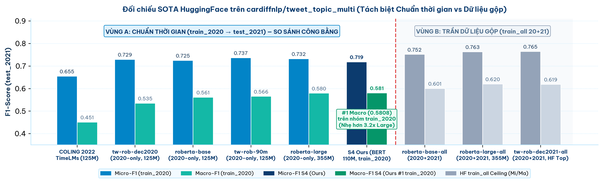  
*Hình 2.1: Đối chiếu `S4` (`bert-base-uncased`, 110M, `train_2020`) với các checkpoint SOTA công khai trên HuggingFace Hub trên `test_2021` (tách riêng nhóm `train_2020` công bằng thời gian và nhóm `train_all` có dữ liệu 2021).*

| Training Split | Model Checkpoint (HuggingFace / Project) | Parameters | Twitter Pre-training | `test_2021` Micro-F1 | `test_2021` Macro-F1 | Exact Match |
|:---|:---|:---:|:---:|:---:|:---:|:---:|
| `train_2020 -> test_2021` | **S4 (Project: `bert-base-uncased`, Global $\tau = 0.60$)** | **110M** | **0 tweets** | **0.7186** | **0.5808 (#1)** | **45.32%** |
| `train_2020 -> test_2021` | `cardiffnlp/roberta-large-tweet-topic-multi-2020` | 355M *(3.2×)* | 0 tweets | 0.7324 | 0.5795 | 49.37% |
| `train_2020 -> test_2021` | `cardiffnlp/twitter-roberta-base-2019-90m-tweet-topic-multi-2020` | 125M | 90M tweets | 0.7367 | 0.5656 | 51.34% |
| `train_2020 -> test_2021` | `cardiffnlp/roberta-base-tweet-topic-multi-2020` | 125M | 0 tweets | 0.7252 | 0.5613 | 49.91% |
| `train_2020 -> test_2021` | `cardiffnlp/twitter-roberta-base-dec2020-tweet-topic-multi-2020` | 125M | 105M+ tweets | 0.7294 | 0.5348 | 50.27% |
| `train_2020 -> test_2021` | `Antypas et al. (COLING 2022) — TimeLMs-2020` | 125M | 58M tweets | 0.6550 | 0.4510 | — |
| `train_all (2020+2021)` | `cardiffnlp/twitter-roberta-base-dec2021-tweet-topic-multi-all` | 125M | 124M tweets | 0.7648 | 0.6187 | 54.85% |
| `train_all (2020+2021)` | `cardiffnlp/roberta-large-tweet-topic-multi-all` | 355M | 0 tweets | 0.7631 | 0.6203 | 53.66% |

### 2.3. Bốn Research Gaps $\rightarrow$ Phương pháp Bổ sung & Kết quả Vượt trội

Thay vì tăng điểm bằng cách mở rộng quy mô lên 355M parameters hoặc pre-training trên hàng trăm triệu tweet, đồ án giải quyết trực diện **4 research gaps của dòng paper `TweetTopic (2020–2024)`**:

| Research Gap trong dòng Paper `TweetTopic` | Phương pháp Kế thừa & Bổ sung (`S1 -> S4`) | Kết quả Vượt trội (Đo trên `test_2021`) |
|:---|:---|:---|
| **G1. Tái sử dụng stock single-label head (`[CLS] + tanh`, uniform `lr = 2e-5`) cho bài toán multi-label 19 classes** (*TweetEval 2020 $\to$ X-Topic 2024*), gây class collapse ở tail classes và bỏ sót secondary labels. | Giữ backbone `bert-base-uncased` (110M), bổ sung **Custom Head + Differential LR 25× (`5e-4` vs `2e-5`) (`S1`)** và **`ResidualHybridPooling ([CLS] + Mean + Attention + LayerNorm) + Multi-Sample Dropout (K=5)` (`S3`)** (overhead `< 0.2%` parameters). | Xóa bỏ hoàn toàn class collapse (`6/19 -> 0/19`); tăng **`+11.63` Macro-F1** (`S0 -> S1`), thu hồi thêm **`+62 TP`** multi-label (`S2 -> S3`) và tăng **`+3.73` pts** trên tweet $\ge 3$ labels. |
| **G2. Đưa trực tiếp chuỗi ẩn danh Cardiff (`{@Entity@}`, `{{USERNAME}}`, `{{URL}}`, `#camelCase`, `741` ký tự BMP) vào WordPiece tokenizer** (*COLING 2022, TweetNLP 2022*) gây vỡ subword và `[UNK]`. | Giữ nguyên cấu trúc bảo toàn ngữ cảnh mạng xã hội, bổ sung bộ chuẩn hóa 6 bước hướng WordPiece **`TweetTextCleaner` (`S2`)**: tách entity placeholders, giữ tín hiệu `http link`, segment `#camelCase` và ánh xạ BMP symbols sang từ khóa tiếng Anh. | Khử `[UNK]` cho các ký hiệu chủ đề; cắt giảm **`67 FP`** (`816 -> 749`), nâng Exact Match `43.06% -> 44.07%`. |
| **G3. Long-tail imbalance `20.18 : 1` nhưng chỉ dùng standard `BCE` cào bằng mọi lớp** (*COLING 2022 $\to$ EMNLP 2024*), để `91.01%` negative cells kéo xác suất tail classes xuống dưới ngưỡng. | Thay standard `BCE` bằng **`Damped Weighted BCE` (`S4`)** với exponent $p = 0.5$ và cap $w_{\max} = 6.0$ (nén dải trọng số về `[1.44, 6.00]`). | Nâng xác suất dương 6 tail classes lên **gấp ~4× (`0.140 -> 0.547`)** trong khi giữ xác suất âm thấp (`0.032`); giảm temporal drift `2020 -> 2021` xuống **`-1.74` pts** (ổn định gấp `4.2×` TF-IDF). |
| **G4. Fixed threshold `0.50` (*TweetNLP 2022*) hoặc rủi ro overfitting per-class thresholds trên validation set nhỏ (`N = 573`)**, thiếu error analysis định lượng toàn diện. | Khóa **Global Threshold $\tau = 0.60$** (tránh tụt `-10.4` pts của per-class thresholds không regularization), kiểm định 3 random seeds và kiểm toán **100% (`918 / 1,679`) failed samples** trên `test_2021`. | **#1 Macro-F1 (`0.5808`)** nhóm `train_2020` (vượt `RoBERTa-large` 355M & vượt *COLING 2022* `+6.36 Mi / +12.98 Ma`); ổn định đa seed ($\sigma \le 0.0066$). |

---

## PHẦN 3. EXPLORATORY DATA ANALYSIS (EDA) & WORDPIECE-AWARE PREPROCESSING

### 3.1. Data Integrity Audit & Temporal Split (Zero Leakage)

Toàn bộ bộ dữ liệu chuẩn `cardiffnlp/tweet_topic_multi` gồm **7,410 tweets** đạt toàn vẹn dữ liệu tuyệt đối: **0 missing values**, **0 empty strings**, và kiểm tra MD5 hash xác nhận **0 duplicate samples** giữa `train_2020` với các tập validation/test.

| Split | Time Window | Tweets | Share (%) | Labels/Tweet | Label Density | Role in Pipeline |
|:---|:---:|:---:|:---:|:---:|:---:|:---|
| `train_2020` | 09/2019–08/2020 | **4,585** | 61.88% | 1.71 | 0.0899 | Huấn luyện tham số $\theta$ và tính class weights $w_c$ |
| `validation_2020` | 09/2019–08/2020 | **573** | 7.73% | 1.73 | 0.0913 | Early Stopping & lựa chọn Global Threshold $\tau$ |
| `test_2020` | 09/2019–08/2020 | **573** | 7.73% | 1.65 | 0.0867 | In-Time Evaluation |
| `test_2021` | 09/2020–08/2021 | **1,679** | 22.66% | 1.55 | 0.0816 | Out-of-Time (OOT) Evaluation |

*Nguyên tắc Zero Leakage:* Trọng số $w_c$ chỉ tính từ `train_2020`; Early Stopping và Global Threshold $\tau$ chỉ chọn trên `validation_2020`; `test_2020` và `test_2021` hoàn toàn đóng băng đến bước đánh giá cuối cùng. Đồ án giữ nguyên phân bố tự nhiên (không synthetic oversampling) nhằm bảo toàn cấu trúc multi-label co-occurrence gốc và xử lý imbalance trực tiếp trong hàm mất mát (`Damped W-BCE`).

### 3.2. Long-Tail Imbalance `20.18 : 1`, Multi-Label Co-occurrence & Temporal Drift

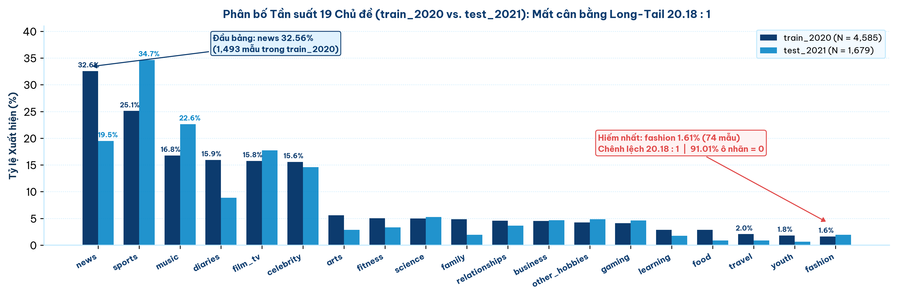  
*Hình 3.1: Tỷ lệ xuất hiện của 19 chủ đề giữa `train_2020` và `test_2021`, thể hiện độ lệch `20.18 : 1` giữa head classes và tail classes.*

| ID | Topic | `train_2020` (n / %) | `test_2020` (n / %) | `test_2021` (n / %) | Shift $\Delta_{20 \to 21}$ |
|:---:|:---|:---:|:---:|:---:|:---:|
| **12** | `news_&_social_concern` | **1,493 (32.56%)** | 195 (34.03%) | 327 (19.48%) | **-13.09%** |
| **16** | `sports` | **1,151 (25.10%)** | 144 (25.13%) | **582 (34.66%)** | **+9.56%** |
| **11** | `music` | 769 (16.77%) | 95 (16.58%) | 380 (22.63%) | **+5.86%** |
| **03** | `diaries_&_daily_life` | 731 (15.94%) | 77 (13.44%) | 149 (8.87%) | **-7.07%** |
| **06** | `film_tv_&_video` | 722 (15.75%) | 90 (15.71%) | 298 (17.75%) | +2.00% |
| **02** | `celebrity_&_pop_culture` | 714 (15.57%) | 94 (16.40%) | 245 (14.59%) | -0.98% |
| **00** | `arts_&_culture` | 256 (5.58%) | 33 (5.76%) | 48 (2.86%) | -2.72% |
| **07** | `fitness_&_health` | 231 (5.04%) | 20 (3.49%) | 56 (3.34%) | -1.70% |
| **15** | `science_&_technology` | 229 (4.99%) | 38 (6.63%) | 88 (5.24%) | +0.25% |
| **04** | `family` | 222 (4.84%) | 16 (2.79%) | 32 (1.91%) | -2.94% |
| **14** | `relationships` | 209 (4.56%) | 19 (3.32%) | 61 (3.63%) | -0.93% |
| **01** | `business_&_entrepreneurs` | 208 (4.54%) | 24 (4.19%) | 78 (4.65%) | +0.11% |
| **13** | `other_hobbies` | 195 (4.25%) | 25 (4.36%) | 81 (4.82%) | +0.57% |
| **09** | `gaming` | 189 (4.12%) | 20 (3.49%) | 77 (4.59%) | +0.46% |
| **10** | `learning_&_educational` | 131 (2.86%) | 15 (2.62%) | 29 (1.73%) | -1.13% |
| **08** | `food_&_dining` | 130 (2.84%) | 10 (1.75%) | 15 (0.89%) | -1.94% |
| **17** | `travel_&_adventure` | 94 (2.05%) | 12 (2.09%) | 15 (0.89%) | -1.16% |
| **18** | `youth_&_student_life` | 83 (1.81%) | 11 (1.92%) | 11 (0.66%) | -1.16% |
| **05** | `fashion_&_style` *(Rarest)* | **74 (1.61%)** | 6 (1.05%) | 32 (1.91%) | +0.29% |

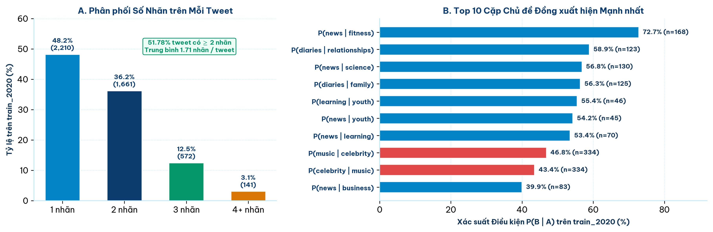  
*Hình 3.2: Label cardinality distribution (`51.78%` có $\ge 2$ nhãn, $LC = 1.708$) và Top 10 cặp topic co-occurrence mạnh nhất trong `train_2020`.*

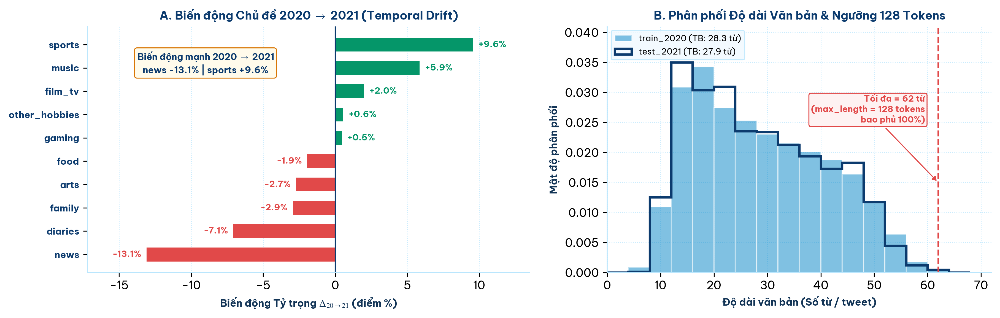  
*Hình 3.3: Topic distribution shift từ 2020 sang 2021 ($d_{\text{JS}} = 0.1377$) và phân phối độ dài câu (tối đa 62 từ $\Rightarrow L_{\max} = 128$ tokens bao phủ 100%).*

* **Multi-Label Co-occurrence:** `51.78%` tweet trong `train_2020` mang từ 2 nhãn trở lên (`36.23%` 2 nhãn, `12.48%` 3 nhãn, `3.08%` $\ge 4$ nhãn). Nhiều cặp có xác suất điều kiện cao như $P(\text{news} \mid \text{fitness}) = 72.7\%$, $P(\text{diaries} \mid \text{relationships}) = 58.9\%$, và cụm giải trí `music` $\leftrightarrow$ `celebrity` (`334` lần đồng xuất hiện).
* **Temporal Drift & Sequence Length:** Khoảng cách Jensen–Shannon đạt $d_{\text{JS}} = 0.1377$ khi `news` (`-13.09%`) và `diaries` (`-7.07%`) hạ nhiệt sau đỉnh COVID-19/bầu cử 2020, nhường chỗ cho `sports` (`+9.56%`) và `music` (`+5.86%`). Độ dài tối đa toàn tập là **62 từ** (trung bình `28.2` từ), nên `max_length = 128` bao phủ 100% chuỗi đầu vào.

### 3.3. WordPiece-Aware Preprocessing (`TweetTextCleaner`) & EDA-to-Design Bridge

Kiểm toán chuỗi gốc trên 7,410 tweet phát hiện 4 dạng nhiễu đặc thù với WordPiece của `bert-base-uncased`: **6,829** entity placeholders `{@Entity@}` (`66.7%` tweet), **4,453** `{{USERNAME}}` (`42.3%`, bị WordPiece tách thành 6 subwords rời), **3,665** `{{URL}}` (`48.1%`), **39.3%** tweet có `#Hashtag` (`21.3%` dạng `camelCase`), và **741** ký tự BMP (`❤` 278, `⚽` 45, `♫` 32, `✨` 31, `☕` 18, `✈` 3) bị ánh xạ thành `[UNK]`.

Mô-đun [`TweetTextCleaner`](../tweet_topic/addons/custom_preprocessor_addon.py) chuẩn hóa qua 6 bước bảo toàn ngữ nghĩa:
1. Chuẩn hóa Unicode `NFC` và xóa ký tự điều khiển vô hình (`\ufe0f`, `\u200d`).
2. `{{USERNAME}}` $\rightarrow$ `@user`; gỡ dấu ngoặc entity placeholder `\{@(.*?)@\}` $\rightarrow$ `@ \1`.
3. Giữ tín hiệu liên kết `{{URL}}` $\rightarrow$ `http link` thay vì xóa bỏ.
4. Ánh xạ các ký tự BMP mang ngữ nghĩa chủ đề sang từ khóa tiếng Anh (`⚽ -> soccer`, `♫ -> music`, `☕ -> coffee food`, `✈ -> travel airplane`, ...).
5. Tách từ hashtag tại biên chữ hoa–thường (`#SmallYouTuberArmy` $\rightarrow$ `#Small You Tuber Army`).
6. Chuẩn hóa dấu nháy/gạch ngang Unicode và rút gọn dấu câu, khoảng trắng thừa.

| Ràng buộc Đo được từ EDA | Quyết định Thiết kế trong Phần 4 (`S1 -> S4`) |
|:---|:---|
| Long-tail imbalance `20.18 : 1`; `91.01%` negative cells | Dùng **Macro-F1**, tách `lr_head = 5e-4` (`S1`) và **`Damped W-BCE`** (`S4`) |
| `51.78%` multi-label tweets ($LC = 1.708$) | 19 Sigmoid độc lập + **`ResidualHybridPooling` + MSD ($K=5$)** (`S3`) |
| Temporal drift $d_{\text{JS}} = 0.1377$ (`2020 -> 2021`) | **Pre-trained Contextual BERT** + Early Stopping trên `validation_2020` |
| Cardiff placeholders, `#camelCase` & `741` ký tự BMP | Áp dụng **`TweetTextCleaner`** hướng WordPiece (`S2`), bảo toàn ngữ cảnh gốc |
| `validation_2020` quy mô nhỏ ($N = 573$, tail classes 12–19 mẫu) | Khóa **Global Threshold `τ = 0.60`** nhằm tránh overfitting per-class thresholds |

---

## PHẦN 4. MÔ HÌNH HÓA — CONTROLLED ABLATION LADDER (`S0 -> S4`)

### 4.1. Kiến trúc Duy nhất & Tổng quan Thiết kế

Đồ án tập trung chuyên sâu vào một phương pháp Deep Learning duy nhất: **`bert-base-uncased`** (*Devlin et al., NAACL 2019*; 12 Transformer Encoder layers, hidden size $d = 768$, ~110M parameters, không có Twitter pre-training), đối chiếu cùng baseline tuyến tính TF-IDF + Logistic Regression (OvR). Toàn bộ classification head đề xuất chỉ bổ sung **< 0.2% parameters (~199K)** so với backbone gốc.

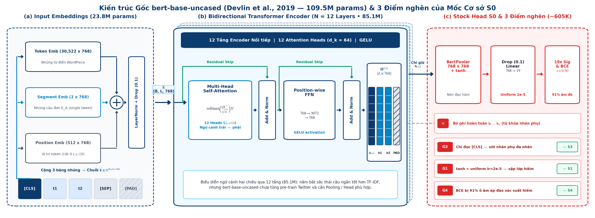  
*Hình 4.1a: Kiến trúc gốc `bert-base-uncased` (Devlin et al., 2019 — 109.5M params) và ba điểm nghẽn của Stock Head `S0` trước khi áp dụng chuỗi cải tiến `S1 -> S4`.*

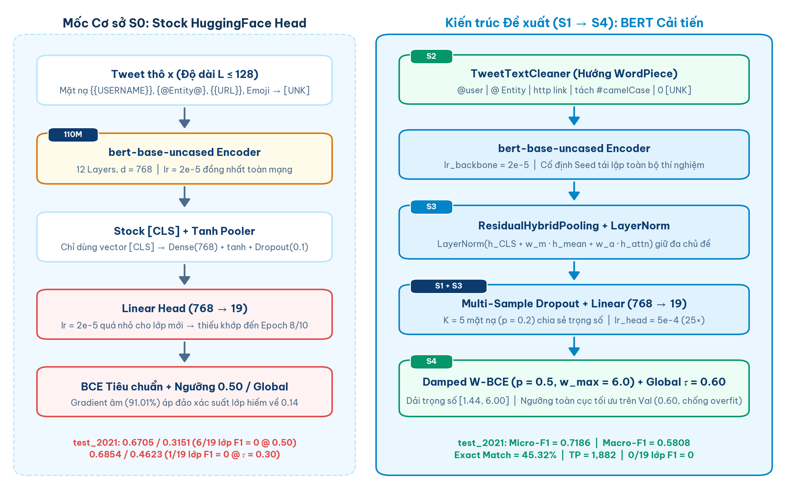  
*Hình 4.1: Đối chiếu baseline `S0` (Stock HuggingFace Head) và kiến trúc BERT cải tiến lũy tiến `S1 -> S4` (Global Threshold $\tau = 0.60$).*

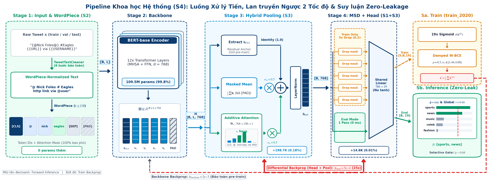  
*Hình 4.1b: Pipeline khoa học End-to-End của kiến trúc đề xuất `S4` (Input & WordPiece Normalization → `bert-base-uncased` 12 tầng → `ResidualHybridPooling` 3 nhánh → Multi-Sample Dropout + Shared Linear → Tách luồng Training `Damped W-BCE` / Differential LR Backprop và Inference Zero-Leakage tại $\tau = 0.60$).*

### 4.2. Controlled Ablation Ladder (`S0 -> S4`)

Để cô lập đóng góp thực chất của từng thành phần, đồ án thay đổi **đúng một yếu tố tại mỗi bước** (*One-Factor-at-a-Time*):

| Stage | Experiment ID | Yếu tố duy nhất bổ sung so với bước trước | Mục tiêu kỹ thuật trực tiếp |
|:---:|:---|:---|:---|
| **`S0`** | `v4_s0_stock_bce` | **Baseline gốc:** Stock `[CLS] + tanh + Linear`, uniform LR $\eta = 2\times 10^{-5}$, standard BCE | Tái hiện thiết lập mặc định của các benchmark trước |
| **`S1`** | `v4_s1_custom_head_bce` | **+ Custom Head & Differential LR:** Linear head trực tiếp từ `[CLS]` với $\eta_{\text{head}} = 5\times 10^{-4}$ (gấp 25× backbone) | Khắc phục underfitting ở classification head gây class collapse `F1 = 0` tại `S0` |
| **`S2`** | `v4_s2_cleaner_bce` | **+ `TweetTextCleaner`:** WordPiece-aware preprocessing 6 bước | Loại bỏ nhiễu placeholders, tách `#camelCase`, khử `[UNK]` và giảm FP |
| **`S3`** | `v4_s3_hybrid_pool_msd_bce` | **+ `ResidualHybridPooling` + MSD ($K=5, p=0.2$):** `[CLS] + Mean + Attention + LayerNorm` và 5 dropout branches | Tổng hợp đồng thời từ khóa của nhiều chủ đề nằm rải rác trong tweet ngắn |
| **`S4`** | `v4_s4_damped_wbce` | **+ `Damped Weighted BCE`** ($p=0.5, w_{\max}=6.0$) + **Global $\tau = 0.60$** | Nâng xác suất dương của tail classes ~4× trong khi vẫn kiểm soát chặt FP |

### 4.3. Cơ chế Toán học của Ba Thành phần Cốt lõi (`S1`, `S3`, `S4`)

1. **Differential Learning Rate (25× — `S1`):** Backbone BERT giữ $\eta_{\text{backbone}} = 2\times 10^{-5}$ nhằm bảo tồn pre-trained linguistic representations, trong khi classification head khởi tạo ngẫu nhiên học với $\eta_{\text{head}} = 5\times 10^{-4}$ (AdamW, weight decay `0.01`, gradient clipping `1.0`).
2. **`ResidualHybridPooling` + Multi-Sample Dropout (MSD — `S3`):** Giữ `[CLS]` làm residual path chính, cộng `Masked Mean` và `Additive Attention` qua `LayerNorm`, rồi đưa qua $K = 5$ dropout masks độc lập (`p = 0.2`) chia sẻ chung một tầng Linear $768 \to 19$ (*Inoue, 2019*):

$$\alpha_i = \text{softmax}_i\big(\mathbf{v}^\top \tanh(\mathbf{W}_a \mathbf{h}_i + \mathbf{b}_a)\big), \qquad \mathbf{h}_{\text{attn}} = \sum_{i=1}^{L} \alpha_i \mathbf{h}_i$$

$$\mathbf{h}_{\text{hybrid}} = \text{LayerNorm}\Big(\mathbf{h}_{\text{CLS}} + w_{\text{mean}} \mathbf{h}_{\text{mean}} + w_{\text{attn}} \mathbf{h}_{\text{attn}}\Big), \qquad \mathcal{L}_{\text{MSD}} = \frac{1}{K} \sum_{m=1}^{K} \mathcal{L}\big(\mathbf{z}^{(m)}, \mathbf{y}\big)$$

3. **`Damped Weighted BCE` (`S4`):** Thay vì standard `BCE` (khiến xác suất dương trung bình 6 tail classes chỉ đạt `0.140` ở `S0` và `0.342` ở `S3`), `S4` sử dụng positive class weights lấy căn bậc hai và chặn trần tại $w_{\max} = 6.0$ (nén dải trọng số về **`[1.44, 6.00]`**):

$$w_c = \min\!\left(\left(\frac{N - N_c}{N_c}\right)^{0.5},\; 6.0\right), \qquad \mathcal{L}_{\text{W-BCE}} = -\frac{1}{19}\sum_{c=1}^{19} \Big[ w_c y_c \log \hat{p}_c + (1 - y_c)\log(1 - \hat{p}_c) \Big]$$

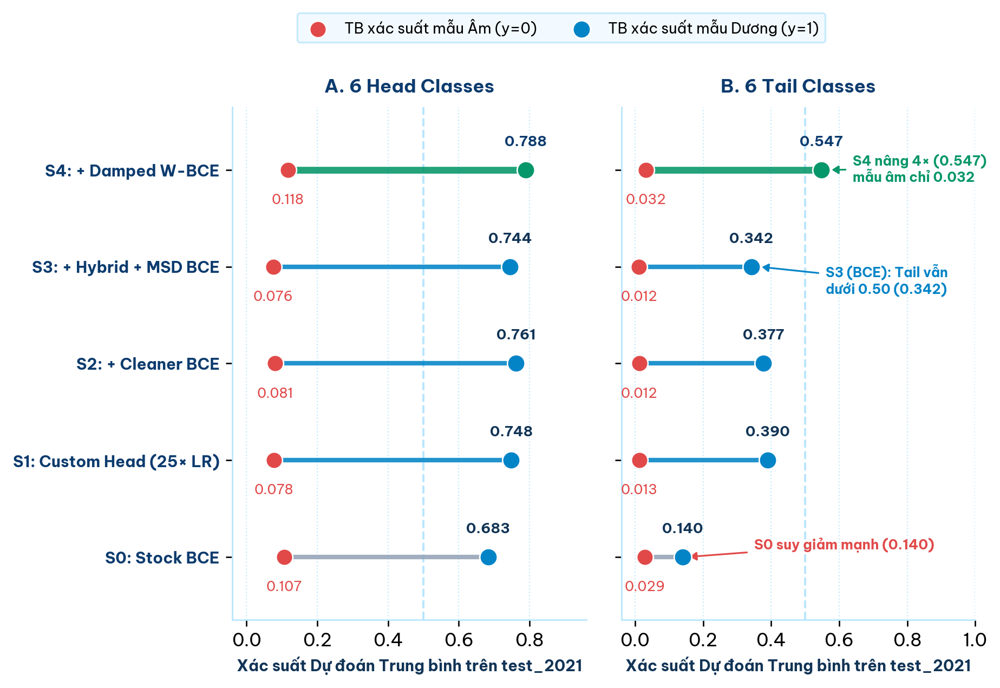  
*Hình 4.2: Diễn tiến probability separation giữa mẫu Positive ($y=1$) và Negative ($y=0$) trên `test_2021` từ `S0` tới `S4`. Bước `S4` nâng xác suất dương 6 tail classes lên `0.547` (gấp ~4× `S0`) trong khi giữ xác suất âm thấp (`0.032`).*

### 4.4. Training Schedule `10 Epochs + Cosine Annealing + Early Stopping` (100% Kaggle GPU)

Toàn bộ các mô hình `S0 -> S4` được huấn luyện trên **Kaggle GPU (Tesla T4, AMP FP16)** với batch size `32`, lịch trình **Cosine Annealing + Linear Warmup 10%**, training budget tối đa **10 epochs** và **Early Stopping (`patience = 3`)** theo `val_f1_balanced` trên `validation_2020`.

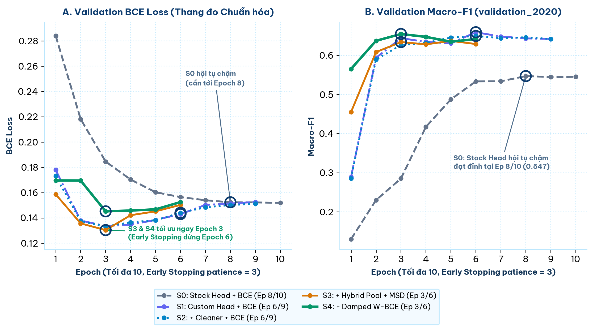  
*Hình 4.3: Đường cong Validation BCE Loss và Validation Macro-F1 qua tối đa 10 epochs của chuỗi `S0 -> S4` (vòng tròn đánh dấu checkpoint Early Stopping lựa chọn).*

* **`S0` hội tụ chậm (`best_epoch = 8 / 10`):** Với uniform `lr = 2e-5` cho cả backbone và classification head khởi tạo mới, `S0` cải thiện chậm qua từng epoch và chỉ đạt đỉnh Val Macro-F1 (`0.5470`) tại epoch 8.
* **`S1` & `S2` tăng tốc rõ rệt (`best_epoch = 6 / 9`):** Nhờ tách `lr_head = 5e-4`, classification head hội tụ nhanh và dừng tại epoch 9.
* **`S3` & `S4` hội tụ nhanh nhất (`best_epoch = 3 / 6`):** Nhờ `ResidualHybridPooling` + MSD regularization, mô hình đạt đỉnh ở epoch 3 và `Early Stopping` dừng kịp tại epoch 6 trước khi `train_loss` giảm sâu gây overfitting (`0.1948 -> 0.0850`).

#### Kiểm chứng Bổ sung: `10 Epochs + Cosine` vs `15 Epochs + ReduceLROnPlateau` (& `LLRD = 0.90`)

Để kiểm tra xem việc mở rộng training budget lên **15 epochs** (`early_stopping_patience = 6`) kết hợp **`ReduceLROnPlateau`** (`factor = 0.5, patience = 1, min_lr = 1e-7`) và **Layer-Wise Learning Rate Decay (`LLRD = 0.90`)** có cải thiện Out-of-Time generalization hay không, toàn bộ chuỗi `S0 -> S4` đã được huấn luyện lại trên **Kaggle GPU** (`outputs/v5_15ep_vs_v4_10ep_comparison.json`):

| Stage | Training Schedule | `Ep` (Best/Ran) | `test_2020` Micro / Macro | `test_2021` Micro / Macro | `test_2021` Exact | $\Delta_{20 \to 21}$ Micro |
|:---|:---|:---:|:---:|:---:|:---:|:---:|
| **`S0`** (Stock Head) | `10ep Cosine` | 8 / 10 | 0.7185 / 0.5095 | 0.6854 / 0.4623 | 40.56% | -3.31 |
| **`S0`** (Stock Head) | `15ep Plateau` (`2` LR drops) | 10 / 15 | **0.7347 / 0.6367** | **0.6963 / 0.5535** | **41.93%** | -3.84 |
| **`S4`** (Primary) | **`10ep Cosine` (Selected)** | **3 / 6** | 0.7360 / 0.6470 | **0.7186 / 0.5808** | 45.32% | **-1.74** |
| **`S4`** | `15ep Plateau` (`3` LR drops) | 6 / 12 | **0.7596 / 0.6711** | 0.7083 / 0.5678 | 45.03% | -5.13 |
| **`S4` + `LLRD (0.90)`** | `15ep Plateau + LLRD` ($\tau = 0.75$) | 5 / 11 | 0.7461 / 0.6544 | 0.7112 / 0.5617 | **48.18%** | -3.49 |

* **Kết luận chọn cấu hình:** `15ep Plateau` giữ peak LR lâu hơn (`ep 1..4` không giảm), giúp cải thiện mạnh baseline yếu `S0` (`+9.12` Macro trên `2021`) và lập đỉnh In-Time `test_2020` cho `S4` (`0.7596 / 0.6711`). Tuy nhiên, việc fit quá sâu vào phân phối 2020 gây temporal overfitting khiến `test_2021` giảm còn `0.7083 / 0.5678` (temporal drift nới rộng `-1.74 -> -5.13`). Vì mục tiêu cốt lõi là **Out-of-Time generalization (`2020 -> 2021`)**, đồ án **giữ nguyên `10 Epochs + Cosine`** làm cấu hình chuẩn.

---

## PHẦN 5. ĐÁNH GIÁ THỰC NGHIỆM, ERROR ANALYSIS (`S4`) & KẾT LUẬN

### 5.1. Kết quả Ablation Ladder `S0 -> S4` & Đối chiếu Published Benchmarks

> **Truy xuất mã nguồn & tái lập:** Toàn bộ số liệu trong Mục 5.1–5.3 được tính trực tiếp từ đầu ra Kaggle GPU (`outputs/v4_*/test_predictions.json`, `metrics_summary.json`, `val_probabilities.json`) và có thể kiểm chứng từng dòng lệnh tại [`analysis/tweet_topic_evaluation_and_error_analysis.ipynb`](../analysis/tweet_topic_evaluation_and_error_analysis.ipynb) (**Sections 1–7**).

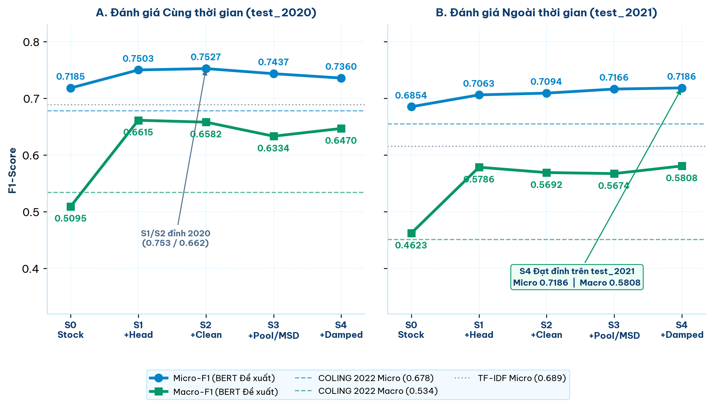  
*Hình 5.1: Hiệu năng thực nghiệm của chuỗi ablation `S0 -> S4` trên `test_2020` và `test_2021`, đối chiếu cùng mốc *Antypas et al. (COLING 2022)* và Baseline TF-IDF.*

| Configuration / Published Benchmark | Threshold | `Ep` | `val_2020` Micro / Macro | `test_2020` Micro / Macro | `test_2021` Micro / Macro | $\Delta_{20 \to 21}$ Micro / Macro | `test_2021` Exact | `test_2021` TP / FP / FN | Zero-F1 (`2021`) |
|:---|:---:|:---:|:---:|:---:|:---:|:---:|:---:|:---:|:---:|
| **Antypas et al. (COLING 2022)** — `RoBERTa-base` | `0.50` | — | — | 0.6610 / 0.3420 | 0.6380 / 0.3110 | -2.30 / -3.10 | — | — | — |
| **Antypas et al. (COLING 2022)** — `TimeLMs-2020` | Val-tuned | — | — | 0.6780 / 0.5340 | 0.6550 / 0.4510 | -2.30 / -8.30 | — | — | — |
| **TF-IDF 100k + Logistic Regression (OvR)** | `0.50` | — | 0.6538 / 0.5284 | 0.6890 / 0.5227 | 0.6154 / 0.3997 | **-7.36 / -12.30** | 34.07% | — | — |
| `S0` reference at fixed `0.50` | `0.50` | 8 / 10 | 0.6540 / 0.3415 | 0.6971 / 0.3709 | 0.6705 / 0.3151 | -2.66 / -5.58 | 43.95% | — | **6 / 19** |
| **`S0`: BERT Stock Head + BCE** | Global (`0.30`) | 8 / 10 | 0.6891 / 0.5070 | 0.7185 / 0.5095 | 0.6854 / 0.4623 | -3.31 / -4.72 | 40.56% | 1,807 / 862 / 797 | **1 / 19** |
| **`S1`: + Custom Head & Diff LR (`5e-4`)** | Global (`0.35`) | 6 / 9 | 0.7304 / **0.6419** | 0.7503 / **0.6615** | 0.7063 / 0.5786 | -4.40 / -8.29 | 43.06% | 1,867 / 816 / 737 | **0 / 19** |
| **`S2`: + `TweetTextCleaner` (WordPiece)** | Global (`0.40`) | 6 / 9 | 0.7316 / 0.6270 | **0.7527** / 0.6582 | 0.7094 / 0.5692 | -4.33 / -8.90 | 44.07% | 1,843 / **749** / 761 | **0 / 19** |
| **`S3`: + `ResidualHybridPooling` + MSD (`K=5`)** | Global (`0.30`) | 3 / 6 | **0.7327** / 0.6178 | 0.7437 / 0.6334 | 0.7166 / 0.5674 | -2.71 / -6.60 | 44.01% | **1,905** / 808 / **699** | **0 / 19** |
| **`S4`: + `Damped W-BCE` ($p=0.5, w_{\max}=6.0$)** | **Global (`0.60`)** | **3 / 6** | **0.7269 / 0.6328** | **0.7360 / 0.6470** | **0.7186 / 0.5808** | **-1.74 / -6.62** | **45.32%** | **1,882 / 752 / 722** | **0 / 19** |

**Đóng góp định lượng từng bước (và bằng chứng Zero Overfitting trên `validation_2020`):**
0. **Đối chiếu `val_2020` $\leftrightarrow$ `test_2020`:** Trên `S4 @ 0.60`, hiệu năng `validation_2020` (`0.7269 / 0.6328`, Exact Match `45.72%`) không vượt `test_2020` (`0.7360 / 0.6470`, Exact Match `47.47%`), xác nhận việc chọn Early Stopping và khóa 1 Global Threshold $\tau = 0.60$ trên tập validation nhỏ ($N = 573$) hoàn toàn không bị overfitting. Bước `S3 -> S4` đồng thời nâng `val_2020` Macro-F1 thêm **`+1.50` pts** (`0.6178 -> 0.6328`).
1. **`S0 -> S1`:** Xóa sổ hoàn toàn class collapse (`6/19` tại `0.50` và `1/19` tại global về **`0/19`**), tăng **`+2.09` Micro-F1 và `+11.63` Macro-F1** trên `test_2021`.
2. **`S1 -> S2`:** `TweetTextCleaner` giảm **`67 FP`** trên `test_2021` (`816 -> 749`), nâng Exact Match `43.06% -> 44.07%` và tăng Micro-F1 trên cả hai năm.
3. **`S2 -> S3`:** `ResidualHybridPooling + MSD` thu hồi thêm **`+62 TP`** (`1,843 -> 1,905`), nâng mạnh nhóm tweet $\ge 3$ labels (`+3.65` pts) và giảm temporal drift `2020 -> 2021` từ `-4.33` xuống `-2.71` pts.
4. **`S3 -> S4`:** `Damped W-BCE` đưa Global Threshold tối ưu về **`τ = 0.60`**, cắt tiếp `56 FP` (`808 -> 752`), đạt đỉnh toàn hệ thống trên `test_2021` ở cả **Micro-F1 (`0.7186`)**, **Macro-F1 (`0.5808`)** lẫn **Exact Match (`45.32%`)**, với temporal drift chỉ **`-1.74` pts** (ổn định gấp `4.2×` TF-IDF).

#### Đánh giá cân bằng Precision & Recall qua từng bước (`test_2021`)

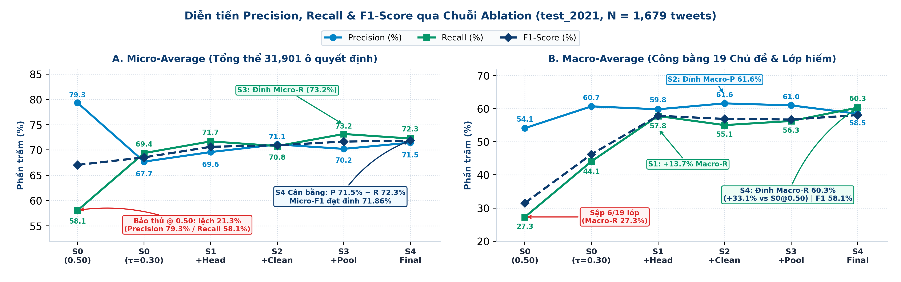  
*Hình 5.1b: Tiến triển Micro/Macro Precision & Recall qua các cấu hình TF-IDF và `S0 -> S4` trên `test_2021`.*

| Cấu hình (`test_2021`) | Threshold | Micro-Precision | Micro-Recall | Micro-F1 | Macro-Precision | Macro-Recall | Macro-F1 |
|:---|:---:|:---:|:---:|:---:|:---:|:---:|:---:|
| **TF-IDF 100k + OvR** | `0.50` | 0.6865 | 0.5576 | 0.6154 | 0.5391 | 0.3466 | 0.3997 |
| **`S0` @ `0.50`** | `0.50` | **0.7933** | 0.5806 | 0.6705 | 0.5413 | 0.2727 | 0.3151 |
| **`S0` @ `τ = 0.30`** | `0.30` | 0.6770 | 0.6939 | 0.6854 | 0.6072 | 0.4409 | 0.4623 |
| **`S1` @ `τ = 0.35`** | `0.35` | 0.6959 | 0.7170 | 0.7063 | 0.5983 | 0.5780 | 0.5786 |
| **`S2` @ `τ = 0.40`** | `0.40` | 0.7110 | 0.7078 | 0.7094 | **0.6162** | 0.5505 | 0.5692 |
| **`S3` @ `τ = 0.30`** | `0.30` | 0.7022 | **0.7316** | 0.7166 | 0.6101 | 0.5629 | 0.5674 |
| **`S4` @ `τ = 0.60`** | `0.60` | **0.7145** | **0.7227** | **0.7186** | 0.5848 | **0.6032** | **0.5808** |

1. **"Ảo giác Precision" ở `S0 @ 0.50`:** `S0` tại ngưỡng mặc định đạt Micro-P rất cao (`79.33%`) chỉ vì dự đoán quá bảo thủ (chỉ bắn vào các head classes dễ), kéo theo Micro-R tụt sâu (`58.06%`), Macro-R chỉ đạt `27.27%` và **`6/19` lớp hiếm bị sụp đổ hoàn toàn**.
2. **Vai trò bổ trợ rõ rệt giữa `S1 -> S3`:** `S1` mở khóa mạnh **Macro-R** (`44.09% -> 57.80%`, **`+13.71` pts**); `S2` (`TweetTextCleaner`) làm sạch nhiễu tweet giúp lập đỉnh **Macro-P (`61.62%`)** và tăng Micro-P (`+1.51` pts, giảm `67 FP`); `S3` (`ResidualHybridPooling + MSD`) thu hồi thêm `+62 TP` để lập đỉnh **Micro-R (`73.16%`)**.
3. **Điểm cân bằng tối ưu tại `S4 @ 0.60`:** `Damped W-BCE` + $\tau = 0.60$ đưa **Micro-P (`71.45%`) $\approx$ Micro-R (`72.27%`)** (độ lệch chỉ `0.82%`), đồng thời lập đỉnh **Macro-R (`60.32%`)** (`+33.05` pts so với `S0 @ 0.50`), từ đó đồng thời đạt cực đại ở cả **Micro-F1 (`0.7186`)**, **Macro-F1 (`0.5808`)** và **Exact Match (`45.32%`)**.

> **Tổng hợp Nguồn gốc Baseline, Kiến trúc 2 Tầng (`S1` vs `S2–S4`) & Cân bằng Precision–Recall:**
> * **Nguồn gốc 4 nhóm baseline:** (i) *Paper COLING 2022* (`TimeLMs-2020`, `RoBERTa-base` trích từ Antypas et al., 2022); (ii) *HuggingFace Hub* (model cards CardiffNLP `roberta-large`, `tw-rob-90m`); (iii) `TF-IDF 100k OvR` (ML) và (iv) `S0 Stock BERT` (DL mặc định) cùng được huấn luyện sạch trên Kaggle GPU với tập `train_2020`.
> * **Kiến trúc thực nghiệm 2 tầng (`S1` vs `S2–S4`):** `S1` tạo bước nhảy lớn nhất vì đóng vai trò **Tầng 1 (gỡ lỗi hội tụ nền)** — loại bỏ `BertPooler tanh` và tách `Differential LR 25×` để `13` lớp hiếm thoát trạng thái gradient bão hòa; đây là điều kiện tiên quyết trước khi đo lường **Tầng 2 (`S2–S4`)**. Riêng ở **`S2` (`TweetTextCleaner`)**, dù `Macro-F1` tạm chững nhẹ (`0.5786 -> 0.5692`) do ngưỡng validation dịch chặt hơn (`0.35 -> 0.40`), `S2` cải thiện đúng mục tiêu làm sạch nhiễu: giảm **`-67 FP`** (`816 -> 749`), lập đỉnh toàn hệ thống về **`Macro-Precision = 0.6162`**, tăng `Exact Match` (`43.06% -> 44.07%`) và tăng `Micro-F1` đồng thời trên cả `val_2020`, `test_2020` lẫn `test_2021`, tạo đầu vào sạch để `S3–S4` bứt phá Recall.
> * **Cân bằng Precision–Recall:** So sánh `S0 @ 0.50` (`79.3% P / 58.1% R`, bảo thủ cực đoan gây sập `6/19` lớp) và `S4 @ 0.50` (`67.1% P / 75.8% R`, kéo Recall quá tay làm tăng báo nhầm) khẳng định mốc **`S4 @ 0.60`** (`71.5% P ≈ 72.3% R`, lệch chỉ `0.8%`) là điểm cân bằng tối ưu thực tế.

### 5.2. Global Threshold (`τ = 0.60`) & Multi-Seed Stability (`S4`)

* **Tại sao khóa Global Threshold `τ = 0.60` thay vì tối ưu 19 Per-Class Thresholds trên `validation_2020`?**

| Threshold Strategy trên cùng xác suất `S4` | `validation_2020` Micro / Macro | `test_2020` Micro / Macro | `test_2021` Micro / Macro | Nhận xét |
|:---|:---:|:---:|:---:|:---|
| Fixed Threshold `0.50` | 0.7222 / 0.6361 | 0.7298 / 0.6375 | 0.7115 / 0.5782 | Đã tương đối cân bằng nhờ `Damped W-BCE` |
| **Global Threshold (`τ = 0.60`)** | 0.7269 / 0.6328 | **0.7360 / 0.6470** | **0.7186 / 0.5808** | **Generalization tốt nhất trên cả hai tập Test** |
| Unregularized Per-Class Thresholds | **0.7449 / 0.6773** | 0.7315 / 0.6410 | 0.7077 / 0.5730 | **Overfitting mạnh lên `val` ($N=573$), tụt `-10.4` pts sang `2021`** |

* **Multi-Seed Stability qua 3 random seeds độc lập (`42, 1337, 2024`):**

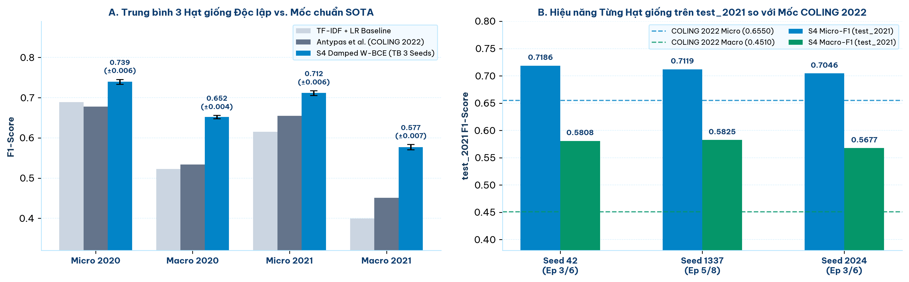  
*Hình 5.2: Kết quả `S4` (`Global τ = 0.60`) qua 3 random seeds độc lập — độ lệch chuẩn nhỏ ($\sigma \le 0.0066$ trên `test_2021`).*

| Seed | `Ep` (Best / Ran) | `val_2020` Micro / Macro | `test_2020` Micro-F1 | `test_2020` Macro-F1 | `test_2021` Micro-F1 | `test_2021` Macro-F1 |
|:---:|:---:|:---:|:---:|:---:|:---:|:---:|
| **42** | 3 / 6 | 0.7269 / 0.6328 | 0.7360 | 0.6470 | 0.7186 | 0.5808 |
| **1337** | 5 / 8 | 0.7360 / 0.6426 | 0.7480 | 0.6567 | 0.7119 | 0.5825 |
| **2024** | 3 / 6 | 0.7288 / 0.6520 | 0.7343 | 0.6528 | 0.7046 | 0.5677 |
| **Mean $\pm$ Std** | — | **0.7306 $\pm$ 0.0039 / 0.6425 $\pm$ 0.0078** | **0.7394 $\pm$ 0.0061** | **0.6522 $\pm$ 0.0040** | **0.7117 $\pm$ 0.0057** | **0.5770 $\pm$ 0.0066** |

### 5.3. Error Analysis Chuyên sâu & Audit Toàn bộ `918 / 1,679` Failed Samples (`S4`, `test_2021`)

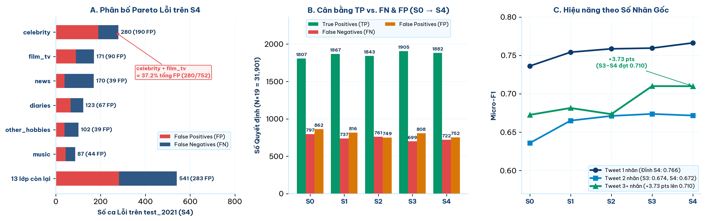  
*Hình 5.3: Phân bố Pareto FP theo chủ đề (riêng `celebrity` và `film_tv` chiếm `37.2%` tổng FP) và hiệu năng theo label cardinality trên `test_2021`.*

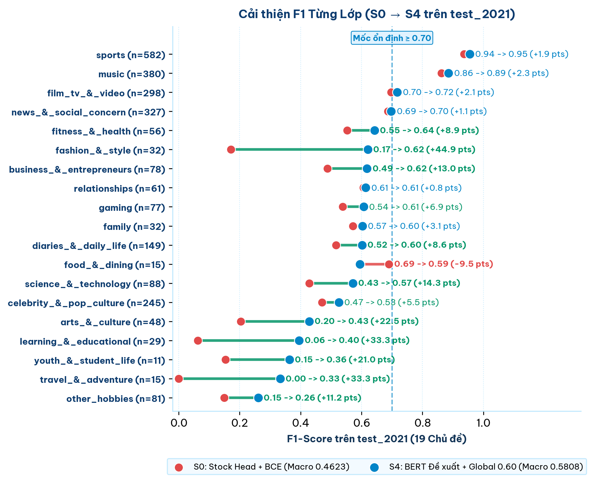  
*Hình 5.4: Per-class F1 của toàn bộ 19 chủ đề từ `S0` tới `S4` trên `test_2021` — phục hồi `+11` đến `+45` pts ở các tail classes.*

| Topic (`test_2021`) | Support | `S0` F1 | `S1` F1 | `S2` F1 | `S3` F1 | **`S4` F1** | `S4` TP / FP / FN |
|:---|:---:|:---:|:---:|:---:|:---:|:---:|:---:|
| `sports` | 582 | 0.9360 | 0.9566 | 0.9612 | 0.9630 | **0.9549** | 551 / 21 / 31 |
| `music` | 380 | 0.8627 | 0.8607 | 0.8789 | 0.8795 | **0.8857** | 337 / 44 / 43 |
| `film_tv_&_video` | 298 | 0.6968 | 0.7170 | 0.6929 | 0.7284 | **0.7174** | 217 / 90 / 81 |
| `news_&_social_concern` | 327 | 0.6864 | 0.6814 | 0.6878 | 0.6917 | **0.6975** | 196 / 39 / 131 |
| `fitness_&_health` | 56 | 0.5532 | 0.6038 | 0.5510 | 0.5510 | **0.6422** | 35 / 18 / 21 |
| `fashion_&_style` *(Rarest)* | 32 | 0.1714 | 0.6667 | 0.6667 | 0.6296 | **0.6207** | 18 / 8 / 14 |
| `business_&_entrepreneurs` | 78 | 0.4878 | 0.6573 | 0.6571 | 0.6512 | **0.6180** | 55 / 45 / 23 |
| `relationships` | 61 | 0.6061 | 0.6667 | 0.5789 | 0.3750 | **0.6139** | 31 / 9 / 30 |
| `gaming` | 77 | 0.5378 | 0.6765 | 0.6462 | 0.6040 | **0.6071** | 51 / 40 / 26 |
| `family` | 32 | 0.5714 | 0.5634 | 0.5797 | 0.5797 | **0.6027** | 22 / 19 / 10 |
| `diaries_&_daily_life` | 149 | 0.5163 | 0.5198 | 0.5278 | 0.5596 | **0.6019** | 93 / 67 / 56 |
| `food_&_dining` | 15 | 0.6897 | 0.6111 | 0.7027 | 0.6452 | **0.5946** | 11 / 11 / 4 |
| `science_&_technology` | 88 | 0.4286 | 0.4857 | 0.5255 | 0.5170 | **0.5714** | 44 / 22 / 44 |
| `celebrity_&_pop_culture` | 245 | 0.4704 | 0.4772 | 0.4838 | 0.5217 | **0.5254** | 155 / 190 / 90 |
| `arts_&_culture` | 48 | 0.2034 | 0.4074 | 0.3579 | 0.4255 | **0.4286** | 21 / 29 / 27 |
| `learning_&_educational` | 29 | 0.0625 | 0.4231 | 0.3750 | 0.4667 | **0.3953** | 17 / 40 / 12 |
| `youth_&_student_life` | 11 | 0.1538 | 0.4444 | 0.4211 | 0.4348 | **0.3636** | 6 / 16 / 5 |
| `travel_&_adventure` | 15 | **0.0000** | 0.2667 | 0.2400 | 0.2857 | **0.3333** | 4 / 5 / 11 |
| `other_hobbies` *(Broadest)* | 81 | 0.1489 | 0.3077 | 0.2810 | 0.2712 | **0.2609** | 18 / 39 / 63 |

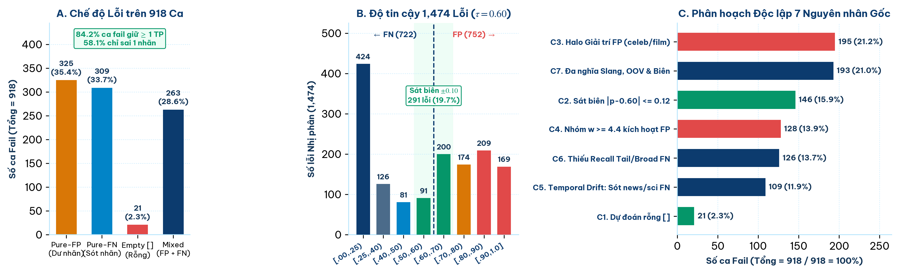  
*Hình 5.5: Kiểm toán 100% (`918 / 1,679`) failed samples trên `test_2021` của `S4`: error modes, confidence distribution trên 1,474 binary errors và mutually exclusive 7-category root-cause taxonomy.*

* **Tổng quan 918 failed samples (`test_2021`, `S4`):** Trong 918 mẫu không đạt Exact Match 19/19 nhãn, có **84.2% (773 mẫu)** vẫn bắt đúng ít nhất 1 chủ đề (`TP >= 1`) và **58.1% (533 mẫu)** chỉ sai lệch đúng **1 nhãn** (`325` Pure-FP, `309` Pure-FN partial, `21` Empty `[]`, và `263` Mixed FP+FN). Qua chuỗi `S0 -> S4`, hệ thống phục hồi **203 mẫu** lên Exact Match (regression `123` $\Rightarrow$ **`+80` net Exact Match**). Riêng ngoại lệ duy nhất `food_&_dining` (`-9.5` pts từ `S0` sang `S4`) do support rất nhỏ (`n = 15`): trọng số `Damped W-BCE` ($w = 5.85$) nâng Recall lên `73.3%` (`11/15`) nhưng phát sinh `11 FP`.
* **Phân rã 4 Tầng Ngân sách Lỗi qua `3-Seed S4 Consensus` (`42, 1337, 2024` trên `test_2021`, `1,474` binary errors):**
  * **Stratum 1 — Unanimous `3/3` Extreme (`FP ≥ 0.85` hoặc `FN ≤ 0.15`):** **`35.9%` (`529` lỗi, $\sigma_3 = 0.032$)** — Data & Annotation Ceiling (ẩn `{{URL}}`, unseen `#Hashtags`, và crowd-annotation noise được xác nhận độc lập qua giao thức Zero Test Leakage trên [`validation_2020`](validation_error_analysis.md)).
  * **Stratum 2 — Unanimous `3/3` Moderate:** **`32.8%` (`484` lỗi, $\sigma_3 = 0.087$)** — Structural Bias (`81.4%` tổng FN là đồng thuận cứng `3/3`).
  * **Stratum 3 (`2/3` Boundary: `17.5%`, `257` lỗi) & Stratum 4 (`1/3` Seed Variance: `13.8%`, `204` lỗi — `75%` là FP):** **`43.5%` tổng FP là variance-driven**; chỉ cần **3-Seed `S4` Probability Averaging** (không train mới) đã cắt ngay **`-87 FP` (`752 → 665`)**, nâng `test_2021` lên **`0.7220` Micro-F1 (`+0.34`) / `0.5896` Macro-F1 (`+0.88`) / `46.22%` Exact Match (`+0.90%`)**.

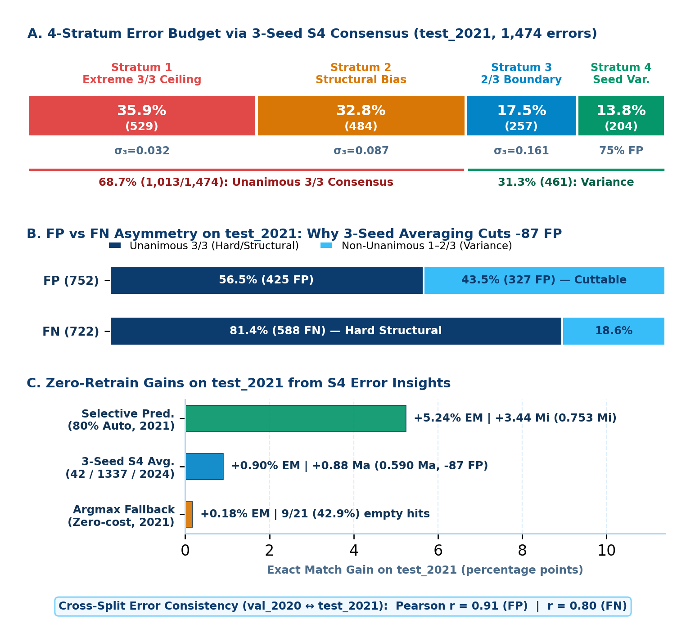  
*Hình 5.8: Phân rã 4-Stratum Error Budget qua `3-Seed S4 Consensus` trên `test_2021` (`1,474` binary errors), bất đối xứng `FP` vs `FN` và các đòn bẩy Zero-Retrain.*

#### Giải phẫu Cơ chế Lỗi Sâu bên trong BERT (Notebook Sections 4–6: [`tweet_topic_evaluation_and_error_analysis.ipynb`](../analysis/tweet_topic_evaluation_and_error_analysis.ipynb))

Khai phá định lượng trên toàn bộ probability matrix và surface features của `test_2021` (`N = 1,679`), đối chiếu chéo với `validation_2020` (`N = 573`) và `test_2020` (`N = 573`), chỉ ra **5 cơ chế lỗi và insight cốt lõi**:

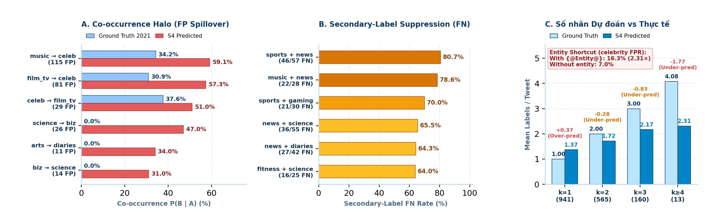  
*Hình 5.6: Giải phẫu 3 cơ chế lỗi cốt lõi của `S4` trên `test_2021`: (A) Co-occurrence Halo (FP Spillover), (B) Secondary-Label Suppression (FN), và (C) Label Cardinality Compression kèm Entity Shortcut (`{@Entity@}`).*

1. **Co-occurrence Halo (Spurious FP Spillover) & Entity Shortcut (`{@Entity@}`):**
   * Trên các tweet chỉ mang `music` (không có `celebrity`, `n = 250`), `S4` dự đoán nhầm `celebrity` tới **`46.0%` (`115 FP`)**, khuếch đại $P(\text{celebrity} \mid \text{music})$ từ `34.2%` thực tế lên **`59.1%`**. Tương tự, `film_tv` kéo nhầm `celebrity` **`39.3%` (`81 FP`)**, đẩy $P(\text{celebrity} \mid \text{film\_tv})$ từ `30.9%` lên **`57.3%`**.
   * **Co-occurrence Shift `2020 -> 2021`:** Ba cặp `science + business`, `arts + diaries`, `celebrity + diaries` từng đồng xuất hiện `15%–35%` trong `train_2020` nhưng giảm về **`0.0%`** ở ground truth `test_2021`, trong khi `S4` tiếp tục tái lập prior 2020 (`47.0%`, `34.0%`, `31.0%`).
   * **Entity Shortcut:** False Positive Rate (FPR) của `celebrity` trên tweet **chứa `{@Entity@}`** đạt **`16.27%` (`157 / 965`)** — cao gấp **`2.31×`** so với tweet không có entity (**`7.04%`**, `33 / 469`), chiếm **`82.6%` (`157 / 190`)** tổng FP của `celebrity`.

2. **Secondary-Label Suppression & Label Cardinality Compression:**
   * Khi hai chủ đề đồng xuất hiện, primary topic lấn át secondary topic dưới fixed threshold `0.60`: ở `sports + news` (`n = 57`), `S4` giữ `sports` nhưng bỏ sót `news` **`80.7%` (`46 / 57`)**; `music + news` sót `news` **`78.6%`**, `sports + gaming` sót `gaming` **`70.0%`**, `news + science` sót `science` **`65.5%`** (`36 / 55`).
   * **Cardinality Compression:** `S4` có xu hướng **over-predict** trên single-label tweets (`mean_pred = 1.37` vs `1.00`, `434 FP` vs `87 FN`) nhưng **under-predict** trên multi-label tweets (`k = 2`: `1.72`; `k = 3`: `2.17`; `k >= 4`: `2.31` vs `4.08`, gom `635 FN` ở nhóm $\ge 2$ nhãn).

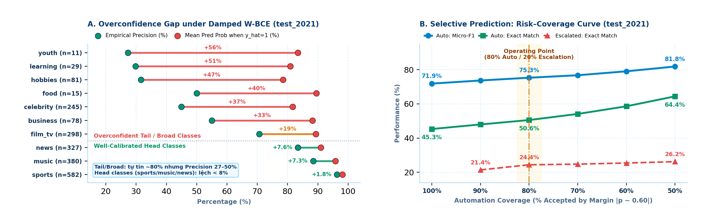  
*Hình 5.7: (A) Overconfidence Gap giữa xác suất dự đoán và empirical Precision do `Damped W-BCE` trên `test_2021`; (B) Đường cong Selective Prediction (Risk–Coverage) theo decision margin $m(x) = \min_c |\hat{p}_c - 0.60|$.*

3. **Probability Calibration Trade-off của `Damped W-BCE` (Overconfidence Gap & ECE):**
   * Chuyển từ standard BCE (`S3`) sang `Damped W-BCE` (`S4`) nâng `+1.34` Macro-F1 nhưng làm **Expected Calibration Error (`ECE`)** tăng `3.1×` (**`0.0115 -> 0.0352`** trên `test_2021`).
   * **Class-Dependent Overconfidence:** Các head classes được calibrated rất sát (`sports`: mean prob `98.1%` vs Precision `96.3%`, gap `+1.8%`; `music`: `+7.3%`; `news`: `+7.6%`), ngược lại các tail/broad classes bị phồng xác suất mạnh: `youth` (`83.4%` vs `27.3%`, gap **`+56.1%`**), `learning` (`+51.0%`), `other_hobbies` (`+46.9%`), `food` (`+39.6%`) và `celebrity` (`81.7%` vs `44.9%`, gap **`+36.7%`**, `73` high-confidence FP $\ge 0.85$). **Insight:** Xác suất thô của `S4` phù hợp cho intra-class ranking, **không được hiểu như calibrated posterior đồng nhất giữa 19 lớp**.

4. **Temporal Drift Decomposition (`2020 -> 2021`) & Unseen Entity vs Unseen Hashtag Paradox:**
   * **Hidden Semantic Shift lớn hơn mức suy giảm bề mặt:** Nếu per-class accuracy giữ nguyên như `2020` và chỉ thay đổi class prior (`sports +9.6%`, `music +5.9%`), Micro-F1 trên `test_2021` lẽ ra phải **tăng lên `0.7405` (`+0.45` pts)**. Như vậy, mức giảm `-1.74` pts bề mặt đang che giấu **true semantic/annotation shift `-2.19` pts** (`0.7405 -> 0.7186`), chủ yếu do `news` giảm Recall còn `59.9%` (`131 FN`) khi từ vựng COVID/bầu cử 2020 hạ nhiệt, trong khi **9/19 classes duy trì hoặc tăng F1** sang 2021.
   * **Unseen Entity vs Unseen Hashtag Paradox:** Tweet chứa **unseen 2021 entities** (`n = 711`) đạt Micro-F1 **cao hơn (`0.7403`, Exact `49.7%`)** so với tweet chứa seen 2020 entities (`n = 471`, `0.6952`, Exact `40.3%`) — vì context câu xung quanh đủ rõ cho vận động viên/ca sĩ mới, còn các recurring entities 2020 (`Trump`, `BTS`, `Netflix`) mang tính đa miền gây chồng lấn nhãn. Ngược lại, **unseen 2021 hashtags** (`n = 583`) làm Exact Match giảm `-3.86%` (`42.88%` vs `46.74%`) do các viết tắt mờ (`#HTGAWM`, `#YT`).

5. **Operational Insights — Selective Prediction (Risk–Coverage) & Cross-Split Error Consistency:**
   * **Selective Prediction (Zero Retraining):** Phân tầng `test_2021` theo decision margin $m(x) = \min_c |\hat{p}_c(x) - 0.60|$ cho thấy hai nhóm tách biệt rõ: nhóm **High-Confidence ($m \ge 0.30$, `33.8%` tập dữ liệu)** đạt **`0.8709` Micro-F1 và `74.47%` Exact Match** (`0` empty, chỉ `32 FP`), còn nhóm **Borderline ($m < 0.10$, `30.6%`)** tụt xuống `0.6301` Micro / `24.71%` Exact và tập trung tới **`52.1%` tổng FP (`392 / 752`)**. Khi tự động hóa **80%** mẫu an toàn nhất và chỉ chuyển **20%** mẫu margin thấp sang Human/LLM Escalation, luồng tự động đạt **`0.7530` Micro-F1 (`+3.44`) / `0.6018` Macro-F1 (`+2.10`) / `50.56%` Exact Match (`+5.24%`)** (ở mốc **50% coverage** đạt **`0.8183` Micro / `64.40%` Exact**).
   * **Zero-Cost Argmax Fallback cho 21 Empty Predictions `[]`:** `9 / 21` (`42.9%`) ca rỗng của `S4` có `argmax(p)` trùng đúng ground truth — hậu xử lý 1 dòng (`if empty: argmax`) nâng tức thì hiệu năng lên `0.7191` Micro / `0.5812` Macro / `45.50%` Exact với chi phí tính toán bằng `0`.
   * **Cross-Split Error-Profile Consistency (`val_2020` $\leftrightarrow$ `test_2021`):** Phân bố lỗi từng lớp giữa `validation_2020` và `test_2021` tương quan rất chặt (**Pearson $r = 0.9085$ cho FP**, **$r = 0.8036$ cho FN**; Top 3 FP và Top 5 FN trùng khớp tuyệt đối), chứng minh error diagnosis trên validation là chỉ báo đáng tin cậy cho OOT data mà không cần truy cập tập Test.

| Quantitative Finding (`test_2021`) | Underlying Mechanism in BERT (`S4`) | Engineering & Operational Insight |
|:---|:---|:---|
| `music/film_tv → celeb` chiếm `37.2%` FP; `{@Entity@}` tăng `celeb` FPR `2.31×` | 19 Sigmoid độc lập + Entity Shortcut & 2020 co-occurrence prior | Phân tách rõ *tác phẩm* vs *đời tư nghệ sĩ*; cần mô hình hóa label interaction thay vì 19 đầu tách rời |
| `sports+news` sót `news` `80.7%`; Cardinality Compression (`1.0→1.37` vs `3.0→2.17`) | Global threshold cứng `τ = 0.60` kéo mọi tweet về mean cardinality tập train (`1.71`) | Bổ sung `argmax` fallback khử 100% empty predictions (`9/21` đúng ngay); xử lý riêng nhóm đa nhãn dày |
| `ECE` tăng `3.1×` (`0.0115→0.0352`); `youth/learning/celeb` overconfident `+37–56%` | Positive weights `w_c > 1` của `Damped W-BCE` đẩy phồng positive logits ở tail/broad classes | **Không đọc raw probabilities của `S4` như precision đồng nhất**; cần class-group calibration khi triển khai |
| Hidden Semantic Shift `-2.19%`; unseen `#Hashtag` giảm Exact `-3.86%` | `news` mất từ vựng COVID/2020 (`131 FN`); unseen acronyms không có surface cues | Giám sát drift theo **từng topic lõi** (đặc biệt `news`) thay vì chỉ theo dõi aggregate Micro-F1 |
| `30.6%` borderline tweets ($m < 0.10$) gom `52.1%` FP (`24.7%` Exact) | Semantic uncertainty tập trung trong dải `[0.50, 0.70]` quanh $\tau = 0.60$ | Áp dụng **Selective Prediction (`80%` Auto / `20%` Escalation)** nâng ngay hiệu năng lên `0.753 Mi / 0.602 Ma / 50.6% Ex` |

* **Qualitative Evidence trên `test_2021`:**
  * *Tail-Class Recovery (`S0 -> S4`):* **Idx 48** (`travel` + `diaries`, `#vanlife #adventure`) và **Idx 172** (`arts` + `learning`, `#storytelling #mythological`) — `S0` bỏ sót hoặc trả rỗng `[]`, `S4` đạt Exact Match.
  * *FP Reduction via `TweetTextCleaner` (`S1 -> S2`):* **Idx 44** (`film_tv`, `#SmallYouTuberArmy`) và **Idx 141** (`sports`, `{@Philadelphia Eagles@}`) — sau chuẩn hóa, `S2 -> S4` loại bỏ hoàn toàn FP `diaries` và `celebrity`.
  * *Secondary-Label Recovery via `ResidualHybridPooling` (`S2 -> S3 -> S4`):* **Idx 150** (`[celebrity, music, news]`, Ariana Grande & bầu cử) và **Idx 159** (`[news, science]`, biến đổi khí hậu) — khôi phục đủ secondary labels mà `[CLS]` đơn lẻ bỏ sót.
  * *Objective Data Ceilings trên `S4`:* **Idx 8** (*"Level 7 badge on {{USERNAME}}! {{URL}}"*) mất ngữ cảnh trang đích trong `{{URL}}` khiến cụm `Level 7 badge` kéo nhầm sang `gaming`; **Idx 11** (`#HTGAWM #PowerGhost`) và **Idx 1294** (*Genshin Impact*) là viết tắt/thực thể phát sinh sau mốc pre-training của `bert-base-uncased`.

### 5.4. Giới hạn Khách quan & Kết luận

#### Giới hạn Khách quan trong Phạm vi Nghiên cứu
1. **Out-of-Domain Vocabulary Gap của `bert-base-uncased`:** Do backbone pre-trained trên văn bản tiếng Anh phổ thông (0 Twitter pre-training, đóng băng trước 2021), các thực thể/tiếng lóng mới (`Genshin Impact`, `#HTGAWM`, `YT strikes`) đóng góp trực tiếp vào mức giảm `-1.74` pts Micro-F1 từ 2020 sang 2021.
2. **Natural Inter-Class Overlap của hệ 19 chủ đề rộng:** Cụm giải trí (`celebrity` 190 FP, `film_tv` 90 FP) đồng xuất hiện dày đặc cùng `music`, `other_hobbies` là nhãn gom ranh giới mờ và cặp `sports + news` mang tính chủ quan cao giữa các annotators.
3. **Missing Multimodal & URL Context do Anonymization:** Việc ẩn toàn bộ trang đích `{{URL}}` (làm fail rate tăng `+4.7%`: `57.3%` vs `52.6%` ở tweet không có URL) và lược bỏ ảnh/video tạo nên giới hạn tự nhiên đối với text-only classification.

#### Kết luận
Đồ án đã hoàn thiện trọn vẹn quy trình 5 phần cho bài toán **Multi-Label Twitter Topic Classification (`cardiffnlp/tweet_topic_multi`)** bằng duy nhất một backbone gọn nhẹ **`bert-base-uncased` (110M parameters)**, giải quyết trực diện 4 research gaps cốt lõi của dòng nghiên cứu `TweetTopic (2020–2024)`:

1. **Xóa sổ hoàn toàn Class Collapse:** Giảm số lớp `F1 = 0` từ `6/19` (`S0 @ 0.50`) và `1/19` (`S0 @ global`) về **`0 / 19`** trên toàn bộ 19 chủ đề.
2. **Đạt hiệu năng vượt trội trên Out-of-Time `test_2021`:** Mô hình hoàn thiện **`S4` (`Damped W-BCE`, Global $\tau = 0.60$)** đạt **`0.7186` Micro-F1**, **`0.5808` Macro-F1** và **`45.32%` Exact Match** — vượt mốc **Antypas et al. (COLING 2022)** **`+6.36` Micro-F1 / `+12.98` Macro-F1**, vượt TF-IDF Baseline **`+10.32` Micro / `+18.11` Macro**, và xếp **#1 Macro-F1** nhóm `train_2020` trên HuggingFace Hub (vượt cả `RoBERTa-large` 355M).
3. **Ổn định trước Temporal Drift & Multi-Seed Reproducibility:** Suy giảm `2020 -> 2021` chỉ còn **`-1.74` pts Micro-F1** (ổn định gấp `4.2×` TF-IDF) và độ lệch chuẩn qua 3 random seeds đạt $\sigma \le 0.0066$.

---

## PHỤ LỤC — TRUY XUẤT MÃ NGUỒN, CONFIG & NOTEBOOK (CODE PROVENANCE)

Bảng dưới ánh xạ trực tiếp mọi giai đoạn thực nghiệm, số liệu và phân tích lỗi trong báo cáo sang đúng tệp mã nguồn, cấu hình YAML và section tương ứng trong Notebook tái lập để thuận tiện đối chiếu và bảo vệ đồ án:

| Nội dung trong Báo cáo & Slide | Mã nguồn / Cấu hình Huấn luyện (Kaggle GPU) | Code / Notebook Kiểm chứng (Pure CPU) |
| :--- | :--- | :--- |
| **EDA & Data Integrity Audit** (`7,410` tweets, Long-Tail `20.18:1`, $d_{JS} = 0.1377$) | [`eda/run_eda.py`](../eda/run_eda.py) | [`eda/eda_report.md`](../eda/eda_report.md), [`eda/eda_summary.json`](../eda/eda_summary.json) |
| **WordPiece Preprocessing (`S2`)** (`TweetTextCleaner` 6 bước, `741` BMP) | [`tweet_topic/addons/custom_preprocessor_addon.py`](../tweet_topic/addons/custom_preprocessor_addon.py) | [`configs/v4/v4_s2_cleaner_bce.yaml`](../configs/v4/v4_s2_cleaner_bce.yaml) |
| **Kiến trúc `S0 -> S4`** (`ResidualHybridPooling`, MSD, `Damped W-BCE`, Differential LR) | [`tweet_topic/models/bert/encoder_model.py`](../tweet_topic/models/bert/encoder_model.py), [`pooling.py`](../tweet_topic/models/bert/pooling.py), [`losses.py`](../tweet_topic/models/bert/losses.py) | [`configs/v4/v4_s0_stock_bce.yaml`](../configs/v4/v4_s0_stock_bce.yaml) → [`v4_s4_damped_wbce.yaml`](../configs/v4/v4_s4_damped_wbce.yaml) |
| **Training Pipeline & Kaggle Dispatch** (`10ep Cosine`, `15ep Plateau + LLRD`, `3 Seeds`) | [`scripts/run.py`](../scripts/run.py), [`scripts/build_package_notebooks.py`](../scripts/build_package_notebooks.py), [`scripts/kaggle_dispatcher.py`](../scripts/kaggle_dispatcher.py) | [`configs/v4/v4_s4_damped_wbce_s1337.yaml`](../configs/v4/v4_s4_damped_wbce_s1337.yaml), [`configs/v5_15ep/`](../configs/v5_15ep/v5_s4_damped_wbce_15ep.yaml) |
| **Bảng 5.1 & 3-Seed Stability** (`0.7186 / 0.5808`, `σ ≤ 0.0066`) | `outputs/v4_s0..s4*/metrics_summary.json` | [`tweet_topic_evaluation_and_error_analysis.ipynb`](../analysis/tweet_topic_evaluation_and_error_analysis.ipynb) (**Section 1**) |
| **Bảng 5.3 Per-Class Recovery & Strict Substitution (`S1 -> S4`)** | `outputs/v4_s0..s4/test_predictions.json` | [`tweet_topic_evaluation_and_error_analysis.ipynb`](../analysis/tweet_topic_evaluation_and_error_analysis.ipynb) (**Section 2**), [`scripts/extract_v4_error_cases.py`](../scripts/extract_v4_error_cases.py) |
| **Audit 918 Failed Samples (`1,474` lỗi, `{{URL}}`, `+80` EM recovery)** | `outputs/v4_s4_damped_wbce/test_predictions.json` | [`tweet_topic_evaluation_and_error_analysis.ipynb`](../analysis/tweet_topic_evaluation_and_error_analysis.ipynb) (**Section 3**) |
| **Co-occurrence Halo (`46%`), `{@Entity@}` (`2.31×`) & Suppression (`80.7%`)** | `outputs/v4_s4_damped_wbce/test_predictions.json` | [`tweet_topic_evaluation_and_error_analysis.ipynb`](../analysis/tweet_topic_evaluation_and_error_analysis.ipynb) (**Section 4**) |
| **Calibration (`ECE` `3.1×`), 2021 Drift & Selective Prediction (`80% Auto`)** | [`tweet_topic/evaluation/calibration.py`](../tweet_topic/evaluation/calibration.py), [`selective.py`](../tweet_topic/evaluation/selective.py) | [`tweet_topic_evaluation_and_error_analysis.ipynb`](../analysis/tweet_topic_evaluation_and_error_analysis.ipynb) (**Section 5**), [`scripts/postprocess_analysis.py`](../scripts/postprocess_analysis.py) |
| **Qualitative Case Studies (`Idx 608`, `172`, `993`, `1145`, `8`)** | `outputs/v4_s0..s4/test_predictions.json` | [`tweet_topic_evaluation_and_error_analysis.ipynb`](../analysis/tweet_topic_evaluation_and_error_analysis.ipynb) (**Section 6**) |
| **Zero-Leakage `validation_2020` Audit (`532` lỗi, Crowd-Noise `ValIdx 494/447/24`)** | `outputs/v4_s4_damped_wbce/val_probabilities.json` | [`tweet_topic_evaluation_and_error_analysis.ipynb`](../analysis/tweet_topic_evaluation_and_error_analysis.ipynb) (**Section 7**), [`validation_error_analysis.md`](validation_error_analysis.md) |

---

## TÀI LIỆU THAM KHẢO

1. **Barbieri, F., Camacho-Collados, J., Espinosa Anke, L., & Neves, L. (2020).** *TweetEval: Unified Benchmark and Comparative Evaluation for Tweet Classification.* Findings of EMNLP 2020.
2. **Loureiro, D., Barbieri, F., Neves, L., Espinosa Anke, L., & Camacho-Collados, J. (2022).** *TimeLMs: Diachronic Language Models from Twitter.* Proceedings of ACL 2022: System Demonstrations.
3. **Antypas, D., Ushio, A., Camacho-Collados, J., Neves, L., Silva, V., & Barbieri, F. (2022).** *Twitter Topic Classification.* Proceedings of the 29th International Conference on Computational Linguistics (COLING 2022), `arXiv:2209.09824`.
4. **Camacho-Collados, J., Rezaee, K., Riahi, T., Ushio, A., Loureiro, D., Antypas, D., Boisson, J., Espinosa Anke, L., Liu, F., & Martínez Cámara, E. (2022).** *TweetNLP: Cutting-Edge Natural Language Processing for Social Media.* Proceedings of EMNLP 2022: System Demonstrations.
5. **Antypas, D., Preece, A., & Camacho-Collados, J. (2023).** *SuperTweetEval: A Challenging, Unified and Heterogeneous Benchmark for Social Media NLP Research.* Findings of EMNLP 2023, `arXiv:2310.14757`.
6. **Antypas, D., Ushio, A., Barbieri, F., & Camacho-Collados, J. (2024).** *Multilingual Topic Classification in X: Dataset and Analysis.* Proceedings of EMNLP 2024 (`X-Topic`), `arXiv:2410.03075`.
7. **Devlin, J., Chang, M.-W., Lee, K., & Toutanova, K. (2019).** *BERT: Pre-training of Deep Bidirectional Transformers for Language Understanding.* NAACL-HLT 2019.
8. **Sun, C., Qiu, X., Xu, Y., & Huang, X. (2019).** *How to Fine-Tune BERT for Text Classification?* CCL 2019.
9. **Inoue, H. (2019).** *Multi-Sample Dropout for Accelerated Training and Better Generalization.* `arXiv:1905.09788`.
